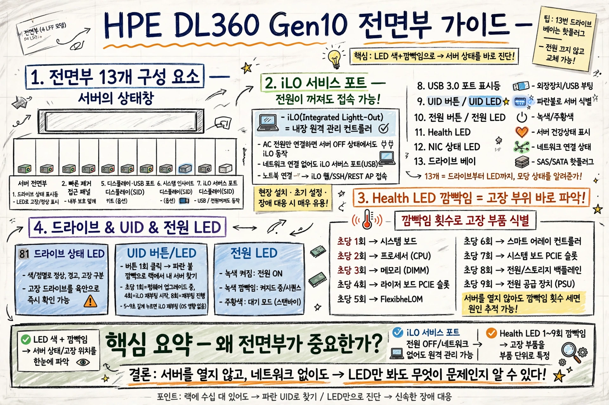
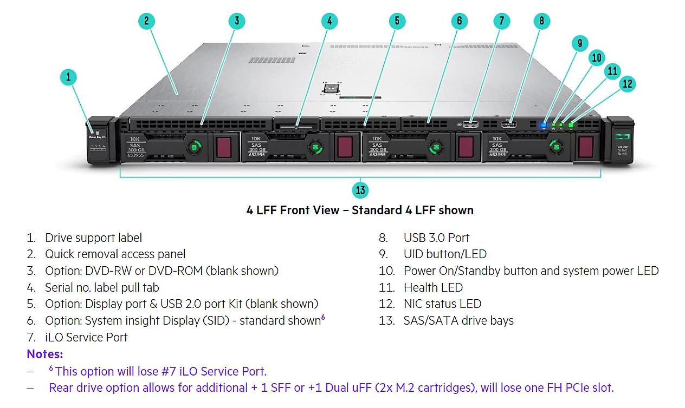
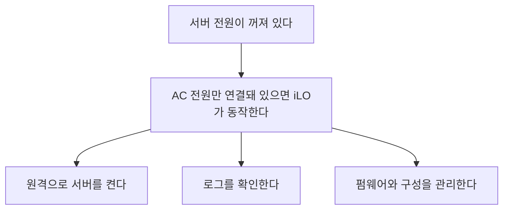
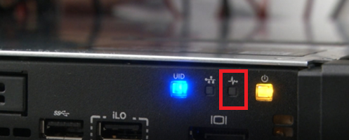
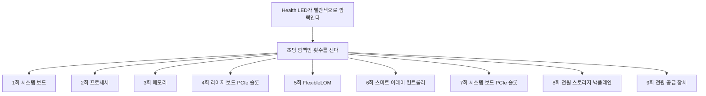

# HPE DL360 Gen10 전면부, LED 색깔과 깜빡임만으로 고장 부위를 찾습니다

> **Summary**
> HPE DL360 Gen10 전면부의 LED 색상과 깜빡임으로 드라이브와 서버 상태, 고장 부위를 확인할 수 있습니다. iLO 서비스 포트는 AC 전원만 연결돼 있으면 서버가 꺼져 있어도 원격 관리가 가능하며, UID·전원·Health·NIC LED와 USB 포트는 서버 위치 확인과 상태 점검에 활용됩니다.

---

- HPE DL360 Gen10 전면부는 13개 구성 요소로 이뤄져 있고, LED 색깔과 깜빡임만으로 서버 상태와 고장 부위를 바로 알 수 있습니다.
- iLO 서비스 포트는 네트워크에 연결하지 않고도 원격 관리에 접속할 수 있게 해주고, 전원이 꺼진 상태에서도 동작합니다.
- Health LED의 깜빡임 횟수(초당 1~9회)가 고장 난 부품을 가리키므로, 서버를 열지 않고도 원인을 좁힐 수 있습니다.

데이터센터 랙 앞에 서서 서버 한 대가 멈췄다는 연락을 받은 적 있으시죠? 랙에는 수십 대의 서버가 나란히 꽂혀 있는데, 어느 놈이 문제인지, 어디가 고장인지 당장 알 수가 없습니다. 그런데 HPE DL360 Gen10은 전면부만 봐도 답이 나옵니다. LED 색깔과 깜빡임이 서버 상태를 그대로 말해주기 때문입니다!

🎥 [동영상 보기](https://www.youtube.com/watch?v=sJtXoyf9O94)

## 전면부 13개, 어디에 뭐가 있을까요?

HPE DL360 Gen10은 1U 랙 서버입니다. 전면부에는 드라이브 베이부터 LED까지 13개 구성 요소가 모여 있습니다. 벤더마다 명칭은 다르지만 기능은 비슷합니다. 이 글은 4 LFF 모델 기준입니다.

그림의 번호가 각 구성 요소입니다. 1번 드라이브 상태 표시등부터 13번 드라이브 베이까지, 하나하나가 역할을 갖고 있습니다. 전면부는 장식이 아닙니다. 서버 상태를 읽는 창입니다. 2번 빠른 제거 접근 패널은 서버 내부 보호용 덮개이고, 3번 DVD 드라이브와 5번 디스플레이·USB 포트 키트, 6번 시스템 인사이트 디스플레이(SID)는 옵션입니다. 4번 일련번호 라벨에는 제품 일련번호와 iLO 접속 계정 정보가 적혀 있습니다.

## 드라이브 상태, LED만 봐도 알 수 있을까요?

드라이브는 서버의 얼굴입니다. 1번 드라이브 상태 표시등(Drive Support Label)은 각 드라이브의 상태를 LED로 보여줍니다. 색깔과 점멸만으로 정상, 고장, 경고를 구분합니다. 드라이브가 여러 개 달려 있어도, 고장 난 드라이브를 육안으로 바로 찾을 수 있습니다.

13번 드라이브 베이(SAS/SATA Drive Bays)는 저장장치를 꽂는 칸입니다. 2.5인치(SFF)나 3.5인치(LFF) 규격의 핫플러그 드라이브를 장착합니다. 전원을 끄지 않고 교체하고 늘릴 수 있습니다. 용량과 성능을 유연하게 확장하는 구조입니다. 드라이브마다 LED가 달려 있어 활동, 장애, 재빌드 상태를 즉시 확인할 수 있습니다.

## iLO, 전원이 꺼져도 접속이 될까요?

7번 iLO 서비스 포트는 이 서버의 핵심입니다. iLO(Integrated Lights-Out)는 HPE 서버에 내장된 원격 관리 컨트롤러입니다. 전원 제어, 하드웨어 상태와 로그 모니터링, 원격 콘솔과 가상 미디어, 펌웨어와 구성 관리, REST와 SSH API까지 제공합니다.

전원이 꺼져 있어도 iLO는 살아 있습니다! AC 전원만 연결돼 있으면, 서버가 꺼진 대기 상태에서도 iLO가 동작합니다. 그래서 전원이 나간 서버도 원격으로 켜고, 로그를 확인하고, 관리할 수 있습니다.

iLO 서비스 포트는 USB 포트입니다. 데이터센터 네트워크에 연결하지 않고도 iLO에 접속할 수 있게 해줍니다. 현장 설치나 초기 설정, 장애 대응 때 네트워크 없이 iLO 웹과 SSH, REST API에 안전하게 접속하는 통로입니다.

## UID 버튼, 랙에서 내 서버를 어떻게 찾을까요?

랙에는 똑같이 생긴 서버가 수십 대입니다. 9번 UID 버튼과 UID LED는 그중 내 서버를 찾는 도구입니다. 버튼을 짧게 한 번 누르면 앞뒤 양면의 UID LED가 파랗게 켜집니다. iLO에서 원격으로 켜고 끌 수도 있습니다. 현장 작업자와 지시자가 "저 파란 불 켜진 서버"라고 말하면 바로 통합니다.

최신 HPE 서버에서는 전원이 꺼진 상태에서 UID 버튼을 누르면 서버 상태 요약(Server Health Summary)을 확인할 수 있습니다. 그리고 버튼을 5~9초간 길게 누르면 iLO를 재부팅합니다. 서버 운영체제에는 영향이 없습니다!

UID LED의 파란색 깜빡임도 의미가 있습니다. 초당 1회는 원격 관리나 펌웨어 업그레이드 중, 초당 4회는 iLO 수동 재부팅 시퀀스 시작, 초당 8회는 재부팅 시퀀스 진행 중입니다.

## 전원 버튼과 Health LED, 색깔이 말해주는 게 뭘까요?

10번 전원 버튼은 짧게 한 번 누르면 대기전원과 가동 상태를 바꿉니다. 대기 상태에서도 iLO는 켜져 있어 원격 전원 제어와 로그 확인이 가능합니다. iLO 설정에서 로컬 전원 버튼을 비활성화할 수도 있습니다. 응답이 없을 때는 4초간 길게 눌러 강제 전원을 끕니다.

전원 LED는 녹색이 켜짐, 녹색 깜빡임이 켜짐과 시퀀스 수행, 주황색이 대기 모드입니다.

11번 Health LED는 서버 건강을 한눈에 보여줍니다. 녹색은 정상, 녹색 깜빡임은 iLO 재부팅 중, 주황색 깜빡임은 성능 저하, 빨간색 깜빡임은 심각한 상태입니다. 깜빡임 횟수만 세면 고장 부위가 보입니다! 초당 1회는 시스템 보드, 2회는 프로세서, 3회는 메모리, 4회는 라이저 보드 PCIe 슬롯, 5회는 FlexibleLOM, 6회는 스마트 어레이 컨트롤러, 7회는 시스템 보드 PCIe 슬롯, 8회는 전원·스토리지 백플레인, 9회는 전원 공급 장치입니다.

## NIC LED와 USB, 연결은 됐을까요?

12번 NIC 상태 LED는 네트워크 연결을 보여줍니다. 녹색은 연결됨, 녹색 깜빡임은 활성화, 꺼짐은 비활성화입니다. 케이블이 뽑혔는지, 포트가 죽었는지 전면부에서 바로 확인합니다. 8번 USB 3.0 포트는 외장 장치나 USB 부팅 미디어를 연결하는 곳입니다.

## 그래서, 전면부는 서버의 얼굴일까요?

전면부는 서버의 얼굴이 아니라, 서버의 상태창입니다! 드라이브 LED가 고장을 알리고, iLO가 전원이 꺼져도 관리를 이어주고, Health LED의 깜빡임이 고장 부위를 가리킵니다. 서버를 열지 않고, 네트워크에 연결하지 않고도 상태를 읽을 수 있는 구조입니다. 랙 앞에 서서 LED만 봐도 서버가 무슨 말을 하는지 알 수 있습니다. 그게 전면부의 역할입니다.

