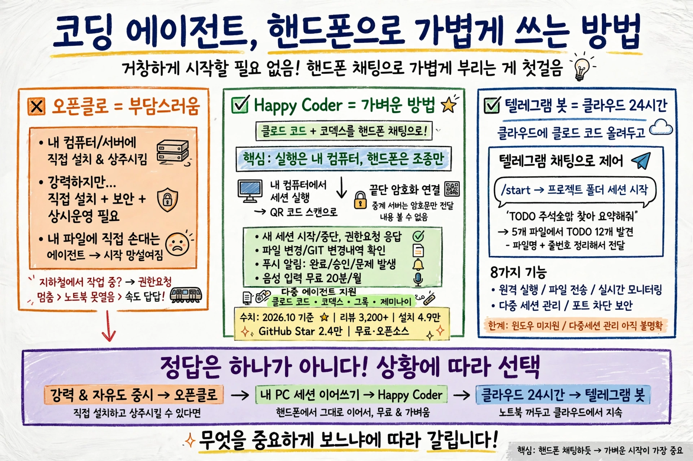
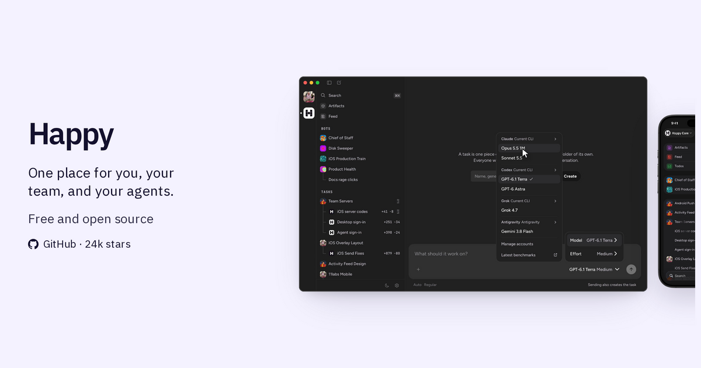
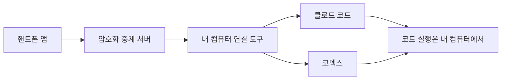
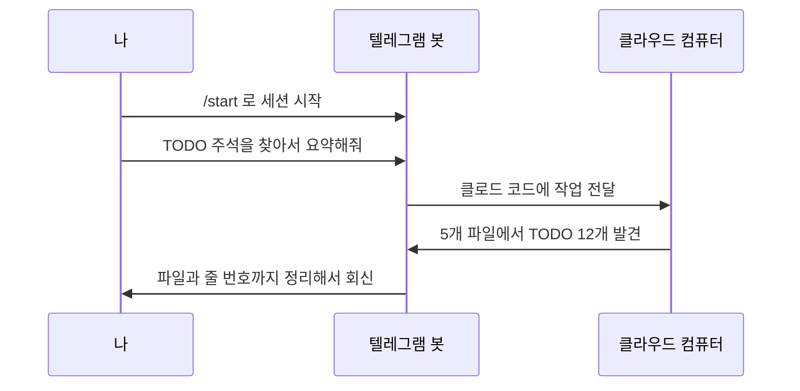
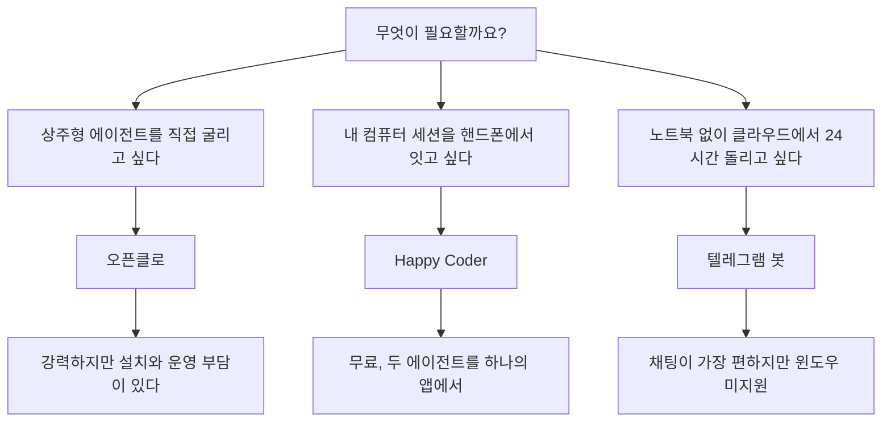

# Happy Coder: 오픈클로가 부담스러우면, 핸드폰 채팅으로 클로드 코드를 씁니다

> **Summary**
> Happy Coder позволяет управлять с телефона сессиями Claude Code и Codex, работающими на собственном компьютере, через зашифрованное соединение. Альтернатива — Telegram-бот, который запускает Claude Code на облачном компьютере и управляет им через чат; выбор зависит от того, нужно ли продолжать локальную работу с телефона или запускать задачи в облаке круглосуточно.

---

- 오픈클로가 부담스럽게 느껴진다면, 클로드 코드와 코덱스를 핸드폰 채팅으로 쓰는 가벼운 방법이 있습니다.
- Happy Coder는 핸드폰 앱으로 내 컴퓨터에서 돌아가는 세션을 그대로 이어서 쓰고, 끝단 암호화로 중계 서버도 내용을 볼 수 없습니다.
- 텔레그램 봇 방식은 클라우드 컴퓨터에 클로드 코드를 올려두고, 채팅으로 명령하고 결과를 받는 방법입니다.

지하철에서 클로드 코드가 돌리던 작업이 궁금해진 적 있으시죠? 노트북을 열 수도 없고, 그렇다고 작업을 멈출 수도 없는 순간 말입니다. 집에 돌아가면 끝나 있겠지 싶다가도, 중간에 권한 요청 하나 때문에 멈춰 서 있으면 속이 탑니다!

🎥 [동영상 보기](https://www.youtube.com/watch?v=GCS0OG9QMSE)

## 오픈클로, 왜 부담스럽게 느껴질까요?

오픈클로는 강력합니다. 내 컴퓨터나 서버에 직접 올려두고 상주시키는 에이전트라서, 한번 세팅하면 알아서 일합니다. 그런데 바로 그 점이 부담입니다. 직접 설치하고, 상주시키고, 보안까지 챙겨야 하니까요. 내 파일에 직접 손을 대는 에이전트라서, 선뜻 시작하기가 망설여지는 겁니다.

이럴 때 필요한 건 더 거창한 도구가 아닙니다. 이미 쓰고 있는 클로드 코드와 코덱스를, 핸드폰에서 채팅하듯 부리는 가벼운 방법이면 충분합니다.

## Happy Coder, 핸드폰이 조종석이 됩니다

Happy Coder는 클로드 코드와 코덱스를 핸드폰에서 쓰는 무료 오픈소스 앱입니다. 아이폰과 안드로이드, 웹에서도 쓸 수 있습니다.

구조는 단순합니다. 실행은 내 컴퓨터에서 돌아가고, 핸드폰은 조종만 합니다. 컴퓨터에 작은 연결 도구를 깔고, 핸드폰 앱으로 QR 코드를 한 번 스캔하면 연결이 끝납니다. 포트를 열 필요도 없습니다. 핸드폰과 컴퓨터는 암호화된 중계 서버로 연결되는데, 중계 서버는 암호문만 전달할 뿐 내용을 볼 수 없습니다. 끝단 암호화라서, 중간에 누가 엿볼 걱정이 없습니다!

핸드폰에서는 세션에 필요한 일을 거의 다 할 수 있습니다. 새 세션을 시작하고, 메시지를 보내고, 권한 요청에 답하고, 진행 중인 작업을 멈추고, 모델을 바꾸고, 바뀐 파일과 Git 변경 내역까지 확인합니다. 작업이 끝나거나 승인이 필요하거나 문제가 생기면 푸시 알림이 옵니다. 키보드를 두드리기 귀찮을 때는 말로 지시할 수도 있습니다. 음성 입력은 한 달에 20분까지 무료입니다.

클로드 코드만 되는 게 아닙니다. 코덱스도 같은 앱에서 쓸 수 있습니다. 그록과 제미나이까지 함께 볼 수 있으니, 에이전트를 여러 개 쓰는 분에게는 앱 하나로 정리되는 셈입니다.

숫자도 뒷받침합니다. 소개 당시 구글 플레이 평점은 5.0, 리뷰 1.22천 개, 다운로드 1만 회를 넘겼습니다. 2026년 10월 기준으로는 평점 4.95, 리뷰 3,200여 개, 설치 4만 9천 회까지 늘었습니다. 깃허브 스타는 2026년 9월 기준 약 2만 4천 개입니다. 무료에 오픈소스라는 점까지 합치면, 부담 없이 시작해볼 만한 조건입니다.

## 텔레그램 봇, 클라우드 컴퓨터를 채팅으로 부립니다

두 번째 방법은 텔레그램 봇입니다. 클라우드 컴퓨터 안에 클로드 코드를 올려두고, 텔레그램 채팅으로 모든 것을 제어하는 방식입니다. 노트북을 꺼두어도 클라우드에서 계속 돌아갑니다.

대화는 이렇게 흘러갑니다. 봇에 `/start`를 보내면 프로젝트 폴더에서 세션이 시작됩니다. "TODO 주석을 모두 찾아서 요약해줘"라고 보내면, 파일을 뒤져서 결과를 돌려줍니다. 소개된 예시에서는 5개 파일에서 TODO 12개를 찾아 파일 이름과 줄 번호까지 정리해서 보여줬습니다. 채팅창이 곧 터미널이 되는 셈입니다!

기능도 여덟 가지로 정리되어 있습니다. 원격 실행, 파일 전송, 동적 도구 제어, 실시간 모니터링, 다중 세션 관리, 내장 포트 차단까지. 보안은 포트 차단으로 챙기고, 설정은 클라우드 서버 설정부터 macOS 설정, 워크플로우, 초보자 튜토리얼까지 안내가 있습니다.

다만 아직 아쉬운 점도 있습니다. 윈도우는 아직 지원하지 않습니다. 여러 세션을 각각 다른 봇에 묶는 방법도 아직 분명하지 않다는 지적이 있습니다. 가볍게 시작하기에는 좋지만, 본격적으로 쓰기 전에 이런 한계는 알고 가는 게 좋습니다.

## 셋 중 무엇을 고르면 될까요?

정답은 하나가 아닙니다. 무엇을 중요하게 보느냐에 따라 갈립니다!

- 직접 설치하고 상주시키는 강력한 에이전트를 원한다면 오픈클로가 맞습니다. 자유도가 가장 큽니다.
- 내 컴퓨터에서 돌리던 세션을 핸드폰에서 그대로 이어서 보고 싶다면 Happy Coder가 가볍습니다. 클로드 코드와 코덱스를 하나의 앱에서 볼 수 있고, 무료입니다.
- 노트북을 꺼두고 클라우드에서 24시간 돌리고 싶다면 텔레그램 봇 방식이 편합니다. 채팅이 가장 익숙한 인터페이스니까요.
거창하게 시작할 필요는 없습니다! 핸드폰에서 채팅하듯 부리는 것부터가, 코딩 에이전트와 함께 일하는 가장 가벼운 첫걸음입니다.

