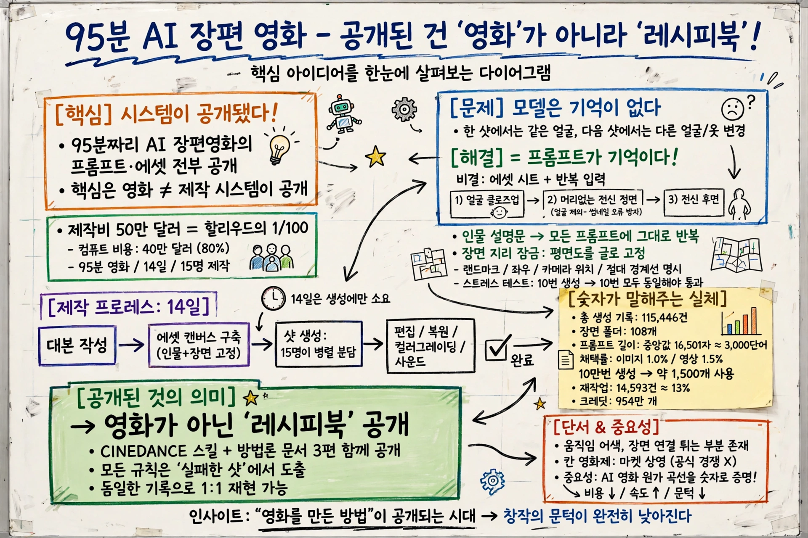
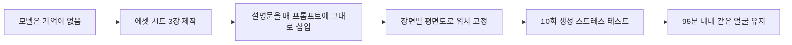
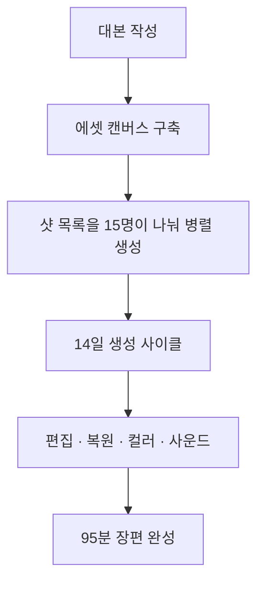
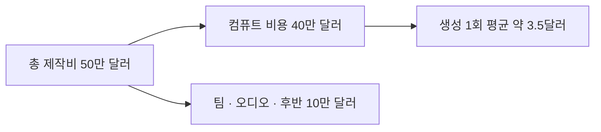

# Hell Grind: 95분짜리 AI 장편 영화의 진짜 가치는 영화가 아니라 공개된 프롬프트입니다

> **Summary**
> Hell Grind은 15명이 14일간 생성 작업을 진행해 만든 95분짜리 AI 장편 영화로, 제작비 50만 달러 중 40만 달러가 컴퓨트 비용이다. 모델의 기억 부족을 인물 에셋 시트와 반복되는 상세 프롬프트, 장면 평면도, 스트레스 테스트로 보완했으며, 11만 건이 넘는 생성 기록과 프롬프트, 제작 도구와 방법론을 공개해 AI 영화 제작의 재현 가능한 레시피를 제시했다.

---

- 95분짜리 AI 장편 영화의 프롬프트와 에셋이 전부 공개됐습니다.
- 핵심은 영화 자체가 아닙니다. 모델의 기억 문제를 해결한 제작 시스템이 통째로 나온 것입니다.
- 제작비는 50만 달러, 그중 40만 달러가 컴퓨트 비용입니다. 할리우드 장편 예산의 100분의 1 수준입니다.

95분짜리 영화를 14일 만에 만들었다면 믿으시겠어요? 그것도 사람 15명이서요. 이 영화는 실제로 나왔습니다. 전 장면이 AI로 만들어진 장편 영화입니다. 그런데 더 놀라운 소식은 따로 있습니다. 영화가 아니라, 영화를 만든 방법 전부가 공개됐다는 점입니다!

🎥 [동영상 보기](https://www.youtube.com/watch?v=t33k2tn4GpA)

## 영화는 어떻게 만들어졌을까요?

이 영화는 네 명의 도둑이 박물관 강도를 벌이다 지옥의 문을 여는 액션 판타지입니다. 제작팀 15명이 14일 동안 생성에만 매달렸습니다. 영상과 대사는 `Seedance 2.0`이, 인물과 장면은 `Soul Cinema`가 만들었습니다. 이미지 수정에는 `Nano Banana Pro`와 `Seedream 4.5`, `GPT Image 2`가 쓰였습니다. 그런데 도구는 전부가 아니었습니다. 진짜 문제는 따로 있었거든요.

## 모델은 기억이 없습니다. 그래서 프롬프트가 기억이 됩니다?

영상 생성 모델은 기억이 없습니다. 한 샷에서 주인공 얼굴을 아무리 잘 만들어도, 다음 샷에서는 다른 얼굴이 나옵니다. 옷도 바뀌고요. 95분 내내 같은 얼굴을 유지해야 하는 장편에서는 치명적인 문제입니다. 제작팀은 이 문제를 프롬프트로 해결했습니다. 비결은 에셋 시트입니다!

인물 한 명마다 세 장의 그림을 먼저 만듭니다. 얼굴 클로즈업, 머리 없는 전신 정면, 전신 후면입니다. 전신 정면에서 머리를 일부러 자른 이유가 있습니다. 넓은 샷에서 모델이 흐릿한 썸네일에서 얼굴을 가져오는 일을 막기 위해서입니다. 그리고 인물을 설명하는 설명문을 매 프롬프트에 한 글자도 줄이지 않고 그대로 붙여넣습니다. 일관성은 설정이 아니라 반복이라는 뜻입니다.

장면의 지리도 따로 잠급니다. 장면마다 평면도를 글로 적어서 모든 샷에 그대로 넣습니다. 랜드마크와 좌우 관계, 카메라 위치, 절대 넘지 말아야 할 선까지 적혀 있습니다. 에셋을 확정하기 전에는 스트레스 테스트도 거칩니다. 자세와 조명을 바꿔 10번을 생성하고, 10번 모두 인물을 알아봐야 통과합니다!

## 95분을 어떻게 14일 만에 만들었을까요?

제작 과정은 단계가 분명합니다. 먼저 대본을 쓰고, 에셋 캔버스에 영화 전체를 묶어둡니다. 그 다음 샷 목록을 15명이 나눠서 병렬로 생성합니다. 생성이 끝나면 편집과 복원, 컬러 그레이딩, 사운드 작업으로 넘어갑니다. 14일은 생성에만 쓴 시간이고, 후반 작업은 따로 진행됐습니다.

## 숫자가 말해주는 제작의 실체는?

공개된 생성 기록은 115,446건입니다. 장면별로 정리된 폴더가 108개입니다. 프롬프트 길이는 중앙값이 16,501자, 우리 말로 약 3,000단어에 달합니다. 한 샷의 프롬프트가 3,000단어가 넘는 경우도 있습니다. 그런데 생성한 것 중 실제로 쓰인 비율은 얼마나 될까요? 이미지 채택률은 약 1.0%, 영상은 약 1.5%입니다. 10만 번 넘게 생성해서 1,500개 정도를 건진 셈입니다. 크레딧은 954만 개가 들어갔고, 재작업 기록만 14,593건입니다. 전체의 약 13%가 다시 만든 기록이라는 뜻입니다.

## 공개된 건 영화가 아니라 레시피북입니다!

이번 공개의 진짜 가치는 영화가 아닙니다. 프롬프트를 자동으로 써주는 `CINEDANCE` 스킬과 세 편의 방법론 문서까지 함께 나왔습니다. 방법론 문서에는 이런 문장이 적혀 있습니다. 모든 규칙은 실패한 샷에서 나왔다고요. 공개된 기록만 있으면 같은 영화를 1:1로 다시 만들 수도 있습니다. 그래서 이 공개를 95분짜리 레시피북이라고 부르는 것입니다.

물론 단서도 분명합니다. 움직임이 어색한 장면이 있고, 장면 연결이 튀는 부분도 있습니다. 칸에서 상영된 것은 맞지만, 공식 경쟁 부문이 아니라 마켓 상영이었습니다. 그럼에도 이 공개가 중요한 이유는 분명합니다. AI 영화의 원가 곡선이 어디로 가고 있는지, 숫자로 보여줬기 때문입니다. 영화 한 편이 아니라, 영화를 만드는 방법이 공개된 순간입니다!

