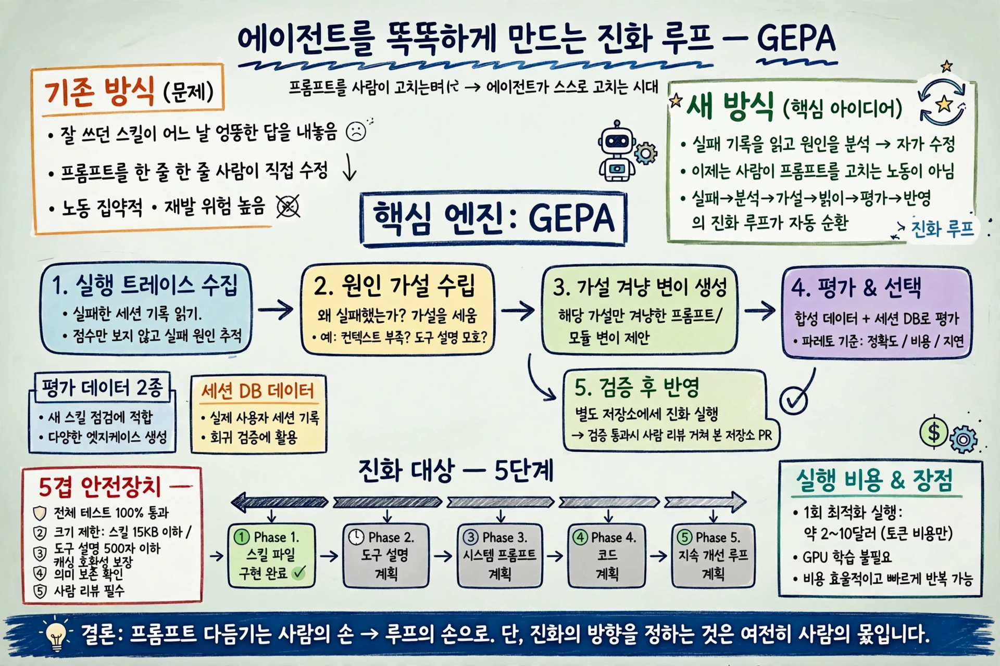
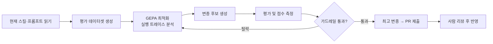
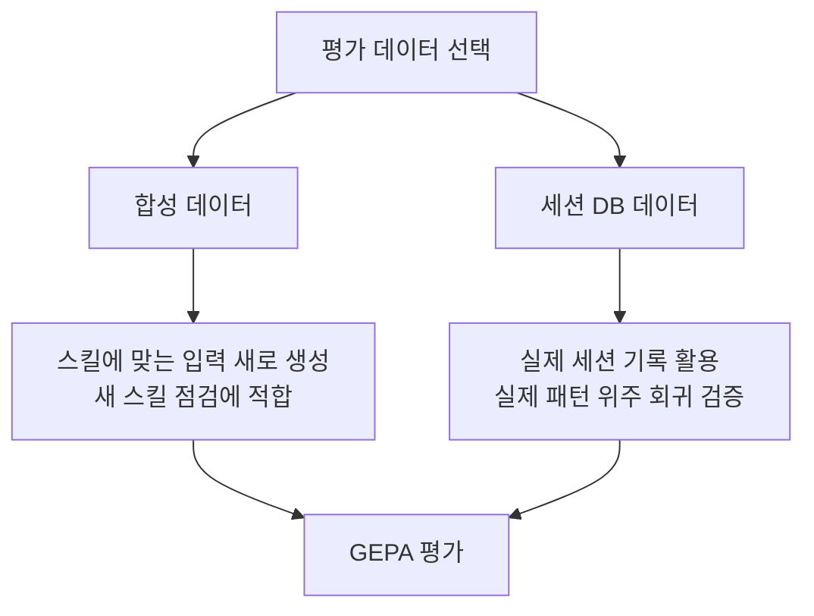
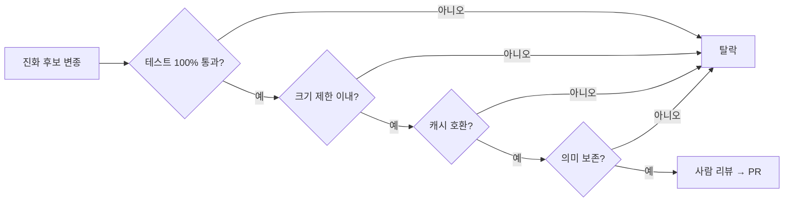

# Hermes Agent Self-Evolution: 프롬프트는 사람이 고치는 게 아닙니다. 실패 기록이 스스로 고칩니다

> **Summary**
> 에이전트를 똑똑하게 만드는 일은 이제 사람이 프롬프트를 고치는 노동이 아닙니다. 실패 기록을 읽고 원인을 분석해 프롬프트를 스스로 고치는 진화 루프가 돌고 있습니다. 핵심 엔진은 GEPA로, 실행 트레이스를 보고 왜 실패했는지 가설을 세우고 그 가설을 겨냥한 변이만 만듭니다. 진화는 별도 저장소에서 돌고 검증된 결과만 사람 리뷰를 거쳐 본 저장소에 PR로 들어가며, 한 번 돌리는 데 토큰 비용은 약 2~10달러이고 GPU 학습은 필요 없습니다.

---

- 에이전트를 똑똑하게 만드는 일은 이제 사람이 프롬프트를 고치는 노동이 아닙니다. 실패 기록을 읽고 원인을 분석해 프롬프트를 스스로 고치는 진화 루프가 돌고 있습니다.
- 핵심 엔진은 `GEPA`입니다. 실행 트레이스를 보고 왜 실패했는지 가설을 세우고, 그 가설을 겨냥한 변이만 만듭니다. 평가는 합성 데이터나 실제 세션 기록으로 합니다.
- 진화는 별도 저장소에서 돌고, 검증된 결과만 사람 리뷰를 거쳐 본 저장소에 PR로 들어갑니다. 한 번 돌리는 데 토큰 비용은 약 2~10달러, GPU 학습은 필요 없습니다.


에이전트를 쓰다 보면 이런 순간이 있습니다. 잘 쓰던 스킬이 어느 날부터 엉뚱한 답을 내놓기 시작하는데, 고치려면 프롬프트를 한 줄 한 줄 뜯어봐야 하는 거죠. 그런데 이 다듬는 일을 에이전트 스스로에게 맡기면 어떨까요?

지난 글에서는 에이전트가 자기 도구를 직접 만드는 모습을 다뤘습니다. 이번에는 그 도구를 스스로 갈고닦는 진화 루프를 봅니다!

🎥 [동영상 보기](https://www.youtube.com/watch?v=IcCzzwWgaws)

## 실패한 이유부터 묻습니다. 점수만 보지 않습니다

프롬프트를 자동으로 고치는 시도는 예전에도 있었습니다. 문제는 방식이었습니다. 강화학습은 GPU 학습 비용이 크고, 무작위 변이는 왜 틀렸는지 모른 채 점수만 보고 골랐습니다.

`GEPA`는 다르게 접근합니다. 실행 트레이스를 함께 읽어 들여, 실패한 이유를 LLM에게 되돌아보게 합니다. 원인 가설을 세우고, 그 가설을 해소하는 변이만 골라서 제안합니다. `DSPy`는 그 변이를 실제 프롬프트와 모듈에 적용하고, 평가 데이터셋에서 성능을 재는 인프라를 맡습니다.

이 조합이 강력한 이유는 두 가지입니다. 첫째, 변이가 무작위가 아니라 원인을 겨냥합니다. 둘째, 여러 목표를 한 번에 봅니다. 정확도·비용·지연을 파레토 기준으로 함께 따져서, 한쪽만 좋은 변종이 아니라 균형 잡힌 변종을 고릅니다. 이 방식은 ICLR 2026 Oral로 발표됐습니다.



## 평가 데이터, 어디서 가져올까요?

진화가 제대로 되려면 평가 데이터가 좋아야 합니다. 이 프레임워크는 데이터 출처를 두 가지로 나눠서, 상황에 맞게 고를 수 있게 했습니다.

**합성 데이터**는 평가 대상 스킬에 맞는 입력을 새로 만들어 씁니다. 외부 사용자 데이터가 아직 없거나, 새로 추가한 스킬을 점검할 때 적합합니다.

**세션 DB 데이터**는 실제 사용 기록에서 평가 입력을 가져옵니다. 코딩 에이전트들의 실제 세션 기록을 그대로 쓰기 때문에, 실제 사용 패턴 위주로 회귀 검증을 할 수 있습니다. 프로덕션에 가까운 검증이 필요할 때 이쪽이 맞습니다.

전환은 옵션 하나로 끝납니다. `--eval-source synthetic`을 `--eval-source sessiondb`로 바꾸기만 하면 됩니다. 어떤 데이터를 쓸지는 목적이 정합니다.



## 무엇을 진화시키나요? 지금 되는 건 1단계뿐입니다

진화 대상은 단계별로 정리돼 있습니다. 그런데 표를 볼 때 한 가지는 꼭 짚어야 합니다. 지금 당장 구현된 건 1단계뿐이라는 점입니다.

| 페이즈 | 진화 대상 | 상태 |
| --- | --- | --- |
| Phase 1 | 스킬 파일(`SKILL.md`) | 구현됨 |
| Phase 2 | 도구 설명 | 계획 |
| Phase 3 | 시스템 프롬프트 섹션 | 계획 |
| Phase 4 | 도구 구현 코드 | 계획 |
| Phase 5 | 지속적 개선 루프 | 계획 |

Phase 4의 코드 진화에는 외부 도구인 Darwinian Evolver를 씁니다. 이 엔진은 Git 기반의 "유기체" 단위로 코드를 변이시키는 방식이라 라이선스가 AGPL v3입니다. 그래서 본 저장소는 이를 외부 CLI로만 호출하는 구조로 분리해 두었습니다. 본체는 MIT 라이선스를 유지합니다.

계획 단계가 많다고 실망할 필요는 없습니다. 스킬 진화 하나만으로도, 사람이 프롬프트를 손보는 노동의 상당 부분이 루프로 넘어가니까요.

## 안전장치는 어떻게 되나요? 다섯 겹으로 걸러냅니다

자동으로 바뀐 프롬프트가 본 저장소에 바로 머지된다면, 의도치 않은 회귀가 생길 위험이 큽니다. 그래서 진화 후보는 다섯 겹의 가드레일을 통과해야 합니다.

**첫째, 전체 테스트 스위트 통과입니다.** `pytest tests/ -q`를 100% 통과해야 PR 후보가 됩니다. 점수가 올라도 테스트가 깨지면 끝입니다!

**둘째, 크기 제한입니다.** `SKILL.md`는 15KB 이하, 도구 설명은 500자 이하로 제한됩니다. 변이 과정에서 프롬프트가 비대해지는 자연스러운 경향을 막고, LLM 컨텍스트 비용을 통제합니다.

**셋째, 캐싱 호환성입니다.** 대화 중간에 프롬프트가 바뀌어 KV 캐시가 무효화되는 변경은 허용되지 않습니다. 진화는 세션 시작 전 정적인 프롬프트 영역에만 한정됩니다.

**넷째, 의미 보존입니다.** 평가 메트릭이 좋아져도, 원래 스킬의 목적에서 멀어졌다면 후보에서 제외됩니다. 정체성이 흐려진 개선은 개선이 아닙니다!

**다섯째, 사람 리뷰입니다.** 모든 변경은 직접 커밋이 아니라 PR 형태로만 제출되고, 사람 리뷰어가 최종 검토합니다. 자동화 루프와 사람의 의사결정을 명확히 분리한 핵심 정책입니다.



## 직접 돌리려면 어떻게 하나요?

설치는 일반적인 Python 프로젝트와 같은 방식입니다. 진화 대상 에이전트 저장소를 환경 변수로 지정한 뒤, 스킬 하나를 골라 진화를 돌립니다.

```bash
python -m evolution.skills.evolve_skill \
    --skill github-code-review \
    --iterations 10 \
    --eval-source synthetic
```

실제 사용 세션 기록으로 평가하고 싶다면 `--eval-source sessiondb`로 바꾸기만 하면 됩니다. 전체 아키텍처, 평가 데이터 전략, 제약 조건, 벤치마크 통합, 페이즈별 타임라인은 저장소 안의 `PLAN.md`에 정리돼 있습니다.

한 번의 최적화 실행은 약 2~10달러 수준의 토큰 비용으로 수행됩니다. GPU 학습이 필요 없어서, API 호출만으로 진화 루프가 돕니다. 비용이 낮다는 건, 진화를 자주 돌릴 수 있다는 뜻이기도 합니다.

프롬프트 다듬기는 이제 사람의 손에서 루프의 손으로 넘어가고 있습니다. 사람은 루프가 내놓은 결과를 보고 될 것과 안 될 것을 가르는 일에 집중하면 됩니다. 진화의 방향을 정하는 건 여전히 사람의 몫입니다!

