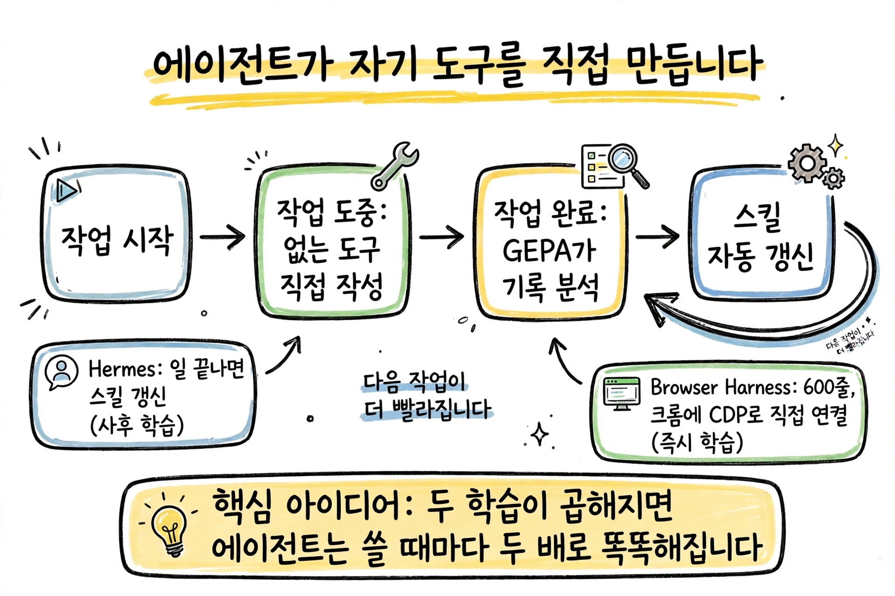
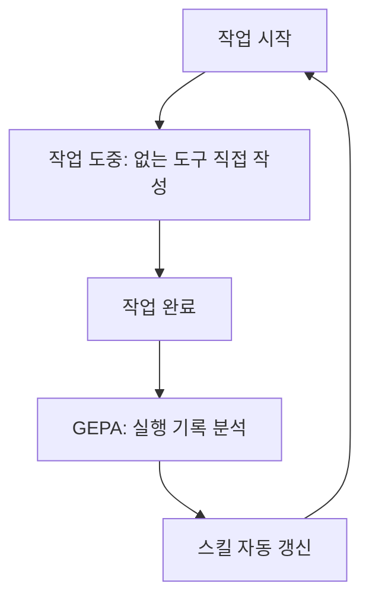
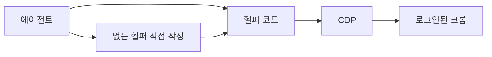
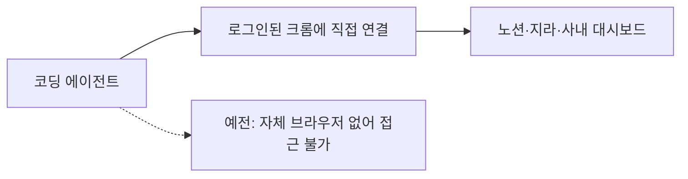

# Hermes Agent: 에이전트가 자기 도구를 직접 만들면, 학습 속도가 곱해집니다

> **Summary**
> Hermes는 작업 기록을 분석해 스킬을 사후에 개선하고, Browser Harness는 작업 중 필요한 도구를 직접 만들어 로그인된 크롬에서 활용합니다. 두 학습 방식이 결합하면 에이전트가 작업할 때마다 도구와 스킬이 함께 발전해 자동화의 속도와 정확도를 높입니다.

---

- 사후 학습과 즉시 학습이 한 작업에 동시에 돌면, 에이전트는 쓸 때마다 두 배로 똑똑해집니다.
- 핵심은 도구를 만드는 주체가 바뀌었다는 점입니다. 사람이 짜주던 자동화 코드를 에이전트가 직접 쓰고 고칩니다.
- 브라우저 역시 예외가 아닙니다. 로그인된 크롬에 그대로 붙어서, 없는 도구는 그 자리에서 만들어 씁니다.

월요일 아침, 같은 보고서를 뽑는 스크립트를 손으로 고쳐 쓴 적 있으시죠? 사이트 구조가 조금만 바뀌어도 자동화는 멈추고, 결국 사람이 다시 손을 댑니다. 그런데 이제 에이전트가 그 일을 직접 하기 시작했습니다. 그것도 두 가지 방법으로 동시에요!

🎥 [동영상 보기](https://www.youtube.com/watch?v=QjzlCr1fL9o)

### 왜 이 소식이 다를까요?

2026년 2월 25일에 나온 오픈소스 에이전트, Hermes가 있습니다. 출시 7주 만에 별 9만 5천 개를 찍었고, 11월 기준으로는 26만 개를 넘겼습니다. 한 주에 한 번씩 메이저 릴리스를 내는 속도도 남다릅니다. 그런데 숫자보다 중요한 건 따로 있습니다. 이 에이전트는 일을 마칠 때마다 자기 스킬을 스스로 고칩니다!

5월에 나온 v0.7.0에는 메모리 플러그인, 여러 API 키를 돌려쓰는 크레덴셜 풀, 스텔스 브라우저, 보안 스캐닝까지 들어갔습니다. 릴리스 하나하나가 기능을 쌓는 게 아니라, 에이전트 자체를 바꾸고 있습니다.

### Hermes는 어떻게 스스로 배울까요?

비결은 `GEPA`라는 자가 진화 메커니즘입니다. 작업이 끝나면 실행 기록을 읽고, 어떤 패턴이 먹혔는지 분석해서 스킬을 자동으로 만들고 다듬습니다. 학술적인 뒷받침도 있습니다. 이 메커니즘은 ICLR 2026 Oral에 올랐습니다. 같은 일을 다음에 다시 하면 더 빠르고 정확하게 돕니다. 사람이 스킬을 손으로 써줄 필요가 없습니다.

### Browser Harness는 뭐가 다를까요?

Browser Harness는 4월에 공개된 오픈소스 도구입니다. MIT 라이선스고, 파이썬 코드가 600줄이 채 안 됩니다. 의도적으로 짧게 짰습니다. 코드 전체가 모델의 컨텍스트 윈도우에 통째로 들어가야, 에이전트가 자기 도구의 소스를 다 읽고 필요할 때 직접 고칠 수 있으니까요.

Playwright나 Selenium처럼 자체 브라우저를 띄우지 않습니다. 사용자가 이미 쓰던 크롬에 CDP로 직접 붙습니다. 그래서 이미 로그인된 사이트가 있으면 그 세션이 곧바로 활용됩니다. 작업 도중에 필요한 도구가 없으면? 에이전트가 그 자리에서 짜서 파일에 추가합니다!

### 두 학습이 만나면 무슨 일이 생길까요?

Hermes가 Browser Harness를 새 스킬로 받아들인 게 바로 이 소식의 핵심입니다. 작업 한 번에 두 층의 학습이 동시에 일어납니다. Hermes는 작업이 끝난 뒤에 기록을 분석해서 스킬을 갱신합니다. Browser Harness는 작업 도중에 없는 도구를 그 자리에서 만들어 추가합니다. 한쪽은 사후 학습, 다른 쪽은 즉시 학습입니다. 두 학습이 같은 작업에 동시에 작용하면, 한 번 돌릴 때마다 두 도구가 같이 똑똑해집니다. 한 줄로 요약하면 곱셈 효과입니다!

### "비터 레슨"은 무슨 뜻일까요?

Browser Harness를 만든 팀은 이 설계를 "에이전트 하네스의 비터 레슨"이라고 불렀습니다. AI 발전사에서 사람이 손으로 짠 정교한 프레임워크가 결국 더 단순한 학습 메커니즘에 밀려나더라는, 서튼의 비터 레슨을 에이전트 도구에 옮긴 겁니다.

그래서 구현에는 매니저 레이어, 재시도 프레임워크, 세션 매니저, 설정 시스템, 로깅 프레임워크가 없습니다. 도메인 스킬 파일은 사람이 손으로 쓴 변경을 받지 않습니다. "스킬은 하네스가 씁니다. 여러분이 쓰는 게 아닙니다." 사람이 자동화 코드를 잘 짜는 시대에서, 에이전트가 자기 자동화 코드를 쓰는 시대로 옮겨간다는 선언입니다.

### 코딩 에이전트의 브라우저 문제는요?

코딩 에이전트가 못 풀던 한 가지가 브라우저 접근이었습니다. Claude Code, Codex, OpenCode 같은 도구가 자체 브라우저를 띄울 수 없으니, 로그인된 노션, 지라, 사내 대시보드 같은 곳을 못 건드렸습니다. Browser Harness가 그 자리에 들어옵니다. 이미 로그인된 크롬에 그대로 붙어서 작업하니까 별도 인증 절차가 필요 없습니다!

무료 티어로는 클라우드 브라우저 3개를 동시에 띄울 수 있고, 프록시와 캡차 해결까지 포함입니다. 설치는 `npx skills add` 한 줄이면 끝나고, 스킬 표준을 따르니 Hermes뿐 아니라 다른 에이전트에서도 같이 쓸 수 있습니다.

도구를 만드는 일이 사람의 손에서 에이전트의 손으로 넘어가고 있습니다. 다음에 자동화할 일이 생기면, 누가 코드를 짤지부터 다시 생각해 봐야겠습니다.

