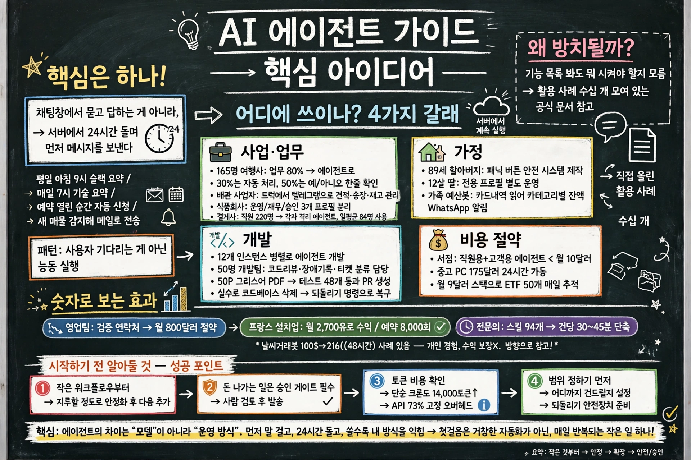
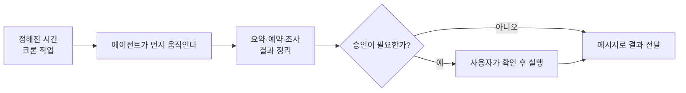
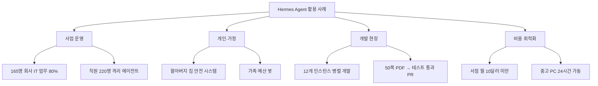
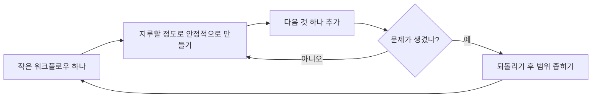

# Hermes Agent: 채팅창이 아니라 서버에서 24시간 일하는 게 차이입니다

> **Summary**
> 에이전트 공식 문서에는 쓰는 사람들이 직접 올린 활용 사례가 수십 개 모여 있습니다. 공통점은 하나입니다. 채팅창에서 묻고 답하는 게 아니라, 서버에서 24시간 돌며 먼저 메시지를 보냅니다. 업무·가정·개발·절약까지 쓰임새는 넓지만, 시작은 작은 워크플로우 하나부터가 정답에 가깝습니다.

---

- 에이전트 공식 문서에는 쓰는 사람들이 직접 올린 활용 사례가 수십 개 모여 있습니다.
- 공통점은 하나입니다. 채팅창에서 묻고 답하는 게 아니라, 서버에서 24시간 돌며 먼저 메시지를 보냅니다.
- 업무·가정·개발·절약까지 쓰임새는 넓지만, 시작은 작은 워크플로우 하나부터가 정답에 가깝습니다.

AI 에이전트를 깔아놓고도 뭘 시켜야 할지 몰라 며칠째 방치한 적 있으시죠? 기능 목록을 봐도 감이 안 옵니다. 그래서 공식 문서의 활용 사례 모음이 눈에 띄었습니다. 쓰는 사람들이 직접 올린 이야기만 수십 개가 모여 있거든요. 읽어보니 패턴이 보였습니다!

🎥 [동영상 보기](https://www.youtube.com/watch?v=0TV2yenS33U)

## 에이전트, 도대체 뭘 시키나요?

패턴은 단순합니다. 에이전트가 서버에서 24시간 돌고, 정해진 시간에 먼저 움직입니다. 평일 아침 9시에 받은 편지함을 요약해 슬랙에 올리고, 매일 아침 7시에 기술 요약을 보내주고, 체육관 예약이 열리는 순간 수강 신청을 마칩니다. 집을 구하는 사람에겐 새 매물이 뜨면 조건에 맞는 것만 골라 메일로 보내줍니다.

채팅 서비스는 탭을 닫으면 끝이지만, 이 에이전트는 서버에서 계속 돕니다. 아침에 일어나기 전에 텔레그램 메시지가 와 있습니다!

## 누가, 어디에 쓰나요?

쓰임새는 네 갈래로 나뉩니다. 어디에나 끼워 넣는 도구가 아니라, 각자 자기 일에 맞게 쓰는 모습입니다.

**사업 운영이 먼저입니다.** 165명짜리 여행사 IT 업무를 혼자 맡은 사람은 일의 80%를 에이전트로 옮겼습니다. 30%는 에이전트가 혼자 해결하고, 50%는 예·아니오 한 줄 확인만으로 끝납니다. 배관 사업자는 트럭에서 텔레그램으로 견적·송장·고객 관리·재고를 다룹니다. 식품 회사는 한 대의 장비에 운영·재무·승인용 프로필 세 개를 나눠 돌립니다. 한 결제 회사는 직원 220명에게 각자 격리된 에이전트를 줬고, 하루 평균 84명이 활발히 씁니다.

**가정에서도 쓰입니다.** 89세 할아버지 집에 패닉 버튼이 달린 안전 시스템을 에이전트가 직접 만들었습니다. 12살 딸에게는 아빠 에이전트와 별개로 전용 프로필을 만들어줬고, 가족 예산 봇은 카드 내역을 읽어 카테고리별 잔액을 왓츠앱으로 알려줍니다.

**개발 현장도 있습니다.** 에이전트 자체를 만드는 팀은 12개 인스턴스를 병렬로 돌립니다. 50명 규모 개발팀은 코드 리뷰·장애 기록·티켓 분류를 맡겼습니다. 50쪽짜리 그리스어 PDF를 텔레그램으로 보내면, 저장소를 읽고 테스트 48개를 통과한 PR로 돌려받은 사례도 있습니다. 코드베이스를 날려버린 사고가 있었지만, 되돌리기 명령 한 번으로 전부 복구됐습니다.

**비용을 줄이는 용도도 있습니다.** 서점은 직원용·고객용 에이전트 두 개를 월 10달러 미만으로 돌립니다. 중고 PC 한 대(175달러)를 24시간 가동하는 사람도 있고, 월 9달러 수준의 스택으로 고객 50개 배당 ETF를 매일 추적하는 사례도 있습니다.

## 숫자로 보면 얼마나 달라지나요?

숫자가 말해주는 게 있습니다. 영업팀은 검증된 연락처 목록을 슬랙 메시지 하나로 받아, 1인당 좌석 비용과 비교해 월 800달러를 아낍니다. 프랑스 소상공인 대상 설치 서비스를 하는 사람은 월 2,700유로 수익에 예약 실행 8,000회를 기록했습니다. 임상 문서 작업을 맡긴 전문의는 스킬 94개로 건당 30~45분을 줄였습니다. 매일 새벽 3시에 돌아가는 '꿈꾸기' 작업은 하루 대화를 읽어 내일 쓸 맥락을 미리 정리합니다. 한 사람은 크론 작업 28개와 스킬 30개 이상을 돌립니다.

날씨 거래 봇으로 100달러를 48시간 만에 216달러로 불렸다는 이야기도 있습니다. 다만 이건 한 사람의 경험담이고, 투자 수익을 보장하지 않습니다. 숫자는 각자 측정한 값이라 그대로 받아들이기보다 방향으로 읽는 게 맞습니다!

## 시작하기 전에 알아둘 건 뭘까요?

사례는 모두 자발적 제보라 검증된 벤치마크가 아닙니다. 그래서 커뮤니티 조언이 더 와닿습니다. "작은 워크플로우 하나로 시작하세요. 지루할 정도로 안정적으로 만든 뒤 다음 걸 추가하세요." 처음부터 모든 스킬과 도구를 다 넣으면 과부하가 옵니다.

돈이 나가는 일은 승인 게이트가 기본입니다. 스위스 웹 에이전시는 송장을 에이전트가 절대 직접 보내지 않고 사람이 검토한 뒤 발송합니다. 실제 서비스 사업도 주인이 단계마다 승인합니다.

토큰 비용도 봐야 합니다. 단순한 크론 작업에도 14,000토큰이 들 수 있고, API 호출의 73%가 고정 오버헤드라는 분석도 있습니다. 설치가 늘 순조로운 건 아닙니다. 며칠 밤을 헤맨 사례도 있습니다.

되돌리기 같은 안전장치가 있지만, 에이전트에게 맡기기 전에 어디까지 건드릴 수 있는지 범위를 정해두는 게 먼저입니다!

에이전트의 차이는 모델이 아닙니다. 닫아도 계속 돌고, 먼저 말 걸고, 쓸수록 내 방식을 익히는 운영 방식에 있습니다. 그래서 첫걸음은 거창한 자동화가 아니라, 매일 반복되는 작은 일 하나입니다!

