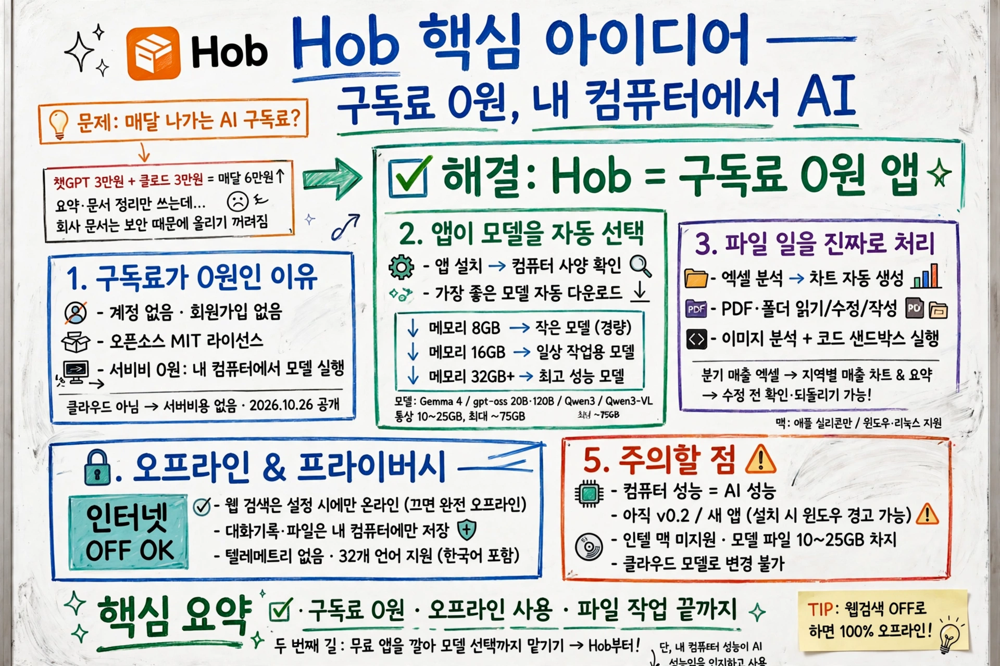
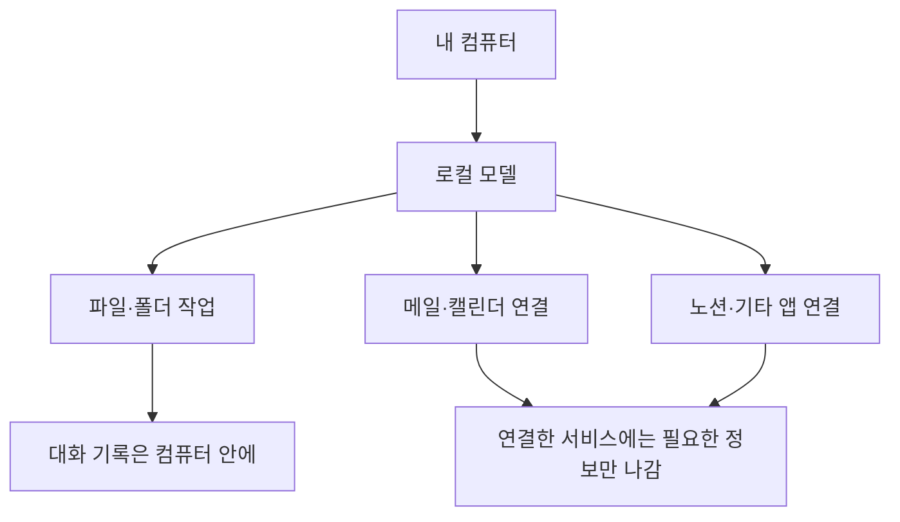

# Hob: 구독료 0원, 파일은 내 컴퓨터에. 로컬 AI가 클로드처럼 일합니다

> **Summary**
> Hob은 구독료와 계정 없이 컴퓨터에서 AI 모델을 실행하며, 파일을 읽고 수정하고 분석하는 무료 오픈소스 앱입니다. 모델을 자동으로 선택하고 오프라인에서도 사용할 수 있어 대화와 파일이 컴퓨터에 남지만, 성능은 컴퓨터 사양에 좌우되고 외부 서비스 연결 시 필요한 정보가 전송될 수 있습니다.

---

- 매달 3~6만 원씩 나가는 AI 구독료, 안 내고 쓸 방법이 있습니다. `Hob`은 계정도, 구독료도 없는 무료 오픈소스 앱입니다.
- 앱을 깔면 내 컴퓨터 사양에 맞는 AI 모델을 알아서 골라 내려받고, 엑셀·PDF·폴더를 내 컴퓨터 안에서 직접 다룹니다.
- 인터넷이 꺼져도 돌아가고, 대화 기록은 컴퓨터 밖으로 나가지 않습니다. 다만 컴퓨터 성능이 곧 AI 성능이라는 점은 알고 써야 합니다.

매달 카드 명세서를 볼 때마다 이런 생각이 드신 적 있으시죠? 챗GPT 구독료, 클로드 구독료, 합치면 3만 원이 훌쩍 넘는데, 정작 쓰는 건 요약이랑 문서 정리뿐인데 말이죠. 게다가 회사 문서는 보안 때문에 유료 AI에도 올리기 꺼려지는데, 답답한 상황이 계속됐습니다. 그런데 구독료 자체가 없는 앱이 나왔습니다! 원문 포스트는 직접 열리지 않아, 공식 사이트와 공개 리뷰를 교차 확인해 정리했습니다.

🎥 [동영상 보기](https://www.youtube.com/watch?v=F923vhUnd_M)

## 구독료가 0원인 이유가 뭘까요?

`Hob`은 2026년 10월 26일에 공개된 데스크톱 앱입니다. 클로드나 챗GPT 데스크톱 앱처럼 파일 일을 해주는 조수인데, 모델이 클라우드가 아니라 내 컴퓨터에서 돌아갑니다. 회원가입이 없습니다. 계정이 없습니다. 구독료도 없습니다. 소스는 `MIT` 라이선스로 공개돼 있습니다. 유료로 바꿀 기능 자체가 없습니다. 이게 어떻게 가능할까요? 비결은 모델을 직접 만들지 않는다는 점입니다. 이미 공개된 오픈 웨이트 모델을 내 컴퓨터에서 돌리는 방식이라, 서버비가 들지 않습니다!

## 모델 고르는 일, 앱이 대신합니다

로컬 AI가 어렵다고 느껴졌던 이유, 뭘까요? 모델을 고르는 일부터 막막했기 때문입니다. 이름도 낯선 모델이 수십 개고, 내 컴퓨터에서 돌아갈지 알 수 없었으니까요. `Hob`은 이 고민을 아예 없앴습니다. 앱을 처음 켜면 컴퓨터 사양을 확인하고, 그 컴퓨터에서 잘 돌아가는 가장 좋은 모델을 골라 내려받습니다.

모델 목록은 이렇습니다. `Gemma 4`가 여러 크기로, `gpt-oss`가 20B와 120B로, 작은 `Qwen3`와 이미지를 읽는 `Qwen3-VL`도 있습니다. 메모리 8GB면 가장 작은 모델이, 16GB면 일상 작업에 좋은 모델이, 32GB 이상이면 가장 좋은 모델이 들어갑니다. 가장 큰 모델은 디스크를 75GB쯤 차지합니다. 보통은 10~25GB면 충분합니다. 맥은 애플 실리콘만 지원하고, 윈도우와 리눅스에서도 돌아갑니다.

## 파일 일을 진짜로 합니다?

채팅만 하는 로컬 AI 앱은 많았습니다. 그런데 `Hob`이 다른 점은 파일 일을 끝까지 한다는 점입니다. 폴더를 열어주면 파일을 읽고 고치고, 엑셀을 분석해 차트를 그리고, PDF 양식을 채우고, 이미지도 봅니다. 코드도 샌드박스 안에서 돌립니다. 예를 들어 분기 매출 엑셀을 주면 지역별 매출 차트와 요약을 돌려줍니다. 결과를 열어보고, 고치고, 공유할 수 있습니다. 바꾸기 전에는 꼭 물어보고, 잘못 바꿨으면 되돌릴 수 있습니다!

## 메일·캘린더·노션도 연결될까요?

맥에서는 메일과 캘린더가 기본으로 연결됩니다. `Notion`, `Linear`, `Figma`, `GitHub` 같은 앱은 커넥터로 붙일 수 있습니다. 이메일 내용을 확인하고 캘린더 일정을 보면서 답을 만드는 식입니다. 다만 한 가지는 알고 써야 합니다. 커넥터로 연결한 외부 서비스에는 그 서비스가 동작하는 데 필요한 정보가 나갑니다. 오프라인·비공개 이야기는 모델과 대화에만 해당하고, 직접 연결한 서비스에는 적용되지 않습니다!

## 오프라인이 진짜 오프라인일까요?

네, 진짜입니다. 웹 검색이 유일하게 온라인으로 동작하는 기능인데, 설정에서 끌 수 있습니다. 끄면 모델 다운로드와 업데이트를 제외하고 완전히 오프라인으로 돌아갑니다. 비행기 안에서도, 인터넷이 끊긴 곳에서도 파일 작업을 이어갈 수 있습니다. 텔레메트리도 없습니다. 대화 기록과 파일은 내 컴퓨터에만 남습니다. 한국어를 포함해 32개 언어로 쓸 수 있습니다.

## 아쉬운 점은 없을까요?

있습니다. 아직 아주 새 앱이라서요. 첫 공개가 2026년 10월 말이라 버전이 0.2대입니다. 윈도우 설치 파일에는 아직 마이크로소프트 인증서가 없어서, 설치할 때 "Windows가 PC를 보호했습니다"라는 경고가 뜹니다. 그럴 땐 추가 정보를 눌러 실행하면 됩니다. 인텔 맥은 지원하지 않습니다. 그리고 가장 중요한 점, 클라우드 모델로 바꿀 방법이 없습니다. 컴퓨터가 약하면 가벼운 모델이 들어가고, 그 모델 수준에서 답이 멈춥니다. 모델 파일이 디스크를 18GB쯤 차지하는데, 초기에 지우는 방법이 마땅치 않다는 지적도 있었습니다. 만든 쪽에서 다음 업데이트에 고치겠다고 밝혔습니다.

이 글은 특정 무료 앱 하나를 소개하는 글입니다. 딥시크 채팅과 가중치가 공짜라는 무료 사용 관점을 다룬 글과는 각도가 다릅니다. 그 글은 무료 정책을, 이 글은 무료 앱 자체를 봅니다. 구독료를 아끼는 방법에도 두 갈래가 있습니다. 무료 모델을 직접 쓰는 방법과, 무료 앱을 깔아 모델 선택까지 맡기는 방법입니다. 두 번째 길을 원하신다면, `Hob`부터 깔아보시는 게 어떨까요?

