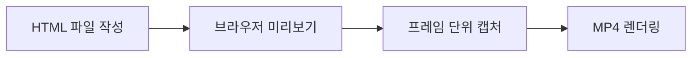
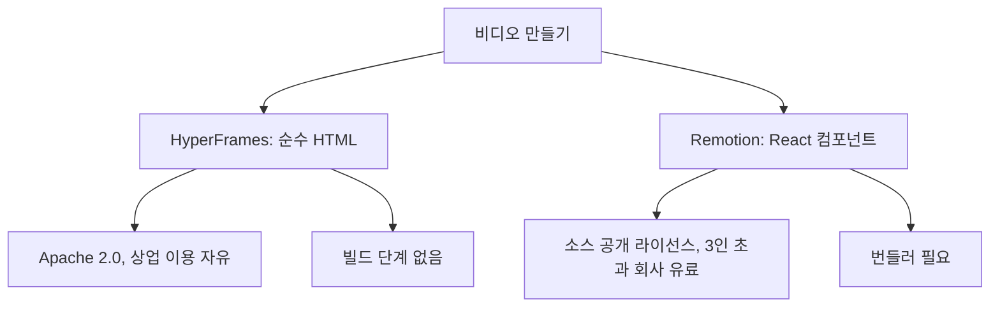

# HyperFrames: 비디오 편집기가 아니라, HTML 파일이 곧 비디오입니다

> **Summary**
> 영상 편집 앱을 켜지 않고 HTML 파일 하나로 비디오를 만듭니다. index.html이 곧 비디오 컴포지션이고, 말로 설명하면 코딩 에이전트가 HTML을 쓰고 브라우저에서 미리본 뒤 MP4로 렌더링합니다. 같은 입력이면 같은 결과가 나오는 결정적 렌더링이라 자동화 파이프라인에 잘 맞고, GSAP·Lottie·CSS·Three.js 같은 애니메이션 런타임은 Frame Adapter로 연결해 프레임 단위로 정확하게 재생합니다. React도 빌드 단계도 필요 없고 Apache 2.0이라 상업 이용에 제한이 없지만, 렌더링은 기본적으로 내 컴퓨터에서 돌아가고 Node.js 22와 FFmpeg이 필요합니다.

---

- 영상 편집 앱을 켜지 않고 HTML 파일 하나로 비디오를 만듭니다. `index.html`이 곧 비디오 컴포지션입니다.
- 말로 설명하면 코딩 에이전트가 HTML을 쓰고, 브라우저에서 미리본 뒤 MP4로 렌더링합니다. 같은 입력이면 같은 결과가 나옵니다.
- React도, 빌드 단계도, 독자적 문법도 필요 없습니다. 단, 렌더링은 내 컴퓨터에서 돌아가고 Node.js 22와 FFmpeg이 필요합니다.


쇼츠 하나 만들려고 편집 앱을 켰는데, 자막 위치 하나 맞추는 데만 한 시간이 간 적 있으시죠? 컷 나누고, 자막 달고, 효과음 고르고, 썸네일 만들고. 영상 하나에 들어가는 손길이 너무 많습니다. 그런데 이 손길을 줄이는 방법이 편집 앱을 더 잘 쓰는 게 아니라, 편집 앱을 아예 안 쓰는 것이라면 어떨까요?

🎥 [동영상 보기](https://www.youtube.com/watch?v=iqb5Rd6KKr8)

## HTML 파일이 곧 비디오라고요?

HyperFrames는 HTML과 CSS, 애니메이션만으로 비디오를 만드는 오픈소스 프레임워크입니다. 핵심은 단순합니다. 비디오의 설계도가 타임라인이 아니라 HTML 파일이라는 점입니다!

공식 소개 문장은 세 문장으로 끝납니다. HTML을 쓰고, 비디오로 렌더링하고, 에이전트를 위해 만들었습니다. React도 필요 없고, 독자적인 문법도 없습니다. 순수 HTML 파일이 곧 비디오 컴포지션이고, 빌드 단계 없이 `index.html`이 그대로 재생됩니다. 웹 페이지를 만드는 손으로 비디오를 만드는 셈입니다.

지난번에 다룬 영상 편집 스킬들이 에이전트에게 편집을 맡기는 도구였다면, 이 글은 편집의 재료 자체를 바꾸는 이야기입니다. 타임라인 대신 HTML 파일이 설계도가 됩니다. 이 차이가 왜 클까요? HTML은 사람이 읽고, 고치고, 버전 관리할 수 있는 텍스트이기 때문입니다!



## 어떻게 만드나요?

시작은 명령어 네 줄입니다. 프로젝트를 만들고, 브라우저에서 미리보고, MP4로 뽑아냅니다.

```plain text
npx hyperframes init my-video
cd my-video
npx hyperframes preview      # preview in browser (live reload)
npx hyperframes render       # render to MP4
```

미리보기는 브라우저에서 바로 열리고, 고칠 때마다 바로 반영됩니다. 렌더링은 브라우저가 페이지를 프레임 단위로 캡처하고 FFmpeg이 MP4로 묶는 방식입니다. 그래서 같은 입력이면 같은 결과가 나옵니다. 결정적 렌더링이라고 부르는 이유입니다. 자동화 파이프라인에 붙이기 좋은 성질입니다.

애니메이션은 어떻게 움직일까요? Frame Adapter라는 연결 방식을 씁니다. GSAP, Lottie, CSS, Three.js 같은 원하는 애니메이션 런타임을 자유롭게 연결합니다. 라이브러리 시계로 움직이는 애니메이션이 프레임 단위로 정확하게 재생됩니다. 이 부분이 렌더링할 때 벽시계 시간으로 재생되는 방식과 갈리는 지점입니다.

## 에이전트에게 말로 시키면 어떻게 될까요?

이 프레임워크가 코딩 에이전트와 잘 맞는 이유는, 에이전트가 가장 잘 쓰는 언어가 HTML이기 때문입니다. 스킬 마켓플레이스에서 검색해 설치한 뒤에는 말로 설명하면 됩니다. "10초짜리 제품 소개 영상을 만들어줘. 제목은 서서히 나타나고, 배경 영상과 배경 음악을 넣어줘." 이렇게 말하면 에이전트가 HTML을 쓰고, 미리보고, 렌더링합니다.

기존 콘텐츠를 비디오로 바꾸는 일도 말로 시킵니다. 저장소 하나를 보고 용도와 구조를 설명하는 영상을 만들 수도 있고, PDF 한 장을 45초짜리 소개 영상으로 요약할 수도 있고, CSV 파일을 움직이는 막대 차트 경주로 바꿀 수도 있습니다. 9:16 세로 영상에 통통 튀는 자막을 음성 내레이션에 맞춰 붙이는 일도 마찬가지입니다.

수정이 필요하면 에이전트를 비디오 에디터처럼 부립니다. "제목을 2배로 키우고, 다크 모드로 바꾸고, 끝에 페이드아웃을 넣어줘." 이렇게 말하면 됩니다. 0:03 지점에 이름과 직함을 넣는 하단 자막도 한 문장으로 추가합니다. 이 장면이 저는 가장 인상 깊었습니다. 편집이 타임라인을 만지는 일이 아니라, 문장을 고치는 일이 되니까요!

웹사이트를 통째로 비디오로 바꾸는 명령도 있습니다. `hyperframes capture` 명령으로 웹사이트를 캡처해 비디오로 변환하는 전체 파이프라인이 들어 있습니다. 50개가 넘는 사전 제작 블록도 카탈로그로 준비돼 있습니다. 셰이더 트랜지션, 소셜 오버레이, 데이터 차트 같은 블록을 한 줄로 가져옵니다. 참고로 블록 카탈로그는 계속 늘고 있어서, 현재 기준으로는 약 450개까지 커졌습니다.

```plain text
npx hyperframes add flash-through-white   # shader transition
npx hyperframes add instagram-follow      # social overlay
npx hyperframes add data-chart            # animated chart
```

## Remotion이랑 뭐가 다를까요?

비슷한 길을 먼저 간 도구가 있습니다. Remotion입니다. 둘 다 헤드리스 브라우저와 FFmpeg으로 렌더링합니다. 갈리는 지점은 두 가지입니다. 작업물과 라이선스입니다!



HyperFrames는 Apache 2.0 라이선스라 상업적 사용에 제한이 없습니다. 렌더링당 비용도, 좌석 상한도, 회사 규모 제한도 없습니다. Remotion은 소스 공개 커스텀 라이선스라 3인 초과 회사에서는 유료 회사 라이선스가 필요합니다. 빌드 단계도 다릅니다. HyperFrames는 `index.html`을 직접 재생하고, Remotion은 번들러가 필요합니다. 다만 분산 렌더링은 Remotion 쪽이 먼저 성숙했습니다. 수집 시점에는 HyperFrames가 단일 머신 렌더링만 지원했지만, 현재는 클라우드와 AWS Lambda 렌더링 경로도 생겼습니다.

숫자로 보면 관심은 뜨겁습니다. 2026년 11월 23일 기준 별 8만 8천 개, 포크 8천 개를 넘겼습니다. 패키지는 CLI, core, engine, producer, studio, player까지 일곱 가지로 나뉘어 있습니다. TypeScript 기반입니다.

## 쓰기 전에 확인할 것

세 가지는 미리 알아두면 좋습니다. 첫째, 준비물입니다. Node.js 22 이상과 FFmpeg이 필요합니다. 둘째, 비용 구조입니다. 프레임워크 자체는 무료 오픈소스지만, 스튜디오 앱의 Pro 요금제는 월 25달러이고, 영상·이미지·음성 생성 모델을 쓰면 별도 비용이 듭니다. 셋째, 렌더링 위치입니다. 기본은 내 컴퓨터에서 돌아갑니다. 대용량 렌더링을 자주 돌린다면 클라우드 렌더링 경로를 먼저 확인하는 편이 좋습니다.

영상 편집이 코드가 되는 흐름에서, 이 도구가 바꾸는 건 편집의 재료입니다. 타임라인을 여는 대신 HTML 파일을 여는 것입니다. 그 한 줄이 바뀌면, 비디오 만들기가 웹 페이지 만들기가 됩니다. 여러분의 다음 영상, 혹시 HTML 파일 하나로 시작해 보시겠어요?

