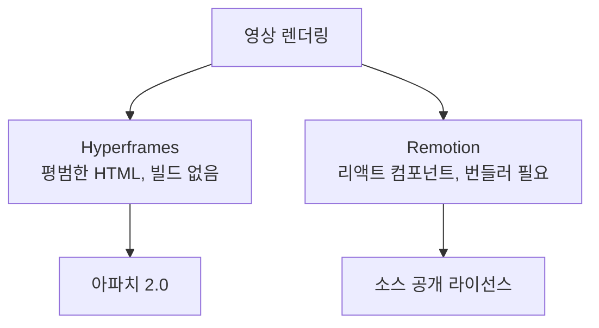

# Hyperframes: 모션그래픽 영상, 애프터이펙트가 아니라 HTML로 만듭니다

> **Summary**
> Hyperframes를 사용하면 애프터이펙트 대신 평범한 HTML로 모션그래픽 영상을 만들 수 있습니다. 헤드리스 크롬이 프레임을 하나씩 정확히 렌더링하고 FFmpeg으로 인코딩해 재현 가능한 영상을 만들며, 코딩 에이전트가 기획부터 렌더링까지 지원합니다. 아파치 2.0 라이선스로 상업적으로도 렌더링 요금 없이 이용할 수 있지만, 아직 1.0 전이라 빠르게 바뀌며 글꼴·브라우저 환경에 따라 출력이 달라질 수 있습니다.

---

- 모션그래픽 영상을 애프터이펙트가 아니라 HTML로 만듭니다. 에이전트가 이미 잘 아는 언어로 영상을 쓰는 겁니다.
- 렌더러는 화면을 녹화하지 않습니다. 헤드리스 크롬에서 프레임 하나하나를 정확히 찍어 `FFmpeg`으로 묶으니, 같은 입력이면 같은 영상이 나옵니다.
- 스킬 한 번이면 코딩 에이전트가 기획부터 렌더링까지 돕니다. 코드는 무료 공개, 상업 이용에도 렌더링 요금이 없습니다.


영상 하나 만들려고 타임라인을 열면, 키프레임부터 이징까지 배울 게 끝이 없습니다. 이런 적 있으시죠? 그런데 에이전트에게 영상을 맡기면 문제는 더 커집니다. 에이전트는 영상 편집기를 못 다룹니다. 그래서 발상을 바꿨습니다. 에이전트가 이미 잘 아는 언어로 영상을 쓰게 하자고요. 그 언어가 HTML입니다!

🎥 [동영상 보기](https://www.youtube.com/watch?v=iqb5Rd6KKr8)

### 왜 HTML일까요?

에이전트는 HTML을 수없이 봤습니다. 학습 데이터에 웹페이지가 가득합니다. 반면 영상 편집기 조작법은? 거의 없습니다. 그래서 영상 정의를 웹페이지로 바꿨습니다. `index.html` 하나가 영상 한 편입니다. 타이밍은 `data-` 속성으로 적습니다. 빌드 단계도 없습니다. 파일이 그대로 브라우저에서 열리고, 미리보기도 브라우저에서 바로 봅니다. 영상도 코드처럼 고칠 수 있게 된 겁니다!

### 녹화가 아니라 프레임을 찍습니다

핵심이 뭘까요? 재생을 녹화하는 게 아닙니다. 렌더러가 각 프레임을 정확히 찾아가서 찍습니다. 느린 컴퓨터에서도 프레임이 빠지지 않습니다. 같은 입력이면 같은 프레임, 같은 출력입니다. 결정적 렌더링이라 자동화 파이프라인과 회귀 테스트에 맞습니다. 움직임은 `GSAP`, CSS 애니메이션, `Lottie`, `Three.js`, `Anime.js`, WAAPI, 직접 만든 어댑터까지 붙일 수 있습니다. 단, 애니메이션은 '찾을 수 있는' 형태여야 합니다. 벽시계처럼 흘러가는 애니메이션은 프레임 단위로 찍을 수 없으니까요.


### 에이전트에게 시키는 법은?

스킬을 한 번 깔면 에이전트가 기획부터 돕습니다. HTML을 쓰고, 애니메이션을 연결하고, 미디어를 붙이고, 검사하고, 미리보고, 렌더링합니다. 스킬은 9개, 핵심은 `/hyperframes`부터 읽는 겁니다. 직접 손으로 하려면 CLI 세 줄이면 됩니다.

```bash
npx hyperframes init my-video
cd my-video
npx hyperframes preview
npx hyperframes render
```

`Node.js` 22 이상과 `FFmpeg`만 있으면 됩니다. 준비된 블록도 약 450개 있습니다. 전환·자막·차트·지도·3D·카메라 무빙까지, 직접 만들기 전에 카탈로그부터 봅니다. 에이전트가 쓰는 도구도, 사람이 쓰는 도구도 결국 같은 파일입니다!


### 뭘 만들 수 있을까요?

출시 영상, 제품 데모, 튜토리얼, 설명 영상, 데이터 차트 레이스, 지도 애니메이션, 자막 영상, 슬라이드 발표까지 됩니다. 심지어 좋아하는 영상을 다시 만드는 스킬도 있습니다. 원본과 프레임을 대조해 검증하면서요. 공식 문서에는 실제 서비스에서 쓴다고 적혀 있습니다. 공개 반년 만에 별 8만 8천 개를 넘긴 이유, 숫자가 말해줍니다!

### 레모션과 뭐가 다를까요?

영감은 레모션에서 받았습니다. 둘 다 헤드리스 크롬과 `FFmpeg`으로 렌더링합니다. 차이는 저작 모델입니다. 레모션은 리액트 컴포넌트와 번들러가 필요하고, 하이퍼프레임은 평범한 HTML입니다. 에이전트에게 건네는 파일도 평범한 HTML 파일입니다. 라이선스도 다릅니다. 아파치 2.0이라 상업 이용에도 렌더링 요금이나 좌석 제한이 없습니다.



### 알고 써야 할 점은?

아직 1.0 전입니다. 버전이 빠르게 오릅니다. 2026년 11월 기준 0.9대, 하루에 세 번 릴리스가 나온 적도 있습니다. 기본값으로 익명 사용 통계를 보냅니다. 끌 수 있습니다. 컴퓨터마다 글꼴과 크롬 빌드가 달라 한 픽셀씩 어긋날 수 있습니다. 똑같이 뽑아야 하면 도커 렌더를 씁니다. 저장소를 통째로 받으면 테스트용 기준 파일이 커서 무겁습니다. 건너뛰는 방법이 문서에 있습니다. 원문 게시글은 영상만 있는 글이라, 내용은 공식 저장소와 문서로 재구성했습니다.

영상 제작의 진입장벽은 도구가 아니라 언어였습니다. 에이전트가 이미 아는 언어로 영상을 쓰게 하니, 영상도 코드처럼 버전 관리되고, 다시 만들고, 고칠 수 있는 결과물이 됩니다!

