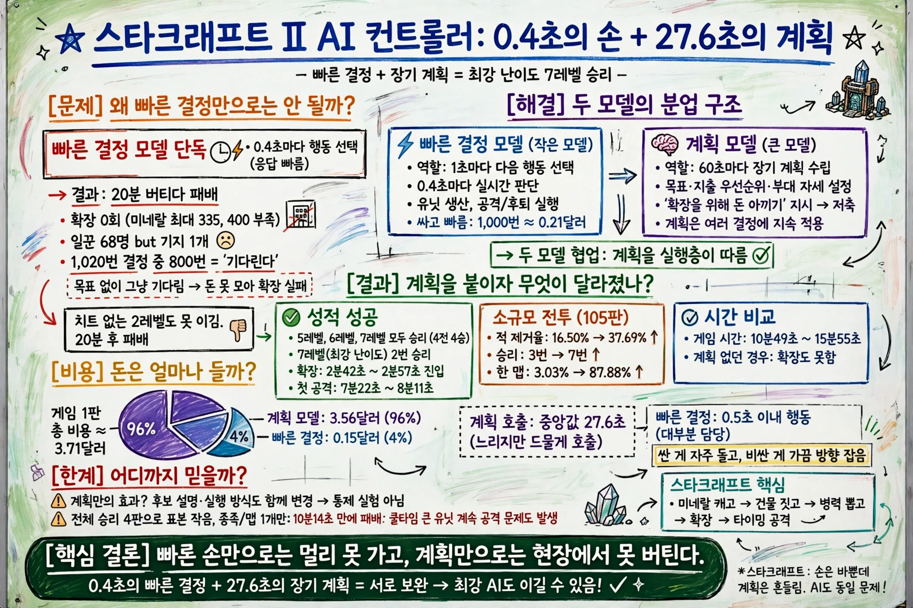
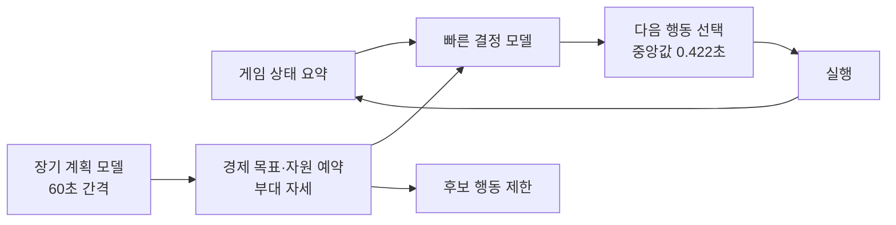
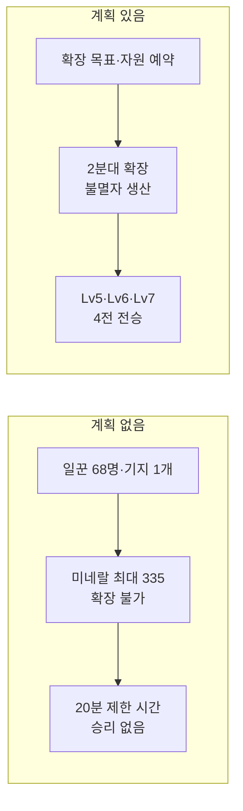

# JEV-Star: 스타크래프트 II 최강 AI를 이긴 비결, 빠른 손과 긴 계획의 분업입니다

> **Summary**
> 빠른 결정 모델이 0.4초마다 다음 행동을 고르고, 큰 모델이 장기 계획을 붙잡아 두는 스타크래프트 II 컨트롤러입니다. 계획이 없던 컨트롤러는 20분 동안 확장 한 번 못 하고 졌지만, 계획을 붙이자 치트 없는 최강 난이도 7레벨을 두 번 이겼습니다. 게임 한 판에 약 3.71달러가 들었는데, 계획이 96%를 차지했습니다. 빠름과 계획, 둘 다 필요했습니다.

---

- 빠른 결정 모델이 0.4초마다 다음 행동을 고르고, 큰 모델이 장기 계획을 붙잡아 두는 스타크래프트 II 컨트롤러입니다.
- 계획이 없던 컨트롤러는 20분 동안 확장 한 번 못 하고 졌지만, 계획을 붙이자 치트 없는 최강 난이도 7레벨을 두 번 이겼습니다.
- 게임 한 판에 약 3.71달러가 들었는데, 계획이 96%를 차지했습니다. 빠름과 계획, 둘 다 필요했습니다.

스타크래프트를 해보신 적 있으시죠? 미네랄을 캐고, 건물을 짓고, 병력을 뽑고, 타이밍을 봐서 쳐들어가야 합니다. 손은 바쁜데 머릿속 계획은 자꾸 흔들립니다. 지금 당장 살 수 있는 유닛을 사다 보면, 정작 확장에 필요한 미네랄 400은 절대 안 모입니다. AI 컨트롤러도 똑같은 함정에 빠졌습니다. 빠른 결정만으로는 이길 수 없었습니다!

🎥 [동영상 보기](https://www.youtube.com/watch?v=cUTMhmVh1qs)

### 왜 빠른 결정만으로는 안 될까요?

처음 만든 컨트롤러는 빠른 결정 모델 하나만으로 게임을 돌렸습니다. 이 모델은 주어진 상황에서 실행 가능한 행동 중 하나를 고르는 역할을 맡았습니다. 응답 속도는 중앙값 0.4초로 빨랐습니다. 그런데 결과는 처참했습니다. 가장 쉬운 2레벨 상대를 상대로 20분 제한 시간까지 버텼을 뿐, 확장은 한 번도 못 했습니다. 일꾼은 68명까지 늘었는데 기지는 하나뿐이었습니다. 관찰된 미네랄 잔고는 최대 335에 그쳤습니다. 확장 건물에 필요한 400에 끝내 닿지 못했습니다. 당장 살 수 있는 것을 계속 사느라, 미래를 위한 돈을 모을 수 없었던 겁니다. 결정 1,020번 중 800번이 "기다린다"였습니다. 기다림 자체가 잘못은 아닙니다. 문제는 무엇을 위해 기다리는지, 그 목표가 없었다는 점입니다.

### 두 모델의 분업은 어떻게 돌아갈까요?

그래서 연구팀은 일을 둘로 나눴습니다. 빠른 결정은 작은 결정 모델이 계속 맡고, 장기 계획은 큰 모델이 따로 맡았습니다. 결정 모델은 1초에 최대 한 번씩 다음 행동을 고릅니다. 계획 모델은 게임 시간 60초 간격으로 목표와 지출 우선순위, 부대 자세를 정해줍니다. 계획은 한 번 나오면 여러 결정에 계속 적용됩니다. 확장을 위해 돈을 아끼라는 지시가 있으면, 실행 층이 낮은 우선순위 지출을 막아 미네랄을 모아줍니다. 공격과 후퇴에는 따로 기준선을 두고, 한 번 정한 자세는 일정 시간 유지합니다. 공격했다가 2초 만에 후퇴하는 오락가락을 막기 위해서입니다. 이 장면이 저는 가장 인상 깊었습니다. 계획이 추상적인 조언이 아니라, 돈과 명령에 직접 걸리는 장치로 바뀐다는 점이 말입니다!

### 계획이 붙자 무엇이 달라졌을까요?

결과는 숫자로 드러났습니다. 계획이 붙은 컨트롤러는 5레벨, 6레벨, 7레벨에서 네 판을 모두 이겼습니다. 치트 없는 최강 난이도인 7레벨은 서로 다른 시작 조건으로 두 번 이겼습니다. 게임 시간은 10분 49초에서 15분 55초 사이였고, 첫 공격은 7분 22초에서 8분 11초 사이에 나왔습니다. 확장은 2분 42초에서 2분 57초 사이에 들어갔습니다. 계획 없던 컨트롤러가 20분 동안 못 했던 일을, 계획이 붙자 초반에 해낸 겁니다!

소규모 전투에서도 차이가 났습니다. 35개 전투 맵에서 각각 세 판씩, 총 105판을 돌렸습니다. 적 제거율은 평균 16.50%에서 37.69%로 올랐고, 승리 횟수는 3번에서 7번으로 늘었습니다. 한 맵에서는 제거율이 3.03%에서 87.88%로 뛰었습니다. 다만 승리 7번은 여전히 적은 숫자입니다. 105판 중 98판은 졌습니다. 적을 많이 잡아도 살아남아 이기는 것과는 다른 문제라는 뜻입니다. 계획이 전투를 잘하게는 했지만, 승리를 보장하지는 않았습니다.

### 비용은 얼마나 들까요?

빠른 결정은 쌉니다. 게임 한 판에 약 0.15달러입니다. 응답 1,000번에 약 0.21달러 수준입니다. 문제는 계획입니다. 계획 모델이 게임 한 판 비용의 96%를 차지합니다. 전체 평균 3.71달러 중 3.56달러가 계획 몫입니다. 계획 호출은 느리기도 합니다. 중앙값 27.6초가 걸렸습니다. 대신 호출이 드물어서, 대부분의 행동은 여전히 빠른 결정 층에서 0.5초 안에 나왔습니다. 싸고 빠른 층이 자주 돌고, 비싸고 느린 층이 가끔 방향을 잡는 구조입니다. 그런데 여기서 질문이 생깁니다. 계획이 비싼데, 그 돈이 정말 계획 덕분일까요?

### 어디까지 믿어야 할까요?

논문 스스로 한계를 분명히 밝혔습니다. 계획이 있는 쪽과 없는 쪽은 계획 말고도 후보 설명과 실행 방식이 함께 바뀌었습니다. 계획의 기여도를 따로 떼어 증명한 통제 실험이 아닙니다. 전체 게임 승리도 네 판뿐이라, 승률을 추정하기에는 표본이 작습니다. 종족도 프로토스 대 저그, 맵도 하나뿐입니다. 시야 특권을 가진 8레벨 상대와의 대결에서는 10분 14초 만에 졌습니다. 소규모 전투에서는 쿨타임이 긴 무기를 가진 유닛이 물러나야 할 때 계속 공격만 하는 장면도 남았습니다. 계획이 모든 조율을 대신하지는 못했습니다.

참고로 이름이 겹치는 다른 프로젝트와 헷갈리지 않으셔야 합니다. 앞서 소개한 검색 도구는 같은 결정 모델을 검색에 쓴 것이고, 이 글의 컨트롤러는 그 모델을 스타크래프트 II 조작에 쓴 것입니다. 모델 이름은 같지만, 프로젝트는 전혀 다릅니다. 결정 모델 자체는 주어진 선택지 중에서 하나를 고르는 빠른 판단기이고, 어디에 붙이느냐에 따라 검색 도구가 되기도 하고 게임 컨트롤러가 되기도 합니다.

결론은 단순합니다. 빠른 손만으로는 멀리 못 가고, 계획만으로는 현장에서 못 버팁니다. 0.4초의 손과 27.6초의 계획이 각자 자리에서 돌 때, 최강 AI도 이길 수 있었습니다!

