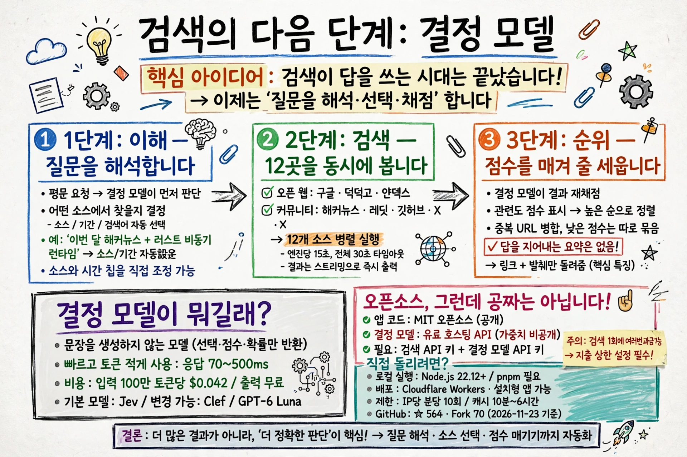
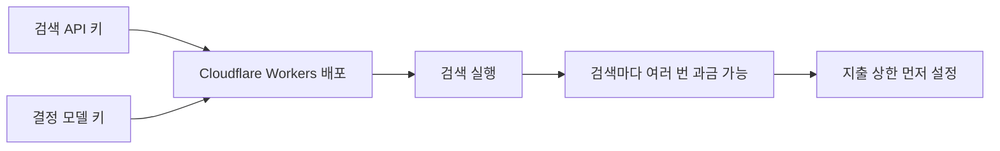

# Jev Search: 검색은 AI가 계획하고, 답 대신 링크와 점수를 돌려줍니다

> **Summary**
> Jev Search interpretiert Suchanfragen, wählt passende Quellen und Zeiträume aus und durchsucht zwölf Plattformen parallel. Ein Entscheidungsmodell bewertet und sortiert die Ergebnisse, liefert aber nur Links, Auszüge und Relevanzwerte statt Antworten. Der MIT-lizenzierte App-Code ist offen; für den Betrieb sind kostenpflichtige Such- und Modell-APIs erforderlich, daher sollten Nutzungskosten begrenzt werden.

---

- 검색이 답을 쓰는 시대는 끝났습니다. 이제 검색은 질문을 해석하고, 골라서, 점수를 매겨 돌려줍니다.
- 결정 모델이 소스 12곳과 기간, 검색어를 직접 고릅니다. 구글·덕덕고·얀덱스부터 해커뉴스·레딧·깃허브·X까지 한 번에 봅니다.
- 앱 자체는 MIT 오픈소스지만, 뒤의 결정 모델은 유료 호스팅 API입니다. 공짜로 굴러가는 검색이 아니라는 점이 먼저입니다.

"요즘 로컬 AI 에이전트 프로젝트 찾아줘." 검색창에 문장 하나를 던졌는데, 돌아온 건 키워드 조각에 맞춘 링크 뭉치였습니다. 원하는 건 따로 있었죠. 해커뉴스에서, 이번 달에, 개발자들이 실제로 써본 글만 보고 싶었습니다. 그런데 검색 엔진은 "어디서" "언제"를 묻지 않습니다. 그 빈자리를 결정 모델이 채우는 도구가 나왔습니다!

🎥 [동영상 보기](https://www.youtube.com/watch?v=9oWxrsRo4d8)

## 검색, 어떻게 다를까요?

### 1단계: 이해 — 질문을 해석합니다

평문 요청이 들어오면 결정 모델이 먼저 판단을 내립니다. 어떤 소스에서 찾을지, 기간은 언제로 잡을지, 소스마다 어떤 검색어를 쓸지 말입니다. "이번 달 해커뉴스에서 러스트 비동기 런타임" 같은 요청은 소스와 기간이 이미 들어 있고, "추론 디코딩 새 논문"처럼 아무 단서도 없는 요청은 모델이 알아서 정합니다. 소스와 시간 칩을 손으로 바꿀 수도 있습니다.

### 2단계: 검색 — 12곳을 동시에 봅니다

오픈 웹은 구글·덕덕고·얀덱스 세 엔진이 맡고, 해커뉴스·레딧·깃허브·X·arXiv·유튜브·위키피디아·IMDb·위챗까지 합쳐 12개 소스가 동시에 돌아갑니다. 한 엔진이 실패해도 다른 엔진 결과가 버려지지 않습니다. 엔진마다 15초, 전체 30초라는 마감도 있습니다. 결과는 각 소스가 끝나는 대로 스트리밍으로 흘러나옵니다.

### 3단계: 순위 — 점수를 매겨 줄 세웁니다

가져온 결과를 결정 모델이 다시 채점합니다. 관련도 점수가 눈에 보이고, URL 중복은 합쳐지고, 낮은 점수는 따로 묶입니다. 답을 지어내는 요약은 없습니다. 링크와 발췌만 돌려줍니다. 이게 이 도구의 가장 큰 특징입니다!

## 결정 모델이 뭐길래요?

결정 모델은 문장을 쓰지 않는 모델입니다. 상태를 받고, 정해진 질문에 답만 돌려줍니다. 선택·점수·확률 같은 값을 코드가 바로 쓸 수 있는 형태로 말입니다. 긴 글을 생성하지 않으니 빠르고, 토큰도 적게 듭니다. 발표된 수치는 응답 70~500밀리초, 입력 100만 토큰당 0.042달러, 출력 무료입니다. 기본값은 Jev이고, 클라우드플레어의 Clef나 GPT-6 Luna로 바꿀 수도 있습니다. 이 부분이 저는 가장 인상 깊었습니다. 검색의 "판단"만 떼어내 작은 모델에게 맡긴다는 발상이, 거대한 채팅 모델을 돌리는 것보다 훨씬 싸게 먹히니까요!

## 오픈소스, 그런데 공짜는 아닙니다

여기서 헷갈리기 쉬운 지점이 있습니다. 앱 코드는 MIT 라이선스 오픈소스입니다. 그런데 뒤에서 판단을 내리는 결정 모델은 호스팅 API입니다. 가중치는 공개되지 않았습니다. 직접 돌리려면 검색 API 키와 결정 모델 키가 따로 필요합니다. 검색 한 번에 여러 번 과금될 수 있으니, 공개 배포 전에 지출 상한을 정하는 게 순서입니다. 무료 구간이 아니라 "내 키로 굴리는" 구조입니다!

또 하나, "구글과 덕덕고에서 인덱싱한다"는 표현은 정확하지 않습니다. 이 도구가 직접 색인을 만드는 게 아니라, 검색 API를 통해 각 엔진에 질의하고 결과를 받아옵니다. 빠름의 비밀은 색인이 아니라, 질문을 해석하고 결과를 다시 채점하는 결정 모델에 있습니다. 이게 핵심입니다.

## 직접 돌리려면 무엇이 필요할까요?

로컬 실행은 Node.js 22.12 이상과 `pnpm`이 필요합니다. 배포는 Cloudflare Workers 위에서 돌아가며, 설치형 앱으로도 쓸 수 있습니다. 속도 제한은 IP당 분당 10회이고, 검색 결과는 10분에서 6시간까지 캐시됩니다. 저장소 기준 별은 564개, 포크는 70개로 확인됐습니다(2026-11-23 기준). 테스트는 키 없이도 돌아갑니다.

## 맺음말

검색의 다음 단계는 더 많은 결과가 아니라, 더 정확한 판단입니다. 질문을 해석하고, 소스를 고르고, 점수를 매기는 일까지 맡기는 검색, 그게 이 도구가 보여주는 방향입니다!

