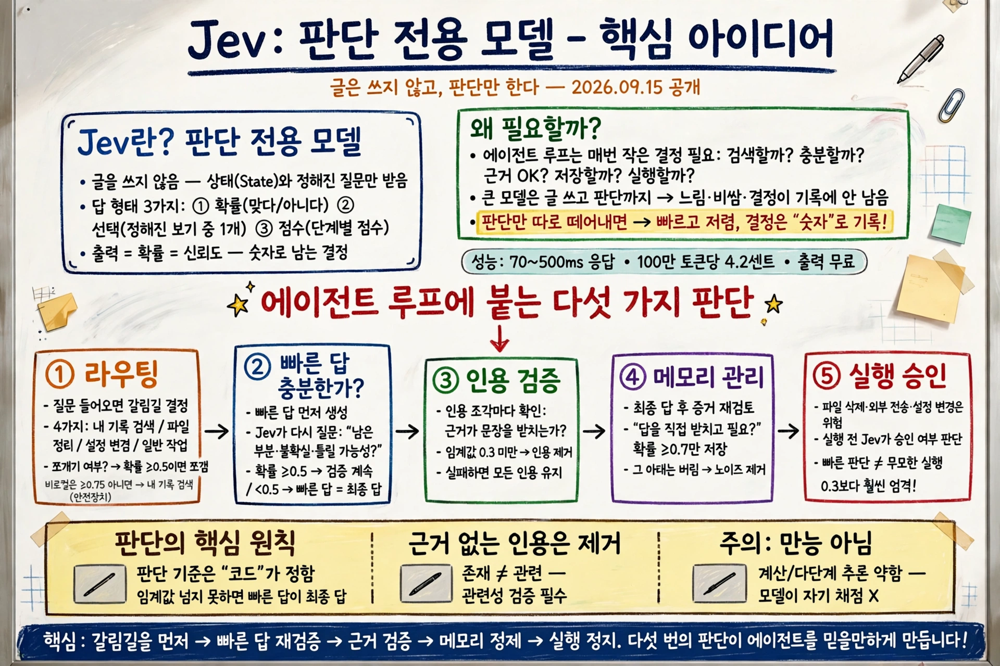
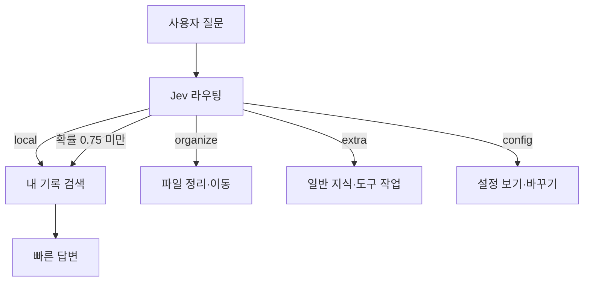
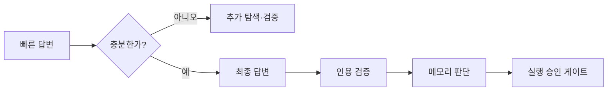

# Jev 활용법: 에이전트 루프 전에 갈림길을 정합니다. 빠른 판단이 루프를 이끕니다

> **Summary**
> Jev는 글을 생성하지 않고 확률과 점수로 판단하는 모델로, 에이전트 루프에서 질문 라우팅, 답변 검증, 인용 검토, 메모리 선별, 실행 승인 등 다섯 가지 결정을 빠르게 처리합니다. 임계값과 안전장치는 코드가 관리하며, 확신이 부족하면 기록 검색이나 추가 검증으로 돌아가고 위험한 실행은 사람의 확인을 거칩니다.

---

- Jev는 글을 쓰지 않고 판단만 합니다. 상태와 질문을 받으면 선택·점수·확률로 답합니다.
- 에이전트 루프에 붙이면 다섯 가지 판단이 들어갑니다. 라우팅부터 답변·인용 검증, 메모리 관리, 실행 승인까지요.
- 판단의 기준은 코드가 쥐고 있습니다. 임계값을 넘지 못하면 빠른 답이 최종 답이 되고, 근거 없는 인용은 떨어집니다.

에이전트에게 파일 하나 찾아달라고 했는데, 검색부터 엉뚱한 곳을 뒤지는 걸 본 적 있으시죠? 큰 모델이 매번 글을 쓰며 판단까지 떠맡다 보니, 토큰은 줄줄 새고 결정은 기록에 남지 않습니다. 판단만 따로 떼어내는 방법이 있습니다!

🎥 [동영상 보기](https://www.youtube.com/watch?v=xCa5DUSJVtA)

## Jev는 글을 쓰지 않습니다. 판단만 합니다

Jev는 2026년 9월 15일에 공개된 판단 전용 모델입니다. 채팅 모델이 문장을 써내는 것과 달리, Jev는 상태(state) 하나와 정해진 질문들을 받아서 답만 돌려줍니다. 질문은 세 가지 모양입니다. 맞다·아니다를 확률로 묻는 `noul`, 정해진 보기 중 하나를 고르는 `choice`, 직접 정한 단계 위에 올려놓는 `score`가 있습니다. 답에는 확률이 붙고, 그 확률이 곧 신뢰도입니다.

왜 이런 모델이 필요할까요? 에이전트 루프는 매번 작은 결정을 내립니다. 검색할까, 말까? 이 답으로 충분할까? 이 근거가 문장을 받칠까? 이걸 메모리에 남길까? 실행해도 될까? 매번 큰 모델에 글을 쓰게 하면 느리고 비싸고, 결정은 문장 속에 녹아 기록에 남지 않습니다. 판단만 하는 모델은 빠르고 싸고, 결정이 숫자로 남습니다. 만든 쪽 발표로는 답이 70~500밀리초 안에 오고, 입력 100만 토큰당 4.2센트, 출력은 무료입니다. 만든 쪽 수치라는 점은 밝혀 둡니다.

## 라우팅이 먼저입니다. 루프에 들어가기 전에 갈림길을 정합니다

질문이 들어오면 에이전트 루프가 돌기 전에 Jev가 먼저 갈림길을 정합니다. 한 번의 묶음 호출로 두 가지 질문에 답합니다. 첫째, 이 질문을 어떻게 다뤄야 할까요? 갈림길은 네 가지입니다. 내 파일·메신저·메일처럼 사용자 기록을 찾아야 하면 `local`, 파일을 정리·이동·이름 변경처럼 행동 자체가 목적이면 `organize`, 설정 보기·바꾸기면 `config`, 그 밖의 일반 지식이나 도구 작업이면 `extra`입니다. 둘째, 질문을 여러 검색 질의로 쪼개야 할까요? 확률이 0.5 이상이면 쪼갭니다.

확신이 없으면 어떻게 될까요? 비로컬 갈림길은 확률 0.75를 넘어야 합니다. 그 아래면 `local`로 돌아갑니다. "모르면 내 기록부터 뒤진다"는 안전장치입니다. 라이브 모델로 한국어·영어 22문항을 세 번 돌린 실측에서는 22문항 모두 맞았습니다. 라우팅이 틀리면 뒤의 모든 단계가 틀어지는데, 이 갈림길이 그만큼 단단하다는 뜻입니다!

## 빠른 답, 그대로 믿지 않습니다. 충분한지 다시 묻습니다

검색형 답변은 빠른 답이 생명입니다. 그래서 먼저 빠른 답변을 내뱉습니다. 그런데 빨리만 답하면 정확하지 않습니다. 그래서 Jev가 한 번 더 묻습니다. 질문과 빠른 답변을 함께 보고, "남은 부분이나 불확실한 부분, 틀렸을 가능성이 있나요?" 확률이 0.5 이상이면 빠른 답은 임시 답이 되고 검증이 이어집니다. 미만이면 빠른 답이 그대로 최종 답이 됩니다. 검증이 필요 없는데 시간을 더 쓸 이유가 없으니까요.

확인에 실패하면 어떻게 될까요? 그때는 검증 쪽으로 넘어갑니다. 확인 안 된 답으로 끝내는 게 더 큰 실수이기 때문입니다. 빠른 답이 곧 최종 답이 되는 구조, 그런데 그 결정을 또 판단 모델이 내린다는 점이 이 패턴의 핵심입니다.

## 인용 검증: 근거가 문장을 받치는지 확인합니다

모델이 인용을 달았다고 해서 근거가 문장을 받치는 건 아닙니다. 목차, 내비게이션 바, 저작권 문구, 뜬구름 잡는 서론 같은 조각이 인용으로 붙는 경우가 있습니다. 존재하는 근거와 관련 있는 근거는 다릅니다!

그래서 Jev는 인용된 조각마다 하나씩 묻습니다. "이 증거가 인용하는 문장이나 사용자 질문과 관련이 있나요?" 임계값은 0.3입니다. 그 아래면 인용에서 제거합니다. 일부만 받치는 조각은 남깁니다. 주제와 무관한 조각만 떨어집니다. 확인에 실패하면 모든 인용을 유지합니다. 없는 것보다 있는 게 낫다는 판단입니다.

## 메모리 관리: 쓸모 있는 증거만 남깁니다

메모리에 그럴듯하지만 쓸모없는 데이터가 쌓이면 어떻게 될까요? 나중에 검색할 때 노이즈가 됩니다. 그래서 최종 답변이 나온 뒤, 인용된 증거를 다시 Jev에 묻습니다. "이 증거가 답 문장을 직접 받치고, 답에 필요한가요?" 확률 0.7 이상만 메모리에 저장합니다. 그 아래는 버립니다. 인용 검증의 0.3보다 훨씬 엄격합니다. 메모리는 한 번 들어가면 계속 쓰이니까요.

## 실행 승인 게이트: 위험한 일은 사람이 확인합니다

파일 삭제, 외부 전송, 설정 변경 같은 실행은 그냥 지나가면 안 됩니다. 이 패턴에서는 Jev가 실행 전 승인 여부를 판단합니다. 개인용 사서 에이전트에서는 자동 권한 게이트도 Jev에 묻습니다. 판단은 빠르지만, 그 판단이 가리키는 행동은 무겁습니다. 그래서 게이트는 "해도 된다"가 아니라 "사람이 봐야 한다"로 이어지는 경우가 많습니다. 빠른 판단이 곧 무모한 실행은 아닙니다!

## 주의할 점이 있습니다

Jev는 만능이 아닙니다. 계산기가 아니고, 수학이나 다단계 추론에 약합니다. 적대적인 상태에 휘둘릴 수도 있습니다. 그래서 임계값은 코드가 정합니다. 모델이 자기 일을 스스로 채점하지 않습니다!

그리고 이 패턴들이 적용된 개인용 사서 에이전트에서는 Jev가 필수입니다. 세션 시작 시 probe 질문 두 개로 판단 모델이 살아 있는지 먼저 확인하고, 안 되면 작은 모델로 폴백하고, 그것도 안 되면 실행을 중단합니다. 판단이 없으면 루프를 돌리지 않겠다는 선언입니다.

각도 구분을 밝혀 둡니다. Jev Search를 소개한 글과 스타크래프트 AI를 다룬 글, Postgres 확장을 다룬 글과 달리, 이 글은 Jev를 에이전트 루프에 붙이는 실전 활용법입니다. 도구 소개가 아니라, 판단 다섯 개를 루프에 꽂는 방법입니다.

판단은 빠를수록 좋지만, 빠르다고 다 믿을 건 아닙니다. 갈림길을 먼저 정하고, 빠른 답을 다시 묻고, 근거를 검증하고, 메모리를 가리고, 실행을 멈추는 다섯 번의 판단이 에이전트를 믿을 만하게 만듭니다.

