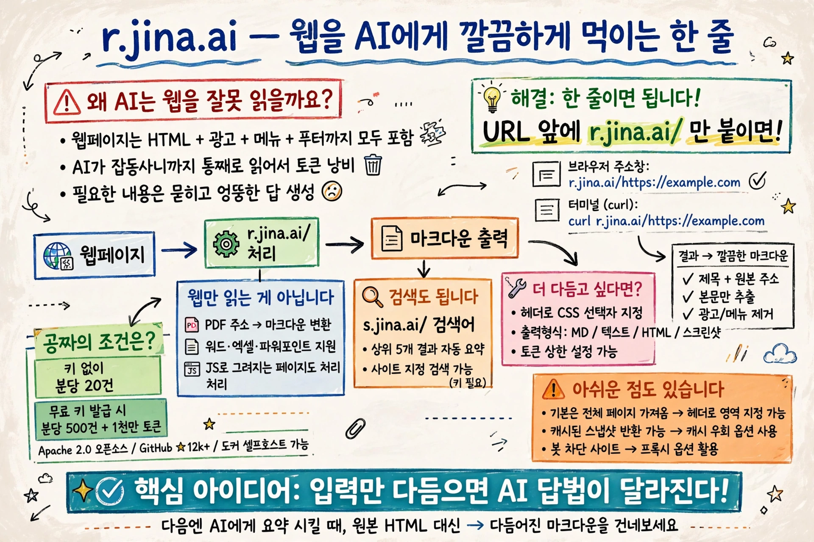
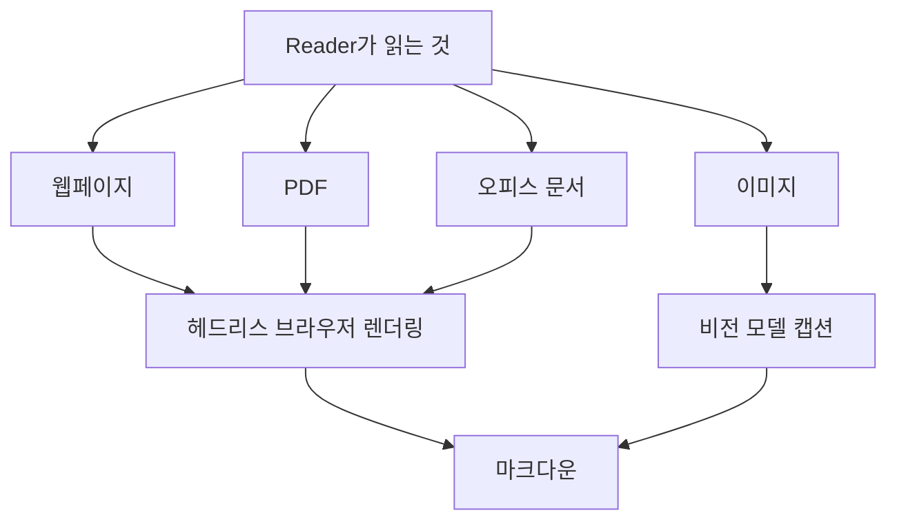
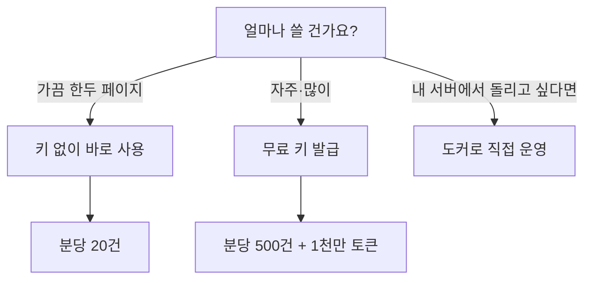

# Jina Reader: URL 앞에 한 줄만 붙이면, AI가 웹을 깨끗하게 읽습니다

> **Summary**
> Jina Reader는 URL 앞에 https://r.jina.ai/를 붙여 웹페이지를 광고와 메뉴가 제거된 마크다운으로 변환하며, PDF·오피스 문서·이미지도 처리합니다. 키 없이 분당 20건, 무료 키로 분당 500건까지 사용할 수 있고, 검색·출력 형식·CSS 선택자 등을 조정하거나 직접 운영할 수 있습니다. 캐시된 콘텐츠나 봇 차단 같은 한계도 있지만, 간단한 URL 인터페이스로 웹 콘텐츠를 AI와 RAG 파이프라인에 쉽게 연결합니다.

---

- URL 앞에 `https://r.jina.ai/`만 붙이면, 웹페이지가 광고와 메뉴를 벗은 깔끔한 마크다운으로 돌아옵니다.
- 웹페이지뿐 아니라 PDF와 오피스 문서도 읽고, 자바스크립트로 그려지는 페이지도 처리합니다.
- 키 없이 바로 쓸 수 있고, 키를 받으면 분당 500건까지 쓸 수 있습니다. 소스 코드는 아파치 2.0으로 공개돼 있습니다.


AI한테 "이 사이트 읽어봐"라고 시켜본 적 있으시죠? 돌아온 답을 보면 본문보다 광고 문구와 메뉴 이름이 먼저 눈에 띕니다. 토큰은 줄줄 새는데 정작 필요한 내용은 뒤쪽에 묻혀 있습니다.

🎥 [동영상 보기](https://www.youtube.com/watch?v=B_nH8GCmBfc)

## 왜 AI는 웹을 잘못 읽을까요?

웹페이지는 사람이 보는 화면이 전부가 아닙니다. HTML 태그, 광고, 네비게이션 바, 푸터까지 한 덩어리로 딸려옵니다. AI는 이 잡동사니를 통째로 먹습니다. 그래서 엉뚱한 부분에서 정보를 뽑아오는 일이 생깁니다. 토큰도 낭비되고 답도 틀어집니다. 문제는 모델이 아니라 입력입니다!

## 한 줄이면 됩니다!

해결 방법은 놀라울 정도로 간단합니다. 읽고 싶은 주소 앞에 `https://r.jina.ai/`를 붙이면 됩니다. 브라우저 주소창에 그대로 붙여 넣어도 되고, 터미널에서는 이렇게 씁니다.

```bash
curl https://r.jina.ai/https://example.com
```

돌아오는 답은 제목, 원본 주소, 마크다운 본문으로 정리된 텍스트입니다. 설치도 없고, 가입도 필요 없습니다. URL 하나가 API 호출이 됩니다!

## 직접 확인해 봤습니다

말만 믿고 쓰지는 않았습니다. 직접 주소를 넣어봤습니다. `example.com`을 넣어보니 제목과 원본 주소, 그리고 본문만 깔끔하게 돌아왔습니다. 광고도 메뉴도 없었습니다. 다만 응답 위에 "캐시된 스냅샷"이라는 안내가 붙어 있었습니다. 최신 내용이 급하면 캐시를 우회하는 옵션을 쓰면 됩니다.


## 웹만 읽는 게 아닙니다

읽을 수 있는 게 웹페이지뿐이면 반쪽짜리였겠죠. PDF 주소도 그대로 넣으면 마크다운으로 바꿔줍니다. 워드·엑셀·파워포인트 문서도 읽습니다. 이미지에는 비전 모델이 캡션을 달아줍니다. 텍스트만 보는 모델도 그림 내용을 어림잡을 수 있게 됩니다. 자바스크립트로 뒤늦게 그려지는 페이지도 헤드리스 브라우저로 렌더링해서 가져옵니다.



## 검색도 됩니다

주소 하나를 읽는 게 전부가 아닙니다. `s.jina.ai/` 뒤에 검색어를 붙이면 웹 검색을 하고, 상위 5개 결과를 각각 읽어서 마크다운으로 돌려줍니다. 검색 결과 제목만 보고 다시 들어갈 필요가 없습니다. 특정 사이트 안에서만 찾고 싶으면 사이트를 지정하는 옵션도 있습니다. 단, 검색 쪽은 키가 필요합니다.

## 더 다듬고 싶다면?

기본 동작이 마음에 안 들면 헤더 한 줄로 조절합니다. 원하는 부분만 뽑고 싶으면 CSS 선택자를 지정합니다. 특정 요소가 그려질 때까지 기다리게 할 수도 있습니다. 출력 형식도 고릅니다. 마크다운, 순수 텍스트, HTML, 스크린샷까지 됩니다. 토큰이 걱정되면 응답 토큰 상한을 정해두면 됩니다. 자주 쓰는 조합은 프리셋으로 묶여 있습니다.

## 공짜의 조건은?

키 없이 쓰면 분당 20건까지 쓸 수 있습니다. 무료 키를 받으면 분당 500건으로 늘어나고, 새 키마다 1천만 토큰이 따라옵니다. 2024년 4월에 공개됐고, 저장소는 별 1만 2천 개를 넘겼습니다. 소스 코드가 공개돼 있어 도커 이미지로 직접 띄울 수도 있습니다. 이 장면이 저는 가장 인상 깊었습니다. "URL 앞에 붙이기"라는 한 줄짜리 인터페이스가, 거창한 SDK 없이도 파이프라인의 첫 단추가 된다는 게 말이죠!



## 아쉬운 점도 있습니다

장점만 있는 도구는 없습니다. 기본값은 페이지 전체를 가져옵니다. 상단 메뉴와 사이드바까지 딸려올 수 있습니다. 그럴 땐 원하는 영역만 지정하는 헤더를 쓰면 됩니다. 또 방금 확인한 것처럼 캐시된 스냅샷이 돌아올 때도 있습니다. 최신본이 필요하면 캐시 우회 옵션을 쓰면 됩니다. 봇 차단을 거는 사이트는 키를 써도 막힐 수 있습니다. 그럴 땐 프록시 옵션이 준비돼 있습니다.

웹을 AI에게 먹이는 일, 이제는 주소 앞에 한 줄만 붙이면 됩니다. 읽는 방법을 바꾸는 것만으로 답의 품질이 달라집니다. 다음에 AI한테 웹페이지 요약을 시킬 때, 원본 HTML 대신 다듬어진 마크다운을 건네보시면 어떨까요?

