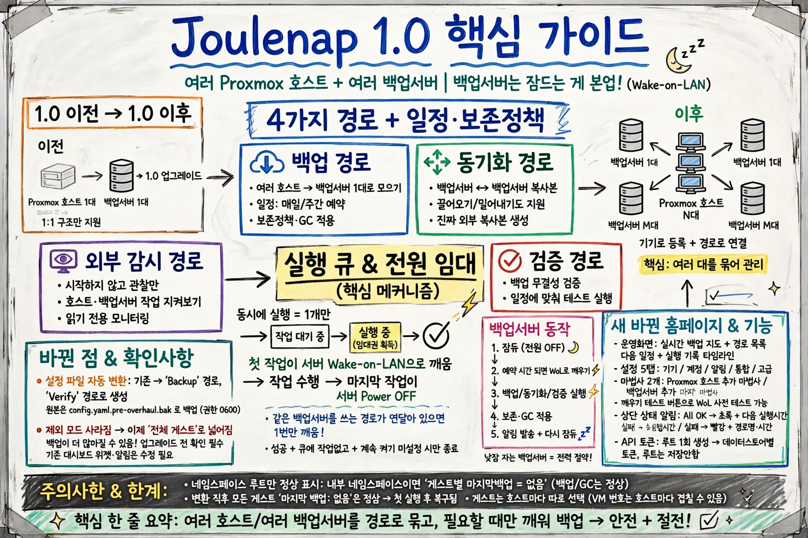
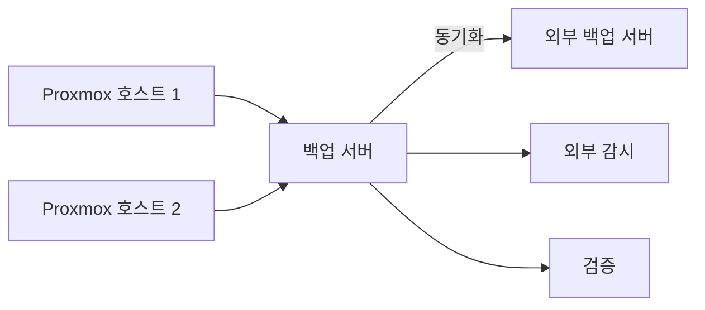
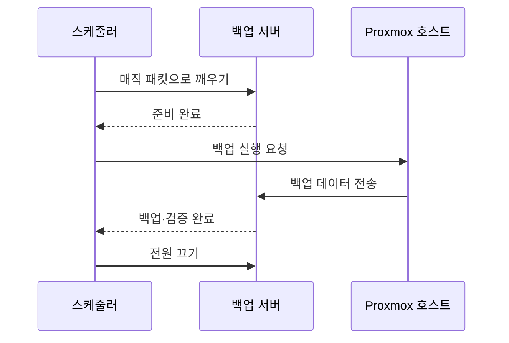

# Joulenap 1.0: 백업 서버 여러 대, 필요할 때만 깨우고 끝나면 다시 잠재웁니다

> **Summary**
> Joulenap 1.0은 여러 Proxmox 호스트와 백업 서버를 관리하며, 백업·동기화·외부 감시·검증 작업에 맞춰 서버를 깨우고 작업 후 다시 잠재우는 스케줄러입니다. 새 실행 큐와 전원 임대 기능으로 서버를 효율적으로 공유하고, 설정은 자동 변환되지만 제외 모드와 대시보드 API·메트릭이 변경되어 업그레이드 후 확인이 필요합니다.

---

- Joulenap 1.0은 백업 서버를 하나만 보던 구조에서 벗어나, 여러 대의 Proxmox 호스트와 여러 대의 백업 서버를 기기와 경로로 묶어 관리합니다.
- 백업·동기화·외부 감시·검증 네 가지 경로가 각각 일정과 보존 정책을 갖고, 백업 서버는 필요할 때만 깨어나고 끝나면 다시 잠듭니다.
- 설정 파일은 자동으로 변환되지만, 대시보드 API와 메트릭 이름이 바뀌고 제외 모드가 사라졌으니 업그레이드 전에 확인할 것이 있습니다.

집에 백업 서버 한 대 세워두신 분, 많으시죠? Proxmox Backup Server를 별도 장비에 깔아두면 든든합니다. 그런데 그 장비, 24시간 켜두시나요? 백업은 하루에 몇 분이면 끝나는데 말이죠.

🎥 [동영상 보기](https://www.youtube.com/watch?v=wve5CrMt0Ag)

## Joulenap은 뭐 하는 도구일까요?

Joulenap은 Wake-on-LAN 백업 스케줄러입니다. 백업 서버는 평소 전원이 꺼져 있습니다. 정해진 시간이 되면 네트워크로 깨우고, 백업을 돌리고, 보존 정책과 가비지 컬렉션을 적용하고, 다시 끄고, 알림까지 보냅니다. 이름 그대로입니다. 아낀 전력에, 낮잠을 더한 이름입니다!

Proxmox 내장 백업 일정은 대상이 항상 켜져 있다고 가정합니다. 그래서 "깨우기 → 백업 → 끄기" 사이클은 만들지 못합니다. 일주일에 한 번만 켜지는 두 번째 백업 서버가 외부 복사본을 받는 경우도 마찬가지입니다. 그 틈을 메우는 도구가 Joulenap입니다.

## 1.0에서 뭐가 달라졌을까요?

가장 큰 변화는 구조입니다. 이전까지 Joulenap은 Proxmox 호스트 한 대와 백업 서버 한 대를 전제로 했습니다. 1.0부터는 호스트도, 백업 서버도 여러 대를 기기로 등록하고, 그 사이를 경로로 잇습니다.

경로는 네 가지입니다. 백업 경로는 여러 호스트를 백업 서버 한 대로 모읍니다. 동기화 경로는 백업 서버에서 백업 서버로 복사본을 보내 진짜 외부 복사본을 만듭니다. 끌어오기와 밀어내기를 모두 지원합니다. 외부 경로는 아무것도 시작하지 않고, Proxmox 호스트와 백업 서버가 각자 돌리는 작업을 지켜보기만 합니다. 검증 경로는 백업을 검증합니다.

게스트 선택은 호스트마다 따로 합니다. 가상머신 번호가 호스트마다 겹칠 수 있기 때문입니다.

## 한 번 깨우면, 끝까지 쓴다?

1.0의 또 다른 핵심은 실행 큐와 전원 임대입니다. 동시에 달리는 작업은 하나뿐이고, 나머지는 줄을 섭니다. 백업 서버가 필요한 작업이 임대권을 잡습니다. 처음 잡은 작업이 서버를 깨우고, 마지막으로 놓은 작업이 서버를 끕니다. 단, 큐에 아직 그 서버를 쓰는 작업이 없고, 작업이 성공했고, 켜두라고 하지 않았을 때만 끕니다.

그래서 한 시간 간격으로 두 경로가 같은 서버를 쓰면, 서버는 한 번만 깨어납니다. 동기화 경로는 양쪽 서버를 깨우고, 각자 따로 놓아줍니다. 실행 기록의 전원 끄기 단계에는 어떤 이유로 껐는지, 혹은 왜 켜둔 채로 두었는지가 적힙니다.

## 화면과 마법사도 새로워졌다

홈페이지는 운영 화면으로 바뀌었습니다. 호스트와 백업 서버를 잇는 실시간 백업 지도, 경로를 만들고 고치고 멈추고 손으로 돌리는 경로 목록, 다음 일정, 단계별 타임라인이 펼쳐지는 실행 기록이 한 화면에 모였습니다. 설정은 기기·계정·알림·통합·고급 다섯 탭으로 나뉘었습니다.

마법사도 두 개가 되었습니다. Proxmox 호스트 추가 마법사는 호스트의 스토리지 설정을 읽어, 그 뒤에 있는 백업 서버를 찾아줍니다. 백업 서버 추가 마법사는 연결·깨우기·끄기를 안내하고, 깨우기 테스트 버튼으로 진짜 매직 패킷을 미리 보내봅니다. 새벽 4시에 깨우기가 안 됐다는 사실을 그때 알게 되는 일이 없어집니다!

API 토큰은 붙여넣거나, 루트 로그인으로 한 번만 만들어 씁니다. 루트 로그인은 저장하지 않습니다. 토큰 이름은 데이터스토어 이름을 따릅니다. 백업 서버마다 토큰이 따로 생기니, 한쪽 설정을 건드렸다고 다른 쪽이 잠기는 일이 없어집니다.

상단 알림은 활동이 아니라 상태를 보여줍니다. 마지막 실행이 성공했으면 초록색 "All OK"와 다음 실행 시간을, 실패했으면 빨간색으로 경로 이름과 시간을 보여줍니다. 백업을 한 번도 받지 못한 게스트는 목록에서 따로 표시됩니다.

## 업그레이드 전에 확인할 것이 있습니다

설정 파일은 첫 시작 때 자동으로 변환됩니다. 기존 백업 작업은 Backup이라는 경로가 되고, 검증 일정은 Verify라는 경로가 됩니다. 원본은 `config.yaml.pre-overhaul.bak`로 복사해두고, 권한은 0600으로 잠급니다.

제외 모드는 사라졌습니다. 변환된 경로는 "전체 게스트"로 넓어집니다. 백업이 더 많아지지, 적어지지 않습니다. 그래도 업그레이드 뒤에는 한 번 확인하는 편이 좋습니다.

대시보드 API와 메트릭 이름이 바뀌었습니다. `/api/dashboard`와 `/metrics`의 모양이 달라져서, 기존 위젯과 알림은 고쳐야 합니다. 메트릭은 이제 경로별 라벨을 답니다.

알려진 한계도 하나 있습니다. 백업 데이터스토어의 루트 네임스페이스를 읽습니다. 스토리지 항목이 네임스페이스 안에 쓰면 백업·보존·가비지 컬렉션은 되는데, "게스트별 마지막 백업"이 "없음"으로 뜹니다.

변환 직후에는 "마지막 백업"이 모든 게스트에서 "없음"으로 보입니다. 경로 식별자가 새로 생겨서 기록이 다시 쌓이기 때문입니다. 첫 실행이 지나면 돌아옵니다. 놀라지 않아도 됩니다!

백업 서버는 잠자는 게 본업입니다. 1.0은 그 낮잠을 여러 대의 호스트와 여러 대의 서버로 넓혔습니다. 호스트가 두 대, 세 대로 늘어난 홈랩이라면, 이제 한 화면에서 다 묶어볼 수 있습니다!

