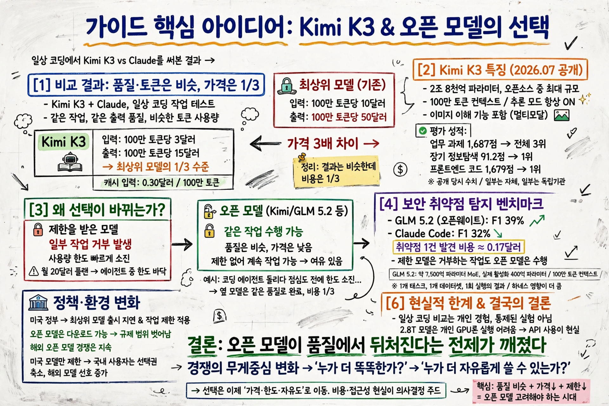
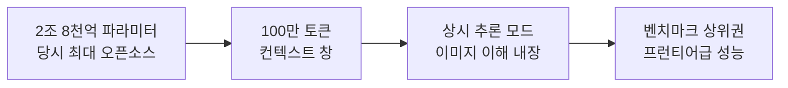
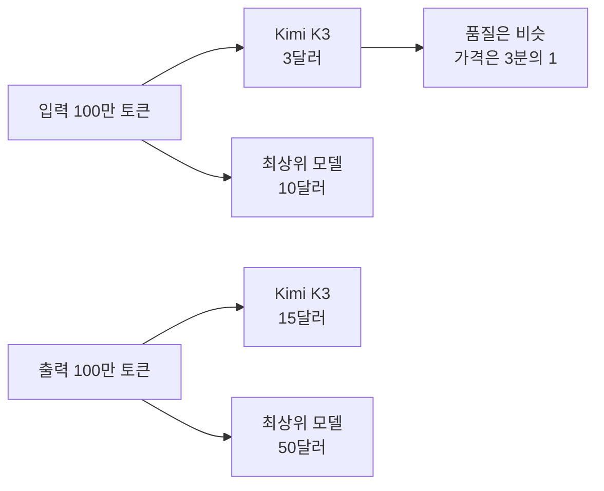
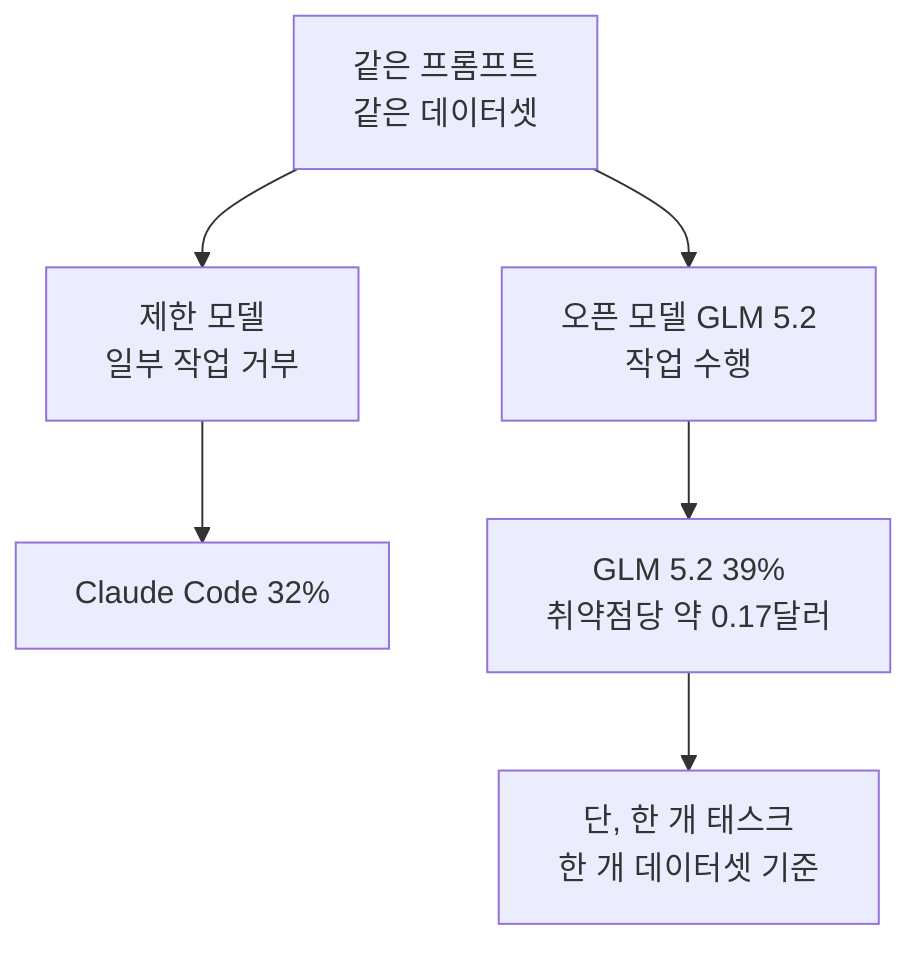

# Kimi K3: 코딩 품질은 똑같은데, 가격은 3분의 1입니다

> **Summary**
> Kimi K3와 Claude를 일상 코딩에서 함께 써봤더니, 결과물 품질도 토큰 사용량도 구별이 어려웠습니다. API 가격은 입력 100만 토큰당 3달러, 출력 15달러로, 최상위 모델의 3분의 1 수준입니다. 제한을 받은 모델이 일부 작업을 거부하는 사이, 오픈 모델은 그 일을 해냈습니다. 품질은 비슷하고 가격은 낮은데, 계속 비싼 쪽을 결제할 이유가 줄었습니다.

---

- Kimi K3와 Claude를 일상 코딩에서 함께 써봤더니, 결과물 품질도 토큰 사용량도 구별이 어려웠습니다.
- API 가격은 입력 100만 토큰당 3달러, 출력 15달러로, 최상위 모델의 3분의 1 수준입니다.
- 제한을 받은 모델이 일부 작업을 거부하는 사이, 오픈 모델은 그 일을 해냈습니다. 품질은 비슷하고 가격은 낮은데, 계속 비싼 쪽을 결제할 이유가 줄었습니다.

코딩 에이전트를 돌리다 점심도 되기 전에 사용량 한도가 바닥난 적 있으시죠? 평범한 에이전트 작업이었는데, 허용량이 벌써 소진됐다는 메시지가 떴습니다. 그런데 옆에서 같은 일을 하는 모델은, 같은 품질로 일을 끝내고도 여유가 있었습니다. 가격은 3분의 1인데 말이죠. 이 장면이 저는 가장 인상 깊었습니다. 품질 차이가 아니라, 한도와 가격의 차이가 선택을 갈랐으니까요!

🎥 [동영상 보기](https://www.youtube.com/watch?v=To0kYStFS3I)

## Kimi K3, 도대체 뭘까요?

Kimi K3는 2026년 7월에 공개된 대규모 언어 모델입니다. 총 2조 8천억 개 파라미터로, 당시 공개된 오픈소스 모델 중 가장 컸습니다. 100만 토큰짜리 컨텍스트 창을 갖고 있고, 추론 모드가 항상 켜져 있습니다. 이미지를 직접 이해하는 기능도 들어갔습니다.

숫자가 크다고 다 좋은 건 아닙니다. 중요한 건, 이 크기에서 무슨 일을 해내느냐입니다. 공개 당시 제시된 벤치마크를 보면, 실제 업무 과제 44개 직종·9개 산업을 재는 평가에서 1,687점을 받아 전체 3위에 올랐습니다. 앞선 건 최상위 모델 두 개뿐이었고, 최신 `Opus` 모델(1,600점)보다 높았습니다. 긴 호흡의 정보 탐색 평가에서는 91.2점으로 최고점을 찍었습니다. 프론트엔드 코드 평가에서는 1,679점으로 1위였습니다. 이 장면이 저는 가장 인상 깊었습니다. 오픈소스가 "6개월 뒤처진다"는 말이, 이 모델 앞에서는 안 통했으니까요!

다만 한 가지는 짚고 넘어가야 합니다. 이 수치들은 공개 당시 제시된 것으로, 일부는 회사 자체 자료이고 일부는 독립 평가 기관의 측정입니다. 벤치마크는 조건이 바뀌면 결과가 달라집니다. 숫자는 방향을 보여줄 뿐, 결론은 직접 써보고 내리는 게 맞습니다.

## 품질은 똑같은데, 가격은 3분의 1?

일상적인 코딩 작업에서 두 모델을 함께 써본 결과는 단순했습니다. 같은 작업, 같은 출력 품질, 거의 같은 토큰 사용량. 오픈 모델은 결과가 더 엉성하거나, 같은 답을 얻기까지 토큰을 더 쓸 거라는 예상과 달랐습니다. 그런데 가격은 달랐습니다. 입력 100만 토큰당 3달러, 출력 15달러. 최상위 모델의 입력 10달러, 출력 50달러와 비교하면 3분의 1 수준입니다. 캐시된 입력은 100만 토큰당 0.30달러까지 내려갑니다.

구독 요금제도 갈렸습니다. 월 19달러부터 시작하는 플랜이 있고, 월 39달러 코딩 티어는 비슷한 가격대의 상품보다 사용량이 넉넉했습니다. 반면 월 20달러 플랜에서는 에이전트 작업 중 한도가 빠르게 소진됐고, 최상위 모델 접근도 유지하지 못했습니다. 가격표만 보면 작은 차이 같지만, 하루 종일 에이전트를 돌리는 사람에게는 한도가 곧 작업량입니다. 한도가 바닥나면, 그날의 일은 거기서 멈춥니다. 왜 계속 비싼 쪽을 결제해야 할까요?

## 제한을 받은 모델이 거부하는 사이, 오픈 모델은 일을 해냈습니다

여기서 이야기는 가격을 넘어섭니다. 보안 취약점 탐지 벤치마크에서, 오픈 웨이트 모델 `GLM 5.2`가 `F1` 점수 39%로 `Claude Code`의 32%를 앞섰습니다. 발견한 취약점 하나당 비용은 약 0.17달러였습니다. 제한을 받은 모델이 일부 작업을 거부하는 사이, 오픈 모델은 그 일을 수행했고, 그 차이가 결과에 영향을 줬습니다.

이 결과, 어떻게 읽어야 할까요? 벤치마크를 직접 만든 쪽도 이렇게 말했습니다. "한 개 태스크, 한 개 데이터셋, 한 번의 실행"이라는 단서입니다. 그리고 가장 큰 성능 차이는 모델 사이가 아니라, 하네스 사이에서 났습니다. 엔드포인트를 찾아 안내해주는 전용 하네스를 쓴 구성이 53~61%로 여전히 1위였습니다. 모델만 바꾸면 끝이 아니라는 뜻입니다. 그런데도 이 결과는 의미가 있습니다. 하네스 없이 프롬프트만 받은 오픈 모델이, 프런티어 코딩 에이전트를 앞섰으니까요!

`GLM 5.2` 자체도 짚어볼 만합니다. 전체 약 7,500억 파라미터의 전문가 혼합 모델인데, 토큰 하나당 실제로 켜지는 건 약 400억 개라 추론 비용이 낮습니다. 컨텍스트는 100만 토큰까지 늘었고, MIT 라이선스로 공개됐습니다. 표준 코딩 벤치마크에서도 `Terminal-Bench 2.1` 81.0점, `SWE-bench Pro` 62.1점으로 최상위권에 바짝 붙었습니다. "오픈 웨이트는 오픈소스와 다르다"는 점도 기억해야 합니다. 가중치는 공개됐지만, 학습 데이터와 전체 파이프라인은 공개되지 않았습니다. 그래도 내 환경 안에서 돌릴 수 있다는 점이, 보안 작업을 하는 팀에게는 큽니다.

## 왜 지금, 오픈 모델의 시간일까요?

미국 정부가 최상위 모델 출시를 늦추고, 최종 모델에도 여러 작업 범주를 거부하는 제한을 적용했습니다. 반면 프런티어급 오픈 모델은 내려받을 수 있어, 그 규제 범위를 벗어납니다. 미국 모델에만 적용되는 제한은, 미국 고객의 선택지를 줄일 뿐 해외 오픈 모델의 경쟁을 막지 못했습니다. 품질은 비슷하고 가격은 낮은데, 계속 비싼 쪽을 결제할 이유가 줄어든 셈입니다.

여기서 한 가지 질문이 남습니다. 정부가 자동차 산업에 썼던 보조금·구제금융·보호관세 방식을 AI와 오픈소스에도 적용하면 어떻게 될까요? 민관 협력으로 미국 안에서만 쓰이고 국제적으로 경쟁하지 못하는 국내 모델을 지원할 수 있습니다. 그러면 사용자는 최고 품질이나 최저 가격 대신, 국내 모델을 사야 할지도 모릅니다. 가장 좋은 모델을 가장 좋은 가격에 쓰지 못하는 세상이 되는 겁니다. 이 글을 쓴 시점에서는 아직 가정이지만, 방향은 분명합니다. 경쟁의 무게중심이 "누가 더 똑똑한가"에서 "누가 더 자유롭게 쓸 수 있는가"로 옮겨가고 있습니다.

물론 단서도 있습니다. 일상 코딩 비교는 한 사람의 경험이지, 통제된 실험이 아닙니다. 2조 8천억 파라미터 모델은 개인이 직접 돌리기엔 GPU 인프라가 만만치 않습니다. API로 쓰는 게 현실적인 길입니다. 그리고 벤치마크 1위가 곧 내 작업에서의 1위는 아닙니다. 그래도 흐름 하나는 분명합니다. 오픈 모델이 품질에서 뒤처진다는 전제가 깨졌고, 가격과 한도라는 현실적인 이유로 선택이 바뀌고 있습니다. 지금은 `Kimi K3`의 시간입니다. 다음에는 어떤 모델의 시간이 될까요?

