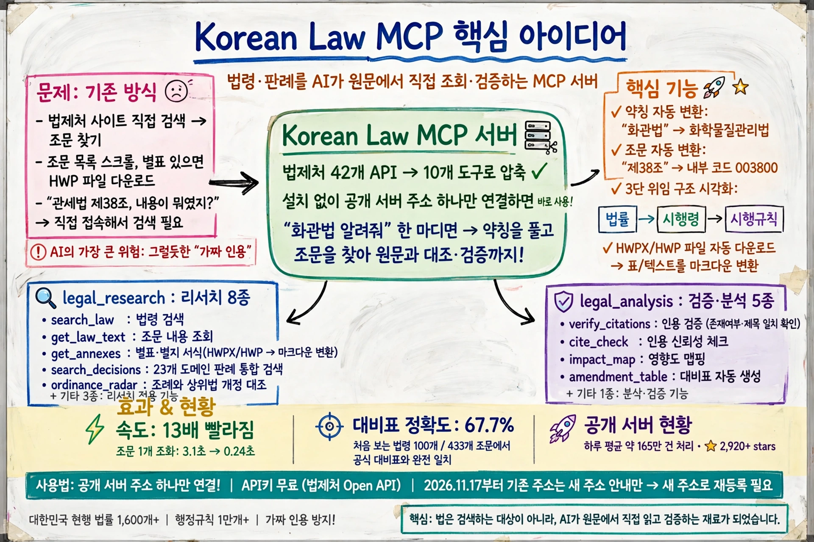
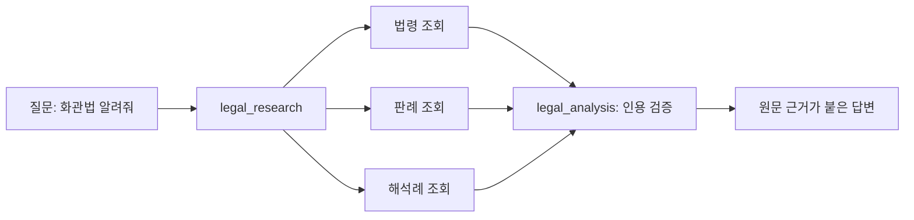
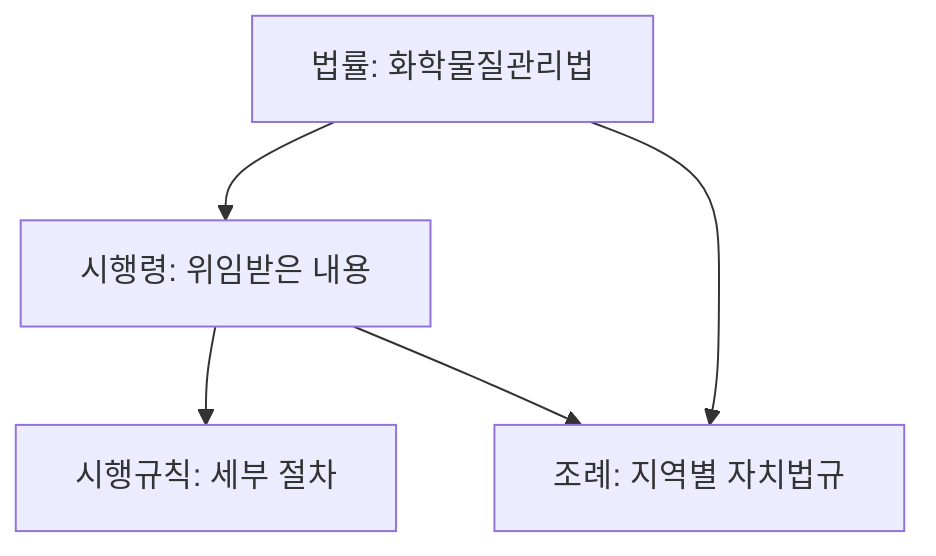
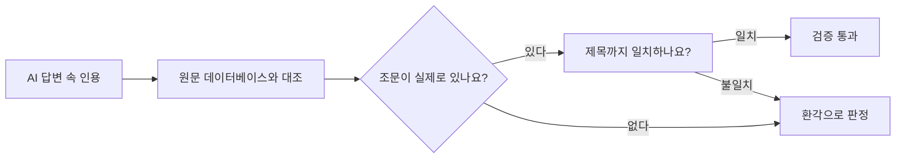

# Korean Law MCP: 법령을 검색하는 게 아니라, AI에게 법령을 직접 물어보면 됩니다

> **Summary**
> Korean Law MCP는 법제처 42개 API를 10개 도구로 묶어, AI 어시스턴트가 대한민국 법령·판례를 원문 그대로 조회하게 만드는 MCP 서버입니다. '화관법 알려줘' 한 마디면 약칭을 풀고 조문을 찾아오고, AI 답변의 인용이 진짜인지 원문과 대조해 검증까지 해줍니다. 설치 없이 공개 서버 주소 하나만 연결하면 바로 쓸 수 있고, 도구는 64개에서 10개로 압축되며 더 빨라졌습니다.

---

- Korean Law MCP는 법제처 42개 API를 10개 도구로 묶어, AI 어시스턴트나 스크립트가 대한민국 법령·판례를 원문 그대로 조회하게 만드는 MCP 서버입니다.
- "화관법 알려줘" 한 마디면 약칭을 풀고 조문을 찾아오고, AI 답변의 인용이 진짜인지 원문과 대조해 검증까지 해줍니다.
- 설치 없이 공개 서버 주소 하나만 연결하면 바로 쓸 수 있고, 도구는 64개에서 10개로 압축되며 더 빨라졌습니다.

"관세법 제38조, 내용이 뭐였지?"

이런 질문이 생기면 어떻게 하시나요? 법제처 사이트에 들어가서 검색창에 법 이름을 치고, 조문 목록을 스크롤하고, 별표가 있으면 HWP 파일을 내려받아 열어봐야 했습니다. 한 조문 확인하는 데만 몇 분씩 걸리는 일이었죠. 그런데 이제는 AI에게 말 한 마디로 물어보면 됩니다!

🎥 [동영상 보기](https://www.youtube.com/watch?v=gmkuOqIV3dc)

## 법이 너무 많아서, 사람이 다 외울 수 있을까요?

대한민국 현행 법률만 1,600개가 넘습니다. 행정규칙은 1만 개가 넘고, 판례와 해석례까지 합치면 규모는 더 커집니다. 법제처 사이트 한 곳에 다 모여 있지만, 프로그램에서 쓰기는 어려웠습니다. 검색은 사람이 직접 해야 했고, AI는 법을 "아는 척"하며 없는 조문을 만들어내기도 했습니다.

> AI가 법을 답할 때 가장 무서운 건 틀린 답이 아니라, 그럴듯한 가짜 인용입니다.

이 도구는 그 지점을 정면으로 찔렀습니다. 법령 체계 전체를 10개 도구로 감싸서 AI가 원문을 직접 조회하게 만든 것입니다.

## 10개 도구는 어떻게 돌아갈까요?

핵심은 두 개의 묶음 도구입니다. `legal_research`는 리서치 8종을 한 번에 처리합니다. 종합 리서치부터 법체계 분석, 처분 근거 확인, 쟁송 대비, 개정 추적, 조례 비교, 절차 안내, 문서 검토까지, 질문의 종류에 따라 알아서 단계를 밟습니다. `legal_analysis`는 검증과 분석 5종을 맡습니다.

개별 도구도 있습니다. `search_law`로 법령을 찾고, `get_law_text`로 조문 전문을 읽고, `get_annexes`로 별표와 서식을 가져옵니다. 판례는 `search_decisions` 하나로 23개 도메인을 통합 검색합니다. 조례가 상위법 개정과 맞는지 자동으로 대조해주는 `ordinance_radar`도 있습니다.

## 약칭도, 조문번호도 알아서 풀어줍니다!

법률 도메인 특화가 이 도구의 진짜 매력입니다! "화관법"이라고만 말해도 `화학물질관리법`으로 알아서 바꿉니다. "제38조"는 내부 코드 `003800`으로 변환해 조회합니다. 법률·시행령·시행규칙으로 이어지는 3단 위임 구조도 그려서 보여줍니다.

별표와 별지서식은 더 까다로운 부분입니다. 별표 내용은 HWPX나 HWP 파일 안에 표로 들어 있는 경우가 많습니다. 이 도구는 파일을 자동으로 내려받아 표와 텍스트를 마크다운으로 변환해 줍니다. "산업안전보건법 별표1 내용 알려줘"라는 질문에 파일 열어볼 필요 없이 답이 나옵니다.

## AI 답변, 원문과 대조해 검증합니다?

AI가 법을 답할 때 가장 위험한 건 없는 조문을 지어내는 환각입니다. `verify_citations`는 답변 속 조문과 판례 번호가 실제로 존재하는지, 제목이 맞는지 법제처 데이터베이스와 대조합니다. 판례가 뒤집혔는지 추적하는 `cite_check`, 조문이 다른 조문에 미치는 영향을 그래프로 그리는 `impact_map`, 신구조문대비표를 만드는 `amendment_table`까지 갖췄습니다.

대비표 정확도도 실측으로 공개했습니다. 처음 보는 법령 100개, 조문 433개에서 공식 대비표와 완전 일치한 비율이 67.7%였습니다. 속도는 조문 1개 조회가 3.1초에서 0.24초로, 13배 빨라졌습니다.

## 설치 없이 바로 쓸 수 있을까요?

공개 서버 주소 하나만 연결하면 됩니다! 클로드나 챗지피티, 커서 같은 AI 앱에서 커넥터로 주소를 추가하면 끝입니다. API 키는 법제처 Open API에서 무료로 발급받습니다. 키 없이도 공용 한도로 쓸 수 있고, 내 컴퓨터에 직접 설치하는 방법도 있습니다. 터미널에서는 `npx korean-law-mcp setup` 한 줄이면 설정이 끝나고, `korean-law "민법 제1조"`처럼 명령어로 바로 조회할 수도 있습니다.

한 가지 주의할 점이 있습니다. 2026년 11월 17일부터 예전 원격 주소는 법령을 조회하지 않고 새 주소 안내만 돌려줍니다. 서버가 국내 공공 클라우드로 옮겼기 때문입니다. 예전 주소를 쓰고 있었다면 새 주소로 다시 등록해야 합니다. 도구와 사용법은 그대로입니다.

지금 이 공개 서버는 MCP 5종 합계로 하루 평균 약 165만 건의 요청을 처리하고 있습니다. 별은 2,920개를 넘겼습니다. 법을 찾는 일이 AI의 기본기가 되는 속도, 생각보다 빠릅니다!

법은 검색하는 대상이 아니라, AI가 원문에서 직접 읽고 검증하는 재료가 되었습니다. 다음에 법이 궁금해지면, 사이트 메뉴를 뒤적이기 전에 AI에게 물어보는 게 먼저일지도 모릅니다.

