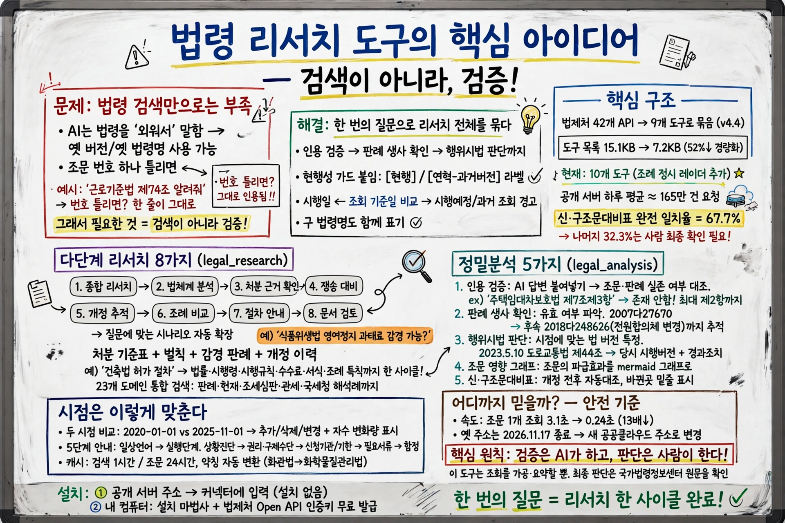
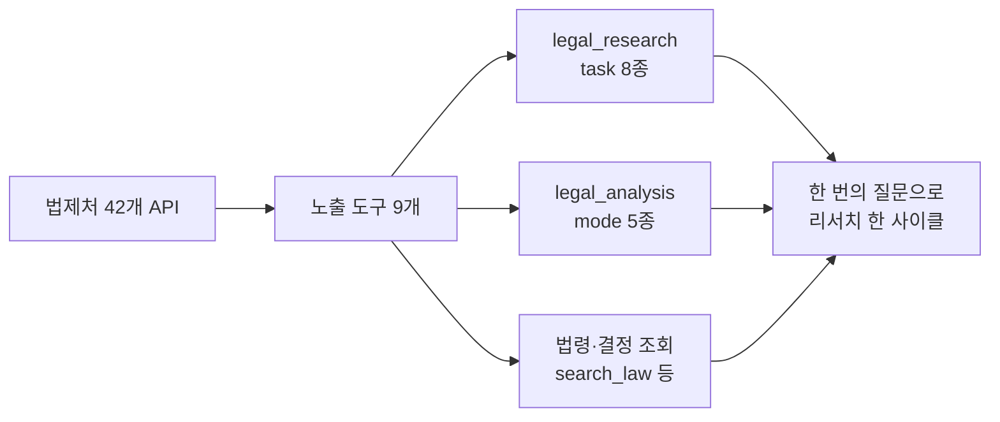
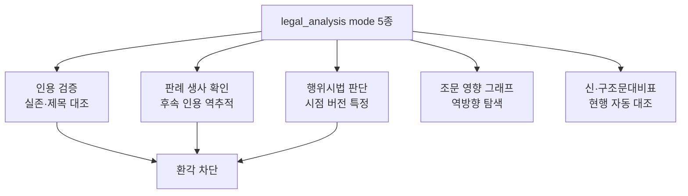
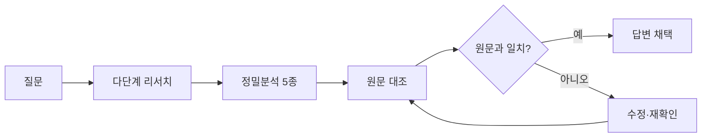

# Korean Law MCP: 법령을 찾는 게 아닙니다. 판례가 살아있는지까지 검증합니다

> **Summary**
> 법령 검색만으로는 AI 답변의 인용이 진짜인지 알 수 없습니다. 이 도구는 인용 검증부터 판례 생사 확인까지, 리서치 전체를 한 번의 질문으로 묶었습니다. 법제처 42개 API를 9개 도구로 묶은 v4.4 구조가 뼈대입니다. 다단계 리서치 8가지와 정밀분석 5가지가 그 위에서 돕니다. 지금은 10개 도구까지 늘었고, 공개 서버는 하루 평균 약 165만 건의 요청을 받습니다. 다만 대비표 완전 일치율은 67.7%라, 최종 판단은 원문에서 확인해야 합니다.

---

- 법령 검색만으로는 AI 답변의 인용이 진짜인지 알 수 없습니다. 이 도구는 인용 검증부터 판례 생사 확인까지, 리서치 전체를 한 번의 질문으로 묶었습니다.
- 법제처 42개 API를 9개 도구로 묶은 v4.4 구조가 뼈대입니다. 다단계 리서치 8가지와 정밀분석 5가지가 그 위에서 돕니다.
- 지금은 10개 도구까지 늘었고, 공개 서버는 하루 평균 약 165만 건의 요청을 받습니다. 다만 대비표 완전 일치율은 67.7%라, 최종 판단은 원문에서 확인해야 합니다.

AI에게 "근로기준법 제74조 알려줘"라고 물어본 적 있으시죠? 답은 그럴듯하게 돌아옵니다. 그런데 조문 번호 하나가 틀려 있으면 어떨까요? 그 한 줄이 그대로 보고서에 들어갑니다. 법령은 숫자가 곧 근거라, 틀린 번호 하나가 답변 전체를 무너뜨립니다. 그래서 검색이 아니라 검증이 필요합니다!

🎥 [동영상 보기](https://www.youtube.com/watch?v=KaUKLOH7290)

## 검색은 왜 부족할까요?

AI는 법령을 외워서 말하지 않습니다. 학습 데이터 속 옛 버전을 현행인 양 내놓기도 하고, 개정된 법령명을 옛 이름 그대로 쓰기도 합니다. 그래서 이 도구는 검색 결과에 현행성 가드를 붙였습니다. 결과에 `[현행]`과 `[연혁-과거버전]` 라벨을 달고, 시행일과 조회 기준일을 비교해 시행 예정이나 과거 조회를 경고합니다. 구 법령명도 함께 표기합니다. 검색이 아니라, 검색 결과에 안전장치를 단 셈입니다.

## 42개 API가 9개 도구로 묶이면 뭐가 달라지나요?

v4.4.0에서 노출 도구가 19개에서 9개로 줄었습니다. 도구 목록이 약 15.1KB에서 약 7.2KB로, 52% 가벼워졌습니다. 매 세션 AI가 읽어야 하는 도구 목록이 절반으로 줄었다는 뜻입니다. 8개 체인은 `legal_research`의 task로, 4개 킬러 기능은 `legal_analysis`의 mode로 들어갔습니다. 기존 도구명을 직접 불러도 그대로 동작하니 하위 호환은 유지됩니다. 지금은 조례 정비 레이더가 더해져 10개 도구가 됐습니다. 클립 기준 9개에서 하나 늘어난 셈입니다.

## 다단계 리서치, 어떻게 돌아가나요?

`legal_research`는 task 8종입니다. 종합 리서치, 법체계 분석, 처분 근거 확인, 쟁송 대비, 개정 추적, 조례 비교, 절차 안내, 문서 검토까지. 질문에 맞는 시나리오 확장이 자동으로 붙습니다. "식품위생법 영업정지 과태료 감경 가능?"이라고 물으면 처분 기준표와 벌칙 조항, 감경된 행정심판 사례, 개정 이력까지 함께 나옵니다. "건축법 허가 절차"를 물으면 법률부터 시행령·시행규칙, 수수료·서식, 조례 특칙까지 이어집니다. 한 번의 질문이 리서치 한 사이클이 됩니다! 23개 도메인 통합 검색이 받쳐줍니다. 판례·헌재·조세심판·관세·국세청 해석례까지 한 번에 봅니다.

## 정밀분석 5가지, 무엇이 다른가요?

`legal_analysis`는 mode 5종입니다. 인용 검증, 판례 생사 확인, 행위시법 판단, 조문 영향 그래프, 신·구조문대비표입니다.

**인용 검증**은 AI 답변을 통째로 붙여넣으면 조문·판례 번호가 실제로 있는지, 제목이 맞는지 대조합니다. 예시 하나가 인상 깊었습니다. 주택임대차보호법 제7조 제3항은 존재하지 않는다고 찍어냅니다. 최대 제2항까지만 있다는 범위까지 함께 알려줍니다.

**판례 생사 확인**은 판례가 아직 유효한지 봅니다. 2007다27670이 유효한지 물으면, 그 사건번호를 인용한 후속 판례를 본문 검색으로 거슬러 찾습니다. 전원합의체가 "변경하기로 한다"고 선언한 2018다248626을 잡아냅니다. 판결문이 사건번호 대신 "2008년 전원합의체 판결"이라는 별칭으로 선언하는 관행까지 추적합니다. 변경된 판례를 살아있는 것처럼 인용하는 사고를 막는 장치입니다!

**행위시법 판단**은 시점을 맞춥니다. "2023.5.10 당시 도로교통법 제44조"를 물으면 그날 시행 중이던 버전을 특정하고, 현행과 비교한 뒤 이후 개정 부칙의 적용례와 경과조치를 발췌합니다. LLM이 현행법으로 오답하는 구조를 차단합니다.

**조문 영향 그래프**는 조문 한 줄의 파급효과를 그립니다. 민법 제103조를 인용한 판례·헌재 결정·자치법규를 역방향으로 탐색하고, 조문이 인용한 법령은 정방향으로 이어 mermaid 그래프 코드를 만듭니다.

**신·구조문대비표**는 개정 조문 전문을 넣으면 현행과 자동으로 대조합니다. 바뀐 곳에 밑줄을 긋고, 같은 부분은 줄로 표시합니다.

## 시점은 어떻게 맞추나요?

두 가지 도구가 시점을 다룹니다. **두 시점 비교**는 임의의 두 시점 본문을 조문 단위로 비교합니다. 개인정보보호법 2020-01-01 대 2025-11-01처럼요. 추가·삭제·변경으로 분류하고 자수 변화량까지 보여줍니다. **5단계 안내**는 "전세금 못 받았어" 같은 평소 말투를 실행 가능한 단계로 바꿉니다. 상황 진단부터 권리·구제수단, 신청기관·기한, 필요서류, 함정까지. 검색은 1시간, 조문은 24시간 캐시가 돕니다. 약칭도 알아듣습니다. `화관법`이라고 쓰면 `화학물질관리법`으로 풀어서 검색합니다.

## 어디까지 믿으면 될까요?

숫자부터 짚어보겠습니다. 신·구조문대비표는 처음 보는 100개 법령 433조문에서 공식 대비표와 완전 일치한 비율이 67.7%였습니다. 구조 불일치 3.9%를 빼면, 나머지 구간은 사람이 확인해야 한다는 뜻입니다. 조문 1개 조회는 3.1초에서 0.24초로, 13배 빨라졌습니다. 공개 서버는 하루 평균 약 165만 건의 요청을 받습니다. 다만 이 수치는 MCP 5종 합계이고 연결 과정 요청까지 포함한 실측이라, 이용자 수와는 다릅니다. 옛 원격 주소는 2026년 11월 17일에 종료됐고, 지금은 국내 공공 클라우드 주소로 옮겼습니다. 오래된 설정은 새 주소로 바꿔야 합니다. 그리고 한 가지는 분명합니다. 법적 효력이 필요한 판단은 국가법령정보센터 원문을 직접 확인해야 합니다. 이 도구는 조회를 가공·요약할 뿐입니다. 검증은 AI가 하고, 판단은 사람이 하는 구조입니다!

설치는 두 가지 길입니다. 설치 없이 쓰려면 공개 서버 주소를 커넥터에 넣으면 되고, 내 컴퓨터에서 직접 돌리려면 `npx korean-law-mcp setup` 명령으로 설치 마법사를 거치면 됩니다. 법제처 Open API 인증키는 무료로 발급받습니다. 마켓플레이스에서 검색해 설치하는 방법도 있습니다.

법령 검색은 시작일 뿐입니다. 인용이 진짜인지, 판례가 살아있는지, 그날의 법이 맞는지까지 확인해야 리서치가 끝납니다. 그 확인을 한 번의 질문에 묶은 게 이 도구의 역할입니다.

