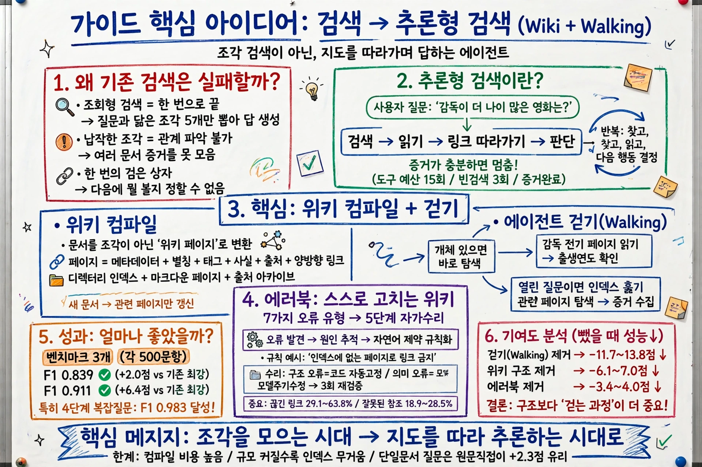
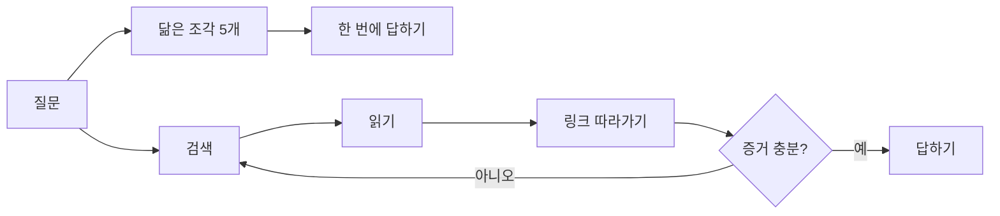
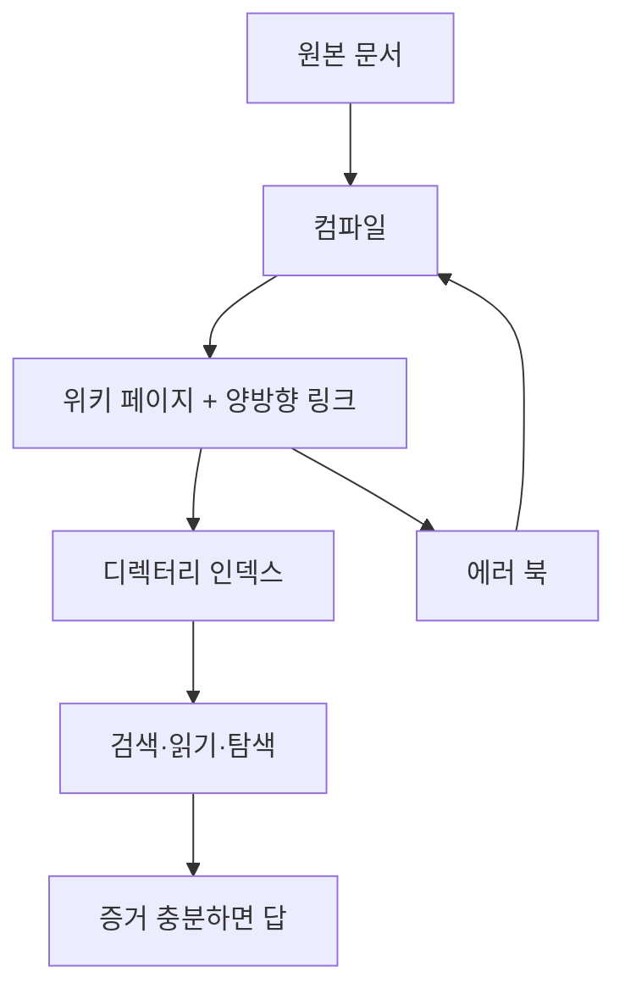
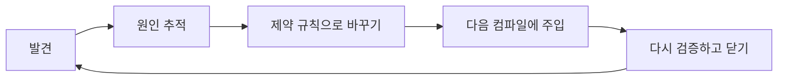

# LLM-Wiki: 검색은 한 번으로 끝나지 않습니다. 위키로 엮으면 에이전트가 추론하며 찾아갑니다

> **Summary**
> LLM-Wiki는 문서를 양방향 링크와 출처가 있는 위키 페이지로 구성하고, 에이전트가 검색·읽기·링크 탐색을 반복하며 증거를 모아 답하도록 합니다. 세 벤치마크에서 기존 방법보다 높은 성능을 보였으며, 특히 탐색 과정이 큰 성과를 냈고 에러 북을 통한 자동 검증·수정으로 위키의 오류를 줄입니다. 다만 초기 구축 비용이 크고, 대규모·단일 문서 질문에는 한계가 있습니다.

---

- 검색은 한 번으로 끝나지 않습니다. 에이전트는 찾고, 읽고, 링크를 따라가고, 증거가 충분한지 스스로 판단합니다.
- 이 논문의 시스템은 문서를 잘게 쪼개 벡터에 넣는 대신, 양방향 링크가 있는 위키 페이지로 컴파일합니다. 검색·읽기·링크 따라가기를 도구로 내놓습니다.
- 세 개 벤치마크에서 기존 방법보다 2.0~8.1점 높았고, 걷는 과정을 빼면 11.7~13.8점이 떨어졌습니다. 위키 구조보다 걷는 과정이 더 컸습니다.

에이전트에게 복잡한 질문을 던졌는데, 답은 맞았는데 근거가 엉뚱한 적 있으시죠? "감독이 더 나이 많은 영화는 어느 쪽일까요?" 같은 질문이 그렇습니다. 영화 두 편을 찾았다고 끝이 아닙니다. 감독 전기 페이지에 있는 출생 연도까지 가야 답이 나옵니다. 그런데 닮은 조각만 골라 오는 검색은 그 전기 페이지를 놓치기 쉽습니다. 질문과 닮지 않았거든요!

🎥 [동영상 보기](https://www.youtube.com/watch?v=aGXTV5MTqDY)

### 검색이 아니라 추론이라니, 무슨 뜻일까요?

지금의 검색은 조회에 가깝습니다. 질문이 들어오면 닮은 조각 다섯 개를 골라 앞에 놓고, 답을 만듭니다. 한 번으로 끝입니다. 이 방식을 논문은 `retrieval-as-lookup`이라고 불렀습니다. 반대로 이 논문이 제안한 방식은 `retrieval-as-reasoning`입니다. 검색 자체가 추론의 일부가 됩니다. 찾고, 읽고, 중간에 본 것을 보고 다음에 어디를 볼지 정하고, 증거가 모이면 멈춥니다.

왜 조각 검색이 복잡한 질문에 약할까요? 이유가 세 가지입니다. 첫째, 납작한 조각은 맞추는 일만 합니다. 관계를 따라가거나 여러 문서의 증거를 모으는 일에는 약합니다. 둘째, 검색이 한 번의 검은 상자라서 에이전트가 다음에 뭘 볼지 정할 수 없습니다. 셋째, 지식이 쌓일수록 틀어집니다. 끊긴 링크, 틀린 참조, 서로 모순되는 페이지가 생겨도 고치는 고리가 없습니다.

### 위키는 어떻게 만들어질까요?

이 시스템의 첫 번째 장치는 컴파일입니다. 원본 문서를 잘게 쪼개는 대신, 구조가 있는 위키 페이지로 바꿉니다. 페이지마다 메타데이터, 별칭, 태그, 사실, 출처, 양방향 링크가 붙습니다. 디렉터리 인덱스와 마크다운 페이지, 소스 아카이브가 한 세트입니다. 사람이 읽어도 되고, 에이전트가 돌아다녀도 됩니다. 새 문서가 들어오면 위키 전체를 다시 짓지 않고, 관련 페이지만 골라 갱신합니다.

두 번째 장치는 도구입니다. 에이전트는 `wiki_search`와 `wiki_read` 두 가지 도구를 씁니다. 검색은 페이지 이름·별칭·태그 같은 구조 신호를 먼저 봅니다. 읽기는 인덱스나 페이지 전체를 가져오고, 페이지 안의 링크가 다음 걸음이 됩니다. 걷는 길은 두 가지입니다. 아는 개체가 있으면 바로 찾아 읽고, 열린 질문이면 인덱스부터 훑어봅니다. 답은 증거가 충분해졌을 때, 도구 예산 15회가 찼을 때, 빈 검색이 3번 이어졌을 때 멈춥니다.

### 틀린 위키는 누가 고칠까요?

이 글에서 가장 마음에 들었던 부분입니다. 위키는 사람이 고치는 게 아닙니다. 스스로 고칩니다. 그 장치가 에러 북입니다. 컴파일된 위키에는 틀린 곳이 생깁니다. 끊긴 링크, 빠진 문단, 잘못된 참조, 없는 페이지를 덮어쓴 흔적, 근거 없는 사실, 페이지끼리 모순되는 내용까지 일곱 가지 오류 유형이 정리됐습니다. 이 중 끊긴 링크가 전체 오류의 29.1~63.8%, 잘못된 참조가 18.9~28.5%였습니다. 링크와 출처 검증이 위키 건강의 핵심이라는 뜻입니다!

에러 북은 다섯 단계를 돕니다. 오류를 발견하고, 원인을 추적하고, 원인을 자연어 제약 규칙으로 바꾸고, 다음 컴파일 프롬프트에 넣어주고, 나중에 다시 검증해서 닫습니다. 규칙은 `error_book.yaml` 파일에 쌓입니다. "인덱스에 없는 페이지로는 링크를 만들지 않는다" 같은 문장입니다. 수리도 두 겹입니다. 구조 오류는 코드가 매번 고치고, 사실·모순 같은 의미 오류는 일정 주기로 모델이 고칩니다. 마무리에는 세 번을 오가며 새로 생긴 오류까지 잡습니다.

### 숫자는 얼마나 좋았을까요?

벤치마크 세 개에서 각 500문항씩 쟀습니다. 결과는 이렇습니다. `HotpotQA`에서 F1 0.839, `MuSiQue`에서 0.739, `2WikiMultiHopQA`에서 0.911입니다. 가장 강한 기존 방법과 비교하면 각각 2.0점, 8.1점, 6.4점 높습니다. 특히 `MuSiQue`에서는 일반 밀집 검색보다 12.9점이나 높았습니다. 단계가 깊어질수록 격차가 벌어졌습니다. 4단계 질문에서는 F1 0.983까지 올랐습니다. 여러 문서를 모아야 하는 질문에서도 강했습니다.

어느 부품이 얼마나 기여했을까요? 걷는 과정을 빼면 11.7~13.8점이 떨어졌습니다. 위키 구조를 빼고 납작한 조각으로 바꾸면 6.1~7.0점이 떨어졌습니다. 에러 북을 빼면 3.4~4.0점이 떨어졌습니다. 구조도 중요했지만, 구조 위를 걷는 과정이 더 중요했습니다. 좋은 지도보다, 지도를 읽고 길을 찾는 과정이 승부를 갈랐습니다!

### 어디까지 믿으면 될까요?

단서도 분명히 적혀 있습니다. 첫째, 만드는 비용입니다. 컴파일은 조각을 자르고 임베딩하는 방식보다 비쌉니다. 한 번 드는 비용이라 나중에 질문이 쌓이면 분산되지만, 처음 짓는 값은 큽니다. 둘째, 규모입니다. 위키가 수만 페이지가 되면 인덱스가 무거워지고 페이지 고르기가 흐려집니다. 웹 규모나 자주 바뀌는 말뭉치는 앞으로 풀어야 할 숙제로 남았습니다. 셋째, 단일 문서 질문에서는 다른 방법이 2.3점 앞섰습니다. 한 문서 안에서 답이 나오는 질문은 원문을 직접 가져오는 쪽이 유리했습니다.

그리고 정직하게 밝혀둘 점이 있습니다. 원문 포스트는 직접 읽지 못했습니다. 이 글은 논문 전문을 1차 원본으로 삼아 썼습니다. 벤치마크 수치도 제공된 문맥 안에서 잰 결과라, 전체 위키피디아를 뒤진 결과가 아닙니다. 논문은 위키를 만드는 연구이지, 바로 설치해서 쓰는 도구가 아닙니다. 저장소나 실행 방법이 함께 공개된 형태가 아니라, 설계와 실험이 본체입니다.

이 점이 위키 가족과 다른 지점입니다. 한 연구자가 제안한 패턴 자체를 다룬 글도 있고, 교환 형식을 다룬 글도 있고, 문서를 자동 생성하는 도구를 다룬 글도 있습니다. 이 글은 그 패턴을 검색 시스템으로 구현한 논문입니다. 패턴이 "위키를 만들자"에서 멈췄다면, 이 논문은 "위키 위에서 에이전트가 어떻게 추론하며 걷는가"까지 답했습니다.

지식을 쌓는 방식이 바뀌면, 에이전트가 묻는 방식도 바뀝니다. 조각을 모아 답하는 시대에서, 지도를 따라가며 답하는 시대로 넘어가는 중입니다!

