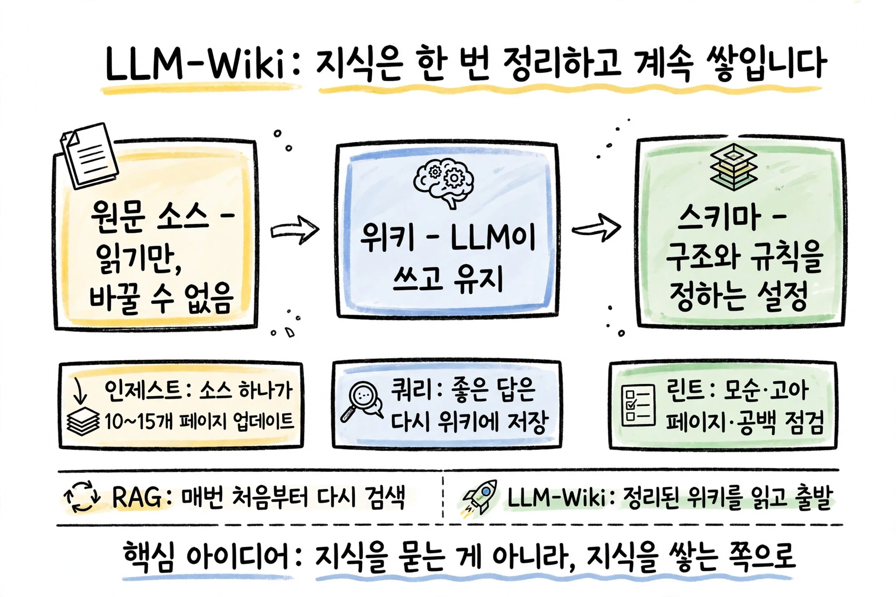
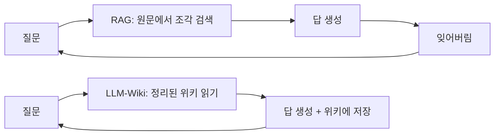
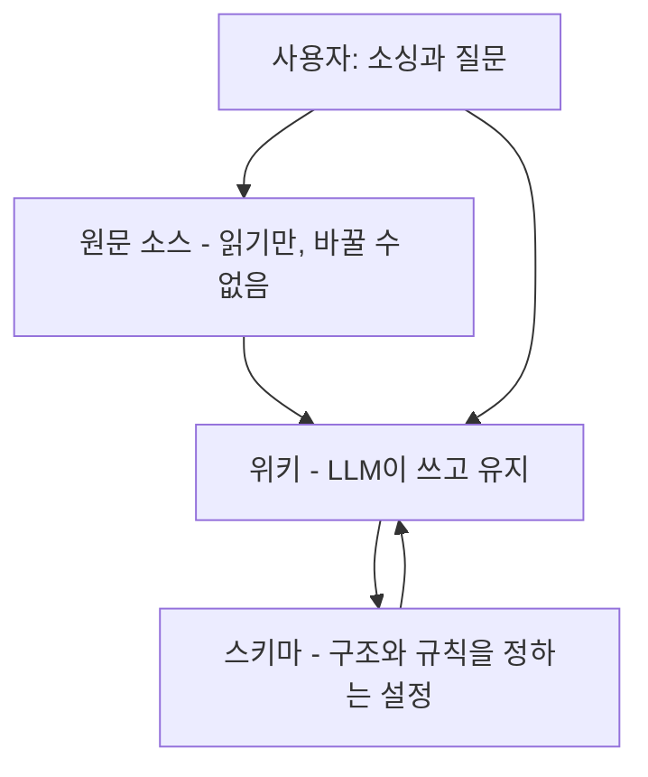
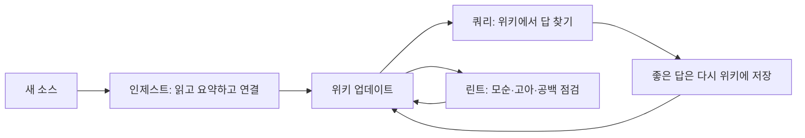

# LLM-Wiki: 매번 처음부터 다시 묻지 않습니다. 지식은 한 번 정리하고 계속 쌓입니다

> **Summary**
> LLM에게 파일을 올리고 물으면 답은 그 자리에서 끝나고 지식은 쌓이지 않지만, LLM-Wiki는 LLM이 소스를 읽고 마크다운 위키를 직접 써서 지식을 한 번 정리해 두고 계속 쌓아 올립니다. 원문 소스, 위키, 스키마 세 겹으로 나누고 인제스트·쿼리·린트 세 가지 작업만 돌리면, 소스 하나가 10~15개 페이지를 업데이트하며 개인 지식 저장소가 스스로 자랍니다. 다만 100개 소스, 수백 개 페이지 규모를 넘으면 검색 도구가 필요하고, 소스를 고르고 확인하는 일은 여전히 사람의 몫으로 남습니다.

---

- LLM에게 파일을 올리고 물으면, 답은 그 자리에서 끝나고 지식은 쌓이지 않습니다. 매번 같은 내용을 처음부터 다시 찾아야 합니다.
- LLM-Wiki는 다릅니다. LLM이 소스를 읽고 마크다운 위키를 직접 써서, 지식을 한 번 정리해 두고 계속 쌓아 올립니다.
- 원문 소스, 위키, 스키마 세 겹으로 나누고, 인제스트·쿼리·린트 세 가지 작업만 돌리면, 개인 지식 저장소가 스스로 자랍니다.

읽은 논문, 본 기사, 들은 팟캐스트. 좋은 내용을 만나면 일단 저장해 두시죠? 그런데 막상 필요할 때가 되면, 어디에 저장했는지부터 다시 찾아야 합니다. 채팅에 파일을 올리고 질문하고, 답을 받고, 다음 날 또 같은 파일을 올리고 또 묻습니다. 지식은 쌓이는 게 아니라, 매번 처음부터 다시 캐는 겁니다!

🎥 [동영상 보기](https://www.youtube.com/watch?v=it8v6GNxBDI)

### RAG는 왜 매번 처음부터 다시 물을까요?

지금 대부분의 LLM 문서 활용법은 **RAG**입니다. 파일 모음을 올리면, LLM이 질문할 때마다 관련 조각을 검색해 답을 만들어 냅니다. 노트북LM, 채팅 파일 업로드, 대부분의 RAG 시스템이 이 방식으로 돕니다. 그런데 이 방식에는 쌓이는 게 없습니다. 같은 질문을 내일 다시 하면, 같은 검색, 같은 답, 같은 망각이 반복됩니다. 지식은 컴파일되지 않습니다. 매번 원문에서 다시 뽑아내는 겁니다.

LLM-Wiki는 이 지점을 뒤집습니다. 소스는 여전히 원문 파일로 들어오지만, 그 사이에 에이전트가 유지하는 마크다운 층이 하나 더 생깁니다. 구조화된, 서로 연결된 위키입니다. 소스가 들어올 때마다 새 개념 페이지가 생기고, 기존 엔티티가 확장되고, 모순이 표시됩니다. 다음 질문은 이미 정리된 내용을 읽고 출발합니다. 위키는 **복리로 쌓입니다!**

### 위키는 세 겹으로 쌓입니다

LLM-Wiki의 구조는 세 겹입니다. 각 겹마다 주인이 따로 있습니다.

**원문 소스**가 첫 번째 겹입니다. 큐레이션한 소스 문서 모음입니다. 기사, 논문, 이미지, 데이터 파일이 들어갑니다. 이 겹은 바꿀 수 없습니다. LLM은 읽기만 하고, 고치지 않습니다. 여기가 **진실의 원천**입니다.

**위키**가 두 번째 겹입니다. LLM이 만드는 마크다운 파일 디렉터리입니다. 요약, 엔티티 페이지, 개념 페이지, 비교, 개요, 합성이 들어갑니다. 이 겹은 LLM이 완전히 소유합니다. 페이지를 만들고, 소스가 들어올 때마다 업데이트하고, 교차 참조를 유지합니다. 사용자는 읽기만 하고, LLM이 씁니다.

**스키마**가 세 번째 겹입니다. 위키의 구조, 관례, 워크플로를 LLM에게 알려주는 설정 문서입니다. 클로드 코드라면 `CLAUDE.md`, 코덱스라면 `AGENTS.md`가 이 역할을 합니다. 이 파일 하나가 LLM을 일반 챗봇이 아니라 **체계적인 위키 관리자**로 바꿉니다. 사용자와 LLM이 시간이 지나며 함께 다듬어 갑니다.

이 구조를 한 문장으로 줄이면 이렇습니다. 옵시디언은 IDE, LLM은 프로그래머, 위키는 코드베이스입니다. 화면 한쪽에는 에이전트를, 반대쪽에는 옵시디언을 열어두고, LLM이 고친 내용을 실시간으로 확인하면 됩니다.

### 소스 하나가 열다섯 페이지를 바꿉니다?

위키는 세 가지 작업으로 돕니다.

**인제스트**부터 시작합니다. 새 소스를 원문 모음에 넣고 LLM에게 처리를 지시하면, LLM이 소스를 읽고, 핵심 내용을 함께 짚고, 요약 페이지를 쓰고, 인덱스를 업데이트하고, 관련 엔티티·개념 페이지를 고치고, 로그에 한 줄을 남깁니다. 소스 하나가 **10~15개 위키 페이지**에 영향을 줄 수 있습니다. 하나씩 처리하며 관여할 수도 있고, 감독을 줄이고 일괄 처리할 수도 있습니다.

**쿼리**는 위키를 대상으로 묻는 일입니다. LLM이 관련 페이지를 찾아 인용과 함께 답을 합성합니다. 답은 마크다운 페이지, 비교 표, 슬라이드 덱, 차트 등 여러 형태가 될 수 있습니다. 좋은 답은 위키에 새 페이지로 다시 저장할 수 있습니다. 탐색 자체가 지식 베이스에 쌓입니다!

**린트**는 주기적인 건강 검진입니다. LLM에게 위키 상태를 점검해 달라고 하면, 페이지 간 모순, 최신 소스에 밀려난 낡은 주장, 들어오는 링크가 없는 고아 페이지, 페이지가 없는 중요 개념, 누락된 교차 참조, 웹 검색으로 채울 수 있는 데이터 공백을 짚어냅니다.

길잡이는 두 파일이 맡습니다. `index.md`는 위키의 모든 페이지를 링크, 한 줄 요약, 메타데이터와 함께 카탈로그화한 파일입니다. LLM은 쿼리에 답할 때 인덱스를 먼저 읽고 관련 페이지를 탐색합니다. **100개 소스, 수백 개 페이지 규모**에서는 임베딩 기반 RAG 인프라 없이도 잘 돕니다. `log.md`는 인제스트, 쿼리, 린트 통과 내역을 시간순으로 기록한 파일입니다. 항목마다 접두사를 일관되게 쓰면, 유닉스 도구로 바로 파싱할 수 있습니다.

### 어디에 쓸 수 있을까요?

적용 분야는 넓습니다. **개인**이라면 목표, 건강, 심리, 자기개발을 추적할 수 있습니다. 저널, 기사, 팟캐스트 노트를 모아 구조화된 자아 기록을 만드는 겁니다. **연구**라면 수주에서 수개월에 걸쳐 논문, 기사, 보고서를 읽으며 진화하는 테제를 담은 위키가 됩니다. **독서**라면 챕터별로 등장인물, 테마, 플롯의 실을 페이지로 엮을 수 있습니다. 수천 개의 상호 연결 페이지를 개인 독자가 구축하는 겁니다. **비즈니스와 팀**이라면 슬랙 스레드, 미팅 전사, 프로젝트 문서, 고객 통화로 LLM이 유지하는 내부 위키를 만들 수 있습니다. 경쟁 분석, 실사, 여행 계획, 강의 노트, 취미 심층 탐구까지, 지식이 시간에 걸쳐 축적되는 곳이면 어디든 쓸 수 있습니다.

### 그런데, 어디까지 믿을 수 있을까요?

정직하게 짚을 부분도 있습니다. 첫째, 규모입니다. `index.md`만으로 버티는 구간은 대략 100개 소스, 수백 개 페이지까지입니다. 그 이상 커지면 검색 도구가 필요합니다. `qmd` 같은 로컬 마크다운 검색 엔진이 그 역할을 합니다. BM25와 벡터 하이브리드 검색에 LLM 리랭킹까지, 모두 기기 안에서 돕니다. CLI와 MCP 서버로 쓸 수 있습니다.

둘째, LLM이 잘못 읽거나 모순을 만들 수 있다는 점입니다. 린트가 일부를 잡아내지만, 소스를 고르는 일과 최종 확인은 사람의 몫으로 남습니다. 위키는 소스만큼만 좋아집니다.

셋째, 이 가이드는 의도적으로 추상적으로 쓰였습니다. 특정 구현이 아니라 아이디어 자체를 전하는 게 목적입니다. 디렉터리 구조, 스키마 관례, 페이지 포맷은 도메인과 취향에 따라 달라집니다. 모든 구성 요소는 선택적이고 모듈식입니다. 필요한 것만 쓰고, 필요 없는 건 무시하면 됩니다.

이 아이디어가 낯설지 않은 이유가 있습니다. 1945년에 나온 **Memex** 구상과 정신이 이어지기 때문입니다. 개인적이고 능동적으로 큐레이션되며, 문서 간 연결이 문서 자체만큼 가치 있는 지식 저장소라는 발상이었습니다. 그때 풀지 못했던 질문, "누가 유지 관리하는가"를 이제 LLM이 맡습니다.

지식을 묻는 게 아니라, 지식을 쌓는 쪽으로. 한 번 정리한 지식은 다음 질문의 출발점이 됩니다!

