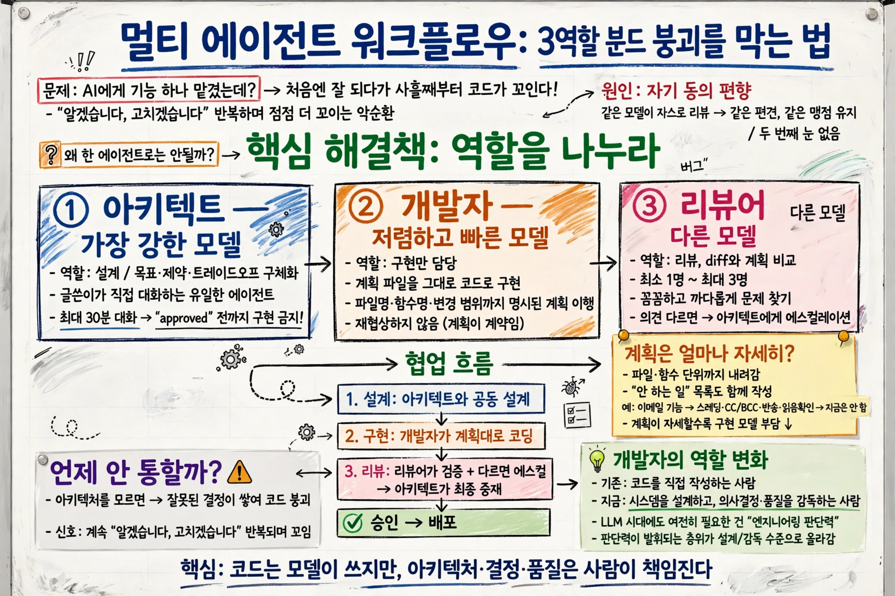
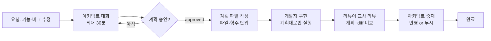
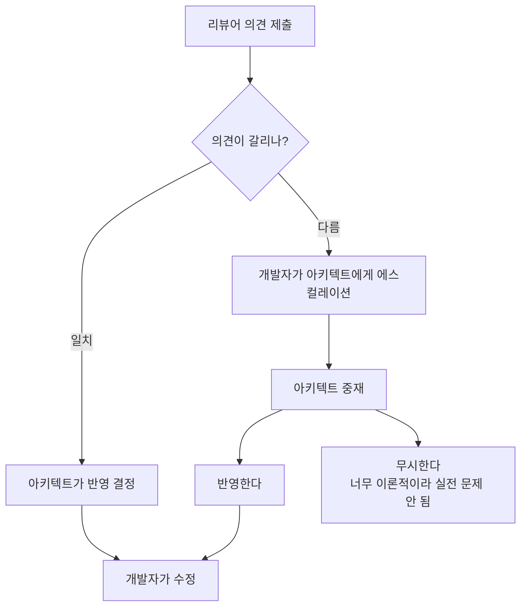
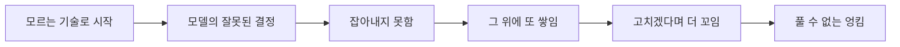

# LLM으로 수만 줄 프로젝트를 유지하는 법: 코드는 AI가 쓰고, 설계는 사람이 합니다

> **Summary**
> LLM으로 수만 줄짜리 프로젝트를 유지하는 비결은 역할 나누기에 있습니다. 강한 모델이 설계하고, 싼 모델이 계획대로 구현하고, 다른 모델들이 교차로 리뷰합니다. 코드를 직접 쓰지 않아도 되지만, 아키텍처를 알고 결정을 내리고 품질을 감독하는 사람의 판단력은 오히려 더 중요해졌습니다.

---

- AI한테 기능 하나 맡겼는데, 처음엔 잘 되다가 사흘째부터 코드가 꼬이기 시작한 적 있으시죠?
- 답은 역할 나누기에 있습니다. 설계는 강한 모델이, 구현은 싼 모델이, 리뷰는 다른 모델이 맡습니다.
- 코드를 직접 쓰지 않아도 됩니다. 대신 아키텍처를 알고, 결정을 내리고, 품질을 감독하는 사람의 판단력이 필요합니다.

AI한테 기능 하나 맡겼는데, 처음엔 잘 되다가 사흘째부터 코드가 꼬이기 시작한 적 있으시죠? "안 돼요"라고 말하면 "알겠습니다! 고치겠습니다!"라고 답하면서, 고칠수록 더 꼬이는 장면 말입니다. 한 개발자는 이 악순환을 끊는 방법을 글 한 편에 정리했습니다. 수만 줄짜리 프로젝트를 수 주간 낮은 결함률로 유지한, 아키텍트·개발자·리뷰어 세 역할의 멀티 에이전트 워크플로우입니다.

🎥 [동영상 보기](https://www.youtube.com/watch?v=ZIWWDDu02Ik)

### 왜 한 에이전트로는 안 될까요?

같은 모델에게 자기가 쓴 코드를 리뷰하게 하면, 거의 의미가 없습니다. 모델 하나를 한 사람으로 생각하면 이해가 쉬운데요. 컨텍스트를 새로 시작해도 같은 모델은 같은 의견과 같은 맹점을 가집니다. 자기 코드에 스스로 동의하는 편향, 이른바 자기 동의 편향 때문입니다!

그래서 리뷰는 반드시 다른 모델이 맡아야 합니다. 다른 모델이 봐야 진짜 "두 번째 눈"이 생깁니다. 모델마다 강점과 약점이 달라서, 잡아내는 문제도 달라지거든요. 이게 이 워크플로우의 출발점입니다.

### 세 역할은 어떻게 나뉠까요?

워크플로우는 세 역할로 나뉩니다. 아키텍트, 개발자, 리뷰어입니다. 각각 다른 모델, 다른 권한, 다른 목적을 가집니다.

**아키텍트**는 가장 강한 모델이 맡습니다. 글쓴이가 직접 대화하는 유일한 에이전트입니다. 목표, 제약, 트레이드오프를 구체화하는 데 최대 30분까지 대화를 주고받습니다. 핵심 규칙이 하나 있습니다. 글쓴이가 "approved"라는 단어를 명시적으로 말하기 전에는 절대 구현을 시작하지 않는다는 것입니다. 모델이 제멋대로 구현에 들어가는 걸 막기 위해서입니다.

**개발자**는 더 저렴하고 빠른 모델이 맡습니다. 아키텍트가 쓴 상세 계획을 받아 그대로 구현합니다. 파일명, 함수명, 변경 범위까지 명시된 계획을 실행만 하면 됩니다. 계획이 충분히 구체적이라 고수준 판단의 여지가 거의 없기 때문입니다.

**리뷰어**는 구현된 코드의 `diff`와 원래 계획을 비교하며 문제를 찾습니다. 최소 한 명, 중요도에 따라 최대 세 명까지 붙습니다. 리뷰어들의 의견이 다르면 개발자가 아키텍트에게 에스컬레이션하고, 아키텍트가 중재합니다. 이때 아키텍트는 "이 피드백은 너무 이론적이라 실제로는 문제가 안 될 것"이라며 리뷰를 무시하는 판단까지 내립니다.

모델마다 성격도 다릅니다. 코드 리뷰에 쓰는 한 모델은 꼼꼼하고 까다로워서, 코드 작성에는 성가시지만 리뷰에는 딱 맞습니다. 또 다른 모델은 글쓴이가 내릴 결정과 잘 맞는 판단을 내리고, 가벼운 모델이 다른 모델이 놓친 해법을 제시하기도 합니다. 여러 모델을 섞어 써야 하는 이유입니다!

### 계획은 얼마나 자세해야 할까요?

계획 파일은 파일·함수 단위까지 내려갑니다. "이 파일의 이 두 컴포넌트에 있는 세 코드 경로에 지수 백오프를 추가한다" 같은 수준입니다. 그리고 안 하는 일 목록도 함께 적습니다. 이메일 기능이라면 스레딩, `CC`·`BCC` 처리, 반송 처리, 읽음 확인, 속도 제한 같은 것들을 "지금은 안 한다"고 미리 정해두는 식입니다.

이 계획이 계약입니다. 개발자는 계획을 이행할 뿐, 재협상하지 않습니다. 계획이 자세할수록 구현 모델의 역할은 작아집니다. 반대로 "이 기능 구현해줘" 수준의 계획이라면, 구현 모델이 더 많은 판단을 해야 하므로 강한 모델이 필요합니다.

그래서 "비싼 모델은 설계에, 싼 모델은 구현에"라는 배치가 논쟁이 되기도 합니다. 정반대로 "계획은 싼 모델로, 구현은 강한 모델로" 하자는 의견도 있습니다. 구현하면서만 드러나는 엣지 케이스, 라이브러리의 숨은 동작, 타입 시스템의 미묘한 제약을 생각하면 일리가 있습니다. 결국 답은 계획의 자세함에 달려 있습니다.

### 실전에서는 어떻게 돌아갈까요?

실제 세션 로그가 이 과정을 그대로 보여줍니다. 개인 비서 봇에 이메일 지원을 추가하는 세션이었습니다. 아키텍트와의 대화는 일방적 지시가 아니라 공동 설계였습니다. "인바운드는 `IMAP` 폴링? 웹훅? `SMTP` 서버?" 같은 구조화된 질문에 글쓴이가 결정하고, 모델이 추가 엣지 케이스를 제시하는 식입니다.

기술적 제안은 모델이 합니다. "`MIME` 파싱이 까다로우니 `mailparser`를 쓰자", "웹훅 인증에 공유 시크릿이 필요하다" 같은 것들입니다. 반면 "양방향 대화냐 단방향 알림이냐", "이메일 스레딩은 나중에" 같은 제품 결정은 사람이 합니다. 이 구분이 아키텍트로서 사람이 해야 할 역할입니다.

구현이 끝나고 QA에서 버그가 터졌습니다. 이메일을 보냈는데 봇이 메시지를 드롭한 것입니다. 원인은 소유자 신원 등록 함수에 이메일이 빠져 있었던 것이었습니다. 모델이 근본 원인을 짚어내자, 글쓴이는 단순 수정에 그치지 않았습니다. "채널 목록이 있는데 왜 하드코딩했지? 공유 리스트를 쓰면 이런 버그 자체가 안 생기잖아"라며 구조적 개선을 요구했습니다. 결과는 6개 작업, 421개 테스트 통과였습니다.

### 이 방식이 안 통하는 때는 언제일까요?

정직한 단서도 있습니다. 잘 모르는 기술에서는 여전히 코드가 금세 엉망이 됩니다. 아키텍처를 모르면 모델의 잘못된 결정을 잡아내지 못하고, 잘못된 결정 위에 잘못된 결정이 쌓입니다. 그때 나타나는 신호가 바로 "알겠습니다, 고치겠습니다"라며 점점 더 꼬이는 장면입니다.

이건 모델의 한계라기보다, 감독자가 상위 수준의 결정을 제대로 통제하지 못할 때 생기는 구조적 문제입니다. 그래서 글쓴이는 익숙하지 않은 기술이라도 계획 단계에서 최대한 이해하려고 애쓴다고 합니다. 초기에 방향을 잘 잡으면 나중에 고생이 줄어드니까요.

검증 수준의 변화도 흥미롭습니다. 초기에는 코드 한 줄 한 줄을 검증해야 했고, 나중에는 함수 단위로 올라갔습니다. 지금은 "전반적 아키텍처" 수준까지 올라왔습니다. 내년쯤이면 그것마저 필요 없을 수 있다는 전망입니다. 다만 지금은 여전히 아키텍처를 아는 사람이 필요합니다!

### 그래서 개발자의 일은 어떻게 바뀔까요?

이 글의 진짜 가치는 도구 설정이 아니라, 개발자의 역할이 어떻게 변하는지를 구체적으로 보여주는 데 있습니다. 코드를 쓰는 사람에서 시스템을 설계하고, 의사결정을 내리고, 품질을 감독하는 사람으로 말입니다.

20여 년 전 웹 에디터가 등장했을 때 누구나 홈페이지를 만들 수 있게 됐지만, 좋은 홈페이지를 만드는 건 여전히 어려웠습니다. LLM 시대도 마찬가지입니다. 누구나 코드를 생성할 수 있지만, 수만 줄 규모에서 품질을 유지하려면 여전히 엔지니어링 판단력이 필요합니다. 다만 그 판단력이 발휘되는 층위가 달라졌을 뿐입니다.

