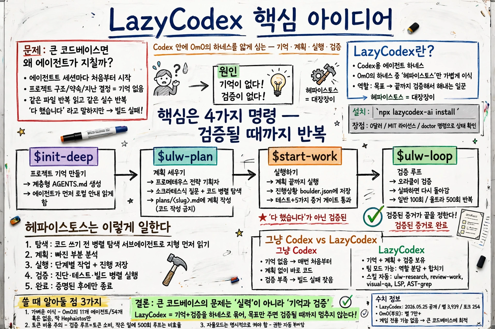
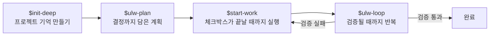
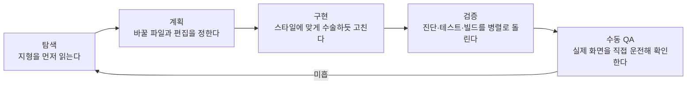
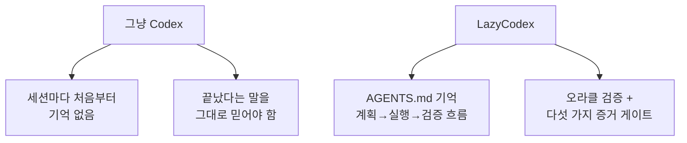

# LazyCodex: 큰 코드베이스에서는 프롬프트가 아니라 하네스가 일합니다

> **Summary**
> LazyCodex는 Codex에 프로젝트 기억, 계획, 실행, 검증을 결합한 하네스를 제공해 큰 코드베이스에서도 작업을 이어가고 결과를 증거로 확인합니다. 단, 전체 OmO의 일부 기능만 포함하며 반복 검증에는 토큰이 많이 들 수 있습니다.

---

- LazyCodex는 Codex 안에 OmO의 하네스를 얇게 심는 도구입니다. 큰 코드베이스에서 에이전트가 기억하고, 계획하고, 검증까지 마치는 흐름을 만듭니다.
- 핵심은 네 가지 명령입니다. `$init-deep`으로 프로젝트 기억을 만들고, `$ulw-plan`으로 계획을 세우고, `$start-work`로 실행하고, `$ulw-loop`로 검증될 때까지 돌립니다.
- "다 했습니다"라는 말이 아니라, 검증된 증거가 끝을 정합니다. 다만 그만큼 토큰이 든다는 점은 알고 써야 합니다.


몇 년째 이어지는 게임 프로젝트가 있다고 해볼까요? 코드는 수십만 줄, 시스템은 서로 얽혀 있고, 새로 온 에이전트는 첫날부터 길을 잃습니다. 기능 하나를 맡겼는데, 에이전트는 금방 "다 했습니다"라고 말합니다. 그런데 빌드가 안 되죠. 이런 적 있으시죠?

🎥 [동영상 보기](https://www.youtube.com/watch?v=G_Snfh2M41M)

## 코드베이스가 크면, 왜 에이전트가 먼저 지칠까요?

에이전트는 세션을 열 때마다 처음부터 시작합니다. 프로젝트 구조도, 약속도, 지난 결정도 모릅니다. 그래서 매번 같은 파일을 다시 읽고, 같은 실수를 반복합니다. 문제는 모델이 아닙니다. 기억이 없다는 게 문제입니다!

LazyCodex는 이 지점을 정면으로 찌릅니다. 에이전트에게 기억을 주고, 계획을 먼저 세우게 하고, 끝났다는 말을 증거로 검증하게 만듭니다.

## LazyCodex는 무엇일까요?

LazyCodex는 Codex용 에이전트 하네스입니다. OmO라는 하네스의 깊은 일꾼, 헤파이스토스만 가볍게 Codex로 가져온 것입니다. 전체 OmO가 아닙니다. 오케스트레이터인 시시포스도, 수십 개의 훅도, 멀티모델 라우팅도 여기엔 없습니다. 딱 한 가지 역할만 가져왔습니다. 목표를 주면, 끝까지 검증해서 해내는 일꾼 말입니다.

설치는 한 줄입니다.

```bash
npx lazycodex-ai install
```

설치가 끝나면 `doctor` 명령으로 상태를 확인할 수 있습니다. 가격도 없습니다. 0달러, MIT 라이선스입니다.

## 네 가지 명령은 어떻게 돌까요?

흐름은 단순합니다. 기억을 만들고, 계획을 세우고, 실행하고, 검증합니다.



`$init-deep`은 계층형 `AGENTS.md`를 만들어 프로젝트 기억을 심습니다. 에이전트가 큰 저장소에 손대기 전에, 로컬 안내부터 읽게 만드는 것입니다. `$ulw-plan`은 프로메테우스라는 전략 기획자입니다. 소크라테스식 질문으로 묻고, 코드베이스를 병렬로 탐색하고, 빠진 부분을 분석한 뒤 `plans/<slug>.md`에 계획을 씁니다. 이때 제품 코드는 절대 쓰지 않습니다. `$start-work`는 그 계획을 끝까지 실행합니다. 진행 상황은 `boulder.json`에 남아서, 세션이 끊겨도 이어집니다. 테스트와 다섯 가지 증거 게이트를 통과해야 체크박스가 지워집니다. 마지막 `$ulw-loop`는 자기 참조 루프입니다. 끝났다고 주장하면 오라클이 검증하고, 검증이 안 되면 다시 돕니다. 반복 상한은 일반 모드 100번, 울트라워크 모드 500번입니다.

## 헤파이스토스는 어떻게 일할까요?

이름은 그리스 신화의 대장장이 신에서 왔습니다. 일하는 방식도 대장장이 같습니다. 다섯 단계를 천천히, 꼼꼼하게 돕니다.



탐색부터가 다릅니다. 코드를 쓰기 전에 병렬 탐색 서브에이전트를 먼저 띄워 지형을 읽습니다. 추측으로 쓰지 않습니다. 검증도 마찬가지입니다. 진단과 테스트와 빌드를 병렬로 돌려, 증명된 다음에야 끝이라고 말합니다.

## 그냥 Codex랑 뭐가 다를까요?



차이는 모델이 아닙니다. 쓰는 방식입니다! 같은 Codex라도, 기억이 있고 계획이 있고 검증이 있으면 다른 도구가 됩니다. 팀 모드까지 켜면 이름 있는 팀원들이 각자 맡은 부분을 나눠 일하고, 리더 세션이 결과를 합칩니다.

스킬도 함께 딸려 옵니다. `ulw-research`는 코드베이스와 웹과 공식 문서와 오픈소스 저장소를 병렬로 뒤지는 최대 포화 연구 모드입니다. `review-work`와 `visual-qa`, `LSP`와 `AST-grep` 같은 스킬은 작업에 맞으면 자동으로 켜집니다.

## 쓸 때 알아둘 점은 없을까요?

세 가지는 알고 쓰시면 좋습니다. 첫째, 이건 가벼운 이식입니다. 전체 OmO의 11개 에이전트와 54개가 넘는 훅이 다 들어 있는 게 아닙니다. 둘째, 검증될 때까지 돈다는 말은 토큰도 그만큼 돈다는 뜻입니다. 500번까지 도는 루프를 작은 일에 켜면 아깝습니다! 셋째, 자율 모드는 명시적으로 켜야 합니다. 설치할 때 권한을 알아서 주지 않습니다.

숫자도 짚어둘게요. 저장소는 2026년 5월 25일에 생겼고, 별 3,939개와 포크 254개를 받았습니다. 부모 프로젝트인 OmO는 별 7만 개가 넘습니다. 게임 전용 기능은 없습니다. 큰 코드베이스를 다루는 하네스라서, 오래된 게임 프로젝트에도 잘 맞는다는 게 핵심입니다.

큰 코드베이스에서 에이전트의 문제는 실력이 아니라 기억과 검증입니다. LazyCodex는 그 두 가지를 하네스로 묶어줍니다. 목표만 주면, 검증될 때까지 멈추지 않습니다!

