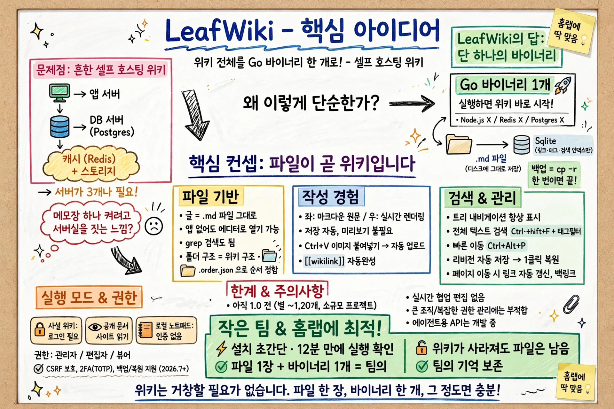
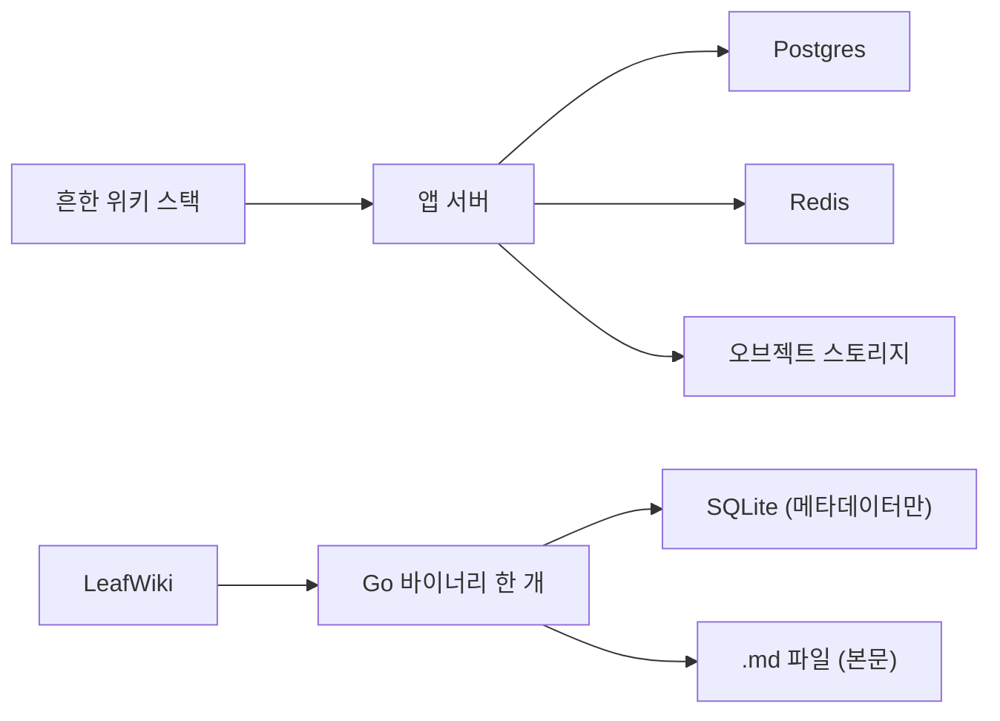
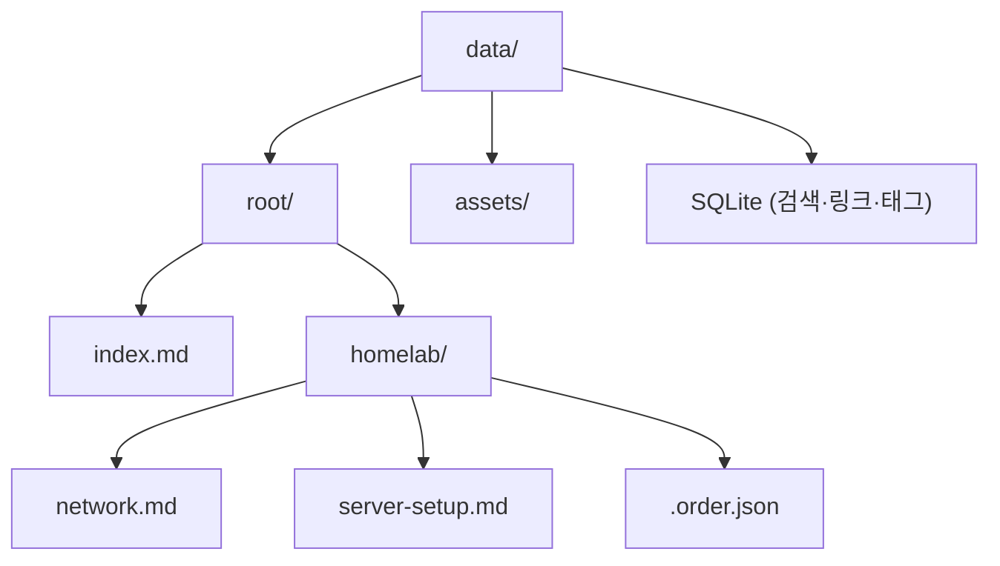
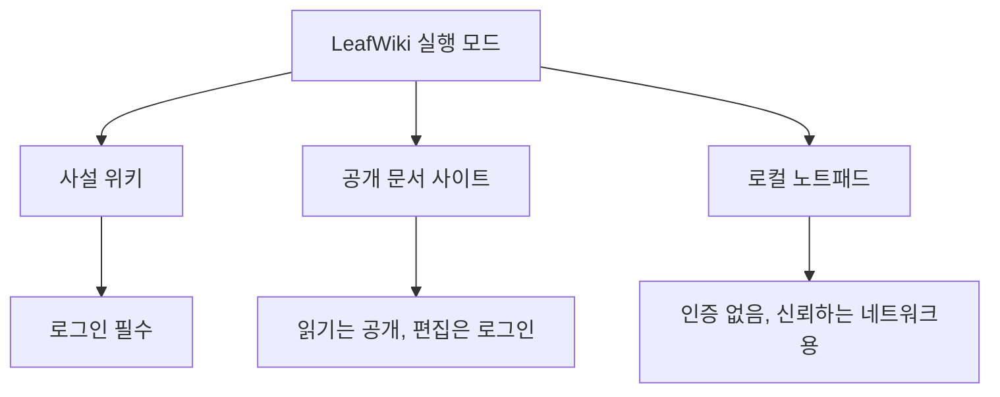

# LeafWiki: 위키 하나 띄우는 데 바이너리 한 개면 됩니다. 웹서버도 DB도 따로 없습니다

> **Summary**
> LeafWiki는 위키 전체를 Go 바이너리 한 개로 띄우는 셀프 호스팅 위키입니다. 웹서버도 DB 서버도 따로 없습니다. 글은 디스크에 마크다운 파일 그대로 저장되고, 링크·태그·검색 인덱스만 옆에 있는 가벼운 SQLite에 둡니다. 트리 내비게이션·전체 텍스트 검색·리비전·백링크까지 갖췄지만, 실시간 협업 편집은 없습니다. 작은 팀과 홈랩이 딱 맞는 자리입니다.

---

- LeafWiki는 위키 전체를 Go 바이너리 한 개로 띄우는 셀프 호스팅 위키입니다. 웹서버도 DB 서버도 따로 없습니다.
- 글은 디스크에 `.md` 파일 그대로 저장되고, 링크·태그·검색 인덱스만 옆에 있는 가벼운 SQLite에 둡니다.
- 트리 내비게이션·전체 텍스트 검색·리비전·백링크까지 갖췄지만, 실시간 협업 편집은 없습니다. 작은 팀과 홈랩이 딱 맞는 자리입니다.

팀 문서를 정리하려고 위키를 띄우려는데, 설치 문서 첫 장부터 데이터베이스 얘기가 나오면 손이 멈추지 않으시나요? 위키 하나 쓰려고 데이터베이스 서버까지 띄우는 건, 메모장 하나 켜려고 서버실을 짓는 기분입니다.

🎥 [동영상 보기](https://www.youtube.com/watch?v=hiwx5_cM9go)

## 왜 위키 하나 띄우는 데 서버가 세 개나 필요할까요?

흔한 셀프 호스팅 위키는 혼자 서지 못합니다. 앱 서버 뒤에 데이터베이스가 붙고, 캐시가 붙고, 오브젝트 스토리지가 붙습니다. 문서 몇 백 장을 정리하는 일에 인프라가 세 개나 필요한 걸까요?

LeafWiki의 답은 단순합니다. 위키 전체를 Go 바이너리 한 개에 넣은 겁니다. 실행하면 위키가 바로 섭니다. Node.js도, Redis도, Postgres도 없습니다!

이 선택이 가능했던 이유는 본문을 데이터베이스에 넣지 않았기 때문입니다. 글은 디스크에 `.md` 파일 그대로 저장됩니다. 링크·태그·검색 인덱스 같은 메타데이터만 파일 옆에 있는 가벼운 SQLite에 둡니다. 그래서 백업은 `cp -r` 한 번이면 끝입니다!

## 파일이 곧 위키입니다. 앱이 없어도 읽을 수 있을까요?

페이지가 일반 파일이라, 앱이 없어도 읽을 수 있습니다. 에디터 아무거나로 열면 됩니다. `grep`으로 검색도 됩니다. 나중에 다른 도구로 옮길 때도 내보내기 단계가 없습니다. 파일이 곧 위키니까요.

폴더 구조가 곧 위키 구조입니다. 트리가 화면 왼쪽에 계속 보이고, 순서는 `.order.json` 파일로 정합니다.

이 구조가 좋은 이유는 하나입니다. 위키가 사라져도 글이 남습니다. 앱은 언젠가 버려질 수 있지만, 마크다운 파일은 어디서든 열립니다. 10년 뒤에도 읽을 수 있는 게 문서의 본분 아닐까요?

이 부분이 저는 가장 와닿았습니다. 도구가 아니라 파일이 남는다는 감각이요!

## 에디터는 어떻게 생겼을까요?

에디터는 마크다운 원문과 렌더링 결과를 나란히 보여줍니다. 미리보기 버튼을 누를 필요가 없습니다. 쓰는 대로 바로 보입니다.

저장은 자동으로 됩니다. 이미지는 `Ctrl+V`로 붙여넣으면 자동으로 업로드되고 링크까지 걸립니다. 내부 링크는 `[[wikilink]]` 형태로 쓰면 옵시디언과 같은 방식으로 자동완성이 뜹니다.

표·작업 목록·각주·콜아웃(`:::info`·`:::warning`)·Mermaid 다이어그램·KaTeX 수식까지, 문서에 필요한 표현은 대부분 들어 있습니다.

## 찾는 일은 어떻게 하나요?

트리가 항상 보여서 전체 구조를 잃지 않습니다. 전체 텍스트 검색은 태그 필터와 함께 쓸 수 있고(`Ctrl+Shift+F`), 빠른 이동(`Ctrl+Alt+P`)으로 마우스 없이 원하는 페이지로 바로 갑니다.

저장할 때마다 리비전이 남습니다. 옵션을 켜면(`--enable-revision`) 모든 저장이 기록되고, 잘못 고쳤으면 한 번의 클릭으로 이전 버전으로 돌아갑니다.

링크도 알아서 챙깁니다. 페이지 이름을 바꾸거나 옮기면 기존 링크가 자동으로 갱신되고, 깨진 링크는 페이지마다 표시됩니다. 옵션을 켜면(`--enable-link-refactor`) 백링크 추적이 돌아갑니다. 문서가 늘어날수록 이 기능이 빛을 발합니다!

## 세 가지 실행 모드, 권한은요?

LeafWiki는 세 가지 방식으로 돌릴 수 있습니다. 로그인해야 들어가는 사설 위키, 누구나 읽을 수 있는 공개 문서 사이트, 인증 없이 쓰는 로컬 노트패드입니다.

권한은 관리자·편집자·뷰어 세 가지 역할로 나뉩니다. CSRF 보호와 인증 속도 제한은 기본으로 켜져 있습니다. 기존 인증 시스템 뒤에 두는 것도 됩니다. 2단계 인증(TOTP)도 들어와 있습니다. 2026년 7월 나온 버전부터 백업·복원 기능이 들어왔고, Git으로 백업하는 기능은 아직 실험 단계입니다.

## 어디까지 믿고 써도 될까요?

정직하게 짚을 점이 있습니다. 아직 1.0 전 버전입니다. 별이 1,200개 남짓한 작은 프로젝트이고, 공식 사이트도 "아직 다듬을 곳이 남았다"고 밝힙니다.

실시간 협업 편집은 없습니다. 승인 워크플로우나 자동화도 없습니다. 큰 조직의 복잡한 권한 관리에도 맞지 않습니다. 에이전트가 읽는 API 키 기능은 아직 개발 중이라, 에이전트용 위키를 찾는 분께는 다른 선택지가 맞습니다. 이 위키는 사람 팀을 위한 위키입니다.

그래도 작은 팀과 홈랩에는 과하지 않은 선택입니다. 독립 테스트에서도 클론 뒤 12분 만에 실행까지 확인됐고, 매시간 초기화되는 공개 데모가 있어 설치 전에 직접 만져볼 수 있습니다.

위키는 거창할 필요가 없습니다. 파일 한 장, 바이너리 한 개, 그 정도면 팀의 기억은 충분히 굴러갑니다!

