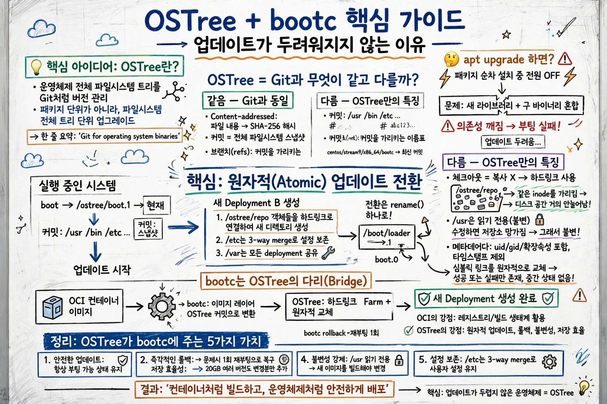
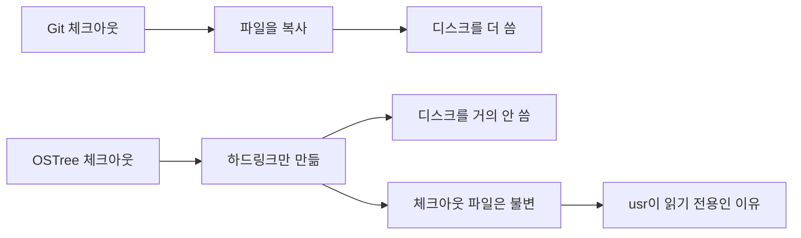
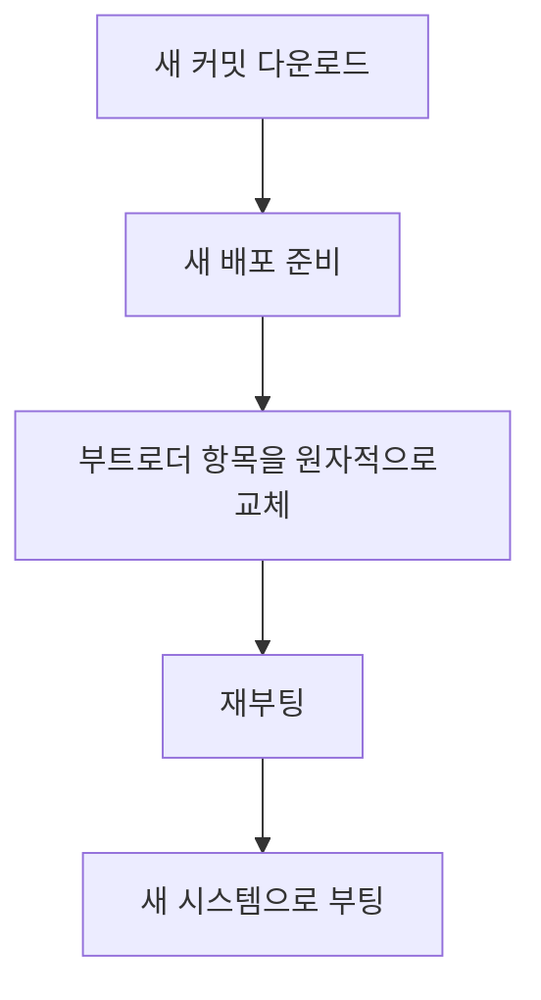

# Let's Bootc! [5] - OSTree는 운영체제 바이너리를 위한 Git이다

> **Summary**
> OSTree는 운영체제 파일시스템 전체를 Git처럼 버전 관리하며, 하드링크 기반 체크아웃과 원자적 전환으로 안전한 업데이트와 간편한 롤백을 제공합니다. bootc는 OCI 컨테이너 이미지를 OSTree 배포로 연결해 컨테이너처럼 빌드하고 운영체제처럼 배포하도록 합니다.

---

- OSTree는 운영체제 전체 파일시스템 트리를 Git처럼 버전 관리하는 시스템입니다. 커밋, 브랜치, 체크아웃 개념이 그대로 적용됩니다.
- 핵심은 하드링크 체크아웃과 원자적 전환입니다. 업데이트 중 전원이 꺼져도 이전 시스템 또는 새 시스템, 둘 중 하나만 남습니다.
- bootc는 OCI 컨테이너 이미지를 OSTree 커밋으로 바꿔주는 다리입니다. 컨테이너처럼 빌드하고, 운영체제처럼 배포합니다.

apt upgrade를 실행했는데, 중간에 전원이 꺼진다면 어떻게 될까요? 수십, 수백 개 패키지가 순차적으로 설치되는데, 어떤 라이브러리는 새 버전이고 어떤 바이너리는 구 버전인 상태가 됩니다. 의존성이 깨지고, 부팅이 안 될 수도 있습니다. 현업에서 이런 상황을 몇 번 겪어보면, 업데이트가 두려워집니다. 그런데 이 문제를 패키지가 아니라 파일시스템 전체를 통째로 관리하면 어떨까요?

🎥 [동영상 보기](https://www.youtube.com/watch?v=ERVyBc_fElY)

## OSTree, 도대체 뭘까요?

OSTree는 Linux 운영체제를 위한 업그레이드 시스템입니다. 패키지 시스템이 아니라, 완성된 파일시스템 트리 전체를 원자적으로 업그레이드합니다. 핵심 아이디어는 한 문장으로 정리됩니다. "Git for operating system binaries", 운영체제 바이너리를 위한 Git입니다! Git이 소스 코드의 버전을 관리하듯, OSTree는 운영체제 전체 파일 트리의 버전을 관리합니다. 2011년에 시작된 이 프로젝트는, 패키지 단위가 아니라 트리 단위로 운영체제를 다루는 발상에서 출발했습니다.

## Git과 뭐가 같고, 뭐가 다를까요?

먼저 같은 점입니다. OSTree는 Git처럼 content-addressed object store를 씁니다. 파일 내용을 SHA-256으로 해시해서 식별합니다. 같은 내용이면 같은 해시, 한 번만 저장됩니다. 커밋은 특정 시점의 전체 파일시스템 트리 스냅샷입니다. 브랜치(refs)는 특정 커밋을 가리키는 이름표입니다. `centos/stream9/x86_64/bootc` 같은 ref가 최신 커밋을 가리키는 방식입니다.

다른 점이 더 중요합니다. Git은 체크아웃할 때 파일을 복사합니다. OSTree는 하드링크를 씁니다. `/ostree/repo`에 저장된 객체들에 대한 하드링크만으로 deployment를 만듭니다. 하드링크는 같은 inode를 가리키는 또 다른 이름일 뿐이라, 디스크 공간을 거의 추가로 쓰지 않습니다. 그런데 하드링크된 파일을 수정하면 저장소 원본까지 망가집니다. 그래서 체크아웃된 파일은 반드시 불변이어야 합니다. bootc 시스템에서 `/usr`이 읽기 전용인 이유가 여기 있습니다. 기술적 선택이 아니라, 구조가 강제하는 것입니다!

또 하나, 메타데이터입니다. Git은 파일 내용과 실행 권한 정도만 봅니다. 운영체제 파일은 uid, gid, 확장 속성까지 필요합니다. OSTree의 content 객체는 이 메타데이터를 모두 포함하고, 해시 계산에도 넣습니다. 반면 타임스탬프는 의도적으로 제외합니다. 빌드 시간만 다르다고 다른 객체가 되면 중복 제거가 무너지니까요.

## 업데이트는 어떻게 원자적으로 바뀔까요?

여기가 OSTree의 진짜 핵심입니다. 새 deployment를 만들 때는 실행 중인 시스템을 전혀 건드리지 않습니다. `/ostree/repo`의 객체들을 하드링크로 묶어 새 deployment 디렉토리를 만들고, `/etc`는 3-way merge로 관리자의 수정 사항을 보존하고, `/var`는 모든 deployment가 공유합니다.

전환은 "swapped directory pattern"으로 합니다. `/boot/loader`는 `/ostree/boot.0` 또는 `/ostree/boot.1` 중 하나를 가리키는 심볼릭 링크입니다. 새 부트로더 설정을 다른 쪽에 준비한 뒤, `rename()` 시스템 콜로 심볼릭 링크를 교체합니다. `rename()`은 원자적 연산입니다. 성공하거나 실패하거나, 중간 상태는 없습니다. 전원이 꺼져도 이전 시스템 또는 새 시스템, 둘 중 하나만 부팅됩니다. 중간 상태는 없습니다!

롤백도 그래서 쉽습니다. 이전 deployment는 삭제되지 않고 남아 있습니다. 새 버전에 문제가 생기면, 부트로더 메뉴에서 이전 버전을 고르거나 `bootc rollback` 명령 하나로 다음 부팅을 이전 deployment로 되돌립니다. 재부팅 한 번이면 됩니다!

## bootc와 OSTree는 어떻게 연결될까요?

bootc는 OCI 컨테이너 이미지와 OSTree를 연결하는 다리입니다. `bootc upgrade`를 실행하면, 레지스트리에서 새 OCI 이미지를 pull하고, 이미지 레이어를 OSTree 커밋으로 변환하고, 하드링크 farm으로 새 deployment를 만들고, `/etc` 3-way merge를 수행하고, 부트로더 심볼릭 링크를 원자적으로 교체합니다.

이 조합이 현명한 이유는 각자의 강점을 쓰기 때문입니다. OCI는 풍부한 생태계입니다. 레지스트리, 빌드 도구, 이미지 레이어 구조를 그대로 씁니다. OSTree는 원자적 업데이트, 롤백, 불변성, `/etc` merge, 하드링크 저장 효율을 담당합니다. 컨테이너처럼 빌드하고, 운영체제처럼 배포합니다!

## 정리: OSTree가 bootc에서 갖는 의미

안전한 업데이트, 즉각적인 롤백, 저장 효율성, 불변성 강제, 설정 보존. 이 다섯 가지가 OSTree가 bootc에 주는 가치입니다. 업데이트가 중간에 실패해도 시스템은 항상 부팅 가능한 상태를 유지합니다. 20GB짜리 이미지를 여러 버전 보관해도 실제 디스크 사용량은 변경된 파일만큼만 늘어납니다. `/usr`이 읽기 전용이라 "돌아가는 시스템을 직접 수정"하는 관행이 막힙니다. 변경이 필요하면 새 이미지를 빌드해야 합니다. 이것이 Infrastructure as Code의 원칙입니다.

OSTree는 bootc의 핵심 엔진입니다. 컨테이너 이미지가 "무엇을" 배포할지 정의한다면, OSTree는 "어떻게" 안전하고 효율적으로 배포할지를 담당합니다. 업데이트가 두렵지 않은 운영체제, 그게 OSTree가 만드는 변화입니다.

