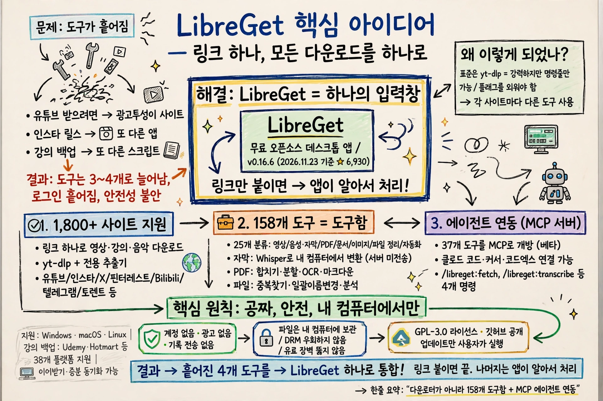
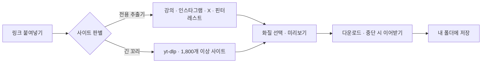
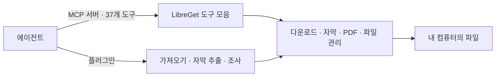

# LibreGet: 링크 하나 붙이면 끝입니다. 1,800개 사이트 다운로드가 도구 하나로 모입니다

> **Summary**
> LibreGet은 윈도우·맥·리눅스에서 1,800개 이상의 사이트에서 콘텐츠를 내려받고, 이어받기와 자막·PDF·파일 관리 등 158개 도구를 제공하는 무료 오픈소스 앱입니다. MCP 서버와 에이전트 플러그인도 지원하며, 계정·광고·다운로드 기록 전송 없이 작동합니다. DRM 우회나 유료 장벽 해제는 하지 않으며, 초기 실행 시 운영체제별 보안 경고나 추가 설정이 필요할 수 있습니다.

---

- `LibreGet`은 링크 하나를 붙이면 1,800개가 넘는 사이트의 영상·강의·음악을 내려받는 무료 오픈소스 데스크톱 앱입니다.
- 다운로드만 하는 도구가 아닙니다. 25개 분류 158개 도구가 자막·PDF·파일 정리까지 맡고, 내장 MCP 서버로 에이전트에게 37개 도구를 넘겨줍니다.
- 계정도, 광고도, 사용 기록 전송도 없습니다. 파일은 내 컴퓨터에 남고, DRM 우회나 유료 장벽 뚫기는 하지 않습니다.

유튜브 영상 하나 받으려고 검색하면, 광고투성이 사이트가 먼저 뜹니다. 인스타 릴스는 또 다른 앱, 산 강의 백업은 또 다른 스크립트. 받으려는 파일은 하나인데, 도구는 세 개, 네 개로 늘어납니다. 이런 적 있으시죠?

🎥 [동영상 보기](https://www.youtube.com/watch?v=nAeNApj0WGw)

## 왜 다운로드 도구는 늘 흩어져 있었을까요?

영상 다운로드의 표준 도구는 `yt-dlp`입니다. 강력하지만 명령줄 도구라, 플래그를 외워야 합니다. 그래서 사람들은 사이트마다 다른 도구를 하나씩 모읍니다. 유튜브용 확장 프로그램 하나, 인스타용 사이트 하나, 강의 백업용 스크립트 하나. 도구가 늘어날수록 로그인 정보도 흩어지고, 어느 도구가 안전한지 어떻게 알 수 있을까요?

`LibreGet`은 이 흩어짐을 하나의 입력창으로 모읍니다. 2026년 7월에 공개된 무료 오픈소스 데스크톱 앱으로, 윈도우·맥·리눅스에서 돌아갑니다. 2026년 11월 23일 기준 별 6,930개를 받았고, 최신 버전은 `v0.16.6`입니다. 참고로 이전 이름은 `OmniGet`이었고, 최근에 이름을 바꿨습니다. 최신 릴리스의 파일 이름에는 아직 이전 이름이 남아 있습니다.

> 링크를 복사해서 붙이면, 받는 일이 시작됩니다. 나머지는 앱이 알아서 합니다.

## 링크 하나, 그다음은 앱이 알아서 합니다

사용법은 단순합니다. 링크를 붙이면 제목과 미리보기, 화질 선택지가 뜹니다. 엔터를 누르면 다운로드가 시작됩니다. `yt-dlp`와 `FFmpeg`은 앱 안에서 알아서 설치되고, 업데이트도 스스로 챙깁니다. 터미널을 열 필요가 없습니다.

받는 범위가 넓은 이유는 두 갈래로 나뉘기 때문입니다. 긴 꼬리는 `yt-dlp`가 맡아 1,800개가 넘는 사이트를 커버하고, 강의·인스타그램·X·핀터레스트·Bilibili·텔레그램·토렌트는 전용 추출기가 맡습니다. 공개 X 게시물은 로그인 없이 받을 수 있고, 북마크나 팔로우 목록은 내 세션이 필요합니다. 인스타그램 스토리는 본 것으로 표시되지 않고 받습니다. 핀터레스트 보드는 원본 화질 그대로 백업하고, 바뀐 것만 추가로 받는 증분 동기화도 됩니다.

끊겨도 괜찮습니다! 부분 파일은 남겨두고 이어서 받고, 속도 제한에 걸리면 대기 시간을 두고 다시 시도합니다. 영상은 `MP4`·`MKV`·`WebM`으로, 음성은 `MP3`·`M4A`·`Opus`·`FLAC`·`WAV`로, 자막은 `SRT`·`VTT`·`ASS`로 저장합니다.

## 158개 도구, 다운로더가 아니라 도구함입니다

받기만 하는 앱이었다면 이야기가 여기에서 끝났을 겁니다. `LibreGet`의 도구 모음에는 25개 분류, 158개 도구가 들어 있습니다. 영상 편집, 음성·자막, PDF, 문서, 이미지, 파일, 시스템, 자동화까지 한 화면에 모여 있습니다.

자막이 필요하면 `Whisper`가 내 컴퓨터에서 직접 음성을 텍스트로 바꿉니다. 서버에 올리지 않으니 강의 음성도 밖으로 나가지 않습니다. PDF는 합치고, 나누고, 압축하고, `OCR`로 읽고, 마크다운으로 바꿉니다. 파일이 쌓이면 중복을 찾고, 이름을 일괄로 바꾸고, 디스크 사용량을 분석합니다.

강의 백업은 별도 플러그인이 맡습니다. `Udemy`·`Hotmart`를 포함해 38개 학습 플랫폼을 지원합니다. 앱 안에서 로그인하고 강의와 구간을 고르면, 강의와 첨부 파일이 강의별로 정리된 폴더에 내려받습니다. 산 강의를 내 디스크에 두는 용도입니다.

## 에이전트에게도 문을 열어줍니다

이 글에서 가장 눈에 띄는 부분은 따로 있습니다. `LibreGet`은 에이전트와 함께 쓰라고 만든 도구입니다. 도구 모음에서 MCP 서버를 켜면, 37개 도구가 모델 컨텍스트 프로토콜로 열립니다. 설정 문단은 복사해서 붙이는 수준이라, 클로드 코드·커서·코드엑스 같은 도구에 바로 연결됩니다. 아직 베타 표시가 붙어 있습니다.

데스크톱 앱 없이 쓰는 길도 있습니다. 클로드 코드용 플러그인이 함께 들어 있습니다. 영상·음성·소셜 게시물 링크를 요청과 함께 붙이면, 가져오기와 자막 추출 스킬이 알아서 동작합니다. 명시적으로 부르는 명령도 네 가지가 있습니다. `/libreget:setup`은 `yt-dlp`·`FFmpeg`·명령줄 도구를 설치하고, `/libreget:fetch`는 파일을 받고, `/libreget:transcribe`는 자막을 뽑고, `/libreget:research`는 자막과 전사를 시간 표시가 붙은 마크다운 노트로 정리합니다.

에이전트에게 파일 관리를 맡기는 일, 이제 다운로드까지 포함됩니다!

## 공짜인데, 조건은 분명합니다

무료의 조건을 먼저 확인했습니다. `GPL-3.0` 라이선스, 유료 등급 없음, 광고 없음, 계정 없음. 다운로드 기록을 서버로 보내지도 않습니다. 쿠키와 API 키는 내 컴퓨터의 프로필 안에만 있습니다. 앱이 스스로 네트워크에 나가는 경우는 내가 시킨 다운로드, 깃허브 업데이트 확인, 내가 설정한 AI 제공자 호출뿐입니다.

선도 분명합니다. DRM을 우회하지 않고, 유료 장벽을 뚫지 않으며, 로그인 정보를 공유하지 않습니다. DRM이 걸린 강의는 건너뛰고 보고합니다. 저작권과 각 플랫폼의 이용 약관은 쓰는 사람이 지켜야 합니다. 앱 안의 약관 안내에도 같은 내용이 들어 있습니다.

아쉬운 점도 있습니다. "그냥 `yt-dlp`에 껍데기를 씌운 것 아니냐"는 지적이 나옵니다. 일리는 있습니다. 긴 꼬리는 `yt-dlp`가 처리하니까요. 다만 전용 추출기, 큐와 이어받기, 158개 도구, MCP 서버까지 합치면 껍데기라고 부르기에는 덩치가 큽니다. 어디까지가 엔진이고 어디부터가 앱인지, 경계는 직접 써보고 판단하는 것이 맞습니다.

처음 실행할 때 경고가 뜨는 것도 알아두면 좋습니다. 유료 인증서가 없어서 윈도우는 스마트스크린 경고가, 맥은 게이트키퍼 경고가 뜹니다. 한 번만 처리하면 됩니다. 맥에서는 게이트키퍼 해제를 위해 터미널 명령 두 줄이 필요합니다. 리눅스 `AppImage`는 배포판에 따라 `libfuse2` 설치가 필요할 수 있습니다.

링크 하나 붙이면 끝나는 다운로드, 이제 도구 하나로 모았습니다. 받는 일에 쓰는 도구가 네 개였다면, 이제는 하나로 줄여볼 차례입니다!

