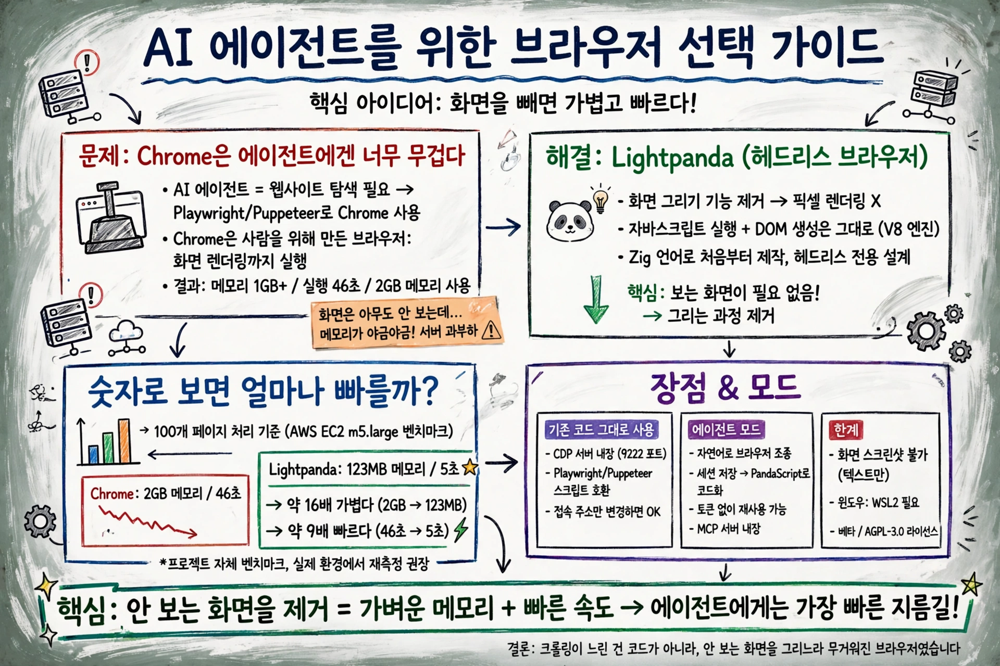
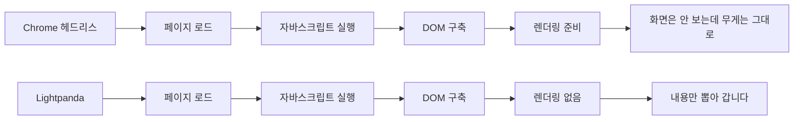
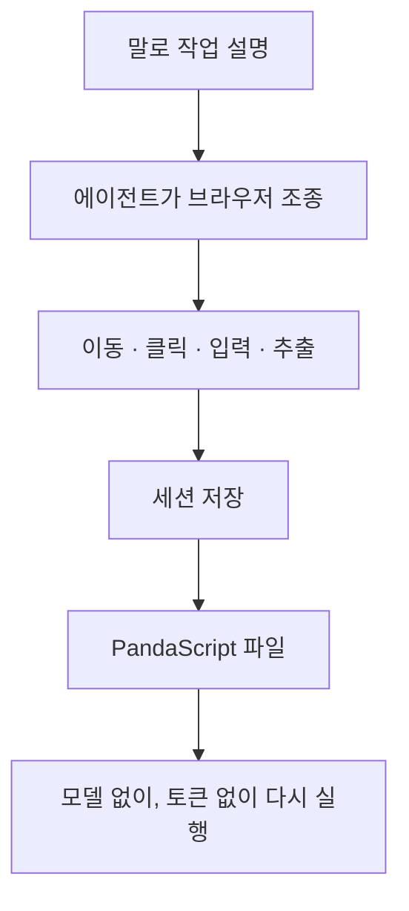
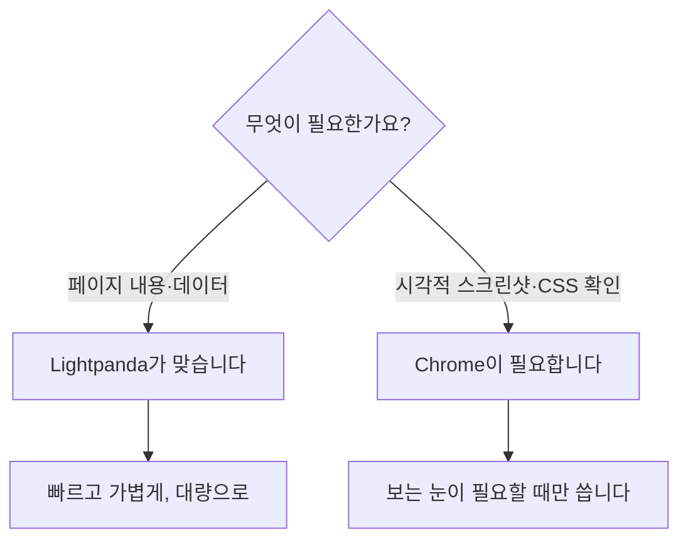

# Lightpanda: 화면을 그리지 않는 브라우저, 크롤링이 9배 빨라집니다

> **Summary**
> Lightpanda는 화면 렌더링을 생략하고 자바스크립트 실행과 DOM 구축에 집중하는 헤드리스 브라우저로, 프로젝트 벤치마크에서 Chrome보다 약 9배 빠르고 메모리를 16배 적게 사용합니다. Playwright·Puppeteer와 연동할 수 있어 대량 크롤링과 AI 에이전트에 적합하지만, 시각적 스크린샷이나 CSS 확인에는 Chrome이 필요하며 아직 베타 단계입니다.

---

- AI 에이전트가 웹사이트를 돌아다니려면 브라우저가 필요하지만, 사람이 보는 화면까지 그리는 Chrome은 에이전트에게 과한 도구입니다.
- Lightpanda는 처음부터 화면 없이 돌리는 용도로만 만든 헤드리스 브라우저로, 자바스크립트는 실행하고 DOM은 만들되 그리는 과정을 통째로 빼버렸습니다.
- 프로젝트 자체 벤치마크에서 100개 페이지를 5초에 처리하고 메모리는 123MB만 써서, Chrome 대비 9배 빠르고 16배 가볍다고 합니다.


크롤링 서버를 돌리다 메모리 알림이 뜬 적 있으시죠? 페이지 몇백 개를 긁어오는데 브라우저 프로세스가 메모리를 야금야금 먹더니, 결국 서버가 버티지 못하는 장면 말입니다. 화면은 아무도 안 보는데 말이죠!

🎥 [동영상 보기](https://www.youtube.com/watch?v=IuI_8vnCd_4)

## 왜 Chrome은 에이전트에게 무거울까요?

AI 에이전트가 웹사이트를 돌아다니려면 브라우저가 필요합니다. `Playwright`나 `Puppeteer` 같은 자동화 도구로 Chrome을 조종하는 방식이 표준이었죠. 화면을 끄고 뒤에서 돌리는 구조입니다.

문제는 Chrome이 원래 사람이 보라고 만든 브라우저라는 점입니다. 화면을 꺼도 내부에서는 렌더링 준비를 합니다. 하나 띄우는 데 메모리 1GB 이상, 느리고 무겁습니다. 에이전트는 화면을 보지 않는데, 보는 사람을 위한 무게까지 짊어지는 셈입니다.

> 화면을 그리지 않는 브라우저가 있다면, 크롤링은 얼마나 가벼워질까요?

## 화면을 빼면 뭐가 달라질까요?

Lightpanda는 처음부터 "보여줄 화면 없이" 돌리는 용도로만 만든 브라우저입니다. 화면을 그리는 기능이 아예 없습니다. Chromium을 고친 것도, WebKit을 덧댄 것도 아닙니다. 처음부터 새로 쓴 브라우저이고, `Zig`이라는 언어로 만들었습니다.

그렇다고 브라우저의 일을 안 하는 건 아닙니다. 자바스크립트는 `V8` 엔진으로 실행하고, HTML을 파싱해 DOM 트리를 만들고, 쿠키·네트워크 요청·폼 입력까지 처리합니다. 빠진 건 그리는 과정뿐입니다. 에이전트에게 필요한 건 페이지 내용이지, 픽셀이 아니니까요!



## 숫자로 보면 얼마나 빠를까요?

프로젝트가 직접 잰 벤치마크가 있습니다. 실제 웹 페이지 933개를 네트워크로 요청했고, `AWS EC2 m5.large` 인스턴스에서 쟀습니다. 100개 페이지 기준 결과는 이렇습니다.

- 메모리 최고 사용량: 123MB 대 2GB, 약 16배 가볍습니다.
- 실행 시간: 5초 대 46초, 약 9배 빠릅니다.
이 수치는 프로젝트가 직접 발표한 것이니, 그대로 믿기보다 자기 페이지로 직접 재보는 게 맞습니다. 참고로 초기에 나온 로컬 측정에서는 11배 빠르다, 9배 가볍다는 수치가 나왔고, 지금 공개된 벤치마크는 9배 빠르고 16배 가볍습니다. 어느 쪽이든 방향은 같습니다. 그리는 일을 빼니 가벼워졌고, 가벼워지니 빨라졌습니다!

## 기존 코드는 그대로 쓸 수 있을까요?

쓸 수 있습니다. Lightpanda는 `CDP` 서버를 내장했습니다. `Playwright`나 `Puppeteer`는 기존 스크립트 그대로 연결됩니다. 서버를 띄우는 명령은 이렇습니다.

```javascript
docker run -d --name lightpanda -p 127.0.0.1:9222:9222 lightpanda/browser:latest
```

`9222`번 포트에 CDP 서버가 열리면, 자동화 코드는 접속 주소만 바꾸면 됩니다. 나머지 코드는 그대로입니다.

한 번만 긁어오는 용도라면 서버를 띄울 필요도 없습니다. `fetch` 명령이 페이지를 받아서 바로 변환해 줍니다.

```javascript
./lightpanda fetch --dump markdown https://demo-browser.lightpanda.io/campfire-commerce/
```

`--dump markdown`이면 마크다운으로, `--dump structured_data`면 페이지의 `JSON-LD`와 오픈그래프, 메타 태그를 JSON으로 뽑아줍니다. 에이전트에게 먹이기 좋은 형태 그대로 나옵니다.

## 에이전트 모드는 뭐가 다를까요?

`lightpanda agent`를 켜면 평범한 말로 브라우저를 조종할 수 있습니다. 이동하고, 클릭하고, 폼을 채우고, 구조화된 데이터를 뽑아냅니다. 에이전트가 브라우저와 같은 프로세스 안에서 돌아서, 도구 호출이 곧바로 브라우저 동작이 됩니다.

이 모드의 재미있는 지점은 따로 있습니다. 세션을 저장하면 `PandaScript`라는 평범한 자바스크립트 파일이 나옵니다. LLM으로 한 번 탐색한 뒤, 그 과정을 코드로 저장해 두는 겁니다. 이후에는 모델 없이, 토큰 없이 그대로 다시 돌릴 수 있습니다. 매번 모델에게 물어보는 게 아니라, 한 번 알아낸 방법을 재사용하는 구조입니다!



`MCP` 서버도 내장했습니다. `lightpanda mcp`를 켜면 AI 앱이 브라우저 도구를 직접 쓸 수 있습니다.

## 어디까지는 못 할까요?

한계도 분명합니다. 화면을 안 그리니, `PNG`로 뽑아도 텍스트만 그려진 이미지가 나옵니다. 시각적 스크린샷이나 CSS 렌더링 확인이 필요하면 Chrome이 여전히 필요합니다. 이 문장이 저는 가장 와닿았습니다. 빠르다는 말의 반대쪽에는, 포기한 기능이 있다는 점입니다.

설치 면에서도 제약이 있습니다. 윈도우 네이티브 빌드는 없고, 윈도우에서는 `WSL2` 안에서 돌려야 합니다. 아직 베타 단계이고, 라이선스는 `AGPL-3.0`이라 호스팅 서비스로 제공할 때는 소스 공개 의무를 따져봐야 합니다.



크롤링이 느린 이유는 코드가 아니라, 안 보는 화면을 그리느라 무거워진 브라우저였습니다. 화면을 빼는 선택이, 에이전트에게는 가장 빠른 지름길이었습니다!

