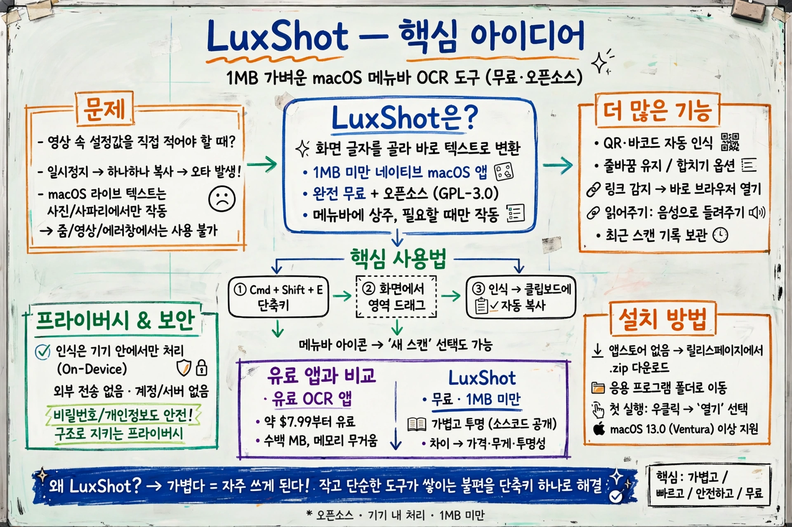
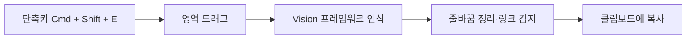
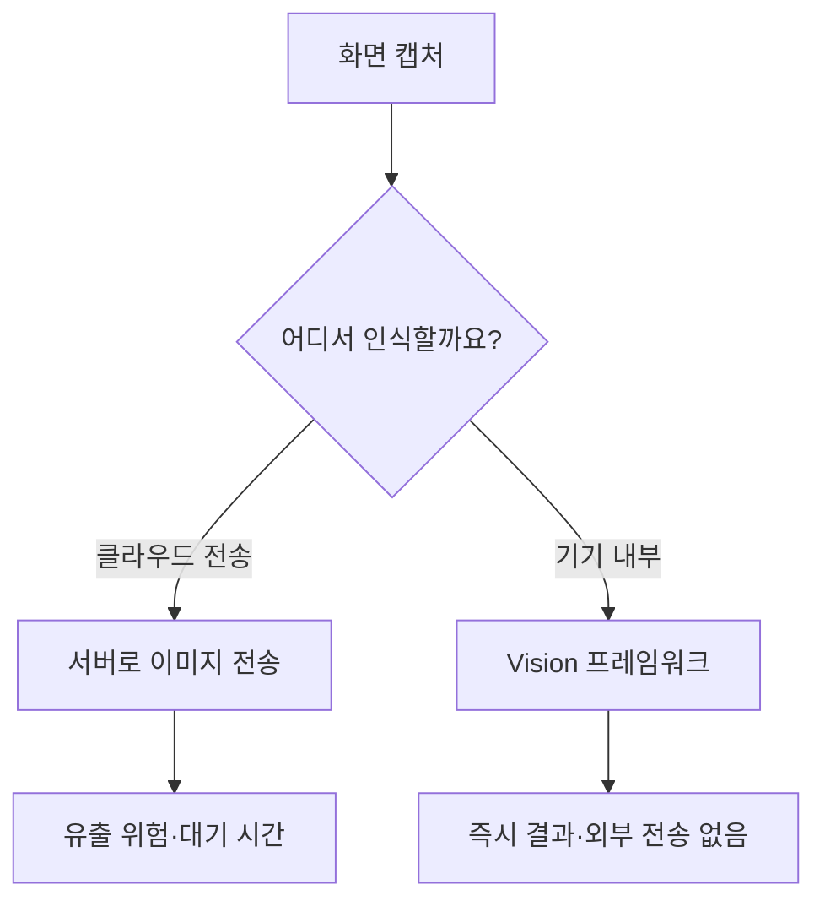
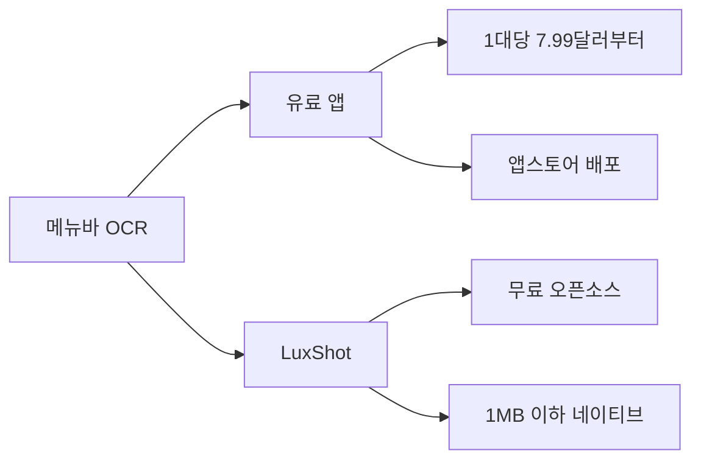

# LuxShot: 복사 안 되는 화면 글자, 단축키 하나로 클립보드에 담습니다

> **Summary**
> 화면 속 글자를 골라 바로 텍스트로 바꿔주는 macOS 메뉴바 OCR 도구 LuxShot을 소개합니다. 1MB가 안 되는 네이티브 앱으로, 단축키를 누르고 영역을 드래그하면 글자가 인식돼 클립보드에 들어갑니다. QR·바코드 인식, 줄바꿈 정리, 링크 자동 열기, 읽어주기, 기록 보관까지 되며 인식은 기기 안에서만 처리돼 외부로 나가지 않으니, 유료 OCR 앱의 핵심 기능을 완전 무료 오픈소스로 쓸 수 있습니다.

---

- LuxShot은 화면에 보이는 글자를 골라 바로 텍스트로 바꿔주는 macOS 메뉴바 OCR 도구입니다. 1MB가 안 되는 가벼운 네이티브 앱이고, 완전 무료 오픈소스입니다.
- 단축키를 누르고 영역을 드래그하면 글자가 인식돼 클립보드에 들어갑니다. QR·바코드 인식, 줄바꿈 정리, 링크 자동 열기, 읽어주기, 기록 보관까지 됩니다.
- 인식은 기기 안에서만 처리돼 외부로 나가지 않습니다. 유료 OCR 앱의 핵심 기능을 무료로 쓸 수 있습니다.

## 영상 속 설정값, 손으로 옮겨 적어본 적 있으시죠?

강의 영상을 보다가 화면에 뜬 설정값 하나가 필요했습니다. 일시정지를 누르고, 글자를 하나하나 옮겨 적었습니다. 두 번 적고도 틀렸습니다. 이런 적 있으시죠?

화면의 글자는 복사할 수 없을 때가 많습니다. 이미지 속 문장, 영상 속 자막, 에러 메시지 창, 스캔한 문서까지요. 맥에는 라이브 텍스트가 있지만, 사진·미리보기·사파리 안에서만 돕니다. 줌 화면이나 영상 프레임 위에서는 손을 놓습니다. 그 빈틈이 바로 이 도구가 메우는 자리입니다!

🎥 [동영상 보기](https://www.youtube.com/watch?v=jBal_eX5ajU)

영상은 같은 방식의 메뉴바 OCR 도구를 보여줍니다. 단축키, 드래그, 클립보드 복사라는 흐름 자체는 같습니다.

## 무거운 앱 대신, 1MB짜리 도구가 답이 될까요?

이 도구의 출발점은 무거움에 대한 피로감입니다. 일렉트론 기반 앱들은 켜는 순간부터 메모리를 잡아먹습니다. 작은 기능 하나 쓰려고 수백 MB짜리 앱을 띄우는 일이 반복되면, 어느 순간 가벼운 도구를 찾게 됩니다.

그래서 선택한 길이 네이티브입니다. `SwiftUI`와 애플 `Vision` 프레임워크로 만들었습니다. 앱 크기는 1MB가 안 됩니다. 메뉴바에 조용히 머물다가 필요할 때만 나섭니다. 가벼움 자체가 기능이라는 주장, 이 앱은 그걸 몸으로 보여줍니다!

## 쓰는 법은 단축키 하나면 될까요?

쓰는 법은 단순합니다. `Cmd + Shift + E`를 누릅니다. 화면에서 글자가 있는 영역을 드래그합니다. 끝입니다. 인식된 글자는 클립보드에 바로 들어갑니다. 메뉴바 아이콘을 눌러 "새 스캔"을 고르는 방법도 있습니다.

이 단순함이 저는 가장 인상 깊었습니다. 설정 화면을 뒤질 필요도, 모드를 고를 필요도 없습니다. 단축키 하나가 곧 사용법 전부입니다.

## 글자만 읽는 게 아닙니다, 뭐가 더 있을까요?

텍스트 인식이 전부는 아닙니다. 화면 속 QR 코드와 바코드를 자동으로 찾아서 해석합니다. 줄바꿈을 유지할지 합칠지 고를 수 있습니다. 인식된 글자 안에 링크가 있으면 브라우저로 바로 열어줍니다. 읽어주기 기능으로 인식 결과를 소리로 들을 수도 있습니다. 최근 스캔 기록도 남아 있어 다시 꺼내 쓸 수 있습니다.

이 목록에서 눈에 띄는 건, 하나하나가 "그냥 복사"를 넘어선다는 점입니다. 붙여넣기 전에 정리가 끝나 있고, 링크는 클릭 한 번으로 이어집니다. 작은 배려들이 모여서 손이 덜 가는 도구가 됩니다.

## 프라이버시는 어떻게 지킬까요?

인식은 기기 안에서만 처리됩니다. 이미지가 외부로 전송되지 않습니다. 계정도 없고, 서버도 없습니다. 화면 속 글자에는 비밀번호나 개인정보가 섞일 수 있습니다. 그래서 인식이 어디서 일어나느냐는 성능 문제가 아니라 프라이버시 문제입니다. 이 도구는 그 답을 구조로 정했습니다. 기기 안에서만, 그게 전부입니다!

## 유료 앱과 비교하면 어떨까요?

같은 일을 하는 유료 앱도 있습니다. 메뉴바 OCR의 대표 주자는 1대당 7.99달러부터 시작합니다. 기능은 비슷합니다. 단축키, 드래그, 클립보드 복사, QR 인식까지요.

차이는 가격과 무게입니다. 이 도구는 무료 오픈소스이고, 1MB가 안 됩니다. 소스도 공개돼 있어(`GPL-3.0`) 누구나 들여다볼 수 있습니다. 유료 앱이 주는 안정감 대신, 가벼움과 투명함을 택한 셈입니다. 어느 쪽이 맞을지는 쓰는 사람이 정할 일입니다.

## 설치는 어떻게 할까요?

앱스토어에는 없습니다. 릴리스 페이지에서 압축 파일을 받아 `응용 프로그램` 폴더로 옮깁니다. 처음 열 때는 보안 경고가 뜹니다. 애플 공증을 받지 않은 앱이라서 그렇습니다. 오른쪽 클릭으로 열기를 고르면 한 번만 확인하고, 다음부터는 평소처럼 열립니다. 맥 13.0(벤투라) 이상에서 돌아갑니다.

설치 과정의 안내가 저는 인상 깊었습니다. 공증이 없다는 사실을 숨기지 않고, 우회 방법을 그대로 안내합니다. 작은 불편함 하나를 감수하면, 가벼운 도구를 쓸 수 있습니다!

## 맺음말

화면의 글자를 복사하는 일은 작아 보입니다. 그런데 하루에도 몇 번씩 반복되면, 그 작은 불편이 쌓입니다. 단축키 하나로 그 쌓임을 없애는 도구, 1MB짜리 메뉴바 앱이 그 일을 합니다. 가볍다는 건, 결국 자주 쓰게 된다는 뜻입니다!

