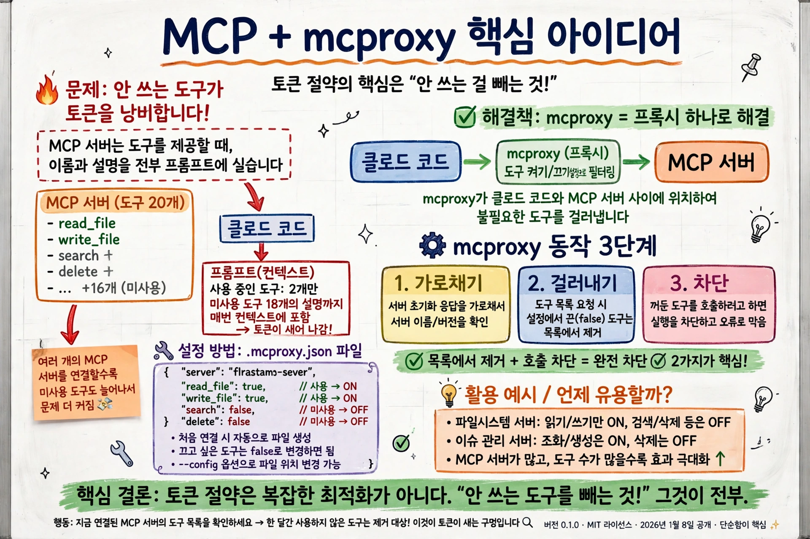

# MCP 도구, 안 쓰는 건 꺼두는 게 토큰 절약의 지름길입니다

> **Summary**
> mcproxy는 클로드 코드와 MCP 서버 사이에서 도구 목록과 호출을 필터링해 사용하지 않는 도구를 차단하고, 불필요한 설명이 프롬프트에 포함되는 일을 줄여 토큰을 절약합니다. 도구별 설정은 간단하지만, 효과는 사용하지 않는 도구가 많을수록 커집니다.

---

- MCP 서버가 주는 도구는 설명까지 통째로 컨텍스트에 실립니다. 안 쓰는 도구가 많을수록 토큰이 불어납니다.
- mcproxy는 클로드 코드와 MCP 서버 사이에 끼는 프록시입니다. 설정 파일에서 도구마다 켜고 끌 수 있습니다.
- 도구를 끄면 목록에서 빠지고, 호출도 막힙니다. 토큰 절약은 복잡한 최적화가 아니라 안 쓰는 걸 빼는 일입니다.

클로드 코드를 쓰다 보면 이런 순간이 있습니다. MCP 서버를 몇 개 연결했는데, 정작 쓰는 도구는 두어 개뿐인데 말이죠. 나머지는 그냥 자리만 차지하고 있습니다. 그런데 이 '자리만 차지하는' 도구들이 공짜가 아닙니다. 도구 설명이 전부 프롬프트에 실려서, 안 쓰는 도구의 설명까지 매번 토큰을 먹습니다!

🎥 [동영상 보기](https://github.com/user-attachments/assets/549f05da-75e2-47b8-b100-9aa3b5f1ccec)

## 안 쓰는 도구가 왜 문제일까요?

MCP 서버는 도구를 제공할 때, 이름과 설명을 함께 넘깁니다. 클로드 코드는 그 설명을 읽고 어떤 도구를 쓸지 판단합니다. 그런데 여기서 함정이 있습니다. 안 쓰는 도구의 설명까지 매번 컨텍스트에 실린다는 겁니다!

서버 하나에 도구가 열 개, 스무 개씩 붙어 있으면 어떨까요? 쓰는 건 두어 개인데, 나머지 열여덟 개의 설명이 매번 토큰을 먹습니다. 서버를 여러 개 연결하면 문제는 더 커집니다. 토큰이 어디서 새는지, 이 장면이 저는 가장 와닿았습니다.

> 안 쓰는 도구의 설명까지 매번 프롬프트에 실립니다. 토큰은 여기서 샙니다.

## 프록시 하나 끼우는 게 전부입니다

mcproxy는 클로드 코드와 MCP 서버 사이에 끼는 작은 프록시입니다. 서버가 보내는 요청을 가로채서, 설정에 따라 도구를 걸러냅니다. 복잡한 설정은 필요 없습니다. 핵심은 딱 하나, 도구마다 켜고 끄는 스위치입니다.

## 어떻게 동작할까요?

동작은 세 단계입니다. 첫째, 가로채기입니다. MCP 서버가 보내는 초기화 응답을 가로채서 서버가 누구인지 확인합니다. 둘째, 걸러내기입니다. 도구 목록을 달라고 하면, 설정에서 끈 도구를 목록에서 뺍니다. 셋째, 차단입니다. 꺼둔 도구를 호출하려고 하면, 실행 자체를 막습니다!

목록에서 빼는 것만으로는 부족합니다. 호출까지 막아야 진짜로 안 쓰는 도구가 됩니다. 이 세 단계가 mcproxy의 전부입니다. 단순하죠? 그런데 이 단순함이 토큰 절약의 핵심입니다.

## 설정은 어떻게 하나요?

설정은 작업 공간에 자동으로 생기는 `.mcproxy.json` 파일 하나입니다. 서버마다 도구 목록이 있고, 도구마다 `true`/`false` 스위치가 붙습니다. 처음 쓰는 도구는 자동으로 등록됩니다. 끄고 싶은 도구는 `false`로 바꾸면 끝입니다. 설정 파일 위치는 `--config` 옵션으로 바꿀 수 있습니다.

서버를 구분하는 기준도 단순합니다. MCP 초기화 응답에 들어 있는 서버 이름과 버전을 씁니다. 설정 파일을 직접 고치지 않아도, 처음 연결하면 알아서 채워집니다. 디버깅이 필요하면 `DEBUG=1`로 자세한 로그를 켤 수 있습니다.

## 어디에 쓰면 좋을까요?

파일시스템 서버를 예로 들어보겠습니다. 파일 읽기, 쓰기, 검색, 디렉터리 나열까지, 도구가 한둘이 아닙니다. 그런데 평소에 쓰는 건 읽기와 쓰기뿐이라면? 나머지는 꺼두면 됩니다. 이슈 관리 서버도 마찬가지입니다. 조회와 생성은 쓰고, 삭제는 꺼두는 식으로 말이죠.

서버를 여러 개 연결할수록 효과가 커집니다. 서버마다 안 쓰는 도구가 쌓이니까요. 반대로 서버가 하나뿐이고 도구도 몇 개 안 되면, 굳이 프록시를 끼울 필요가 없습니다. 이 판단이 저는 가장 중요하다고 봤습니다.

## 숫자로 보면 어떨까요?

이 프로젝트는 아직 초기 단계입니다. 버전은 0.1.0, 라이선스는 MIT입니다. 공개된 건 2026년 1월 8일, 저장소 별은 19개, 포크는 4개입니다. 작은 숫자죠? 그런데 이 작은 숫자가 오히려 말해주는 게 있습니다. 토큰 절약이라는 문제를, 거창한 프레임워크가 아니라 프록시 하나로 푼다는 겁니다.

README에 구체적인 절감 수치는 없습니다. 얼마나 아낄 수 있는지는 안 쓰는 도구가 몇 개인지에 따라 달라집니다. 절감 폭을 숫자로 못 박을 수 없는 게 당연합니다. 서버마다 도구 수가 다르니까요. 기준은 하나입니다. 안 쓰는 도구가 많을수록, 아끼는 토큰도 많습니다.

## 맺음말

토큰 절약은 대단한 최적화 기법이 아닙니다. 안 쓰는 걸 빼는 일입니다. mcproxy는 그 빼는 일을 프록시 하나로 대신해줍니다. 도구 목록에서 빼고, 호출까지 막습니다. 단순하지만 확실합니다! 지난 한 달 동안 한 번도 안 쓴 도구가 있다면, 그게 바로 토큰이 새는 구멍입니다.

