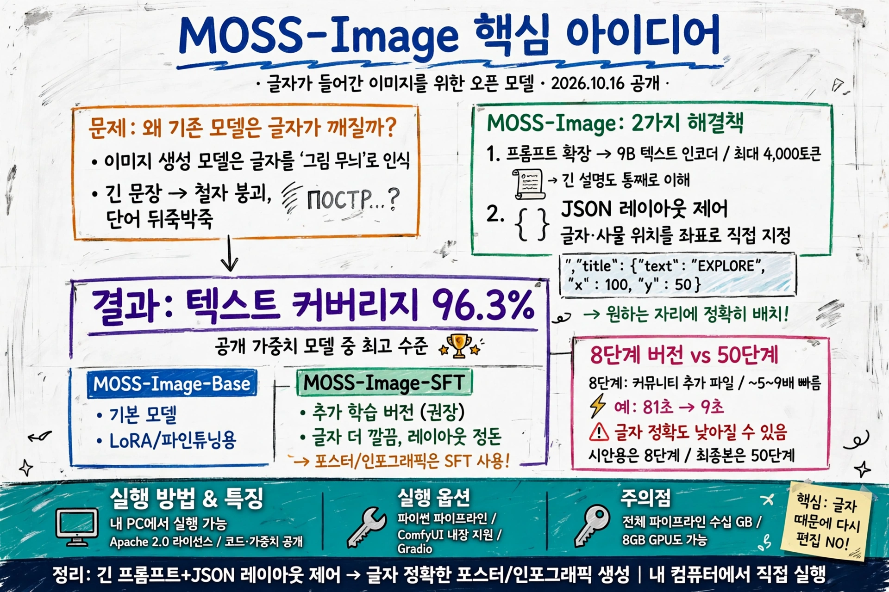
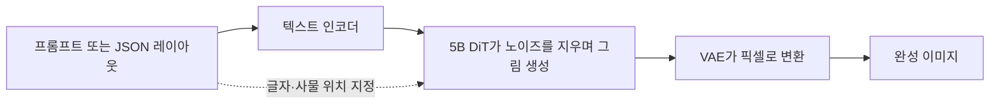
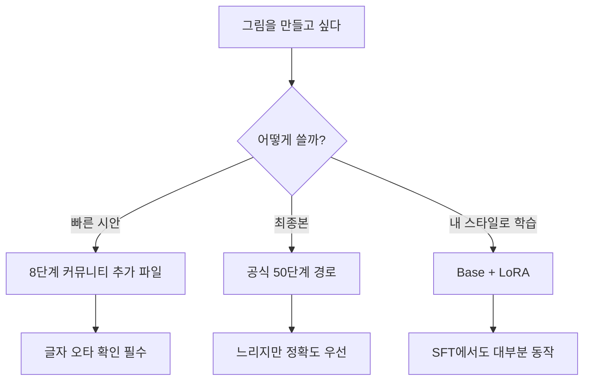

# MOSS-Image: 포스터 글자가 깨지지 않습니다. 글자와 위치를 프롬프트로 정합니다

> **Summary**
> MOSS-Image는 포스터·인포그래픽처럼 글자와 배치가 중요한 이미지 제작에 강한 오픈 모델로, 최대 4,000토큰의 프롬프트를 읽고 JSON으로 글자와 사물의 위치를 지정할 수 있습니다. 권장되는 SFT 버전은 공식 50단계 생성 경로를 사용하며, 8단계 버전은 빠르지만 커뮤니티 제작물이라 글자 오류를 확인해야 합니다. Apache 2.0 라이선스로 공개되어 로컬 실행과 Base 모델 기반의 파인튜닝이 가능하지만, 상당한 하드웨어 자원이 필요합니다.

---

- MOSS-Image는 글자가 들어간 이미지를 만드는 데 강한 오픈 이미지 생성 모델입니다.
- 글자와 사물의 위치를 JSON으로 직접 정할 수 있고, 긴 프롬프트도 최대 4,000토큰까지 읽습니다.
- 가중치는 Apache 2.0으로 공개돼 내 컴퓨터에서 돌릴 수 있고, 8단계 버전은 공식이 아니라 커뮤니티 추가 파일입니다.

포스터를 만들려고 이미지 생성 모델에 문구를 넣은 적 있으시죠? 제목은 대충 맞았는데, 작은 글자가 뒤죽박죽이 되거나 아예 다른 단어가 된 경험 말입니다. 그림은 예쁜데 글자만 믿을 수 없으니, 결국 포스터는 따로 편집 프로그램에서 다시 만들어야 했습니다.

🎥 [동영상 보기](https://www.youtube.com/watch?v=mlOTahZ7AYo)

MOSS-Image는 이 지점을 정면으로 노렸습니다. 글자가 들어간 이미지, 그러니까 포스터·인포그래픽·메뉴판 같은 그림을 잘 만드는 것이 목표입니다. 2026년 10월 16일에 공개됐고, 가중치와 코드가 Apache 2.0 라이선스로 열려 있습니다!

## 글자가 왜 자꾸 깨졌을까요?

이미지 생성 모델은 보통 글자를 "그림의 일부"로 봅니다. 글자의 뜻을 읽는 것이 아니라, 글자처럼 보이는 무늬를 그리는 쪽에 가깝습니다. 그래서 짧은 단어는 그럴듯하게 나오다가도, 문장이 길어지면 철자가 무너지기 시작합니다.

MOSS-Image는 이 문제를 두 가지로 풀었습니다. 먼저 프롬프트를 읽는 부분을 크게 가져갔습니다. 9B 규모의 텍스트 인코더가 최대 4,000토큰까지 프롬프트를 읽으니, 긴 설명도 통째로 들어갑니다. 그리고 글자 렌더링을 따로 측정한 벤치마크에서 평균 96.3%의 텍스트 커버리지를 기록했습니다. 공개 가중치 모델 중에서는 가장 높은 수치라고 기술 보고서에 나와 있습니다. 물론 벤치마크 수치는 벤치마크일 뿐, 모든 문장이 완벽하게 나온다는 뜻은 아닙니다!

## 위치는 어떻게 정하나요?

이 모델의 진짜 차별점은 레이아웃 제어입니다. "제목을 위에, 산 그림을 아래에"처럼 말로만 설명하는 것이 아닙니다. JSON으로 글자와 사물의 위치를 직접 적어줍니다.

예를 들어 포스터 제목 `EXPLORE`의 위치를 좌표로 적으면, 모델은 그 자리에 그 글자를 그립니다. 위치를 바꾸고 싶으면 좌표 숫자만 바꾸면 됩니다. 프롬프트를 다시 짜는 것이 아니라, 설계도를 고치는 방식입니다. 포스터·전단지·안내판처럼 "어디에 무엇이 있어야 하는지"가 정해진 그림에서는 이 차이가 크게 느껴집니다. 브라우저에서 상자를 그려 레이아웃을 짜는 커뮤니티 도구까지 나와 있습니다. 위치를 눈으로 정하고 JSON으로 받는 방식입니다.

## Base와 SFT, 뭐가 다를까요?

MOSS-Image는 두 가지 버전으로 나왔습니다. `MOSS-Image-Base`는 기본 모델이고, `MOSS-Image-SFT`는 선별한 데이터로 추가 학습한 버전입니다. 그림을 만들 때는 SFT 쪽이 권장됩니다. 글자 묶음이 더 깔끔하고 레이아웃도 더 정돈된다고 공식 비교에 나와 있습니다.

Base의 용도는 따로 있습니다. 파인튜닝과 `LoRA` 학습용입니다. Base에서 학습한 `LoRA`는 SFT에서도 대부분 그대로 돌아간다고 합니다. 내 스타일이나 내 도메인에 맞게 가르치고 싶다면 Base에서 시작하는 것이 순서입니다.

## 8단계 버전은 정말 5배 빠를까요?

소개 글에서 "8단계 버전이 약 5배 빠르다"는 말이 눈에 띕니다. 그런데 이 8단계 버전은 공식 릴리스가 아닙니다. 커뮤니티에서 만든 추가 파일이 50단계 기본 경로를 8단계로 줄인 것입니다. 공식 저장소의 커뮤니티 프로젝트 목록에도 이 추가 파일이 올라와 있습니다.

빠른 것은 사실입니다. 한 독립 테스트에서는 공식 경로가 81초 걸린 포스터를 8단계 추가 파일이 9초에 만들었습니다. 약 9배 차이입니다. 그런데 대가가 있습니다. 같은 테스트에서 8단계 버전은 제목을 "OPEN WEIGHT WEIGHTS DAY"처럼 잘못 적었습니다. 글자가 핵심인 그림에서 글자를 틀리면, 빠른 것은 무슨 소용일까요? 속도를 택할지 정확도를 택할지, 용도에 따라 갈리는 문제입니다. 대량으로 시안을 뽑을 때는 8단계, 최종본은 50단계가 현실적인 조합입니다!

## 내 컴퓨터에서 돌리려면 무엇이 필요할까요?

실행은 크게 두 갈래입니다. 파이썬 파이프라인으로 직접 돌리는 방법과 `ComfyUI`에서 쓰는 방법입니다. `ComfyUI`는 출시 당일부터 네이티브로 지원됐습니다. 별도 플러그인 없이 내장 로더로 가중치를 불러오면 됩니다. 웹 화면으로 간단히 써보고 싶다면 `Gradio` 인터페이스도 있습니다.

무게는 가볍지 않습니다. 이미지 변환기 5B에 텍스트 인코더 9B, 디코더까지 합하면 전체 파이프라인이 수십 GB에 이릅니다. 8GB 그래픽카드에서도 돌아간다는 보고가 있지만, 속도와 품질의 타협이 따릅니다. 양자화 버전이나 `CPU` 오프로딩 같은 우회로가 커뮤니티에 나와 있으니, 내 그래픽카드 사양부터 확인하는 것이 먼저입니다.

## 검열이 적다는 말, 정확히 무슨 뜻일까요?

"검열이 적은 모델"이라는 표현의 실제 의미를 짚어봐야 합니다. 핵심은 구조입니다. 가중치가 공개돼 있고 내 컴퓨터에서 돌아가니, API 서비스처럼 요청 단계에서 서버가 내용을 걸러내는 구조가 아닙니다. 그것이 이 표현의 실제 의미입니다.

하지만 "막는 것이 없다"는 "아무렇게나 써도 된다"는 뜻이 아닙니다. 만든 이미지의 책임은 쓰는 사람에게 그대로 남습니다. 타인의 얼굴이나 상표를 마음대로 쓰거나, 가짜 정보를 진짜처럼 퍼뜨리는 일은 모델이 오픈소스라고 해서 허용되지 않습니다. 자유도가 커질수록, 쓰는 사람의 판단이 더 중요해집니다. 이 점은 꼭 짚고 넘어가야 합니다!

정리하면 이렇습니다. MOSS-Image는 글자와 레이아웃이 중요한 그림을 위해 나온 오픈 모델입니다. 긴 프롬프트를 읽고, 글자 위치를 직접 정하고, 가중치가 열려 있어 내 컴퓨터에서 돌릴 수 있습니다. 8단계 버전은 공식이 아니라 커뮤니티 추가 파일이고, 빠르지만 글자 정확도를 꼭 확인해야 합니다. 포스터 한 장을 만들 때 글자 때문에 다시 그렸던 경험이 있다면, 한번 써볼 만한 모델입니다.

