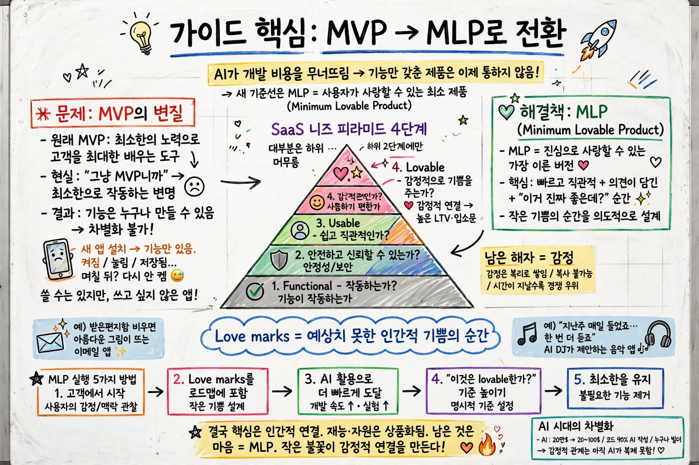
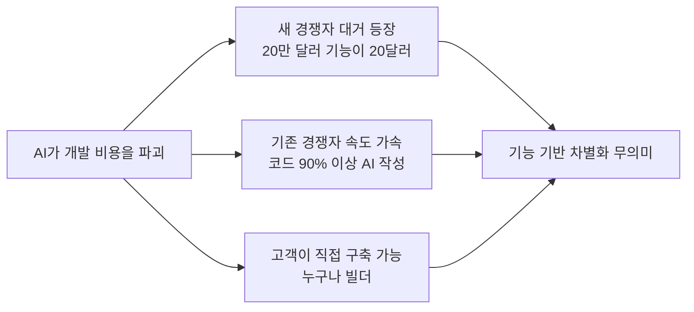
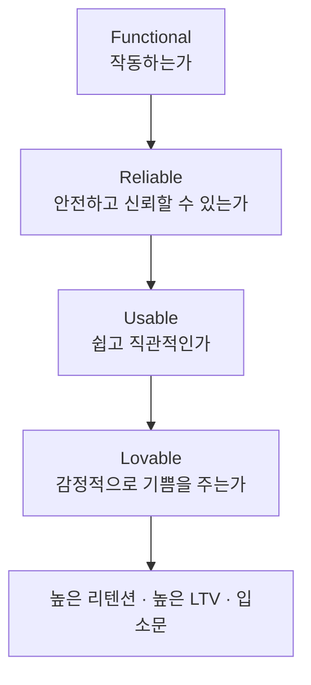

# MVP는 끝났습니다, 이제는 사랑받는 최소 제품이 기준입니다

> **Summary**
> AI가 개발 비용을 무너뜨리면서 기능만 갖춘 제품은 더 이상 통하지 않으며, 새 기준선은 사용자가 사랑할 수 있는 최소 제품, MLP가 됐습니다. MVP는 원래 빠른 학습 도구였지만 '최소한으로 작동하는 제품'이라는 변명으로 변질됐고, 이제 기능은 누구나 만들 수 있어 차별화가 안 됩니다. 남은 해자는 감정입니다. 피라미드 꼭대기 Lovable까지 올라가고 작은 기쁨의 순간을 의도적으로 설계하는 팀이 살아남습니다.

---

- AI가 개발 비용을 무너뜨리면서, 기능만 갖춘 제품은 더 이상 통하지 않습니다. 새 기준선은 MLP, 사용자가 사랑할 수 있는 최소 제품입니다.
- MVP는 원래 빠른 학습을 위한 도구였지만, 현실에서는 "최소한으로 작동하는 제품"이라는 변명으로 변질됐습니다. 이제 기능은 누구나 만들 수 있어 차별화가 안 됩니다.
- 남은 해자는 감정입니다. 피라미드 꼭대기 Lovable까지 올라가고, 작은 기쁨의 순간을 의도적으로 설계하는 팀이 살아남습니다.

새 앱을 하나 깔았는데, 딱 기능만 있는 앱이었습니다. 켜지고, 눌리고, 저장은 됐습니다. 그런데 며칠 뒤에 그 앱을 다시 켰을까요? 아마 아닐 겁니다. 쓸 수는 있는데, 쓰고 싶지 않은 앱이었습니다!

🎥 [동영상 보기](https://www.youtube.com/watch?v=gLFZNzeylCc)

## MVP, 어떻게 변질됐을까요?

MVP는 원래 최소한의 노력으로 고객에 대해 최대한 배우는 프레임워크였습니다. 그런데 현실에서는 의미가 퇴색됐습니다. "최소 기능 제품"으로 말이죠. MVP를 올바르게 쓰는 팀 하나당, "그냥 MVP니까"를 변명으로 삼는 팀이 10개쯤 있다고 합니다.

제품이 골격 상태로 출시된 뒤, 골격 상태로 남아 있는 패턴이 고착화됐습니다. 그래서 MVP라는 용어 자체가 오염됐습니다. 다른 신호를 보내려면 다른 용어가 필요했습니다. 그게 MLP입니다.

MLP는 사용자가 진심으로 사랑할 수 있는 가장 이른 버전의 제품입니다. 빠르고, 직관적이며, 의견이 담겨 있습니다. "이거 진짜 좋은데?"라는 순간을 만들어내는 제품입니다!

## 왜 지금 기준이 올라갔을까요?

소프트웨어 개발이 비쌌기 때문에 MVP가 인기를 끌었습니다. "기능적"을 넘어서는 것은 실제 비용이 들었으니까요. 골격 제품을 출시하고 반복하는 것이 합리적이었습니다. 그런데 지금 AI가 개발 비용을 급격히 파괴하고 있습니다. 모든 기존 제품이 최소 3가지 전선에서 경쟁에 직면했습니다.

첫째, 새로운 경쟁자가 대거 등장했습니다. 기존에 최소 20만 달러가 필요했던 기본 기능을 이제 20달러, 100달러, 또는 무료로 구축할 수 있습니다. 둘째, 기존 경쟁자의 출시 속도가 가속됐습니다. 엔지니어링 팀이 AI를 활용해 코드의 90% 이상을 AI가 작성하는 경우도 다수입니다. 셋째, 고객이 직접 구축할 수 있습니다. 누구나 빌더가 될 수 있는 시대입니다.

기본 제품 유틸리티가 상품화되면서 기능 기반 차별화가 완전히 무의미해지는 지점에 도달하고 있습니다. AI는 기능을 하룻밤에 출시하고 며칠 만에 기능을 맞출 수 있습니다. 그런데 사용자가 제품과 맺은 특정한 감정적 관계는 아직 복제하지 못합니다. 제품이 말하는 방식, 성취를 축하하는 방식, 실수를 처리하는 방식 말입니다. 이런 감정적 요소는 시간이 지날수록 복리로 쌓이며, 복사하기 매우 어렵습니다!

## SaaS 니즈 피라미드, 꼭대기는 어디일까요?

사람의 욕구 위계처럼, 기본적인 안전과 보안이 충족되면 사람은 연결, 소속감, 목적, 기쁨 등 더 높은 것을 추구합니다. 고객에게 선택지가 있으면, 기능적이지만 영혼 없는 제품을 참을 필요가 없어집니다. SaaS 니즈 피라미드는 4단계입니다.

- **Functional** — 작동하는가? 약속한 기능을 수행하는가?
- **Reliable** — 안전하고 신뢰할 수 있는가?
- **Usable** — 쉽고 직관적인가?
- **Lovable** — 감정적으로 기쁨을 주는가?

대부분의 제품이 하위 두 계층에 머물러 있습니다. MVP라 불린 제품이 이 단계를 벗어난 경우는 거의 없습니다. 그런데 감정적으로 연결된 고객은 더 높은 리텐션과 더 높은 LTV를 보이고 주변에 추천합니다. 입소문은 항상 최고의 성장 채널이었지만, 사람들은 감정을 느끼게 한 제품에 대해서만 이야기합니다.

단, AI 에이전트용 도구나 LLM 인터페이스를 구축한다면 lovable은 중요하지 않습니다. 프로토콜 연결만 필요합니다. 인간 사용자 기반을 원한다면 피라미드 하단에 머물면 안 됩니다.

## Love marks, 작지만 기억에 남는 순간은?

Love marks란 제품 내에서 발생하는 예상치 못한 인간적 기쁨의 순간입니다. 기능적으로는 쓸모없지만 사람들이 가장 많이 기억하는 요소입니다. 받은편지함을 비우면 아름다운 그림이 뜨는 이메일 앱이 있습니다. 정량적 가치는 제로이지만 매번 미소를 짓게 만듭니다. 음악 앱의 AI DJ는 "이 노래 지난주 매일 들었죠… 한 번 더 듣죠"라고 말하며 사용자와의 연결감을 형성합니다.

이런 작은 터치들이 인간적 연결의 순간을 만들어냅니다. MVP 논의에서는 절대 다뤄지지 않는 영역입니다. MVP 방식은 기능적이지 않은 모든 것, 취향과 개성, 색깔과 의견을 과도하다며 잘라내도록 훈련시켰습니다. 그런데 일부 선택은 UX 흐름에 약간의 지연이나 마찰을 추가하지만, 경험 전체를 훨씬 좋게 만듭니다. 동일 기능의 15개 경쟁 제품 중에서 선택받는 이유가 됩니다!

브랜드의 감정적 레이어가 모든 제품 결정에 나타나야 합니다. 제품이 말하는 방식, 에러를 처리하는 방식, 승리를 축하하는 방식 모두 마케팅 레이어가 아니라 제품 자체에서 고려해야 합니다. "엔터프라이즈 제품에서는 축하 효과 같은 건 안 된다"는 생각도 있습니다. 그런데 B2B는 수년간 B2C의 흐름을 따라왔습니다. Lovable은 상당한 엔터프라이즈 트랙션을 확보했고, "진지하지 않다"는 불만은 없었습니다.

반면교사도 있습니다. 조달용 제품은 재무 담당자의 통제력은 만족시켰지만, 실제 사용하는 사람에게는 에너지가 빠져나가는 경험이었습니다. 반대로 어떤 대기업은 오래전부터 MLP라는 용어를 리더십 원칙에 내재화해 왔습니다. 그 선택은 한때 선택 사항이었지만, 이제는 모두에게 기본 조건이 됐습니다.

## MLP, 어떻게 만들까요?

실행 방법은 다섯 가지입니다.

첫째, **기능 목록이 아닌 고객에서 시작합니다.** 대부분의 팀이 가치와 노력으로 기능 우선순위를 정하면 모두에게 참을 만하지만 아무도 사랑하지 않는 제품이 됩니다. 대신 특정 세그먼트를 선택하고, 대화하고, 그 그룹이 사랑에 빠질 기능과 경험의 조합을 찾아야 합니다.

둘째, **Love marks를 로드맵에 포함합니다.** 일정이 빠듯할 때 잘리는 nice-to-have가 아니라, 실제 우선순위를 가진 의도적 투자로 취급합니다. 기쁨의 순간, 이스터에그, 작은 상호작용에서의 개성을 챙깁니다. 제품이 사용자의 승리를 어디서 축하하는지, 유머를 어디서 보여주는지, 사람이 만든 느낌이 어디서 나는지 점검합니다.

셋째, **AI를 활용해 더 빠르게 도달합니다.** AI에게 "이 상호작용을 어떻게 더 lovable하게 만들 수 있을까?"라고 물어보면 놀랍도록 좋은 아이디어를 얻을 수 있습니다.

넷째, **기준을 명시적으로 높게 설정합니다.** 출시 전 항상 "이것은 lovable한가?"를 질문합니다. "작동하는가"나 "준비됐는가"가 아니라, 감정적 경험을 평가하도록 강제하는 질문이 모든 팀에 필요합니다. 이 기준을 설정하지 않으면 매번 MVP로 회귀하게 됩니다.

다섯째, **최소한을 유지합니다.** MLP가 출시 전 모든 것을 금도금하라는 의미는 아닙니다. Minimum은 여전히 minimum입니다. 핵심 질문은 "진짜 감정적 순간을 만드는 가장 단순한 것이 무엇인가"입니다.

결국 인간적 연결의 문제입니다. 잠재 사용자의 문제와 경험을 깊이 이해하면서, 자신만의 취향을 더해 더 인간적으로 만들 때 마법이 발생합니다. 고객 이해를 무시하면 아무도 위한 것이 아닌 제품을 만들게 되고, 고유한 접근과 스타일을 무시하면 범용적인 제품이 됩니다.

재능과 자원은 상품화되고 있습니다. 남은 부분은 마음입니다. 관심 있는 것을 작업할 때 개성이 드러나고, 작은 선택과 직감, 기쁨을 주는 상호작용에 대한 아이디어가 나옵니다. MLP는 진짜 사람이 있다는 것을 보여줄 만큼의 최소한의 개성을 가진 제품입니다. 그 작은 불꽃이 감정적 연결을 가능하게 합니다!

