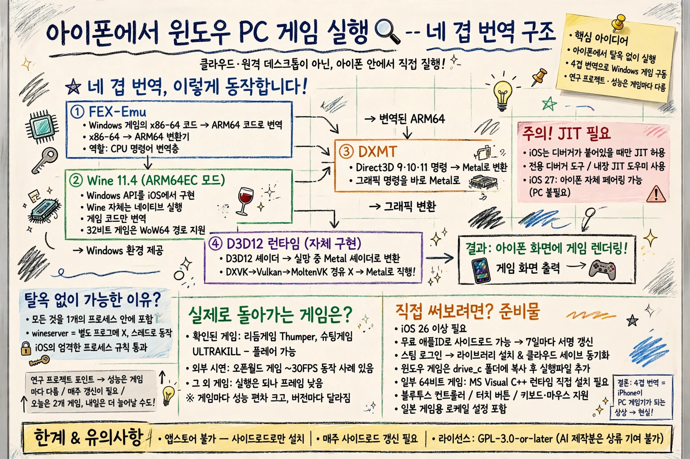
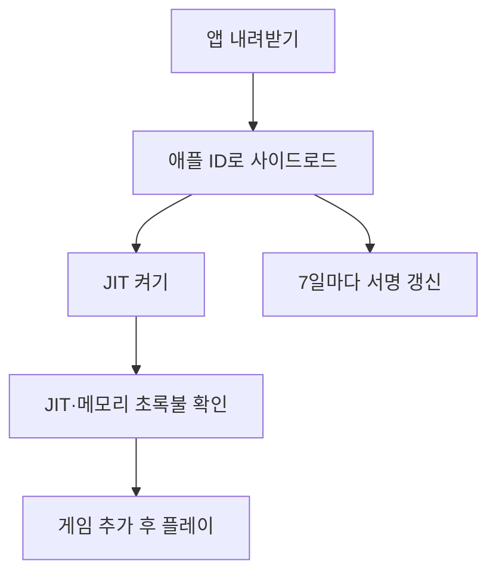

# Madeira: 탈옥 없이 아이폰에서 PC 게임을 돌립니다. 네 겹 번역이 한 번에 일어납니다

> **Summary**
> 아이폰에서 탈옥 없이 윈도우 PC 게임이 돌아갑니다. 게임 코드는 FEX-Emu가 ARM64로 바꾸고, 윈도우는 Wine이, 그래픽은 DXMT와 D3D12가 Metal로 그리는 네 겹 번역 덕분입니다. 아이폰 앱은 다른 프로그램을 실행할 수 없어 모든 것을 하나의 프로세스 안에 넣었고, JIT은 디버거가 붙어 있을 때만 허용돼 사이드로드 설치와 매주 서명 갱신이 필요합니다. 수집 시점 기준으로는 리듬 게임과 슈팅 게임 두 편이 플레이 가능했고, 스팀 로그인·클라우드 세이브·컨트롤러·일본어 로케일까지 갖췄지만 게임마다 성능 편차가 큰 연구 프로젝트입니다.

---

- 아이폰에서 탈옥 없이 윈도우 PC 게임이 돌아갑니다. 네 겹 번역이 한 번에 일어나는 덕분입니다.
- 게임 코드는 FEX-Emu가 ARM64로 바꾸고, 윈도우는 Wine이, 그래픽은 DXMT와 D3D12가 Metal로 그립니다.
- 다만 연구 프로젝트라 게임마다 성능이 다르고, JIT 디버거 연결과 매주 사이드로드 갱신이 필요합니다.

지하철에서 스팀 라이브러리를 열어본 적 있으시죠? 집 PC에 깔린 게임이 손안의 아이폰에서도 돌아가면 좋겠다는 생각이 들 때가 있습니다. 클라우드도, 원격 데스크톱도 아닙니다. 아이폰 안에서 게임이 직접 돌아갑니다!

🎥 [동영상 보기](https://www.youtube.com/watch?v=00sEsT_viD8)

## 네 겹 번역, 어떻게 돌아갈까요?

윈도우 게임은 아이폰이 모르는 언어로 쓰여 있습니다. 명령어부터 그래픽까지, 네 겹을 차례로 바꿔야 화면이 나옵니다. 각 층이 맡은 일이 따로 있습니다.

첫 번째 층은 **FEX-Emu**입니다. 게임의 x86-64 코드를 실행하면서 ARM64 코드로 번역합니다. 두 번째 층은 **Wine 11.4**입니다. `ARM64EC` 모드로 빌드돼서 Wine 자체는 네이티브로 돌고, 게임 코드만 번역합니다. 32비트 게임은 `WoW64` 경로로 돌아갑니다.

세 번째 층은 그래픽입니다. **DXMT**가 Direct3D 9·10·11 명령을 Metal로 바로 바꿉니다. 네 번째 층은 자체 구현한 **D3D12** 런타임입니다. 셰이더를 실행 중에 Metal 셰이더로 변환합니다. 맥에서 쓰던 DXVK→Vulkan→MoltenVK 경로를 거치지 않고 Metal로 바로 간다는 점이 눈에 띕니다!

## 탈옥 없이 되는 이유는 뭘까요?

아이폰 앱은 다른 프로그램을 실행할 수 없습니다. 그래서 모든 것을 하나의 프로세스 안에 넣었습니다. `wineserver`도 별도 프로그램이 아니라 스레드로 돕니다. 이 설계가 아이폰의 엄격한 프로세스 규칙을 통과하는 열쇠입니다!

다만 **JIT**이 필요합니다. 아이폰은 디버거가 붙어 있을 때만 JIT을 허용합니다. 전용 디버거 도구나 내장 JIT 도우미로 해결합니다. iOS 27에서는 아이폰 자체에서 페어링이 가능해져 컴퓨터 없이도 준비할 수 있습니다.

> 앱스토어에는 올릴 수 없습니다. JIT에 디버거가 필요하기 때문입니다. 그래서 사이드로드로 설치합니다!

## 실제로 뭐가 돌아갈까요?

수집 시점 기준으로는 리듬 게임 `Thumper`와 슈팅 게임 `ULTRAKILL`이 플레이 가능했습니다. 다른 게임은 실행은 되지만 프레임이 낮았습니다. 외부 시연에서는 유명 오픈월드 게임이 아이폰에서 30프레임 안팎으로 돌아가는 장면도 나왔습니다. 다만 게임마다 편차가 크고, 버전이 바뀔 때마다 결과가 달라집니다. 연구 프로젝트라는 점을 잊으면 안 됩니다.

기능은 생각보다 알찹니다. 게임 라이브러리에 표지와 검색, 윈도우 데스크톱 세션이 있습니다. 스팀에 로그인해 보유 게임을 설치하고, 스팀 클라우드 세이브도 동기화합니다. 양쪽에서 바뀐 세이브는 묻지 않고 덮지 않고, 교체된 세이브는 백업합니다. 블루투스 컨트롤러와 화면 터치 버튼, 키보드·마우스·트랙패드도 그대로 전달됩니다. 일본 게임용 로케일 설정까지 있습니다.

## 직접 써보려면 뭘 준비해야 할까요?

아이폰은 **iOS 26 이상**이 필요합니다. 무료 애플 ID로도 사이드로드가 가능하지만, 서명이 7일마다 만료돼 매주 갱신해야 합니다. 게임과 세이브는 재설치 뒤에도 남습니다. 설치 순서는 단순합니다.

스팀 게임은 라이브러리에서 로그인해 설치합니다. 이미 가진 윈도우 게임은 폴더째 `drive_c` 안에 복사한 뒤 실행 파일을 골라 추가합니다. 64비트 게임 중 일부는 마이크로소프트 Visual C++ 런타임이 따로 필요합니다. 이 파일은 프로젝트에 포함돼 있지 않으니 직접 준비해야 합니다.

소스에서 빌드하려면 서브모듈까지 함께 받아야 합니다. 포크된 저장소들이 서브모듈로 연결돼 있어, 상류 저장소를 그대로 받으면 빌드가 되지 않습니다. 빌드 스크립트 한 줄로 앱 패키지까지 만들 수 있습니다.

## 라이선스는 왜 GPL일까요?

프로젝트 전체는 **GPL-3.0-or-later**입니다. 애플 Metal 셰이더 변환기와 함께 쓸 수 있도록 추가 허가 조항도 붙어 있습니다. 기반이 된 포크들은 상류와 라이선스가 다릅니다. Wine 포크는 LGPL을 유지하고, FEX-Emu와 DXMT 포크는 상류 MIT 코드를 유지하면서 변경분만 GPL로 묶었습니다. 배포하는 파생물은 오픈소스로 남아야 합니다!

한 가지 주의할 점이 있습니다. 포크에 들어간 작업 중 상당수가 AI 도움을 받아 만들어졌습니다. 상류 프로젝트 중 일부는 AI로 만든 코드를 받지 않으므로, 이 포크의 변경분을 상류에 그대로 보내면 안 됩니다. 라이선스가 허용해도, 기여 정책은 따로 확인해야 합니다.

연구 프로젝트의 매력은 끝이 열려 있다는 점입니다. 오늘은 두 개 게임이 돌아가지만, 내일은 어떤 게임이 돌아갈지 모릅니다. 아이폰이 PC 게임기가 되는 상상, 이제 번역 네 겹으로 현실이 되고 있습니다.

