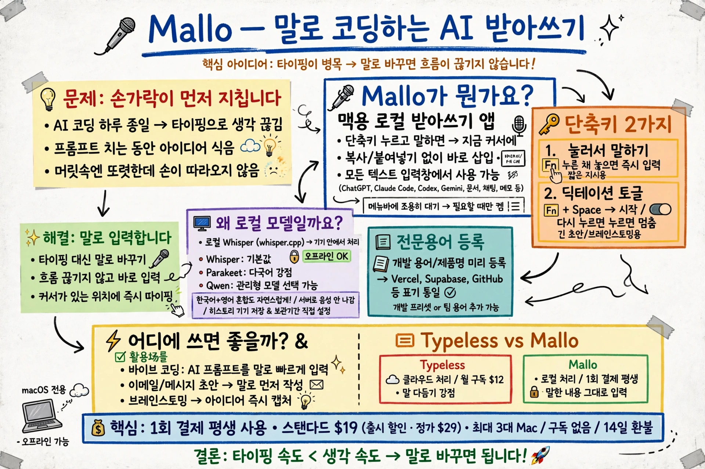
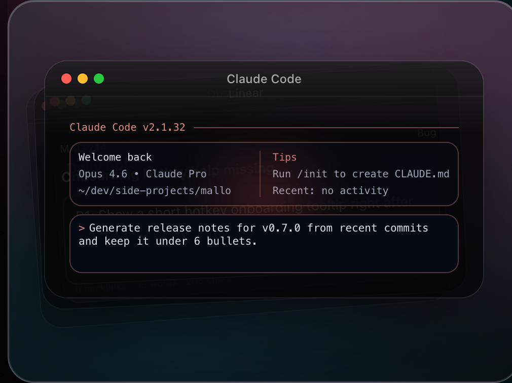
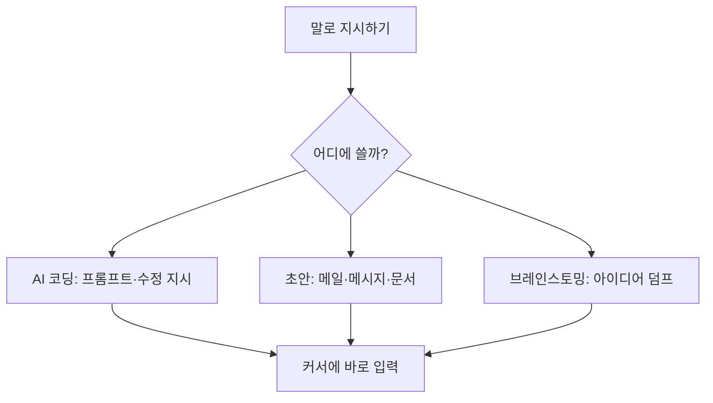
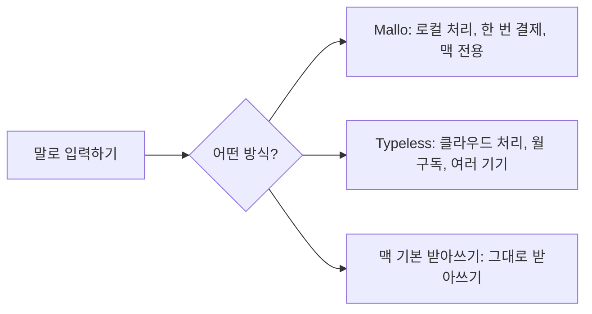

# Mallo: 타이핑은 그만, 말하면 커서에 바로 입력됩니다

> **Summary**
> Mallo는 단축키를 누르고 말하면 커서 위치에 음성을 바로 입력하는 맥용 받아쓰기 앱입니다. 로컬 Whisper 모델로 오프라인에서 작동하고, 전문용어 등록과 다양한 입력 앱을 지원하며, 구독 없이 한 번 결제로 사용할 수 있습니다.

---

- AI랑 하루 종일 코딩하다 보면 타이핑이 먼저 지칩니다. 말로 하면 흐름이 끊기지 않습니다.
- Mallo는 단축키를 누르고 말하면, 지금 커서가 있는 곳에 바로 입력되는 맥용 받아쓰기 앱입니다.
- 로컬 Whisper 모델로 기기 안에서 처리해 오프라인에서도 되고, 한 번 결제하면 평생 씁니다.

## AI랑 코딩하다 보면, 손가락이 먼저 지치시죠?

AI랑 하루 종일 코딩하다 보면 이런 순간이 옵니다. 머릿속에는 지시가 또렷한데, 손가락이 따라오지 않습니다. 프롬프트를 타이핑하는 동안 생각이 식고, 흐름이 끊깁니다!

그래서 말로 하는 겁니다. 타이핑을 줄이는 게 아니라, 아예 말로 바꾸는 겁니다!

🎥 [동영상 보기](https://www.youtube.com/watch?v=vv8CijY15CQ)

## Mallo가 뭔가요?

Mallo는 맥에서 쓰는 AI 받아쓰기 앱입니다. 단축키를 누르고 말하면, 지금 작업 중인 곳에 바로 입력해 줍니다. 복사하고 붙여넣는 과정이 없습니다. 커서 위치에 바로 타이핑됩니다.

ChatGPT, Claude Code, Codex, Gemini 같은 AI 도구는 물론이고, 문서, 채팅, 메모까지 텍스트 입력이 되는 곳이면 어디서든 씁니다. 앱을 바꿀 필요가 없습니다. 지금 쓰고 있는 앱 그대로 말하면 됩니다.

메뉴바에 조용히 머물러 있습니다. 필요할 때만 켜서, 필요한 곳에만 입력합니다. 포커스를 빼앗지 않습니다.

## 단축키는 두 가지, 누르고 말하면 끝입니다

어떻게 쓰는 걸까요? 방식은 두 가지입니다.

첫 번째는 눌러서 말하기입니다. `Fn` 키를 누른 채로 말하면 듣고, 놓는 순간 커서에 입력됩니다. 짧은 지시는 누르고 말하면 끝입니다!

두 번째는 딕테이션 토글입니다. `Fn` + `Space`를 한 번 누르면 시작하고, 다시 누르면 멈춥니다. 긴 초안이나 브레인스토밍처럼 계속 말해야 할 때 씁니다.

## 왜 로컬 모델일까요?

Mallo는 로컬 Whisper 모델(`whisper.cpp`)로 기기 안에서 바로 처리합니다. 그래서 오프라인에서도 쓸 수 있습니다. 별도 계정도 필요 없습니다.

로컬 모델은 세 가지입니다. Whisper가 기본값이고, 다국어에 강한 Parakeet, 관리형 Qwen도 고를 수 있습니다. 한국어와 영어가 섞인 환경에서도 자연스럽게 이어집니다.

음성이 서버로 나가지 않는다는 점이 저는 가장 와닿았습니다. 히스토리는 옵션을 켰을 때만 기기에 저장되고, 보관 기간도 직접 정할 수 있습니다.

## 전문용어도 미리 등록해 두면 됩니다

개발하다 보면 제품명이나 팀 용어가 자주 나옵니다. 말할 때마다 다르게 받아쓰면 나중에 고쳐야 합니다. Mallo는 입력 전에 등록한 용어를 반영해 표기를 일정하게 맞춰줍니다.

개발 프리셋을 쓰거나 팀 용어를 직접 추가할 수 있습니다. 단어 경계만 정확히 바꿔서 문장 뜻은 건드리지 않습니다. 예를 들어 `Vercel` 프리뷰 배포하고 `Supabase` 인증을 맞춘 뒤 `GitHub` 이슈를 열어달라는 지시는, 말한 그대로 정확한 표기로 입력됩니다.

## 어디에 쓰면 좋을까요?

가장 잘 맞는 곳은 바이브 코딩입니다. ChatGPT, Gemini, Claude Code, Codex에 프롬프트와 수정 지시를 말로 빠르게 입력합니다. 의도에서 지시로 넘어가는 흐름이 끊기지 않습니다. 예외 조건이나 제약을 생각나는 순간 바로 입력할 수 있습니다.

이메일이나 메시지 초안도 말로 먼저 만들고, 지금 쓰는 도구에서 다듬으면 됩니다. 브레인스토밍도 마찬가지입니다. 사라지기 쉬운 아이디어를 바로 캡처하고, 나중에 정리하면 됩니다.

## Typeless와 뭐가 다를까요?

Mallo는 Typeless와 닮았습니다. 둘 다 말하면 커서에 입력되는 받아쓰기 앱입니다. 그런데 방향이 다릅니다.

Typeless는 클라우드에서 처리하고 월 구독($12)을 냅니다. 여러 기기에서 쓰고, 말한 내용을 다듬어 주는 데 강합니다. Mallo는 로컬에서 처리하고 한 번만 결제합니다. 맥 전용이고, 오프라인에서도 됩니다. 말한 내용을 그대로 입력하는 데 집중합니다.

한 번 결제면 평생 쓸 수 있습니다. 스탠다드 $19(출시 할인, 정가 $29)에 최대 3대 맥에서 활성화되고, 향후 업데이트도 계속 제공됩니다. 구독이 없습니다! 환불은 구매 후 14일 이내에 요청할 수 있습니다.

## 타이핑이 병목이면, 말로 바꾸면 됩니다

타이핑 속도가 생각을 따라오지 못할 때가 있습니다. 그럴 때 말로 하면 됩니다. 단축키 하나면, 지금 커서가 있는 곳에 바로 입력됩니다. 로컬이라 오프라인에서도 되고, 한 번 결제면 평생 씁니다. AI 코딩할 때 프롬프트를 말로 넣는 흐름, 한 번 써보시면 타이핑으로 돌아가기 어려우실 겁니다!

