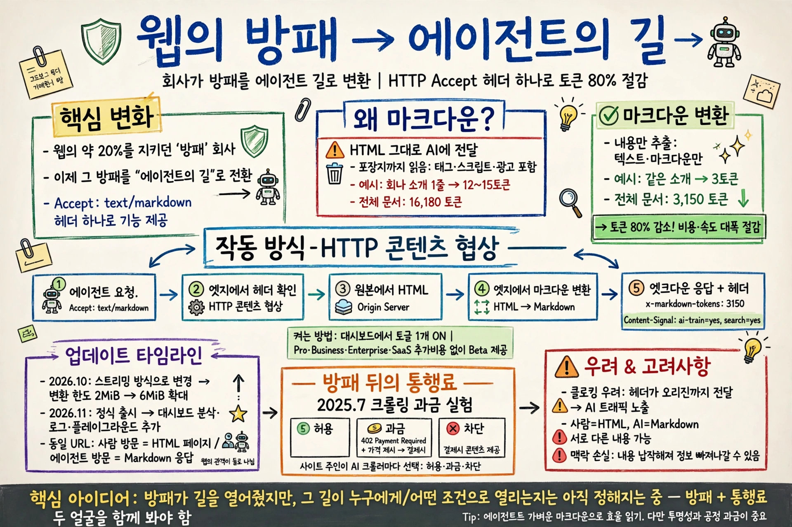
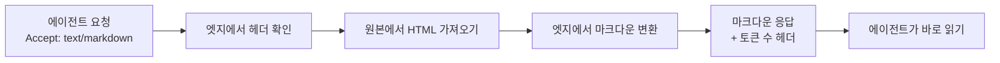
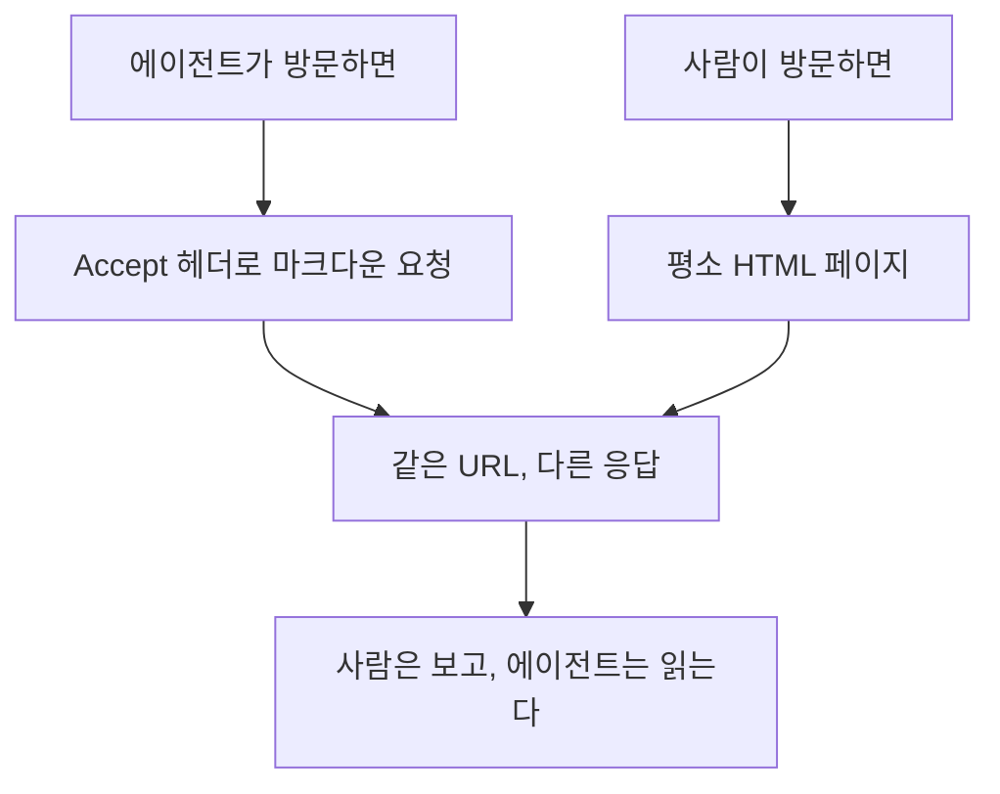

# Markdown for Agents: 웹을 지키던 방패가 에이전트에게 길을 열어줍니다

> **Summary**
> Accept: text/markdown 헤더 하나로 웹페이지를 엣지에서 마크다운으로 변환해 에이전트의 토큰 사용을 약 80% 줄일 수 있습니다. 설정과 분석 기능이 제공되지만, 오리진이 AI 트래픽을 식별해 사람과 다른 콘텐츠를 보여주는 클로킹, 크롤링 과금, 변환 과정의 맥락 손실에 대한 우려도 있습니다.

---

- 웹의 약 20%를 방패처럼 지키던 회사가, 이제 그 방패를 에이전트의 길로 바꾸는 기능을 내놨습니다.
- 에이전트가 `Accept: text/markdown` 헤더 하나만 보내면, 엣지에서 HTML을 마크다운으로 바꿔 줍니다. 토큰은 80% 줄었습니다.
- 다만 문이 열리는 만큼, 오리진이 AI 트래픽을 알아챌 수 있다는 클로킹 우려도 따라옵니다. 방패와 통행료, 두 얼굴을 같이 봐야 합니다.


에이전트에게 웹페이지 하나를 읽히는데 토큰이 몇만 개씩 나간 적 있으시죠? 페이지는 글 몇 줄인데, 읽히는 건 태그와 스크립트, 광고 자리까지 잔뜩입니다. 포장지를 읽는 데 돈을 내는 셈입니다!

🎥 [동영상 보기](https://www.youtube.com/watch?v=_PjUXCFosRk)

## 마크다운이 왜 필요할까요?

HTML을 그대로 AI에게 먹이는 건, 편지를 읽는데 포장지까지 읽는 것과 같습니다. 간단한 "회사 소개" 제목 하나가 마크다운에서는 3토큰쯤인데, HTML에서는 태그와 클래스, 아이디까지 붙어 12~15토큰을 씁니다. 거기에 `div` 껍데기와 내비게이션, 스크립트까지 더해지면 페이지는 점점 무거워집니다.

공식 발표 글 자체가 증거입니다. HTML로는 16,180토큰이던 글이 마크다운으로 바꾸니 3,150토큰이 됐습니다. 80%가 사라졌습니다! 마크다운은 구조가 그대로 드러나는 형식이라, 에이전트가 읽기에 딱 맞습니다. 결과를 더 좋게 만들면서 토큰 낭비는 줄이는 겁니다.

그래서 변환은 이미 AI 파이프라인의 흔한 단계가 됐습니다. 문제는 그 과정이 계산을 낭비하고 비용을 더하며, 무엇보다 콘텐츠 만든 사람이 의도한 쓰임새와 다를 수 있다는 점입니다. 원본에서 직접 구조화된 마크다운을 받으면 어떨까요?

## 헤더 하나로 바뀌는 건 어떻게 가능할까요?

방법은 의외로 단순합니다. 표준 HTTP 콘텐츠 협상입니다. 에이전트가 요청할 때 `Accept: text/markdown` 헤더를 넣으면, 네트워크가 원본에서 HTML을 가져와 엣지에서 마크다운으로 바꾼 뒤 건네줍니다. 사이트 템플릿을 고칠 필요도, 별도 마크다운 주소를 만들 필요도 없습니다.

```bash
curl https://developers.cloudflare.com/fundamentals/reference/markdown-for-agents/ \
  -H "Accept: text/markdown"
```

응답에는 마크다운 본문과 함께 두 가지 헤더가 붙습니다. `x-markdown-tokens`는 변환된 문서의 예상 토큰 수입니다. 읽기도 전에 컨텍스트 윈도우에 들어가는지, 나눠서 읽어야 하는지 판단할 수 있습니다. `Content-Signal` 헤더는 `ai-train=yes, search=yes, ai-input=yes`라고 적혀 있어, 이 콘텐츠를 AI 학습·검색·에이전트 입력에 쓸 수 있다고 알립니다. 나중에는 정책을 직접 정할 수 있게 될 예정입니다.



이 문장이 저는 가장 와닿았습니다. 이미 인기 있는 코딩 에이전트들이 이 헤더를 보내고 있다는 점입니다! 따로 설정을 켤 필요 없이, 에이전트가 요청하면 변환이 따라옵니다.

## 켜는 건 어렵지 않을까요?

대시보드에서 토글 하나만 켜면 됩니다. 계정과 존을 고르고 빠른 실행 메뉴에서 버튼을 누르는 게 전부입니다. 베타로 시작했고, Pro·Business·Enterprise 요금제와 SaaS 고객에게 추가 비용 없이 열렸습니다.

출시 뒤에도 손질이 이어졌습니다. 2026년 10월에는 변환 엔진이 스트리밍 방식으로 바뀌어, 변환할 수 있는 HTML이 2MiB에서 6MiB로 늘었습니다. 2026년 11월에는 정식 출시와 함께 대시보드 분석·로그·플레이그라운드가 붙었습니다. 변환 결과와 절약한 토큰, 실패 이유를 눈으로 확인할 수 있게 됐습니다.



웹의 관객이 둘로 나뉜 셈입니다. 사람에게는 HTML을, 에이전트에게는 마크다운을 주는 겁니다.

## 방패 뒤에 통행료도 있다고요?

이야기의 다른 축이 있습니다. 같은 회사가 2025년 7월부터 크롤링에 돈을 받는 실험을 운영 중입니다. 사이트 주인이 AI 크롤러마다 허용·과금·차단 중 하나를 고르는 방식입니다. 과금을 고르면 크롤러는 `402 Payment Required` 응답과 가격을 받고, 돈을 내겠다는 의사를 보내야 콘텐츠를 받습니다. 중간 정산은 회사가 맡습니다.

막거나 무료로 풀어주는 둘 중 하나만 있던 선택지에, 돈을 받고 열어주는 세 번째 길이 생긴 겁니다! 방패로 막던 회사가 이제 문지기이자 요금 징수원이 된 셈입니다. 새로 생긴 사이트는 기본적으로 AI 크롤러를 막는다고 하니, 방향은 분명합니다. 허락받고, 값을 치르고, 가져가라는 겁니다.

## 걱정되는 점은 없을까요?

물론 있습니다. 헤더가 오리진까지 그대로 전달되니, 원본 서버가 AI 트래픽을 알아챌 수 있습니다. 사람에게는 한 내용을, AI에게는 다른 내용을 보여주는 클로킹이 가능해진다는 지적이 출시 몇 시간 만에 나왔습니다. 검색 업계에서는 전용 마크다운 페이지를 만드는 발상 자체를 어리석다고 깎아내리는 목소리도 있었습니다.

내용이 납작해지면서 맥락이 빠진다는 지적도 있습니다. 마크다운으로 바꾸는 과정에서 뉘앙스와 구조의 일부가 사라질 수 있다는 겁니다. 토큰은 줄지만, 표현의 결이 옅어질 수 있습니다. 그래서 이 기능은 만능이 아닙니다. 문서의 성격에 따라 직접 마크다운을 제공하는 편이 나을 수도 있습니다.

방패가 길을 열어준 건 맞습니다. 다만 그 길이 누구에게, 어떤 조건으로 열리는지는 아직 정해지는 중입니다. 헤더 하나면 된다는 간편함 뒤에, 클로킹과 통행료와 맥락 손실이라는 질문이 나란히 서 있습니다. 에이전트 시대의 웹이 어떤 모습일지, 이 기능이 그 답의 한 조각이 될까요?

