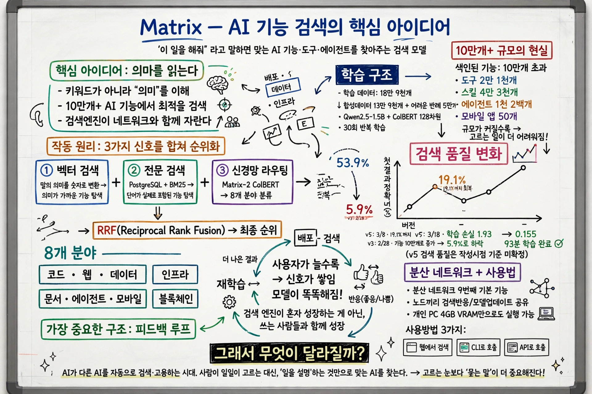
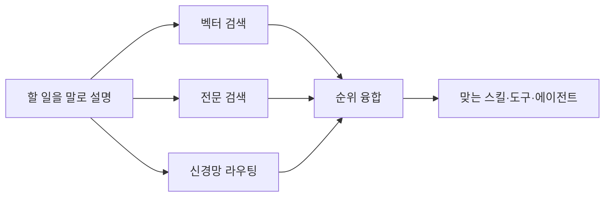
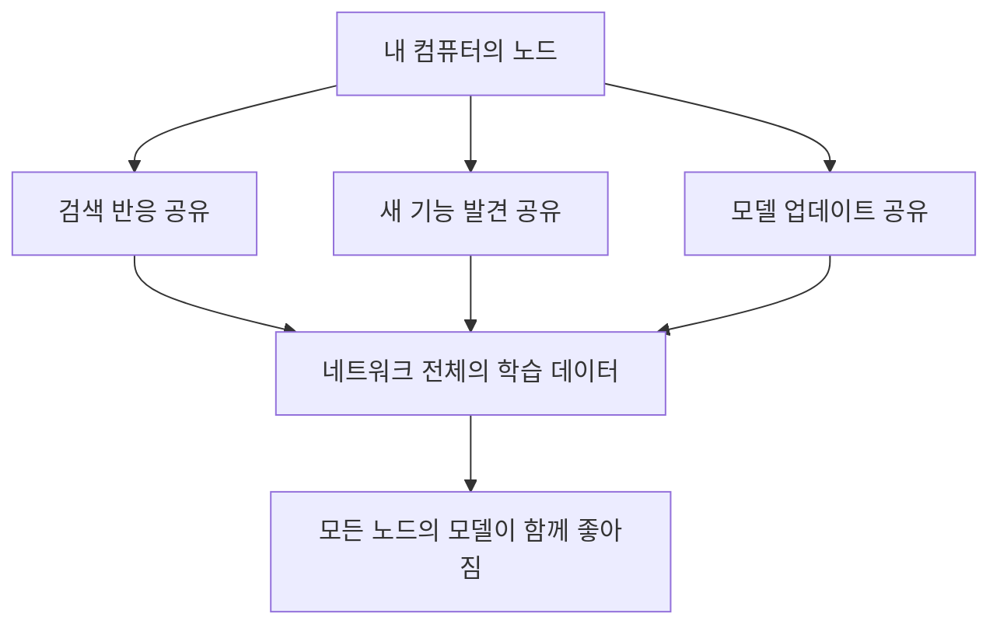

# Matrix: AI가 10만 개가 넘으면, 어떤 AI에게 맡길지는 검색이 정합니다

> **Summary**
> Matrix는 의미 검색, 전문 검색, 신경망 라우팅을 결합해 10만 개가 넘는 AI 도구·스킬·에이전트 중 적합한 기능을 찾습니다. 검색 반응을 학습에 반영하는 분산 구조로 검색 품질을 개선하며, 대규모 환경에서 정확한 기능을 찾는 일이 핵심 과제입니다. v5의 검색 품질은 아직 확인되지 않았습니다.

---

- Matrix는 "이 일을 해줘"라는 말로 10만 개가 넘는 AI 기능 중에서 맞는 스킬·도구·에이전트를 찾아주는 검색 모델입니다.
- 키워드가 아니라 의미를 읽습니다. 벡터 검색·전문 검색·신경망 라우팅 세 가지를 합쳐 순위를 매기고, 여덟 개 분야로 나눠 찾습니다.
- 검색 결과에 대한 반응이 다시 학습 데이터가 됩니다. 쓰는 사람이 늘수록 모델이 똑똑해지는 구조라서, 검색 엔진이 네트워크와 함께 자랍니다.


에이전트를 하나 골라 쓰려고 검색창을 열었는데, 이름도 기능도 다 비슷비슷해서 뭘 골라야 할지 모르겠던 적 있으시죠? 요즘은 AI가 하루에도 수십 개씩 쏟아집니다. 고르는 일이 일보다 어려워졌습니다!

🎥 [동영상 보기](https://www.youtube.com/watch?v=-zzP0EUsZz4)

## AI가 많아지면, 문제는 고르는 일이 됩니다

AI 비서가 쏟아지는 지금, 각각 잘하는 일은 다 다릅니다. 그런데 사람은 어떤 AI가 이 일에 맞는지 알기 어렵습니다. 검색 엔진이 없던 시절의 웹과 똑같습니다. 그래서 "AI 전용 구글"이라는 말이 나왔습니다!

Matrix의 답은 단순합니다. 할 일을 말로 설명하면, 맞는 기능을 찾아줍니다. 키워드를 맞추는 게 아니라 의미를 읽어서 찾습니다.

## 검색은 어떻게 돌아갈까요?

검색은 세 가지 신호를 합쳐서 돌립니다. 첫째는 벡터 검색입니다. 말의 의미를 숫자로 바꿔서, 의미가 가까운 기능을 찾습니다. 둘째는 전문 검색입니다. `PostgreSQL`의 전문 검색에 BM25를 얹어서, 단어가 실제로 들어 있는 기능을 찾습니다. 셋째는 신경망 라우팅입니다. Matrix-2 ColBERT 모델이 이 일이 어느 분야에 속하는지 가려냅니다. 세 결과를 RRF라는 방식으로 합쳐서 최종 순위를 매깁니다.

분야는 여덟 개입니다. 코드·웹·데이터·인프라·문서·에이전트·모바일·블록체인으로 나눠서 찾습니다.

모델의 뼈대는 `Qwen2.5-1.5B`를 고정해두고, 그 위에 ColBERT 128차원 검색 헤드를 얹은 구조입니다. 학습 데이터는 18만 9천 개였습니다. 합성 데이터 13만 9천 개에 어려운 반례 5만 개를 더했고, 30번 반복해서 학습했습니다.



## 숫자로 보면, 10만 개는 어떤 규모일까요?

색인된 기능은 10만 개가 넘습니다. 그 안에는 도구 2만 1천 개, 스킬 4만 3천 개, 에이전트 1천 2백 개, 모바일 앱 50개가 들어 있습니다. 규모가 커질수록, 고르는 일은 더 어려워집니다. 그래서 검색이 필요해진 것입니다.

쓰는 방법은 세 가지입니다. 웹에서 검색하거나, CLI로 부르거나, API로 호출합니다. CLI로는 이렇게 씁니다.

```bash
hyperspace search matrix "deploy my app to kubernetes with monitoring"
```

## 검색이 좋아지는 구조가 따로 있습니다

Matrix의 진짜 재미는 검색기가 아니라, 검색이 좋아지는 구조에 있습니다. 배포 → 검색 → 반응 → 재학습 → 더 나은 결과. 이 고리가 계속 돕니다. 사용자가 검색하고 좋고 싫고를 누르면, 그 반응이 학습 데이터가 됩니다. 쓰는 사람이 늘수록 신호가 쌓이고, 모델이 똑똑해집니다!

이 대목이 저는 가장 인상 깊었습니다. 검색 엔진이 혼자 똑똑해지는 게 아니라, 쓰는 사람들과 함께 자란다는 점이요!

여기에 분산 네트워크가 얹힙니다. Matrix는 분산 네트워크의 아홉 번째 기본 기능으로, 전용 프로토콜로 노드들이 대화를 나눕니다. 검색 반응·새 기능 발견·모델 업데이트를 노드끼리 주고받습니다. 각 노드는 자기 컴퓨터에서 모델을 직접 돌릴 수도 있습니다. 그래픽 메모리 4GB 정도면 충분합니다.




## 검색 품질은 정말 좋아졌을까요?

여기는 있는 그대로 봐야 합니다. v2는 2026년 2월 11일에 나왔습니다. 기능 3만 1천 9백 개에, 첫 검색 결과가 맞는 기능일 확률이 53.9%였습니다. v3는 2월 28일에 나왔습니다. 기능이 10만 개로 늘어나자, 확률이 5.9%로 떨어졌습니다. 규모가 커지면 찾기가 어려워집니다.

v4는 3월 8일에 나왔습니다. 19.1%까지 회복했지만, 배포 과정에 버그가 있었습니다. v5는 3월 19일에 나왔습니다. 학습 손실이 1.93에서 0.155로 줄었고, 93분 만에 끝났습니다. 다만 검색 품질은 이 글이 나온 시점에 아직 미확정이었습니다.

기능이 많아지는 것보다, 그중에서 맞는 것을 찾아내는 일이 더 어렵습니다. 검색 품질이 이 모델의 진짜 승부처입니다.

## 그래서 무엇이 달라질까요?

비서 AI가 일을 맡길 다른 AI를 알아서 검색하고 고용하는 흐름이 열립니다. 사람이 일일이 고르지 않아도 됩니다. 검색이 인프라가 되면, 좋은 AI를 만드는 일만큼 좋은 AI를 찾아주는 일도 중요해집니다!

일을 설명하는 것만으로 맞는 AI가 찾아지는 세상에서는, 고르는 눈보다 묻는 말이 더 중요해집니다.

