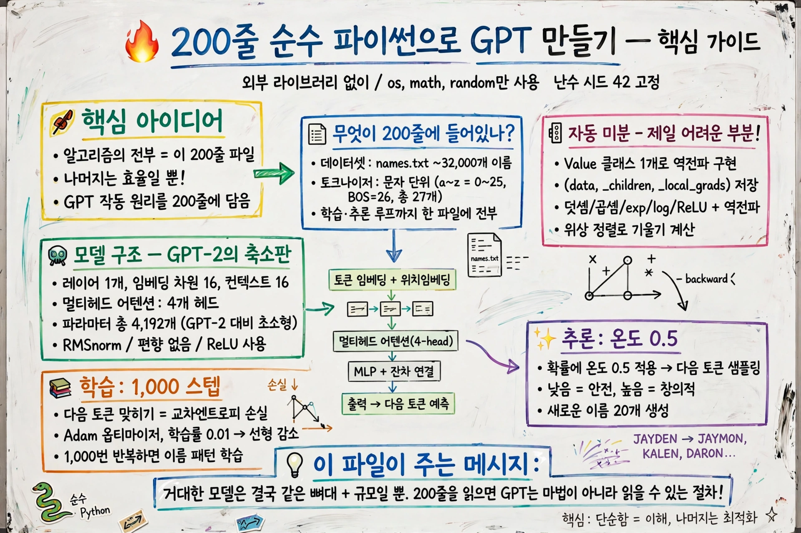
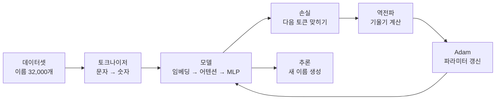
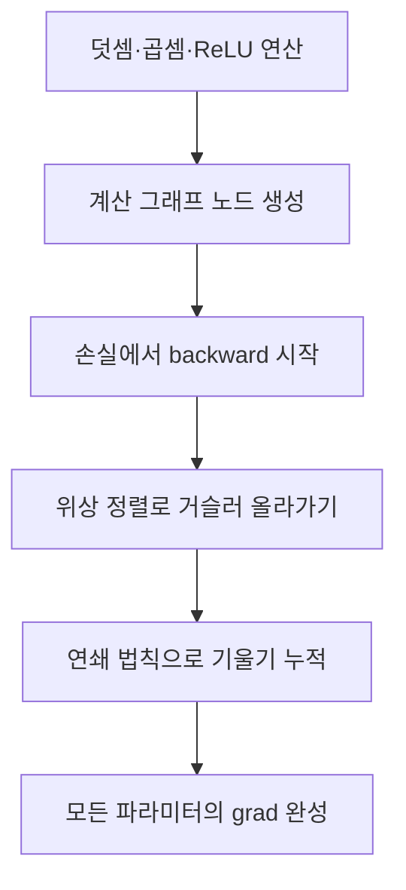
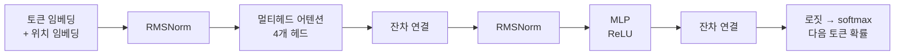

# MicroGPT: GPT의 핵심은 200줄이면 됩니다, 나머지는 효율일 뿐입니다

> **Summary**
> 외부 라이브러리 없이 파이썬 표준 라이브러리만으로 데이터셋 준비부터 토큰화, 자동 미분, GPT 구조, Adam 학습과 추론까지 구현한 200줄짜리 MicroGPT를 소개합니다. 작은 모델을 통해 GPT의 핵심 알고리즘을 직접 살펴볼 수 있으며, 대규모 모델도 같은 기본 구조에 효율성을 더한 것임을 보여줍니다.

---

- 외부 라이브러리 없이 순수 파이썬 200줄만으로 GPT를 학습하고 추론까지 하는 파일이 나왔습니다.
- 데이터셋, 토크나이저, 자동 미분 엔진, GPT-2 닮은 구조, Adam 옵티마이저, 학습·추론 루프까지 전부 이 한 파일 안에 들어 있습니다.
- 핵심은 단순합니다. 이 파일이 알고리즘의 전부이고, 나머지는 효율일 뿐입니다!

## GPT 내부를 보고 싶어 코드를 열어본 적 있으시죠?

GPT가 어떻게 글을 쓰는지 궁금해서 코드를 열어본 적 있으시죠? 그런데 마주치는 건 수천 줄의 프레임워크 코드와 수백 개의 파일입니다. 어디가 모델이고 어디가 학습인지, 경계가 안 보입니다. 그런데 200줄이면 된다고요? 의존성 하나 없이, 파이썬 표준 라이브러리만으로 GPT의 전부를 담은 파일이 나왔습니다!

🎥 [동영상 보기](https://www.youtube.com/watch?v=kCc8FmEb1nY)

## 200줄 안에 뭐가 들어 있을까요?

이 파일은 GPT를 학습하고 추론하는 데 필요한 알고리즘을 전부 담고 있습니다. 데이터셋 준비, 토큰화, 자동 미분, 모델 구조, 옵티마이저, 학습 루프, 추론 루프까지요. 가져오는 건 `os`, `math`, `random` 세 개뿐입니다. 외부 라이브러리는 하나도 없습니다. 난수 시드는 42로 고정해뒀습니다.

## 이름 32,000개가 교과서입니다

데이터셋은 이름 목록 `names.txt` 약 32,000개입니다. 파일이 없으면 자동으로 내려받습니다. 이름 한 개가 문서 한 개입니다. 모델의 임무는 이름들의 철자 패턴을 배우고, 실제로 존재한 적 없는 새 이름을 지어내는 것입니다. 왜 이름으로 학습할까요? 규칙이 단순해서, 모델이 뭘 배웠는지 눈으로 바로 확인할 수 있기 때문입니다!

토크나이저는 문자 단위, 가장 단순한 방식입니다. 알파벳 26개가 토큰 ID 0~25번, 여기에 문장 시작을 알리는 BOS 토큰 26번을 더해 어휘 크기는 27개입니다.

## 자동 미분이 제일 어려운 부분입니다

`Value` 클래스 하나로 역전파를 직접 구현했습니다. 숫자 하나(`data`)에, 그 숫자가 어떻게 계산됐는지(`_children`)와 국소 미분값(`_local_grads`)을 함께 들고 다닙니다. 덧셈·곱셈·거듭제곱·로그·지수·ReLU 연산마다 계산 그래프의 노드가 됩니다. `backward()`는 위상 정렬로 그래프를 거슬러 올라가며 연쇄 법칙을 적용해 모든 파라미터의 기울기를 구합니다. 이 부분이 파일에서 수학적으로 가장 빡센 구간입니다. 그런데 원리를 알고 나면, 프레임워크가 해주던 일이 사실 이 30줄이었다는 게 보입니다!

## 모델은 GPT-2의 축소판입니다

구조는 레이어 1개, 임베딩 차원 16, 컨텍스트 길이 16, 어텐션 헤드 4개입니다. 파라미터는 전부 4,192개입니다. GPT-2의 15억 개와 비교하면 극히 작지만, 모양은 같습니다. 토큰 임베딩과 위치 임베딩을 합치고, 멀티헤드 어텐션과 MLP를 거치며, 잔차 연결로 이어줍니다. GPT-2와 다른 점은 세 가지뿐입니다. 레이어 정규화 대신 RMS 정규화, 편향 없음, GeLU 대신 ReLU입니다.

## 학습은 1,000번, 추론은 온도 0.5로

학습은 문서 하나씩, 1,000 스텝입니다. 다음 토큰 맞히기 게임입니다. 정답 토큰에 모델이 부여한 확률의 로그에 마이너스를 붙인 것이 손실(교차 엔트로피)입니다. Adam 옵티마이저가 기울기로 파라미터를 갱신합니다. 학습률은 0.01에서 선형으로 줄입니다. 1,000번이면 이름 패턴이 몸에 밸까요? 손실 숫자가 내려가는 걸 보면, 모델이 철자를 익혀가는 게 눈에 보입니다!

추론은 온도 0.5로 확률을 나눠 다음 토큰을 뽑습니다. 온도가 낮을수록 안전한 선택, 높을수록 창의적인 선택이 됩니다. 새 이름 20개를 뽑아봅니다. 실존하지 않지만 있을 법한 이름들이 나옵니다.

## 이 파일이 주는 메시지

이 파일이 알고리즘의 전부이고, 나머지는 효율일 뿐입니다. 거대한 모델을 볼 때의 두려움은, 알고 보면 절차를 끝까지 읽어본 적이 없어서 생기는 경우가 많습니다. 200줄을 한 번 끝까지 읽어보시면, GPT가 마법이 아니라 읽을 수 있는 절차라는 게 보입니다. 그 다음부터는 큰 모델도 같은 뼈대에 살을 붙인 것이라는 감이 잡히실 겁니다.

