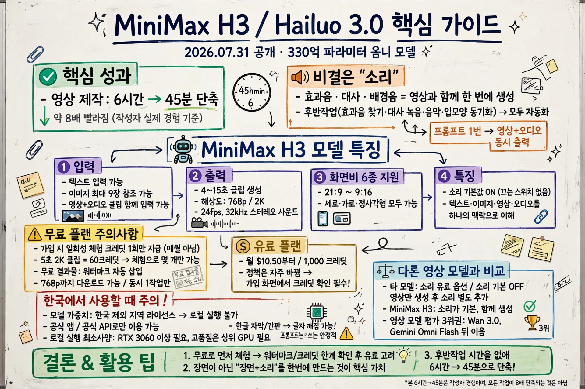
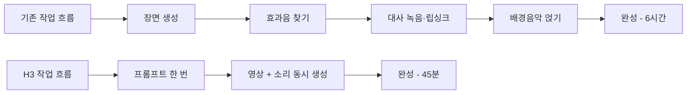
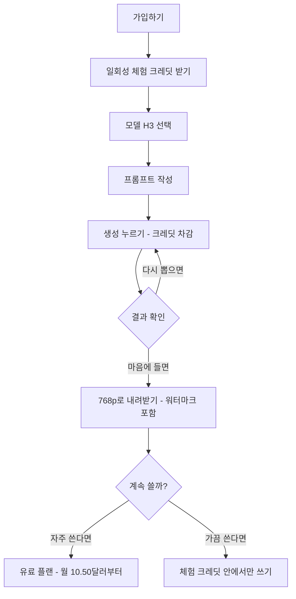
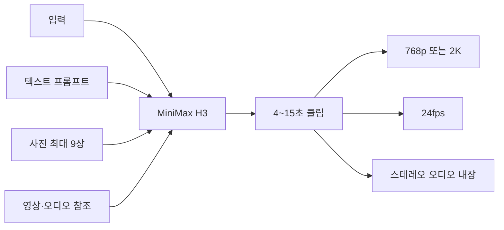

# MiniMax H3: 6시간 걸리던 영상 작업이 45분으로 줄었습니다. 소리까지 한 번에 나옵니다

> **Summary**
> MiniMax H3은 영상과 효과음·대사·배경음을 한 번에 생성해 후반 작업 시간을 줄이는 모델로, 작성자는 작업 시간이 6시간에서 45분으로 단축됐다고 밝혔습니다. 무료 체험은 일회성 크레딧만 제공되고 결과물에 워터마크가 붙으며, 한국에서는 로컬 실행이 제한돼 공식 앱이나 API를 이용해야 합니다.

---

- 영상 만드는 데 6시간 걸리던 작업이 45분으로 줄었습니다.
- 비결은 소리입니다. 효과음·대사·배경음이 영상과 함께 한 번에 나옵니다.
- 무료로 시작할 수 있지만, 체험 크레딧은 한 번뿐이고 무료 결과물에는 워터마크가 붙습니다.

영상 하나 만들려고 주말 오후를 통째로 비워본 적 있으시죠? 장면을 그리고, 자막을 붙이고, 효과음을 찾고, 배경음악을 고르고. 영상은 금방 나오는데, 뒤처리가 본작업보다 오래 걸립니다. 그런데 이 순서를 뒤집은 모델이 나왔습니다!

🎥 [동영상 보기](https://www.youtube.com/watch?v=QCMy9avO3oA)

## MiniMax H3, 도대체 뭘까요?

MiniMax H3는 2026년 7월 31일에 공개된 영상 생성 모델입니다. 같은 회사의 영상 앱에서는 `Hailuo 3.0`이라는 이름으로도 불립니다. 텍스트·이미지·영상·오디오를 하나의 맥락으로 받아서 4~15초짜리 클립을 만듭니다. 해상도는 768p 또는 2K, 초당 24프레임, 소리는 32kHz 스테레오로 함께 나옵니다.

이 모델의 정체는 330억 파라미터 규모의 옴니 모델입니다. 옴니라는 말은 입력 형식이 여러 개라는 뜻입니다. 글만 넣어도 되고, 사진 최대 9장을 참조로 넣어도 됩니다. 영상 클립과 오디오까지 함께 넣으면, 모델이 그 맥락을 읽고 이어지는 장면을 만듭니다. 화면비는 21:9부터 9:16까지 여섯 가지가 준비돼 있습니다.

## 왜 45분으로 줄었을까요?

영상 작업에서 시간을 가장 많이 먹는 부분은 촬영이 아닙니다. 후반 작업입니다. 장면을 만든 뒤에 효과음을 찾고, 대사를 녹음하고, 입 모양을 맞추고, 배경음악을 얹는 과정이 따로 돕니다. 이 모델은 그 과정을 한 번으로 합쳤습니다. 프롬프트 한 번에 영상과 소리가 함께 나옵니다.

> 소리가 따로가 아니라 함께 나온다는 것, 이게 전부입니다.

게시글 작성자는 이 흐름으로 6시간 걸리던 작업을 45분에 끝냈다고 밝혔습니다. 이 수치는 작성자 본인의 경험담입니다. 모든 작업이 8배 빨라진다는 뜻은 아닙니다. 다만 후반 작업을 따로 하지 않아도 된다는 점은 분명합니다. 소리가 필요한 짧은 클립이라면, 체감 시간은 크게 줄어듭니다.

## 무료, 어디까지일까요?

무료라는 말이 먼저 눈에 들어옵니다. 그런데 무료의 범위를 정확히 아는 게 중요합니다. 2026년 11월 기준으로, 무료 플랜은 매달 크레딧을 주지 않습니다. 가입할 때 일회성 체험 크레딧을 한 번 받는 구조입니다. 5초짜리 2K 클립 하나가 60크레딧이니, 체험 크레딧으로는 몇 개 안 뽑아봅니다.

무료 결과물에는 워터마크가 붙습니다. 영상 오른쪽 아래에 표시가 남습니다. 한 번에 하나의 작업만 돌릴 수 있고, 무료로 내려받는 해상도는 768p까지입니다. 2K로 뽑아도, 무료 내려받기는 768p라는 뜻입니다. 유료 플랜은 월 10.50달러부터 시작하고, 1,000크레딧이 들어갑니다.

정책은 자주 바뀝니다. 홈페이지에 "3,000크레딧으로 시작"이라는 배너가 뜬 적도 있습니다. 가입 화면에 적힌 숫자를 한 번 확인하는 게 안전합니다. 무료라고 해서 무제한이 아니라는 점만 기억하면 됩니다!

## 한국에서 쓸 때 주의할 점이 있나요?

두 가지가 있습니다. 첫째, 모델 가중치가 공개됐는데, 그 라이선스가 한국을 제외 지역에 넣어뒀습니다. 국내에서는 모델 파일을 내려받아 로컬에서 돌리는 길이 막혀 있습니다. 대신 공식 앱이나 공식 API로 쓰는 게 맞습니다.

둘째, 로컬 실행은 그래픽카드가 좋아야 합니다. 최소 사양이 RTX 3060급이고, 고품질로 뽑으려면 훨씬 강한 카드가 필요합니다. 한 리뷰에서는 5초짜리 클립 하나에 3분쯤 걸렸다고 전했습니다. 로컬이 무료라고 해도, 하드웨어 비용이 따로 드는 셈입니다.

한글 텍스트도 주의할 점입니다. 원문 게시글에서도 한글 표현에 한계가 있다고 짚었습니다. 영상 안에 한글 자막이나 간판을 넣으면 글자가 깨질 수 있습니다. 프롬프트는 영어로 쓰는 편이 안정적입니다. 이건 지금 시점의 한계라서, 앞으로 나아질 여지는 있습니다.

## 다른 모델과 뭐가 다를까요?

비슷한 영상 모델과 비교하면 차이가 또렷합니다. 한쪽은 소리를 유료 옵션으로 켜야 하고, 한쪽은 API에서 소리가 기본으로 꺼져 있습니다. 또 다른 쪽은 영상만 만들고 소리는 따로 얹어야 합니다. 이 모델은 소리를 끄는 스위치 자체가 없습니다. 소리가 기본값입니다.

평가 순위에서도 상위권입니다. 영상 모델 평가에서 `Wan 3.0`과 `Gemini Omni Flash` 뒤를 잇는 3위권에 들었습니다. 순위가 전부는 아니지만, 소리까지 함께 뽑는 모델 중에서는 앞줄에 서 있다는 뜻입니다.

영상 만드는 일이 6시간에서 45분으로 줄었다는 말, 처음엔 과장처럼 들렸습니다. 그런데 소리를 따로 붙이던 시간을 통째로 없앤다고 생각하면, 숫자가 이해가 됩니다. 무료로 시작해보고, 워터마크와 크레딧 한계를 확인한 뒤에 유료를 고민하는 순서가 맞습니다. 영상의 본질이 장면이 아니라 장면과 소리의 합이라면, 이 모델은 그 합을 한 번에 만드는 쪽으로 방향을 튼 셈입니다!

