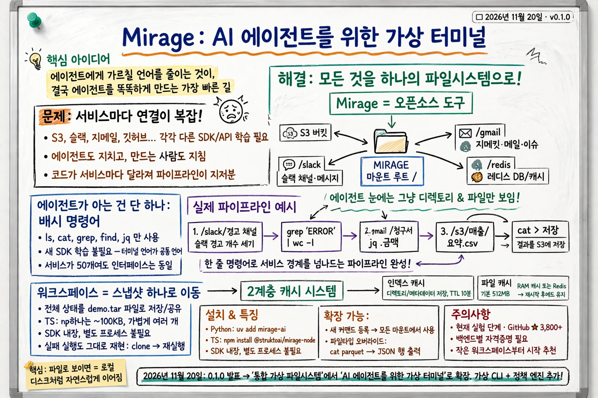
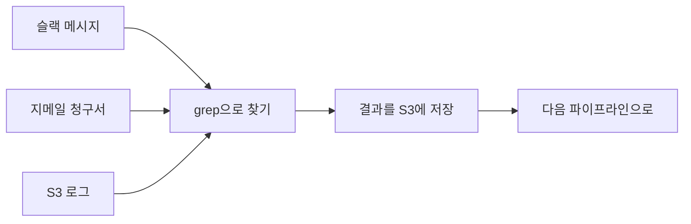
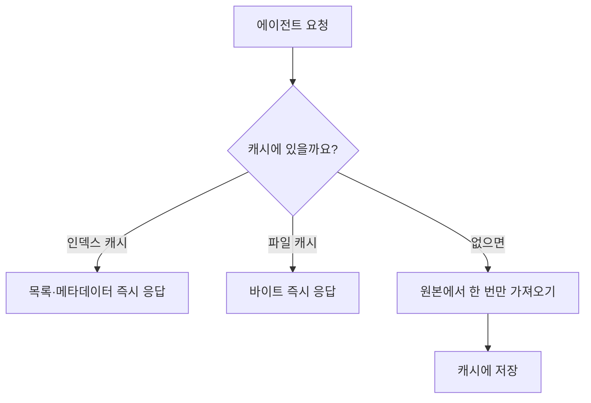

# Mirage: S3도 슬랙도 지메일도, 에이전트에게는 그냥 파일입니다

> **Summary**
> Mirage는 S3, 슬랙, 지메일, 깃허브 같은 50개 넘는 백엔드를 하나의 파일시스템으로 묶어, 에이전트가 ls, grep, cat 같은 배시 명령어만으로 서비스 경계를 넘나들게 하는 오픈소스 도구입니다. 명령어 확장과 파일타입별 오버라이드, 2계층 캐시, 스냅샷으로 통째로 옮기는 워크스페이스를 갖췄고, 터미널 하나가 100KB 수준이라 가볍게 여러 개를 띄울 수 있습니다. 2026년 11월 20일 0.1.0 발표에서 가상 CLI와 가상 머신, 프로필·정책 엔진까지 품은 가상 터미널로 확장됐지만, 저장소에는 아직 실험 단계 표시가 붙어 있어 작은 워크스페이스부터 굴려보는 게 맞습니다.

---

- Mirage는 S3, 슬랙, 지메일, 깃허브를 각각 따로 배우지 않고, 하나의 파일시스템으로 묶어 에이전트에게 건네는 오픈소스 도구입니다.
- 에이전트가 아는 건 `ls`, `grep`, `cat` 같은 배시 명령어뿐인데, 그걸로 서비스 경계를 넘나드는 파이프라인이 돌아갑니다.
- 워크스페이스는 스냅샷 파일 하나로 통째로 옮길 수 있고, 터미널 하나가 100KB 수준이라 가볍게 여러 개를 띄울 수 있습니다.


에이전트에게 "S3에 있는 매출 CSV를 읽어서 슬랙에 요약해줘"라고 시킨 적 있으시죠? 그런데 막상 연결하려고 하면 S3 SDK, 슬랙 API, 지메일 클라이언트까지, 서비스마다 새로 배워야 할 게 줄줄이 나옵니다. 에이전트도 지치고, 만드는 사람도 지칩니다!

🎥 [동영상 보기](https://www.youtube.com/watch?v=LaLE2Qn3kas)

### 에이전트에게 새 언어를 가르치지 않습니다, 파일로 보여줍니다

Mirage의 발상은 단순합니다. S3, 구글 드라이브, 슬랙, 지메일, 깃허브, 노션, 레디스 같은 백엔드를 하나의 루트 아래에 나란히 마운트하는 겁니다. 에이전트 눈에는 그저 디렉토리와 파일만 보입니다!

```mermaid
flowchart TB
    A[에이전트: bash만 알면 됩니다] --> R[하나의 루트 /]
    R --> S[/s3]
    R --> L[/slack]
    R --> G[/gmail]
    R --> H[/github]
    R --> N[/notion]
    R --> D[/data]
```

LLM은 이미 터미널 환경에서 잔뜩 학습됐습니다. 그래서 `ls`, `cat`, `grep`, `find`, `jq`는 에이전트가 가장 잘 아는 언어입니다. 새 SDK 어휘를 가르칠 필요가 없다는 게 핵심입니다. 서비스가 50개가 넘어도, 에이전트가 배우는 인터페이스는 하나입니다.

### 한 줄 파이프라인이 서비스 경계를 넘습니다

파일로 보이면, 파이프라인은 로컬 디스크에서처럼 자연스럽게 이어집니다. 슬랙에서 경고를 세고, 지메일에서 청구서를 찾고, 결과를 S3에 저장하는 일이 한 줄이면 됩니다.

```bash
grep -rlw invoice /s3 /slack /gmail
```

```bash
cp /s3/report.csv /data/local.csv
```

이 장면이 저는 가장 인상 깊었습니다. 슬랙 채널은 디렉토리이고, 메시지는 JSON 파일이고, 몽고DB 컬렉션은 디렉토리, 문서는 JSON 파일로 보인다는 점입니다. 저장 방식이 달라도 에이전트는 파일로만 생각하면 됩니다!



### 파일 종류마다 다르게 읽히는 `cat`이 있을까요?

명령어도 확장할 수 있습니다. `ws.command('summarize', ...)`처럼 새 커맨드를 등록하면 모든 마운트에서 쓸 수 있습니다. 더 재미있는 건 파일타입별 오버라이드입니다. S3에 있는 Parquet 파일에 `cat`을 실행하면 원시 바이트 대신 JSON 행이 나옵니다. 파일이 무엇인지에 따라 읽는 방식이 바뀌는 셈입니다!

### 느린 건 두 번 묻지 않습니다, 캐시가 받습니다

원격 백엔드를 매번 API로 두드리면 느립니다. 그래서 워크스페이스는 2계층 캐시를 갖고 있습니다. 디렉토리 목록과 메타데이터를 담는 인덱스 캐시, 파일 바이트를 담는 파일 캐시입니다.



기본값은 파일 캐시 512MB, 인덱스 TTL 10분입니다. RAM에 두면 가볍게 쓰고, 레디스에 두면 워커와 머신을 넘어 공유되고 재시작 후에도 남습니다.

### 워크스페이스는 통째로 옮깁니다

환경을 `clone`, 스냅샷, 버전 관리할 수 있습니다. 실패한 에이전트 실행을 `demo.tar` 파일 하나로 묶어 다른 머신에서 그대로 열면, 무엇이 잘못됐는지 그 자리에서 확인할 수 있습니다. 재시작도, 재구성도 필요 없습니다!

설치는 한 줄이면 됩니다. 파이썬은 `uv add mirage-ai`, 타입스크립트는 `npm install @struktoai/mirage-node`입니다. 파이썬과 타입스크립트 SDK가 있어서 `FastAPI`나 `Express` 앱 안에 직접 임베드할 수도 있고, 별도 프로세스가 필요 없습니다. 코딩 에이전트에는 가벼운 CLI와 데몬으로 연결됩니다.

### 어디까지 믿고 써야 할까요?

정직하게 짚을 점도 있습니다. 5월에 소개됐을 때는 "통합 가상 파일시스템"이었는데, 11월 20일 0.1.0 발표에서는 가상 CLI, 가상 머신, 프로필과 정책 엔진까지 품은 "AI 에이전트를 위한 가상 터미널"로 커졌습니다. 지금 읽는 문서는 그 최신 모습입니다.

그리고 저장소에는 아직 실험 단계 표시가 붙어 있습니다. 별 3,800개가 넘는 인기 프로젝트지만, 프로덕션에 바로 올리기 전에 작은 워크스페이스부터 굴려보는 게 맞습니다. 백엔드마다 자격증명도 따로 필요합니다. 파일로 보인다고 해서 접근 권한이 저절로 생기는 건 아니니까요.

에이전트에게 가르칠 언어를 줄이는 게, 결국 에이전트를 똑똑하게 만드는 가장 빠른 길 아닐까요?

