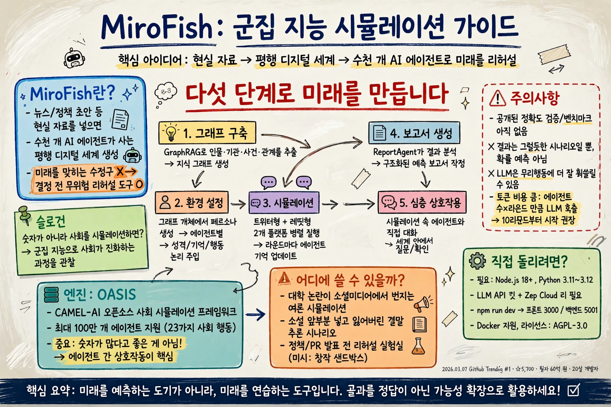
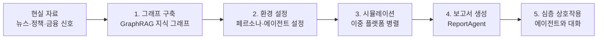
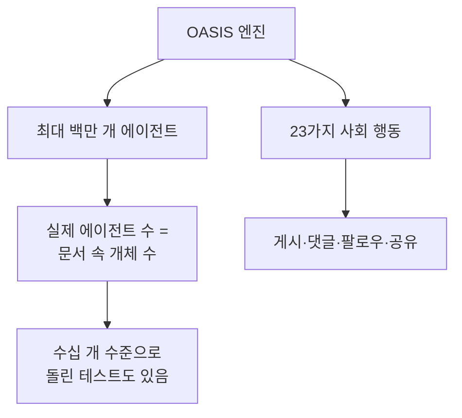
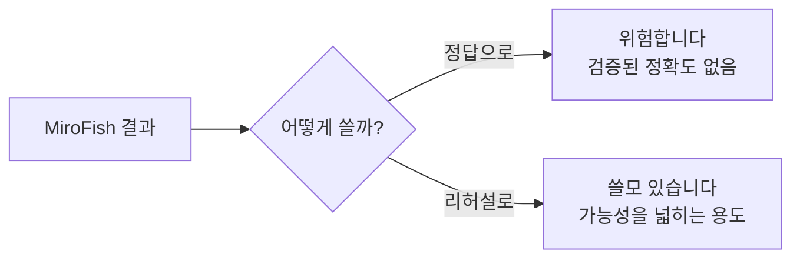

# MiroFish: 미래를 맞히는 게 아니라, 디지털 세계에서 미리 리허설합니다

> **Summary**
> MiroFish는 현실 자료를 바탕으로 AI 에이전트들이 상호작용하는 디지털 사회를 만들어 정책이나 여론의 가능성을 시뮬레이션하는 오픈소스 도구입니다. 정확도 검증은 아직 없어 예측을 정답으로 받아들이기보다, 의사결정 전에 여러 시나리오를 무위험으로 리허설하는 용도로 활용하는 것이 적절합니다.

---

- MiroFish는 뉴스나 정책 초안 같은 현실 자료를 넣으면, 수천 개 AI 에이전트가 사는 평행 디지털 세계를 만들어 미래를 시뮬레이션하는 오픈소스 엔진입니다.
- 그래프 구축부터 환경 설정, 이중 플랫폼 시뮬레이션, 보고서 생성, 심층 상호작용까지 다섯 단계로 돌아가며, 시뮬레이션 엔진은 백만 개 에이전트까지 지원하는 OASIS입니다.
- 다만 공개된 정확도 검증은 아직 없습니다. 미래를 맞히는 수정구가 아니라, 결정을 내리기 전에 무위험으로 리허설하는 도구로 쓰는 게 맞습니다.

새 정책을 발표하기 전에, 여론이 어떻게 흘러갈지 미리 볼 수 있다면 어떨까요? 숫자 모델에 물어보는 게 아니라, 가상의 사회를 만들어서 직접 지켜보는 겁니다. 이게 바로 군집 지능입니다!

🎥 [동영상 보기](https://www.youtube.com/watch?v=out1QDqYiP4)

MiroFish의 동작 방식과 주의점을 설명하는 영상입니다.

## 미래 예측, 숫자가 아니라 사회로 시뮬레이션하면?

기존 예측 도구는 숫자를 넣으면 확률을 내놓습니다. MiroFish는 접근이 다릅니다. 현실 자료를 넣으면 평행 디지털 세계를 만들고, 그 안에 수천 개 AI 에이전트를 풀어놓습니다. 에이전트마다 개성과 장기 기억, 행동 논리가 따로 있습니다. 글을 쓰고, 댓글을 달고, 설득하고, 마음을 바꾸면서 사회가 진화하는 과정을 지켜보는 겁니다.

슬로건이 이 방향을 그대로 보여줍니다. "간결하고 보편적인 군집 지능 엔진, 모든 것을 예측합니다." 숫자를 맞히는 게 아니라, 사회를 흉내 내서 미래 궤적을 추론하는 방식입니다.

## 다섯 단계로 미래를 만듭니다

과정은 다섯 단계로 돌아갑니다.

**1. 그래프 구축입니다.** `GraphRAG`가 자료에서 인물·기관·사건·관계를 뽑아 지식 그래프를 만듭니다. 개별 기억과 집단 기억도 함께 주입합니다.

**2. 환경 설정입니다.** 그래프의 개체에서 페르소나를 만들고, 에이전트별 설정을 주입합니다. 누가 어떤 성향으로 행동할지 정해지는 단계입니다.

**3. 시뮬레이션입니다.** 트위터형 짧은 글 플랫폼과 레딧형 토론 플랫폼, 두 곳에서 병렬로 돌립니다. 라운드가 지날 때마다 에이전트 기억이 업데이트됩니다.

**4. 보고서 생성입니다.** `ReportAgent`가 시뮬레이션 결과를 분석해 구조화된 예측 보고서를 씁니다.

**5. 심층 상호작용입니다.** 시뮬레이션 속 에이전트와 직접 대화할 수 있습니다. 보고서만 읽는 게 아니라, 그 세계 안에 들어가서 물어보는 겁니다!

## 엔진은 OASIS, 백만 개까지?

시뮬레이션 엔진은 `OASIS`입니다. CAMEL-AI에서 만든 오픈소스 사회 시뮬레이션 프레임워크로, 최대 백만 개 에이전트까지 지원하고 23가지 사회 행동을 다룹니다. 게시·댓글·팔로우·공유 같은 행동이 여기에 들어갑니다.

다만 백만이라는 숫자는 엔진의 상한선입니다. 에이전트 수는 문서에서 뽑아낸 개체 수에 따라 정해집니다. 실제 테스트에서는 수십 개 수준으로 돌렸다는 보고도 있습니다. 에이전트 수가 많다고 좋은 게 아닙니다! 중요한 건 숫자가 아니라, 에이전트들이 만들어내는 상호작용입니다.

## 어디에 쓸 수 있을까요?

공개된 데모 사례가 두 가지 있습니다. 대학 논란이 소셜미디어에서 어떻게 번질지 시뮬레이션한 여론 사례, 그리고 고전 소설 앞부분 수십만 자를 넣고 잃어버린 결말을 추론한 사례입니다. 금융·정치 예측 사례는 아직 준비 중이라고 합니다.

쓰임새는 크게 두 갈래입니다. 거시적으로는 의사결정자의 리허설 실험실입니다. 정책이나 PR을 실제로 내놓기 전에 무위험으로 테스트하는 겁니다. 미시적으로는 창작 샌드박스입니다. 소설 결말을 추론하거나, 상상 속 시나리오를 돌려보는 재미가 있습니다.

## 그래서, 믿어도 될까요?

여기서 한 번 멈춰야 합니다. 공개된 정확도 벤치마크나 백테스트는 아직 없습니다. 시뮬레이션 결과는 그럴듯한 시나리오이지, 확률 추정이 아닙니다. LLM 에이전트는 사람보다 무리 행동에 더 잘 휩쓸린다는 연구 지적도 있습니다.

그래서 이 도구는 탁상 전쟁 게임처럼 쓰는 게 맞습니다! 결과를 정답으로 받아들이는 게 아니라, "이런 흐름도 가능하겠구나" 하고 가능성을 넓히는 용도입니다. 토큰 비용도 만만치 않습니다. 에이전트 수에 라운드를 곱한 만큼 LLM 호출이 나가기 때문입니다. 처음에는 40라운드 미만으로, 기본값인 10라운드부터 시작하는 게 좋습니다.

## 직접 돌리려면 무엇이 필요할까요?

직접 돌리려면 준비물이 있습니다. `Node.js` 18 이상, `Python` 3.11~3.12, LLM API 키, `Zep Cloud` 키입니다. LLM은 OpenAI 호환 API면 되고, 장기 기억은 `Zep Cloud`가 맡습니다. `npm run dev` 한 줄이면 프론트엔드 3000번, 백엔드 5001번 포트로 뜹니다. `Docker`로 띄우는 방법도 있습니다. 개발·테스트는 macOS 기준이고, Windows는 아직 테스트 중입니다. 라이선스는 `AGPL-3.0`입니다.

화제성도 대단했습니다. 2026년 3월 7일 GitHub 글로벌 트렌딩 1위에 올랐고, 당시 별 5,700개·포크 623개를 기록했습니다. 이후 샨다 그룹 창업자로부터 3,000만 위안, 우리 돈으로 약 60억 원의 투자를 받았습니다. 만든 사람은 20살 대학생 개발자로, 전작인 여론 분석 도구도 트렌딩 1위를 찍은 적이 있습니다. 예측 기능은 열흘 남짓 만에 만들었다고 합니다.

미래를 맞히는 도구가 아니라, 미래를 연습하는 도구입니다. 그 연습이 쓸모가 있는지는, 직접 돌려보고 판단하면 됩니다!

