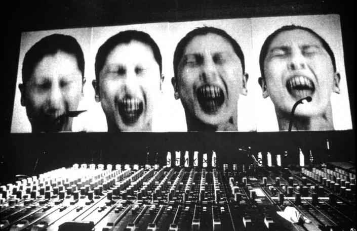
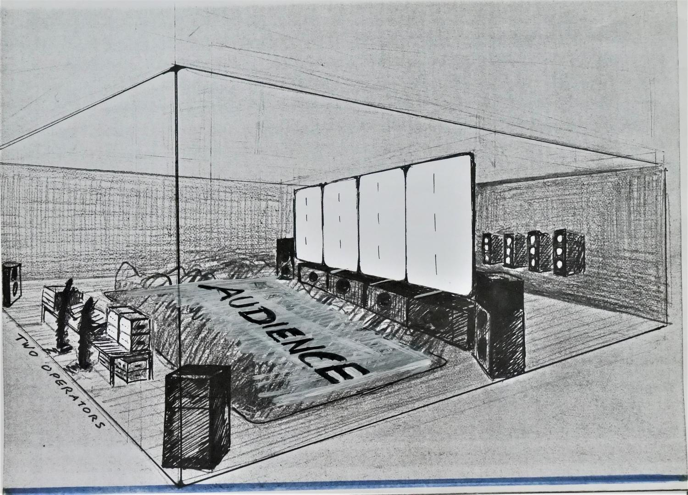
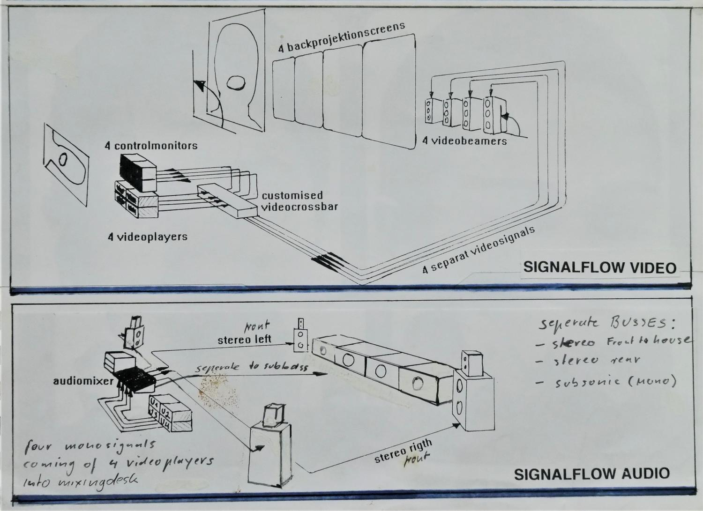
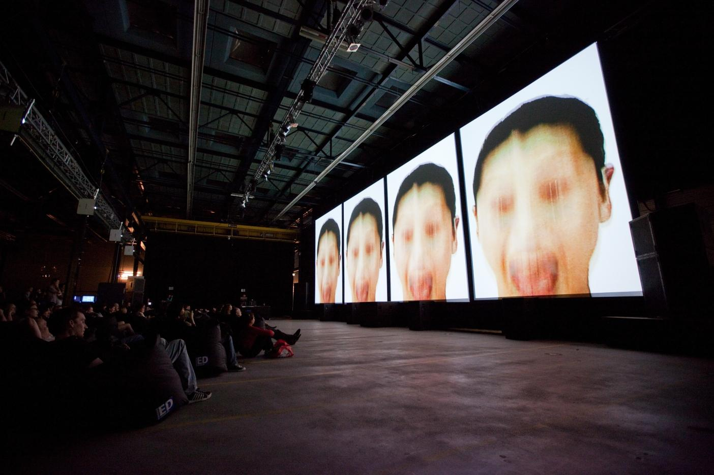
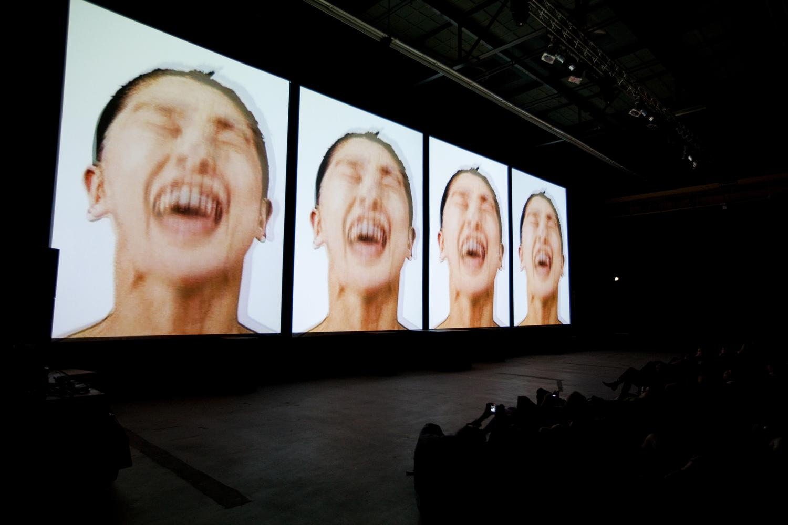
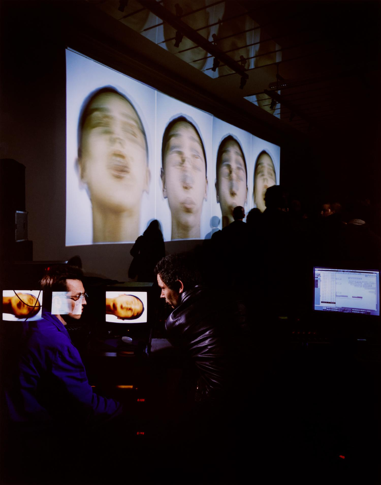
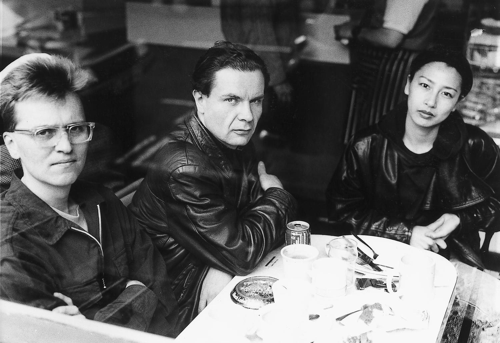
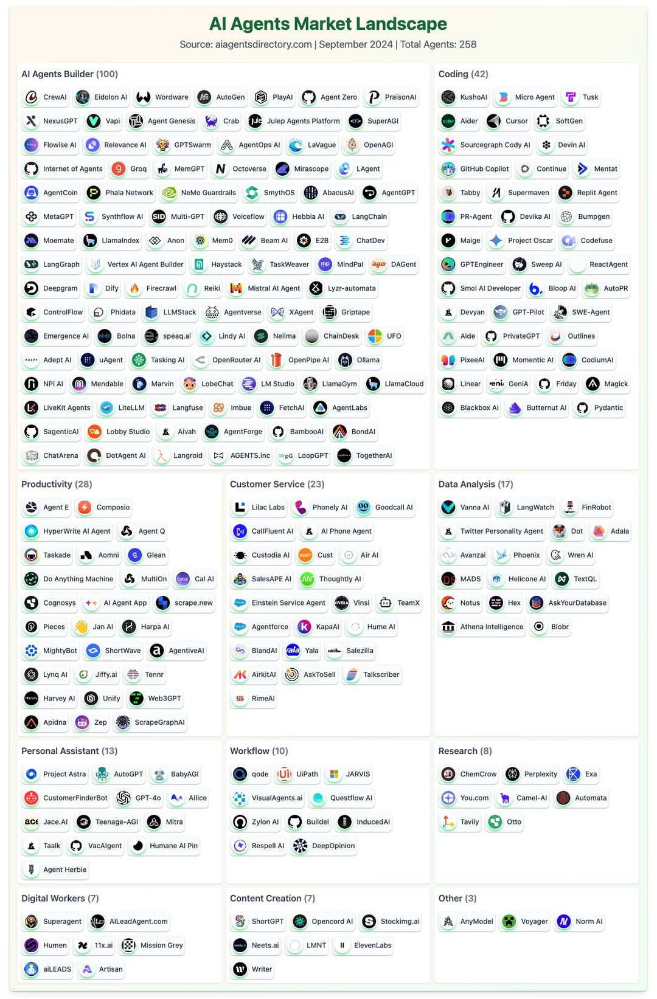

# Modell5 - "자발적 파편화의 시대, 1994년에 예견한 현재”

> **Summary**
> 1994년에 제작된 'MODELL 5'는 일본 퍼포머 Akemi Takeya의 얼굴을 디지털 기술로 극단적으로 변형하여 인간과 기계의 관계를 탐구하는 미디어 아트 작품이다. 이 작품은 기술이 인간 정체성을 어떻게 파편화하는지를 보여주며, 30년이 지난 현재에도 여전히 유효한 질문을 던진다. 관객은 불쾌하면서도 매혹적인 체험을 통해 인간과 기계, 자연과 인공의 경계를 넘나드는 새로운 예술적 가능성을 경험하게 된다.

---

# Modell5

🔗 [https://granularsynthesis.info/MODELL-5](https://granularsynthesis.info/MODELL-5)

🔗 [https://www.youtube.com/watch?v=Wzz3OySvkn0](https://www.youtube.com/watch?v=Wzz3OySvkn0)

🎥 [동영상 보기](https://www.youtube.com/watch?v=tvZ1oZea7C8&t=478s)

## 무엇에 대해 이야기할까?

> *1994-1996년에 개최된 오디오비주얼 퍼포먼스와 설치 작품인 'MODELL 5'. *
> *이 작품은 일본 퍼포머 ****Akemi Takeya****의 얼굴을 4채널 비디오와 12채널 오디오로 구현한 것으로, *
>
> *디지털 이미지와 사운드의 극단적인 조작을 통해 인간과 기계의 관계를 탐구하였다.*
>
> *냉전이 끝나고, 인터넷이 태동하고, 세계화가 가속화되던 때.*
>
> *그런 시대적 맥락 속에서 이 작품은 무엇을 포착했을까?*
>
>

Modell 5는 1994년에 만들어진 미디어 아트 작품이다. 일본인 퍼포머 Akemi Takeya의 얼굴을 소재로, 디지털 기술이 인간 정체성을 어떻게 변형시킬 수 있는지를 극단적으로 보여준다.

나는 이 작품을 처음 봤을 때, 불쾌함과 매혹이 동시에 밀려왔다.

아마도 이것은 인간이 데이터로 변환되고, 얼굴이 픽셀로 분해되며, 정체성이 기계적으로 조작되는 순간을 목격했을 때, 본능적으로 느낀 존재론적 불안감이 아니었을까?

이 작품은 어쩌면 30년도 지난 이 작품은, 2025년 현재 우리의 모습을 이미 ‘포착’했을지도 모른다. 

우리는 매일 자발적으로 자신의 생각, 혹은 얼굴사진들을 AI의 데이터로 환원하며 스스로의 존재를 파편화하는 것에 대해 묘한 불편함을 느끼고 있으니 말이다.

## 어떤 작품일까?

> *한 사람의 얼굴이 4개로 분열되고, 동기화되었다가 어긋나고, 느려지고 빨라지며... *
> *"견딜 수 있음의 경계"에 다다른다. 불쾌하면서도 매혹적인, "기계의 고통"이 공간을 가득 채운다.*
>
>

1994년 런던 ICC에서 처음 공개된 'MODELL 5'는 디지털 비디오를 연극적 공간에 도입한 가장 혁신적인 실험 작품으로 평가받고 있다.

작품은 4개의 세로 스크린, 8채널 오디오, 그리고 4개의 클론으로 구성된다. 하나의 얼굴이 넷으로 분열되어 각기 다른 시간성을 보여준다. 때로는 서로 동기화되고, 때로는 어긋나며, 때로는 기계적으로 반복된다.

공연에서는 4대의 대형 스크린에 아케미 타케야의 얼굴이 확대되어 투사된다. 강렬한 사운드와 얼굴의 미세한 움직임이 점차 과장되고 왜곡되면서, 시청각적 경계가 무너지는 압도적인 체험을 관객에게 선사한다.

기술적 측면에서 이 작품은 granular synthesis라는 사운드 기법을 비디오에 적용했다. 이 기법은 시간을 잘게 쪼개고, 재배열하고, 왜곡하는 과정을 통해 단일 비디오 프레임의 영상과 사운드를 극단적으로 변형하여 새로운 미학적 체험을 창출한다.

하지만 여기서 가장 중요한 것은 '무엇을' 쪼개느냐다. 그 대상은 바로 인간의 얼굴, 그중에서도 퍼포머 Akemi Takeya의 얼굴이다.

## 누가 만들었을까?

이 작품의 특별함은 바로 '경계인'들의 만남에서 시작된다.

세 예술가는 각자 자신만의 방식으로 경계에 서 있었다.

- Hentschläger: 기술을 사용하면서도 기술을 비판하는 모순 사이에서.
- Langheinrich: 동독에서 서독으로, 그리고 비엔나 사이에서.
- Takeya: 일본에서 비엔나로, 그리고 동양과 서양 사이에서.
결국 Modell5는 경계인들이 만들어낸 경계 해체의 작품이 되었다.

인간과 기계, 수용과 비판,자연과 인공, 동양과 서양, 아름다움과 추함의 경계를 넘나들며 새로운 예술적 가능성을 제시한 것은 아닐까?

## 이를통해, 무엇을 생각해볼 수 있을까?

> *인간과 기계의 경계는 어디인가? 정체성은 고정된 것인가, 유동적인 것인가? *
> *기술은 우리를 해방시키는가, 통제하는가?*
>
>

30년이 지난 지금, 이 작품이 여전히 불편하게 느껴진다면, 그것은 우리가 30년 전과 동일한 질문들 앞에 서 있기 때문일 것이다. 특히 AI 시대를 살아가는 우리에게 이 질문들은 더욱 절실하게 다가온다. 매일 우리는 개인 데이터를 제공하고, 알고리즘의 분석을 받으며, 알고리즘에 의해 만들어진 디지털 페르소나로서 살아간다. Modell 5가 보여준 그 불편한 미래가 이미 우리의 일상이 되어버린 것이다.

하지만 여기서 주목해야 할 것은 불쾌함의 가치다. 이 작품이 만드는 불편함은 우리를 각성시켜, 당연하게 받아들이던 것들에 의문을 던지게 한다. 이 질문들에 대한 답은 없을 것이다. 아니, 어쩌면 있어서는 안 될지도 모른다. 이러한 불확실성, 이러한 불편함 자체가 예술의 힘이기 때문이다. 우리를 안전지대에서 끌어내어 경계를 넘어서게 하고, 생각하게 만드는… 결국 Modell 5는 우리의 자화상이었을지 모른다.

기술 시대의 인간 조건을 비추는, 일그러지고 파편화되었지만 오히려 그래서 더욱 진실한 거울. 그리고 우리는 여전히 그 거울 앞에 서 있다. 30년 전보다 더 깊이 그 안으로 들어와 있으면서도, 여전히 유효한 질문을 던지고 있다.

## 참고 링크

- [https://granularsynthesis.info/MODELL-5](https://granularsynthesis.info/MODELL-5)
- [https://kurthentschlager.com/Artist](https://kurthentschlager.com/Artist)
- [https://granularsynthesis.info/Artists](https://granularsynthesis.info/Artists)
- [https://akemitakeya.com/modell-5-1994-1996](https://akemitakeya.com/modell-5-1994-1996)

