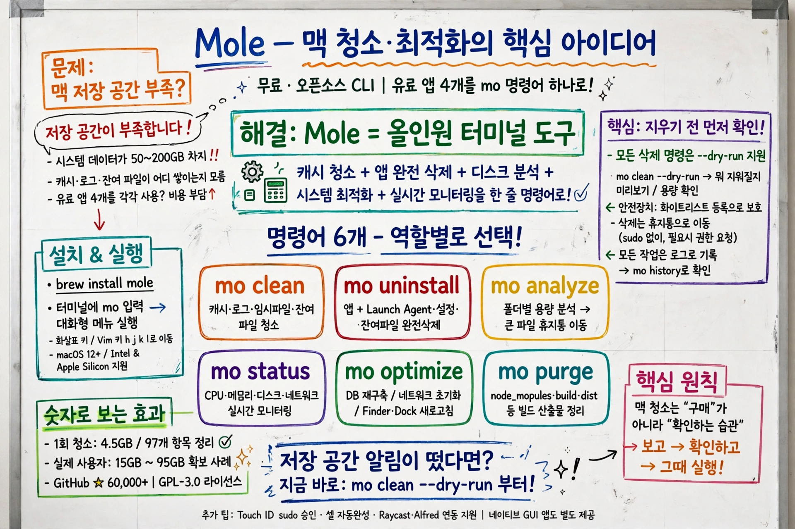
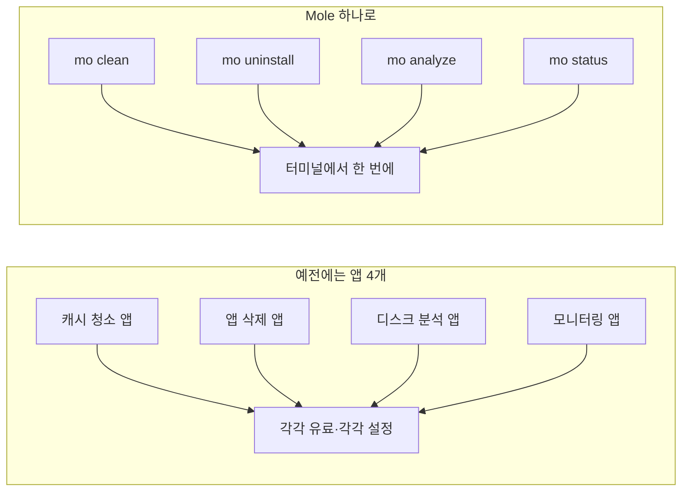
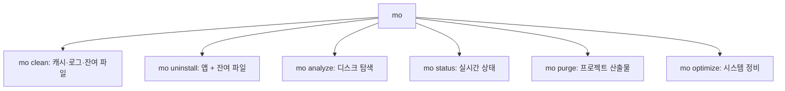
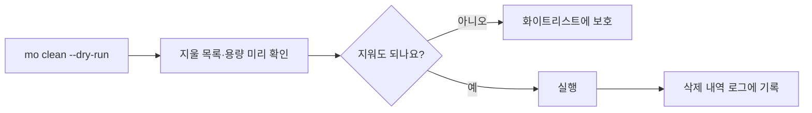

# Mole: 맥 청소, 유료 앱 4개가 하던 일을 터미널 명령어 하나로 끝냅니다

> **Summary**
> Mole은 캐시와 잔여 파일 청소, 앱 완전 삭제, 디스크 분석, 시스템 모니터링과 최적화를 하나의 무료 오픈소스 명령줄 도구로 제공합니다. 삭제 전에 --dry-run으로 대상과 용량을 확인하고, 화이트리스트와 휴지통 등 안전장치를 활용할 수 있습니다.

---

- Mole은 캐시 청소, 앱 완전 삭제, 디스크 분석, 시스템 최적화, 실시간 모니터링을 하나의 터미널 명령어로 묶은 무료 오픈소스 도구입니다.
- 유료 앱 4개가 하던 일을 `mo` 명령어 하나로 합니다. 설치도 Homebrew 한 줄이면 됩니다.
- 지우기 전에 `--dry-run`으로 미리 보고, 화이트리스트와 휴지통으로 안전장치를 두는 게 핵심입니다.


## 맥 저장 공간 부족 알림, 보신 적 있으시죠?

맥을 쓰다 보면 어느 날 "저장 공간이 부족합니다"라는 알림이 뜹니다. 설정에서 확인해보면 "시스템 데이터"라는 항목이 수십 GB, 심하면 200GB 가까이 차지하고 있습니다. 뭐가 쌓인 건지, 뭘 지워야 하는지 알 수가 없죠. 이런 적 있으시죠?

이럴 때 보통 유료 청소 앱을 찾습니다. 그런데 캐시 청소, 앱 삭제, 디스크 분석, 시스템 모니터링을 각각 다른 앱으로 해결하려니 비용도 만만치 않습니다. 이 네 가지 일을 터미널 명령어 하나로 묶은 도구가 있습니다!

🎥 [동영상 보기](https://www.youtube.com/watch?v=E3XNLh7yPsA)

## Mole, 유료 앱 4개가 하던 일을 하나로 묶었습니다

Mole은 macOS를 깊게 청소하고 최적화하는 무료 오픈소스 CLI 도구입니다. 핵심은 올인원입니다. 캐시 청소, 앱 완전 삭제, 디스크 분석, 실시간 모니터링을 하나의 명령어 `mo`로 묶었습니다.

설치는 Homebrew 한 줄이면 됩니다.

```bash
brew install mole
```

터미널에서 `mo`만 치면 대화형 메뉴가 열립니다. 화살표 키로 고르고, Vim 키(`h`/`j`/`k`/`l`)로도 움직입니다. macOS 12 이상에서 돌아가고, 인텔 맥과 애플 실리콘 맥을 모두 지원합니다.



## 명령어 6개, 각각 역할이 다릅니다

역할이 나뉘어 있어서, 원하는 일만 골라서 하면 됩니다. 여섯 가지 핵심 명령어가 있습니다.

`mo clean`은 깊은 청소입니다. 캐시, 로그, 임시 파일, 지운 앱의 잔여 파일까지 스캔해서 공간을 비웁니다. `mo uninstall`은 앱을 지울 때 Launch Agent, 환경설정, 숨은 잔여 파일까지 함께 제거합니다. 앱을 휴지통으로 끄는 것만으로는 남는 파일이 많습니다. 이 장면이 저는 가장 인상 깊었습니다. 지운 줄 알았던 앱의 흔적이 이렇게 많이 남는다는 점입니다!

`mo analyze`는 디스크 탐색기입니다. 폴더별 용량을 시각적으로 보여주고, 큰 파일을 찾아서 휴지통으로 보냅니다. `mo status`는 실시간 대시보드입니다. CPU, 메모리, 디스크, 네트워크 상태를 한눈에 봅니다. `mo optimize`는 시스템 정비입니다. 데이터베이스 재구축, 네트워크 서비스 초기화, Finder·Dock 새로고침을 합니다. `mo purge`는 개발자용입니다. `node_modules`, `target`, `build`, `dist` 같은 프로젝트 빌드 산출물을 정리합니다.



## 지우기 전에 먼저 보여주는 게 핵심입니다

파일을 지우는 도구는 보안이 제일 걱정됩니다. "이거 써도 될까요?"라는 질문이 나오는 이유입니다. Mole의 답은 지우기 전에 보여주는 것입니다.

모든 삭제 명령은 `--dry-run`을 지원합니다. `mo clean --dry-run`을 치면 뭘 지울지, 용량이 얼마인지 미리 보여주고 아무것도 지우지 않습니다. 목록을 보고 괜찮다고 판단되면 그때 실행합니다. `--debug`를 붙이면 상세 로그까지 확인합니다.

안전장치는 더 있습니다. 삭제할 앱은 미리보기에서 고르고, 개인 데이터는 기본적으로 남깁니다. 꼭 지켜야 할 캐시는 화이트리스트에 등록해 보호합니다. 삭제된 앱은 기본적으로 휴지통으로 갑니다. `sudo` 없이 실행하고, 관리자 권한은 필요할 때만 요청합니다. 모든 작업 내역은 로그 파일에 남고, `mo history`로 바로 확인합니다!



## 숫자로 보면 이렇습니다

공식 사용 예시에서는 한 번의 청소로 4.5GB, 97개 항목이 정리됐습니다. 실제 사용 후기에서는 한 번 실행으로 15GB, 많게는 95GB까지 비워졌다는 사례도 있습니다. GitHub에서 6만 개가 넘는 스타를 모았고, 라이선스는 GPL-3.0입니다.

개발자 친화적인 부분도 있습니다. Touch ID로 `sudo`를 승인하고, 셸 자동 완성을 설정하고, Raycast·Alfred와 연동해 런처에서 바로 부릅니다. 설치 파일 정리, 인텔 코드 제거 같은 부가 명령도 있습니다. 실험적인 Windows·Linux 버전도 제공됩니다.

무료 CLI와 별도로 네이티브 Mac 앱도 있습니다. 버튼으로 조작하는 GUI 앱인데, CLI와는 별개 제품입니다. 터미널이 편하면 CLI로 충분합니다!

## 맥 청소는 사는 일이 아니라 확인하는 습관입니다

맥 청소는 유료 앱을 사는 일이 아닙니다. 뭐가 쌓였는지 보고, 지워도 되는지 확인하고, 그때 실행하는 습관입니다. Mole은 그 습관을 명령어 하나로 묶어둔 도구입니다. 저장 공간 알림이 떴다면, `mo clean --dry-run`부터 쳐보는 게 어떨까요?

