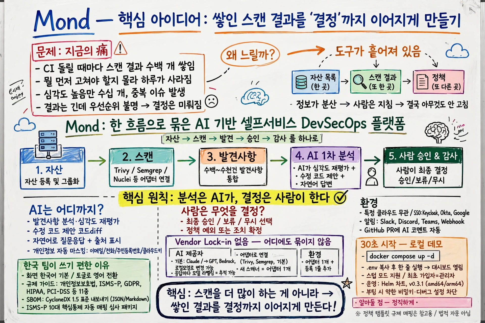
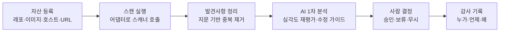
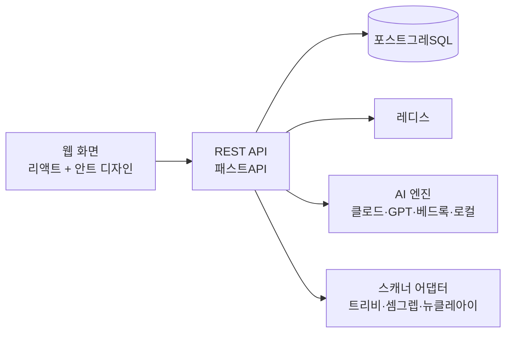
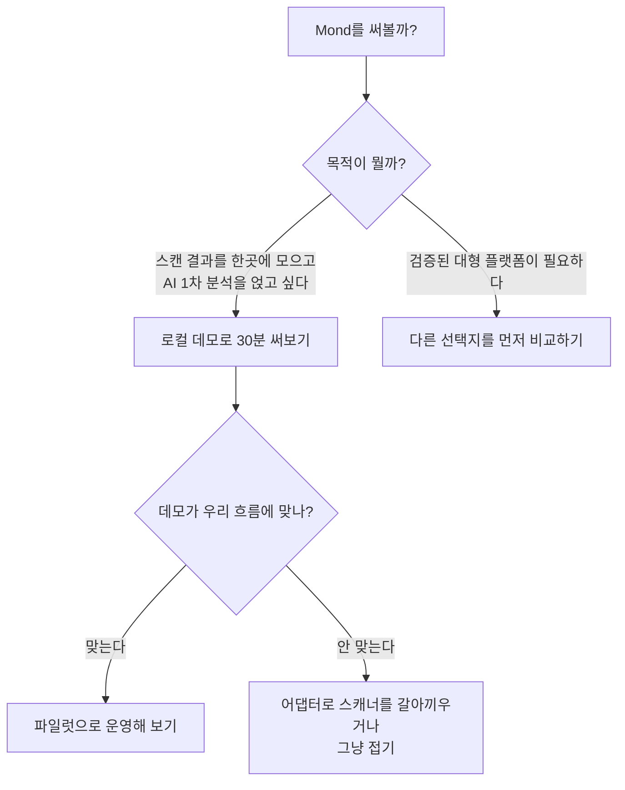

# Mond: 스캔 결과 수천 개, AI가 1차 분석하고 결정은 사람이 합니다

> **Summary**
> Mond는 자산부터 스캔, 발견, 승인, 감사까지 한 흐름으로 묶은 AI 기반 셀프서비스 DevSecOps 플랫폼입니다. AI가 발견사항을 1차 분석해 심각도를 다시 매기고 수정 가이드를 제시하지만, 최종 결정은 사람이 내립니다. 스캐너도 AI 제공자도 클라우드도 어디에도 묶이지 않고, 한국어가 기본 화면이며 규제 가이드까지 들어 있습니다. 다만 아직 별 16개의 작은 프로젝트라, 도입 전 30분 데모로 직접 가늠해 보는 게 맞습니다.

---

- CI를 돌릴 때마다 스캔 결과가 수백 개씩 쌓이는데, 정작 뭘 먼저 고쳐야 할지 가리는 데 하루가 갑니다.
- Mond는 자산부터 스캔, 발견, 승인, 감사까지 한 흐름으로 묶은 AI 기반 셀프서비스 DevSecOps 플랫폼입니다.
- AI가 1차 분석을 하고, 결정은 사람이 합니다. 스캐너도 AI 제공자도 클라우드도, 어디에도 묶이지 않습니다.

스캔 결과를 앞에 두고 한참을 바라본 적 있으시죠? 목록은 긴데, 뭘 먼저 고쳐야 할지 알 수 없습니다. 심각도 `높음`만 수십 개, 같은 이슈가 여러 스캐너에서 중복으로 잡히고, 결정은 미뤄집니다. Mond는 이 지점을 정면으로 파고든 프로젝트입니다.

🎥 [동영상 보기](https://www.youtube.com/watch?v=F5KJVuii0Yw)

## 스캔은 늘었는데, 결정은 왜 느릴까요?

도구가 문제라기보다, 도구가 흩어져 있는 게 문제입니다. 자산 목록은 한 곳, 스캔 결과는 또 한 곳, 정책은 또 다른 곳에 있습니다. 발견사항이 수천 개가 되면 사람은 우선순위를 정하는 데 지치고, 결국 아무것도 못 고치는 날이 생깁니다. Mond가 푸는 문제는 바로 이겁니다. 스캔을 더 많이 하는 게 아니라, 쌓인 결과를 결정까지 이어지게 만드는 겁니다!

## 한 흐름으로 묶으면 뭐가 달라질까요?

Mond는 다섯 가지 영역을 하나의 모델로 다룹니다. 자산, 스캔, 발견사항, 정책, 그리고 AI 인사이트입니다. 흐름은 단순합니다. 자산을 등록하고, 스캔을 돌리고, 발견사항을 AI가 1차 분석하고, 사람이 승인하고, 감사가 남습니다.

대시보드에서는 보안 점수와 자산·발견 통계를 한눈에 봅니다. 발견사항마다 AI 분석 서랍이 열려서, 왜 위험한지, 어떻게 고치는지까지 이어집니다. 정책 시뮬레이션도 있습니다. "이번 PR에 이 발견사항이 들어가면 어떤 정책이 깨질까?"를 합치기 전에 미리 볼 수 있습니다. 궁금한 건 자연어로 물으면 됩니다. AI 인사이트가 자산·발견·정책·지식 네 곳을 검색해 출처 표시와 함께 답합니다.

## AI는 어디까지 하고, 사람은 뭘 결정할까요?

Mond의 문장은 분명합니다. 분석은 AI가, 결정은 사람이 합니다. AI는 발견사항을 분석해 심각도를 다시 매기고, 수정 코드를 제안하고, 자연어 질문에 답합니다. 하지만 최종 판단은 사람이 내립니다. 승인할지, 보류할지, 무시할지. AI가 대신 결정하지 않습니다. 이 선이 Mond의 핵심입니다!

AI 제공자는 한 줄 설정으로 바꿉니다. 기본은 클로드이고, GPT나 베드록으로 갈아탈 수 있고, 사내 폐쇄망이라면 로컬 모델로도 돌릴 수 있습니다. 키를 넣지 않으면 기본 규칙 모드로 모든 화면이 그대로 동작합니다. 응답마다 어떤 제공자·모델이 답했는지 라벨이 붙어 출처를 추적할 수 있습니다. 외부 AI에 보내기 전에 이메일·전화번호·주민등록번호·클라우드 키 같은 개인정보는 자동으로 가려집니다. 폐쇄망 조직에겐 이 부분이 꽤 중요합니다.

## 특정 도구에 묶이지 않는다는 건 무슨 뜻일까요?

스캐너는 어댑터로 연결합니다. 기본으로 트리비, 셈그렙, 뉴클레아이가 들어 있고, 새 스캐너는 어댑터 클래스 하나와 등록 한 줄이면 메뉴와 스캔 실행에 바로 나타납니다. 클라우드도 마찬가지입니다. 특정 클라우드에 묶이지 않고, AI 제공자도, 로그인 방식도 갈아낄 수 있습니다. 싱글 사인온은 키클락·옥타·구글을 지원하고, MCP 서버도 붙어 있어 데스크톱 AI 도구와도 연결됩니다.

알림도 여러 채널로 갑니다. 임계치를 넘긴 발견사항은 슬랙·디스코드·팀즈·일반 웹훅으로 자동 전송됩니다. 깃허브에 푸시하면 웹훅으로 스캔이 자동으로 돌고, CI에서는 한 줄짜리 스캔 액션으로 연결됩니다. 스캔 결과가 PR에 AI 분석 코멘트로 달리는 기능도 있습니다. 도구가 흩어져 있던 흐름이, 이렇게 한 줄로 이어집니다!

## 한국 팀이 쓰기 편한 이유는 뭘까요?

화면은 한국어가 기본입니다. 우측 상단 토글로 영어로 바꿀 수 있고, 위험도나 상태 같은 라벨도 한국어로 통일돼 있습니다. 규제 가이드도 눈에 띕니다. 사업 시나리오를 고르면 적용되는 규제를 보여줍니다. 개인정보보호법·ISMS-P·GDPR·HIPAA·PCI-DSS 등 열한 가지가 들어 있습니다. SBOM은 사이클론DX 1.5 표준으로 뽑히고, 컴플라이언스 리포트는 JSON이나 마크다운으로 받을 수 있습니다. ISMS-P 핵심 통제 열 개를 실제 데이터로 자동 매핑해 주는 심사 패키지도 있습니다. 다만 정책 템플릿의 규제 매핑은 참고용 출발점일 뿐, 법적 자문이 아니라는 점은 문서에 분명히 적혀 있습니다.

## 30초면 시작할 수 있을까요?

로컬 데모는 빠릅니다. 저장소를 받아 환경 설정 파일을 복사한 뒤 `docker compose up -d` 한 줄이면 화면이 뜹니다. 스캐너 바이너리가 없어도 스텁 모드로 화면을 먼저 볼 수 있습니다. 첫 가입자는 자동으로 관리자가 되고, 패스키나 일회용 비밀번호 중 하나로 다중 인증을 한 번 등록한 뒤 들어갑니다. 운영 배포는 헬름 차트로 합니다. 현재 버전은 0.3.1이고, 컨테이너 이미지는 두 가지 아키텍처로 나옵니다. 운영 환경에서는 약한 비밀키나 디버그 설정을 부팅 단계에서 거부합니다!

## 쓰기 전에 알아둘 점은 뭘까요?

정직하게 짚을 부분도 있습니다. 이 프로젝트는 아직 작습니다. 2025년 11월에 공개됐고, 별 개수는 16개, 포크는 1개입니다. 검증된 대형 플랫폼이 아니라 이제 막 자라는 단계라는 뜻입니다. 테스트 커버리지는 의도적으로 낮다고 문서에 적혀 있습니다. AI 인사이트도 환각 위험이 있어 사람의 검토를 권장한다고 명시돼 있습니다. 그래서 도입 전에 이렇게 가늠해 보면 좋습니다.

작은 프로젝트라는 사실이 단점만은 아닙니다. 코드가 작아서 구조를 파악하기 쉽고, 어댑터 하나면 스캐너를 갈아낄 수 있고, 한국어 문서가 처음부터 갖춰져 있습니다. 로드맵도 살아 있습니다. 0.2와 0.3이 끝났고, 다음 단계로는 멀티 클러스터 쿠버네티스 자동 동기화와 워크스페이스 분리가 예정돼 있습니다. 스캔 결과 앞에서 멈춰 선 경험이 있다면, 30분 데모로 직접 가늠해 보는 게 가장 빠릅니다!

