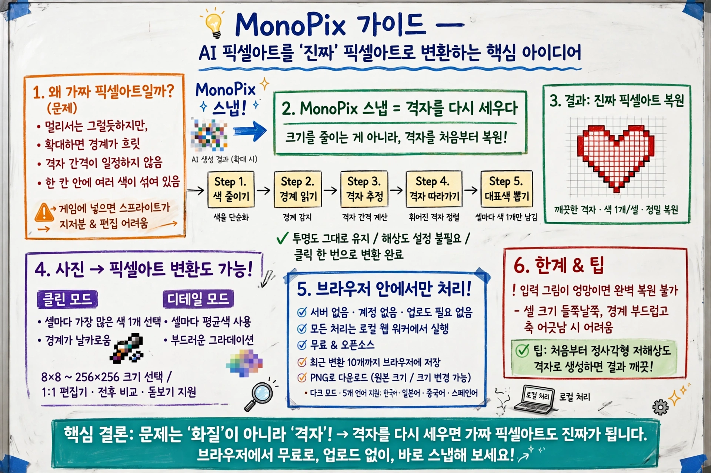
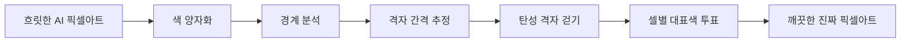
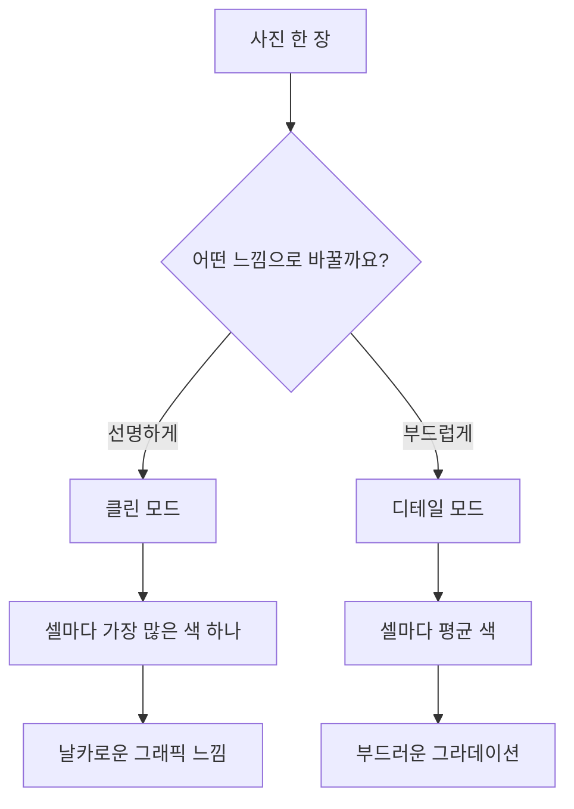

# MonoPix: AI가 그린 가짜 픽셀아트, 격자만 맞추면 진짜가 됩니다

> **Summary**
> MonoPix는 AI가 만든 가짜 픽셀아트를 진짜 픽셀아트로 되돌려 주는 무료 오픈소스 도구입니다. 스냅 기능이 원래 격자를 찾아내 한 칸마다 색 하나만 남기고, 사진도 8×8부터 256×256까지 픽셀아트로 바꿔 줍니다. 모든 처리는 브라우저 안에서만 이뤄져서 서버도 계정도 업로드도 필요 없습니다.

---

- AI가 만든 픽셀아트는 멀리서 보면 그럴듯하지만, 확대하면 경계가 흐릿하고 한 칸 안에 색이 섞여 있습니다.
- MonoPix의 스냅 기능은 원래 격자를 찾아내 한 칸마다 색 하나만 남겨, 진짜 픽셀아트로 되돌려 줍니다.
- 사진도 픽셀아트로 바꿀 수 있고, 모든 처리는 브라우저 안에서만 이뤄져서 서버도 계정도 필요 없습니다.

AI로 게임 스프라이트를 뽑아 본 적 있으시죠? 화면에서는 딱 픽셀아트 같았는데, 확대해 보니 경계가 흐릿하고 칸마다 색이 뒤섞여 있었습니다. 이럴 때 필요한 도구가 MonoPix입니다!

🎥 [동영상 보기](https://www.youtube.com/watch?v=hnKBzPblR3M)

## 왜 가짜 픽셀아트일까요?

문제는 화질이 아니라 구조입니다. 진짜 픽셀아트는 깨끗하고 일정한 격자 위에 서 있습니다. 그런데 AI가 그린 그림은 그 구조를 흉내만 냅니다. 멀리서는 그럴듯해 보이지만, 가까이서 보면 무너집니다!

- 경계가 흐릿합니다.
- 격자 간격이 일정하지 않습니다.
- 한 칸 안에 여러 색이 섞여 있습니다.
그래서 게임에 그대로 넣으면 스프라이트가 지저분해집니다. 편집도 어렵습니다. 칸 하나하나 색이 달라서 손댈 곳이 끝이 없습니다.

## 스냅은 격자를 어떻게 되찾을까요?

MonoPix의 스냅은 크기를 줄이거나 필터를 거는 방식이 아닙니다. 원래 격자를 다시 추정해서 그림을 처음부터 다시 짓습니다.

순서는 다섯 단계입니다. 색을 줄이고, 경계를 읽고, 격자 간격을 추정하고, 휘어진 격자를 따라가면서, 마지막에 셀마다 대표색 하나를 뽑습니다. 투명도도 그대로 살아남습니다. 해상도를 정할 필요도 없고, 격자를 손으로 맞출 필요도 없습니다. 이미지를 올리고 변환 버튼을 누르면 끝입니다!

이 장면이 저는 가장 인상 깊었습니다. "복원"이라는 말이 거창하게 들렸는데, 알고 보니 격자를 다시 세우는 일이었으니까요!

## 사진도 픽셀아트로 바꿀 수 있을까요?

됩니다! 스냅 말고도 사진을 픽셀아트로 바꾸는 변환 기능이 있습니다. 8×8부터 256×256까지 크기를 골라서 바꿉니다. 방식은 두 가지입니다.

클린 모드는 셀마다 가장 많은 색 하나를 골라서 경계가 날카롭게 살아납니다. 디테일 모드는 셀마다 평균 색을 써서 그라데이션이 부드럽게 이어집니다. 1:1 자르기 편집기에 확대·격자 표시도 있고, 변환 전후를 나란히 비교하거나 돋보기로 들여다볼 수도 있습니다.

## 서버도 계정도 없다고요?

MonoPix는 브라우저 안에서만 돌아갑니다. 이미지를 올릴 필요가 없고, 계정을 만들 필요도 없습니다. 모든 처리는 웹 워커에서 로컬로 이뤄집니다. 무료이고, 소스도 공개되어 있습니다.

- 최근 변환 10개까지 브라우저에 저장됩니다.
- PNG로 내려받습니다. 원래 크기 그대로도 되고, 크기를 바꿔서도 됩니다.
- 다크 모드와 5개 언어(영어·한국어·일본어·중국어·스페인어)를 지원합니다.
게임 개발자나 픽셀 아티스트가 쓰기에 딱 맞는 구성입니다. 인디 게임 스프라이트, 레트로풍 게임 그래픽을 만들 때 유용합니다.

## 모든 그림이 완벽하게 고쳐질까요?

여기서 한 가지는 짚고 넘어가야 합니다. 입력 그림의 품질이 나쁘면 스냅도 완벽하게 되돌리지 못합니다. 특히 채팅형 이미지 생성기로 만든 픽셀아트는 셀 너비와 높이가 들쭉날쭉하고, 경계가 부드럽고, 축이 어긋난 경우가 많습니다. 스냅이 격자를 다듬어 주기는 하지만, 원래 격자 자체가 엉망이면 완벽한 복원은 보장할 수 없습니다.

새로 그림을 만들 때는 처음부터 정사각형 저해상도 격자를 지키는 생성 방식을 쓰는 편이 좋습니다. 입력이 깨끗하면 결과도 깨끗합니다.

## 그래서, 가짜는 진짜가 될까요?

MonoPix는 AI 픽셀아트의 약점을 정확히 찔렀습니다. 문제는 화질이 아니라 격자였고, 답은 격자를 다시 세우는 것이었습니다. 브라우저에서 무료로, 업로드 없이, 바로 써 볼 수 있습니다. AI로 뽑은 스프라이트가 흐릿해서 버린 적 있으시다면, 한 번 스냅해 보시는 건 어떨까요?

