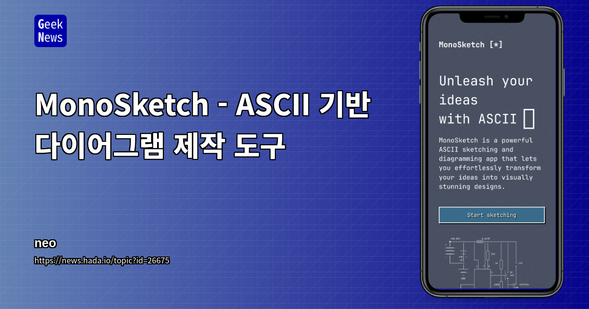
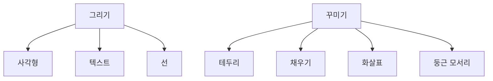
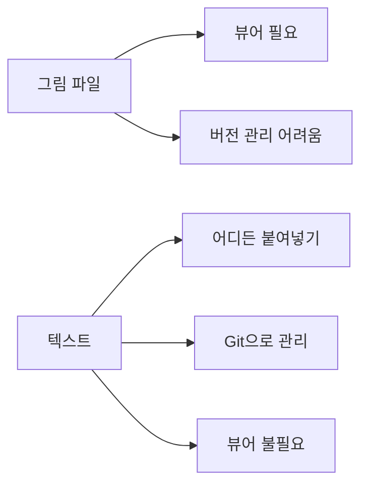

# MonoSketch: 다이어그램은 그림이 아니라 텍스트로 그립니다

> **Summary**
> MonoSketch는 설치·계정·서버 없이 브라우저에서 ASCII 다이어그램을 그리는 무료 오픈소스 도구입니다. 결과물이 순수 텍스트라 문서나 코드에 쉽게 붙여넣고 Git으로 버전 관리할 수 있으며, 사각형·텍스트·선 도구와 자동 저장, 무한 캔버스 등 편집 기능을 제공합니다.

---

- MonoSketch는 ASCII 문자만으로 다이어그램을 그리는 웹 앱입니다. 설치도, 서버도, 계정도 필요 없습니다.
- 사각형·텍스트·선 세 가지 도구로 회로도부터 시스템 구조도까지 그릴 수 있고, 결과물은 순수 텍스트입니다.
- 텍스트라서 README, 코드 주석, 문서, 메신저 어디에나 붙여넣을 수 있고, Git으로 버전 관리까지 됩니다.

이런 적 있으시죠? 시스템 구조를 설명하려고 다이어그램 도구를 켰는데, 로그인하고 템플릿 고르고 내보내기 형식을 정하다가 정작 설명하려던 내용이 뭔지 까먹은 적 말입니다. 그림 한 장 그리려고 계정부터 만들어야 하는 게, 번거롭지 않나요?

MonoSketch는 그 번거로움을 아예 없애버린 도구입니다. 브라우저에서 바로 열리는 클라이언트-온리 웹 앱인데, ASCII 문자만으로 다이어그램을 그립니다. 서버로 데이터를 보내지 않으니까, 그린 내용은 내 기기에만 머무릅니다!

🎥 [동영상 보기](https://www.youtube.com/watch?v=jCd6XfWLZsg)

## MonoSketch, 도대체 뭘까요?

MonoSketch는 ASCII 다이어그램을 그리는 웹 앱입니다. "Unleash your ideas with ASCII"라는 슬로건처럼, 텍스트만으로 아이디어를 시각적 설계로 바꿔줍니다. 클라이언트-온리라서 서버 처리도, 클라우드 업로드도 없습니다. 그린 다이어그램은 내 기기에만 남습니다.

도구는 단 세 가지입니다. 사각형, 텍스트, 선. 여기에 테두리 스타일, 채우기 문자, 화살표 장식, 둥근 모서리를 더하면 회로도, 시스템 구조, 네트워크 흐름 같은 복잡한 그림도 그릴 수 있습니다. 공식 예시에는 스위칭 전원 회로도까지 ASCII로 그려져 있습니다. 텍스트만으로 이 정도 그림이 나온다고요? 네, 나옵니다!

## 왜 하필 텍스트일까요?

다이어그램을 그림 파일로 만들면, 그 파일은 그림을 보여주는 도구 없이는 열 수도 없고, 버전 관리도 어렵습니다. 그런데 ASCII 다이어그램은 순수 텍스트입니다. 텍스트가 가는 곳이면 어디든 갑니다. README에 붙여넣고, 코드 주석에 넣고, 문서에 넣고, 메신저에 붙여넣습니다. Git에 커밋하면 변경 내역이 글자 그대로 보입니다. diff가 됩니다!

이게 MonoSketch의 진짜 강점입니다. 다이어그램이 "파일"이 아니라 "텍스트"가 되는 순간, 다이어그램은 문서의 일부가 됩니다. 별도 뷰어도, 내보내기도, 계정도 필요 없습니다.

## 뭐가 들어있나요?

### 그리기 도구, 딱 세 가지면 충분할까요?

사각형, 텍스트, 선. 세 가지면 충분합니다. 사각형은 테두리와 채우기로 모양을 바꾸고, 선은 화살표 머리를 달아 방향을 표시하고, 텍스트는 설명을 붙입니다. 둥근 모서리로 마무리하면 보기에도 깔끔해집니다.

### 편집은 어떻게 하나요?

무한 캔버스라서 스크롤과 확대·축소가 자유롭습니다. 자동 저장이 되니까 작업이 날아갈 걱정도 없습니다. 여러 프로젝트를 관리할 수 있고, 복사·잘라내기·붙여넣기·복제 같은 표준 편집 명령이 다 됩니다. 레이어 관리와 스마트 스냅핑으로 도형을 정밀하게 맞출 수 있고, 다크 모드도 지원합니다.

### 내보내기는요?

선택한 부분이나 전체 다이어그램을 텍스트로 즉시 복사합니다. 단축키 하나면 끝입니다. macOS는 `Cmd + Shift + C`, Windows와 Linux는 `Ctrl + Shift + C`입니다. 복사한 텍스트를 원하는 곳에 붙여넣으면 됩니다.

## 무거운 도구와 뭐가 다를까요?

Visio나 Lucidchart, Figma 같은 도구는 강력합니다. 그런데 계정이 필요하고, 파일이 무겁고, 버전 관리가 어렵습니다. MonoSketch는 정반대입니다. 설치 없이 브라우저에서 바로 쓰고, 결과물은 텍스트라서 어디든 붙여넣습니다. 물론 복잡한 일러스트나 정밀한 디자인을 그리는 도구는 아닙니다. 시스템 구조나 흐름, 회로도처럼 "구조를 설명하는 그림"에 강합니다.

비슷한 도구로는 asciiflow(웹)와 Monodraw(Mac 전용, 유료)가 있습니다. MonoSketch는 웹에서 무료로 쓸 수 있는 오픈소스라는 점이 다릅니다. Apache 2.0 라이선스라서 자유롭게 쓸 수 있고, 별이 1,800개가 넘습니다.

## 앞으로 뭐가 더 생기나요?

로드맵에는 그룹화 기능, 페인트 도구, 공유·협업 기능이 있습니다. 그룹화로 복잡한 구조를 묶어서 관리하고, 페인트 도구로 자유 곡선을 그리고, 공유 기능과 URL 불러오기로 협업까지 넓힐 계획입니다. 참고로 지금은 TypeScript로 다시 쓰는 작업이 진행 중입니다. 기존 버전은 그대로 쓸 수 있습니다.

## 맺음말

다이어그램은 꼭 그림 파일일 필요가 없습니다. 텍스트로 그리면 다이어그램은 문서가 되고, 코멘트가 되고, 커밋이 됩니다. MonoSketch는 그걸 가장 가볍게 해주는 도구입니다!

