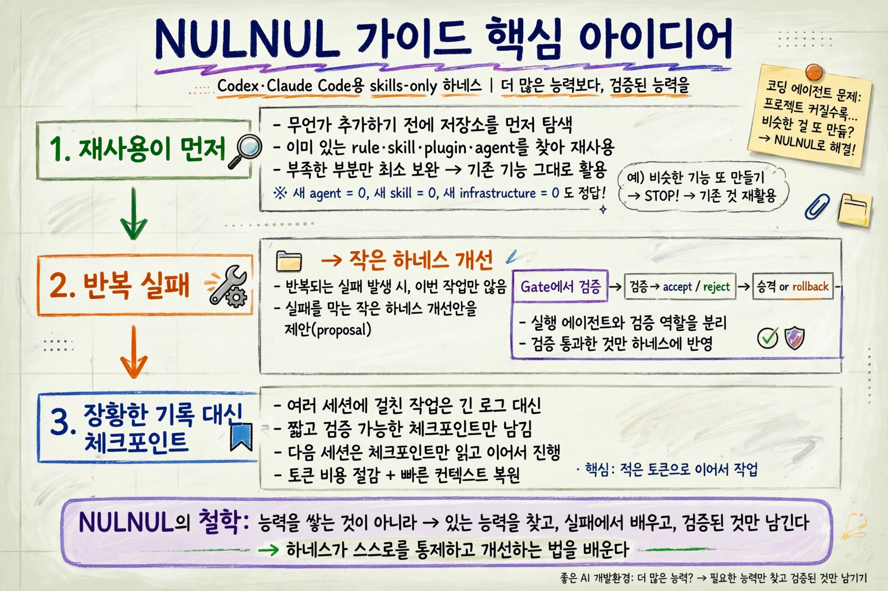
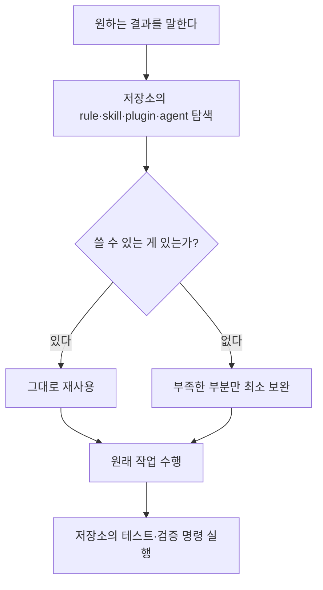
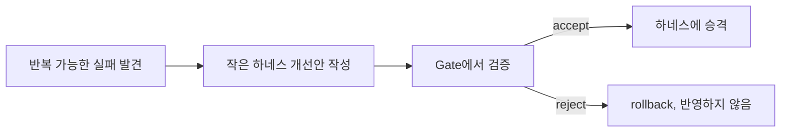

# NULNUL: 능력을 더 주는 게 아니라, 있는 능력을 찾게 하는 하네스입니다

> **Summary**
> NULNUL은 Codex와 Claude Code용 skills-only 하네스로, 새 능력을 추가하기 전에 저장소에 이미 있는 rule·skill·plugin·agent를 먼저 찾아 재사용하고 부족한 부분만 최소한으로 보완합니다. 반복되는 실패는 이번 작업만 고치지 않고 작은 하네스 개선안으로 만들어, 실행 에이전트와 분리된 Gate에서 검증한 뒤에만 승격합니다. 여러 세션에 걸친 작업은 장황한 기록 대신 짧고 검증 가능한 체크포인트만 남겨, 다음 세션이 적은 토큰으로 이어서 일합니다.

---

- NULNUL은 Codex와 Claude Code용 skills-only 하네스로, 새 능력을 추가하기 전에 저장소에 이미 있는 rule·skill·plugin·agent를 먼저 찾아 재사용합니다.
- 반복되는 실패는 이번 작업만 고치지 않고 작은 하네스 개선안으로 만들어, 실행 에이전트와 분리된 Gate에서 검증한 뒤에만 승격합니다.
- 여러 세션에 걸친 작업은 장황한 기록 대신 짧고 검증 가능한 체크포인트만 남겨, 다음 세션이 적은 토큰으로 이어서 일합니다.

코딩 에이전트한테 일을 시키다 보면 이런 장면이 있습니다. 프로젝트가 커질수록 스킬이며 에이전트며 플러그인이 하나둘 늘어나는데, 정작 에이전트는 이미 있는 걸 못 찾고 비슷한 걸 또 만듭니다. 이런 적 있으시죠?

🎥 [동영상 보기](https://www.youtube.com/watch?v=IZAlq-V19U8)

## 있는 걸 먼저 찾는 하네스?

NULNUL의 출발점은 단순합니다. **무언가를 추가하기 전에 이미 있는 것을 먼저 찾는다**는 겁니다. 사용자가 원하는 결과를 말하면, 하네스는 저장소를 읽고 프로젝트에 이미 존재하는 rule·skill·plugin·agent를 탐색합니다. 쓸 수 있는 건 그대로 재사용하고, 부족한 부분만 최소한으로 보완한 뒤 원래 요청했던 작업을 계속 수행합니다. 마지막에는 실제 저장소의 테스트와 검증 명령을 실행해서 결과를 확인합니다.

여기서 가장 인상적인 대목은 이겁니다. 때로는 **새 agent 0개, 새 skill 0개, 새 infrastructure 0개가 정답**일 수도 있다는 겁니다! 능력을 더 주는 게 능사가 아니라는 말입니다. 이미 있는 능력이 잠자고 있는데 새 능력을 쌓으면, 에이전트는 선택지만 늘어나고 정작 맞는 걸 고르지 못합니다. 이 장면이 저는 가장 인상 깊었습니다. "없으면 만든다"가 아니라 "있으면 쓴다"가 먼저라는 순서가, 하네스의 철학을 한 줄로 보여주니까요!

## 실패하면 누가 고치나요?

두 번째 아이디어는 더 과감합니다. 작업 중 반복 가능한 실패가 발견되면, 이번 작업만 고치고 넘어가지 않습니다. 그 실패를 다시 막을 수 있는 **작은 하네스 개선안**으로 만듭니다. 하네스 자체를 개선하는 제안이라는 뜻입니다.

그런데 여기서 중요한 장치가 하나 있습니다. 에이전트가 자기 마음대로 자신의 규칙을 변경하게 두지 않는다는 겁니다. 개선안은 별도의 **Gate**에서 검증합니다. `proposal → 검증 → accept / reject → 승격 또는 rollback` 과정을 통과한 것만 실제 하네스에 반영됩니다. 작업을 수행하는 에이전트와, 그 에이전트의 능력을 승격시키는 판단을 분리한 겁니다. 스스로 개선된다는 말이, 아무 통제 없이 스스로 규칙을 바꾼다는 뜻은 아닙니다. 이 분리가 없었다면 자기 개선은 곧 자기 멋대로가 됐을 겁니다!

## 세션이 바뀌어도 이어서 일할 수 있을까요?

긴 작업을 하다 보면 세션이 바뀌는 일이 생깁니다. 다음 세션이 프로젝트 전체를 처음부터 다시 파악하는 비용도 꽤 큽니다. NULNUL은 이 문제를 장황한 기록으로 풀지 않습니다. 여러 세션에 걸치는 작업에서는 현재 상태를 길게 저장하는 대신 **짧고 검증 가능한 checkpoint**만 남깁니다. 다음 세션은 그 체크포인트만 읽고 이어서 일합니다. 토큰 비용을 아끼는 실용적인 선택입니다.

하네스를 소프트웨어 공학의 관점에서 다룬 글과 비교하면, NULNUL은 그 일반론을 구체적인 동작 규칙으로 구현한 프로젝트에 가깝습니다. 재사용 우선, Gate 검증, 짧은 체크포인트. 세 가지 규칙이 하네스의 전부라고 해도 될 정도입니다. 거창한 구조가 아니라, 매일의 작업에서 반복되는 낭비를 줄이는 규칙 세 개입니다.

좋은 AI 개발 환경은 에이전트에게 더 많은 능력을 주는 걸까요, 아니면 필요한 능력만 찾아 쓰고 검증된 것만 남도록 만드는 걸까요? NULNUL의 답은 후자에 가깝습니다. 능력을 쌓는 대신, 있는 능력을 찾고, 실패에서 배우고, 배운 것을 검증해서 남기는 겁니다. 하네스가 스스로 개선된다는 건, 결국 하네스가 스스로를 통제하는 법을 배운다는 뜻입니다!

