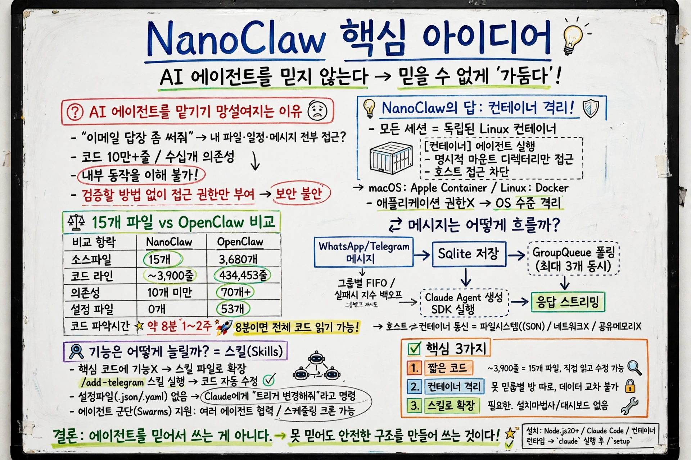
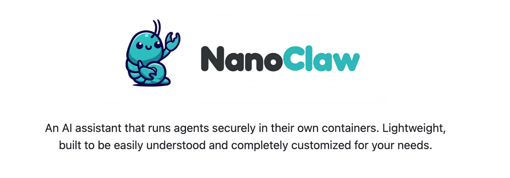
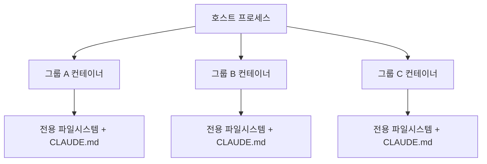

# NanoClaw: 에이전트는 컨테이너에 가두고, 대화는 메신저로 하면 됩니다

> **Summary**
> NanoClaw는 WhatsApp·Telegram 같은 메신저로 대화하는 개인용 AI 에이전트로, 각 세션을 OS 컨테이너에 격리해 접근을 제한합니다. 약 15개 파일과 3,900줄의 간결한 코드로 메시징, 메모리, 스케줄링, 웹 접근을 제공하며, 설정 파일 대신 스킬로 코드를 수정해 필요한 기능만 추가합니다. 사용자가 코드를 직접 읽고 관리하는 것을 전제로 한 오픈소스 프로젝트입니다.

---

- NanoClaw는 메신저로 대화하는 개인용 AI 에이전트인데, 모든 에이전트 세션을 OS 컨테이너 안에서 격리해 실행합니다.
- OpenClaw와 같은 핵심 기능(메시징·메모리·스케줄링·웹 접근)을 제공하면서, 코드베이스는 15개 파일·약 3,900줄까지 줄였습니다.
- 설정 파일은 없습니다. 기능을 늘릴 땐 스킬을 실행해 코드 자체를 바꾸는 방식이라, 코드를 직접 읽고 고치는 게 전제입니다.

## AI 에이전트에게 내 컴퓨터를 맡기기, 망설여지시죠?

AI 에이전트에게 "이메일 답장 좀 써줘"라고 맡기고 싶으셨던 적 있으시죠? 그런데 막상 설치하려고 보면, 에이전트가 내 컴퓨터 전체를 들여다본다는 사실이 먼저 걸립니다. 파일도, 일정도, 메시지 기록도 전부요. 편하고 싶은데, 불안한 게 먼저 옵니다!

🎥 [동영상 보기](https://www.youtube.com/watch?v=0YT1UHMrUY8)

## 에이전트가 무서운 이유, 코드 양 때문일까요?

개인용 AI 에이전트에 대한 관심이 급증하고 있습니다. 단순히 질문에 답하는 챗봇을 넘어, 스스로 계획을 세우고 외부 도구를 쓰며 메신저로 소통하는 프레임워크가 여럿 등장했습니다. 그런데 유명한 프레임워크일수록 수십만 줄의 코드와 수십 개의 의존성을 가진 거대한 모놀리식 시스템으로 변하는 경향이 있습니다.

문제는 규모 그 자체가 아닙니다. 코드가 커지면 내부 동작을 끝까지 이해하기 어려워집니다. 그런데 에이전트에게는 개인의 모든 데이터와 일상에 접근할 권한을 줘야 합니다. 이 조합이 보안 불안감을 만듭니다. 이 대목이 저는 가장 와닿았습니다. 에이전트가 똑똑한 게 문제가 아니라, 똑똑한 걸 검증할 방법이 없다는 게 문제니까요!

## 컨테이너 격리는 뭐가 다를까요?

NanoClaw의 답은 단순합니다. 에이전트를 믿는 대신, 가두는 겁니다!

모든 에이전트 세션은 독립된 리눅스 컨테이너 안에서 실행됩니다. macOS에서는 Apple Container를, Linux와 macOS에서는 Docker를 씁니다. 애플리케이션 레벨에서 권한을 체크하는 수준이 아니라, OS 수준에서 격리합니다. 에이전트는 명시적으로 마운트된 디렉터리에만 접근할 수 있습니다. 호스트 시스템에 예기치 않은 영향을 미치는 일을 원천적으로 차단하는 구조입니다.

그래서 복잡한 작업도 안심하고 맡길 수 있습니다. 대화는 WhatsApp이나 Telegram 같은 친숙한 메신저로, 언제 어디서나 이어집니다.

## 15개 파일이면, 정말 다 읽을 수 있을까요?

NanoClaw를 이해하는 가장 빠른 방법은 OpenClaw와 나란히 놓고 보는 것입니다. 같은 핵심 기능을 제공하면서, 규모는 완전히 다릅니다.

| 비교 항목 | NanoClaw | OpenClaw |
| --- | --- | --- |
| 소스 파일 수 | 15개 | 3,680개 |
| 코드 라인 수 | 약 3,900줄 | 434,453줄 |
| 의존성 | 10개 미만 | 70개 이상 |
| 설정 파일 | 0개 | 53개 |
| 코드 파악 시간 | 약 8분 | 1~2주 |
| 보안 모델 | OS 컨테이너 격리 | 애플리케이션 레벨 권한 검사 |
| 아키텍처 | 단일 프로세스 + 격리된 컨테이너 | 단일 프로세스 + 공유 메모리 |

"8분이면 코드를 다 읽는다"는 게 이 프로젝트의 핵심 주장입니다. 한 번 앉은 자리에서 코드베이스 전체를 읽고 이해할 수 있는 크기라는 뜻입니다. 출시 한 달 만에 1만 개에 가까운 스타를 받은 것도, 이 단순함이 통했다는 증거입니다.

## 메시지는 어떻게 오갈까요?

구조는 마이크로서비스도, 무거운 메시지 브로커도 없는 단일 Node.js 프로세스입니다. 흐름은 이렇습니다.

하나의 프로세스가 메시지를 폴링하고, 큐를 관리하고, 컨테이너를 만들고, 프로세스 간 통신을 처리합니다. `GroupQueue`가 동시 실행 컨테이너 수를 제한하는데, 기본값은 3개입니다. 그룹별로는 선입선출 방식을 따르고, 실패하면 지수 백오프로 재시도합니다.

호스트와 컨테이너 사이의 통신도 파일 시스템으로 합니다. 컨테이너는 그룹별 디렉터리의 JSON 파일을 통해 호스트와 대화하고, 호스트는 이를 폴링해 권한을 검증한 뒤 실행합니다. 네트워크 소켓도, 공유 메모리도 쓰지 않습니다.

## 그룹마다 방이 따로 있다고요?

네, 그렇습니다. 각 채팅 그룹은 고유의 `CLAUDE.md` 메모리를 가지고, 완전히 격리된 자체 파일 시스템과 컨테이너 샌드박스 안에서 실행됩니다. 그룹 간 데이터 교차 접근은 불가능합니다.

이 구조 덕분에 여러 그룹을 동시에 써도, 한 그룹의 대화나 파일이 다른 그룹으로 새지 않습니다. 메신저 그룹마다 독립된 방을 하나씩 주는 셈입니다.

## 기능은 어떻게 늘릴까요?

여기서 NanoClaw의 철학이 가장 잘 드러납니다. 핵심 코드베이스에 기능을 욱여넣지 않습니다. 대신 스킬(Skills) 중심으로 설계했습니다.

Telegram을 추가하고 싶으면 `/add-telegram` 같은 스킬 파일을 실행합니다. 스킬이 포크된 저장소의 코드를 동적으로 변환합니다. 사용자는 자신이 필요로 하는 기능만 가진 깨끗한 코드를 유지합니다. 안 쓰는 기능이 무겁게 달라붙지 않습니다!

설치 마법사나 모니터링 대시보드도 없습니다. 설치부터 구성, 디버깅까지 모든 과정을 "Claude에게 물어보고 해결하는" 방식으로 처리합니다. 설정 파일(`.json`, `.yaml`)로 커스터마이징하는 방식도 배제했습니다. 동작 방식을 바꾸고 싶으면 Claude Code에게 "트리거 단어를 바꿔줘"라고 명령해 코드 자체를 수정하게 합니다.

여기에 에이전트 군단(Agent Swarms)까지 있습니다. 복잡한 작업을 위해 서로 협력하는 특화된 에이전트 팀을 만들 수 있는데, 개인용 AI 비서 프레임워크 중 최초로 지원되는 기능입니다. 스케줄링된 작업도 됩니다. "매일 아침 9시에 해커뉴스 요약 브리핑 보내줘" 같은 반복 작업을 크론으로 설정하면 됩니다. 웹 검색과 콘텐츠 가져오기로 최신 정보를 수집하는 웹 접근 기능도 있습니다.

## 설치는 얼마나 쉬울까요?

준비물은 세 가지입니다. Node.js 20 이상, Claude Code, 그리고 컨테이너 런타임입니다. 저장소를 받은 뒤 디렉터리로 이동하고 `claude`를 실행한 뒤 `/setup`을 입력하면 됩니다. 이후에는 Claude Code가 의존성 설치, 메신저 채널 인증, 컨테이너 런타임 설정, 백그라운드 서비스 구성까지 대화형으로 알아서 처리해 줍니다.

핵심 소스 파일도 여섯 개면 파악됩니다. `src/index.ts`가 오케스트레이터, `src/container-runner.ts`가 컨테이너 생성과 출력 스트리밍, `src/group-queue.ts`가 그룹별 큐와 동시성 제한, `src/ipc.ts`가 권한 검사, `src/db.ts`가 SQLite 저장, `src/task-scheduler.ts`가 예약 작업을 맡습니다. MIT 라이선스 오픈소스라, 포크해서 자기 입맛대로 고치는 것도 자유롭습니다.

에이전트를 믿어서 쓰는 게 아닙니다. 못 믿어도 안전한 구조를 만들어서 쓰는 겁니다. 코드가 짧아서 읽을 수 있고, 컨테이너가 있어서 닿을 수 없고, 스킬이 있어서 필요한 것만 붙이면 됩니다!

