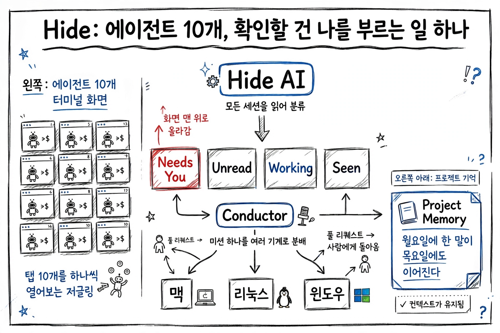
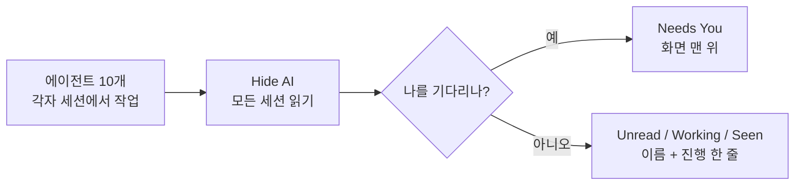
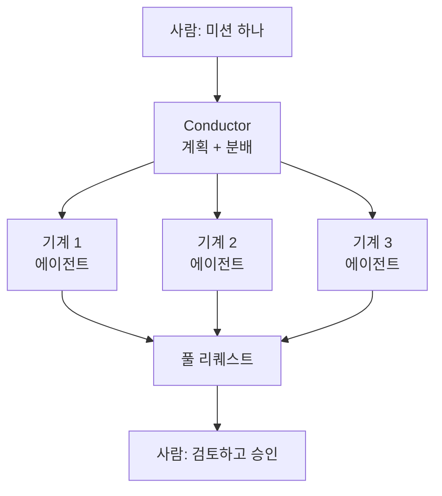

# Next ADE, Hide: 에이전트 10개를 띄워도 확인할 건 나를 부르는 일뿐입니다

> **Summary**
> Hide는 여러 코딩 에이전트를 한 화면에서 관리하며, AI가 세션을 읽어 사람을 기다리는 작업만 우선 보여줍니다. Conductor는 미션을 여러 기계와 에이전트에 나누고 결과를 풀 리퀘스트로 모으며, Project Memory는 결정 사항을 다른 에이전트와 공유합니다. 무료로 제공되지만 아직 초기 단계이고 일부 기능은 개발 중입니다.

---

- Hide는 여러 코딩 에이전트를 한 화면에서 돌리는 데스크톱 ADE입니다. 에이전트가 일을 하고, 사람은 결정을 내립니다.
- Hide AI가 모든 세션을 읽어 나를 기다리는 일만 위에 올립니다. 탭 10개를 일일이 열어볼 필요가 없습니다.
- Conductor에게 미션 하나를 맡기면 여러 기계의 에이전트들이 나눠 일하고, 각 단계가 풀 리퀘스트로 끝납니다.

터미널에 에이전트 10개를 띄워놓고 쓴다는 말, 요즘 심심치 않게 듣습니다. 그런데 탭 10개를 띄워놓고 나면 정작 어려운 건 에이전트가 아니라 확인하는 일입니다. 탭 10개가 전부 같은 무게로 떠 있으니 어느 탭이 내 답을 기다리는지, 어느 탭이 끝났는지 하나하나 열어봐야 압니다. 밀도 있는 작업 서너 개만 동시에 돌려도 머리가 금방 아파옵니다. 이런 적 있으시죠?

🎥 [동영상 보기](https://www.youtube.com/watch?v=qDTjXHQtMJw)

## 탭이 문제입니다, 에이전트가 아닙니다

기존 도구들은 에이전트를 여럿 띄우는 일은 잘 해냅니다. 작업마다 격리된 공간을 주고 터미널과 diff와 브라우저를 한 창에 모읍니다. 그런데 확인하는 방식은 그대로입니다. 탭을 하나씩 열어보는 저글링을 사람에게 떠넘깁니다.

> 에이전트가 10개면, 확인할 탭도 10개입니다. 이게 왜 당연해야 할까요?

Hide는 바로 이 지점에서 출발했습니다. 에이전트를 더 많이 띄우는 게 목표가 아닙니다. 에이전트가 아무리 많아져도 사람이 확인할 건 나를 부르는 일뿐이라는 게 출발점입니다. 그래서 이름도 `Hide`입니다. 안 봐도 되는 걸 숨긴다는 뜻입니다.

## Hide AI가 세션을 읽습니다

Hide의 첫 번째 답은 `Hide AI`입니다. 모든 에이전트 세션을 읽고 사람이 봐야 할 것만 정리합니다. 제목, 왜 멈췄는지, 무엇을 묻는지, 무엇을 놓쳤는지 한 줄로 적어줍니다.

에이전트들은 네 갈래로 나뉩니다. **Needs You, Unread, Working, Seen**입니다. 나를 기다리는 일은 모든 화면 위에 올라오고, 나머지는 이름과 진행 상황 한 줄만 받습니다.

예를 들면 이렇습니다. "승인해 주세요, #431과 #436번"이 위에 뜨고, "#433번: 내보내기는 CSV로 할까요, XLSX로 할까요?"라는 질문이 따라옵니다. 고장 난 테스트를 고친 일은 `Unread`에, 릴리스 노트는 `Revisit`에 조용히 놓입니다. Hide AI를 꺼도 상태 표시는 그대로 동작합니다. 읽는 일만 맡긴 것이라서 그렇습니다!

## Conductor에게 미션 하나를 맡깁니다

두 번째 답은 `Conductor`입니다. 미션 하나를 맡기면 Conductor가 풀 리퀘스트 단위로 계획을 세우고, 각 단계에 맞는 에이전트를 골라 기계에 나눠 띄웁니다. 사람은 꼭 필요할 때만 부릅니다.

소개 영상 장면이 잘 보여줍니다. 송장 내보내기 미션 하나가 10단계로 나뉘어 네 대 기계에 흩어집니다. 쓰는 모델도 섞입니다. 한쪽은 `Claude Code Opus 5`, 다른 쪽은 `GPT-4.1-Sol`, 또 다른 쪽은 `Gemini`입니다. 중간에 리눅스 기계의 에이전트가 열 순서를 묻자 그 질문만 사람에게 올라옵니다. 답하면 일은 이어지고, 각 단계는 풀 리퀘스트로 끝납니다. 검토하고 승인할 일만 남습니다.

에이전트끼리도 서로를 부릅니다. 리드가 워커를, 워커가 헬퍼를 띄웁니다. 이 기계든 저 기계든 상관없습니다. 서로에게 편지로 일을 넘깁니다. 부모 에이전트는 자식이 질문에 멈추면 1분 안에 알고, 20분 동안 조용하면 멈췄다는 걸 압니다. 기다리는 시간이 아니라 기다리는 이유가 먼저 보이는 구조입니다!

## 월요일에 한 말이 목요일에도 이어집니다

세 번째 답은 `Project Memory`입니다. 세션에서 정한 결정을 카드로 만들어 저장소에 대조한 뒤 다음 에이전트에게 넘겨줍니다. 업체가 달라도 이어집니다. 월요일에 한 에이전트에게 "패키지 관리자는 `pnpm`만 쓴다"고 말하면 목요일에 다른 에이전트가 이미 알고 시작합니다. 같은 말을 반복하는 일부터 사라집니다.

에이전트가 브라우저까지 직접 봅니다. 바꾼 페이지를 옆에 띄우고 직접 눌러 결과를 읽습니다. 명세 PDF를 옆에 열고 내보내기 버튼을 눌러 128개 송장을 받아낸 뒤 명세와 맞는지 확인하고 보고합니다. 사람이 눌러볼 차례가 아니라, 에이전트가 스스로 검증하는 차례입니다!

## 노트북을 닫아도 일은 계속됩니다

Hide의 코어는 안 자는 기계에 둡니다. 프로젝트와 편지와 제목이 코어에 살고 노트북은 화면이 됩니다. 노트북을 닫아도 일은 멈추지 않습니다. 다른 기계는 SSH 별명으로 추가하면 그 기계 에이전트들이 같은 목록에 들어옵니다.

폰도 같은 팀입니다. QR을 찍어 연결하면 에이전트가 묻는 일만 알림으로 옵니다. 답하거나 키를 누르거나 새 에이전트를 띄울 수 있습니다. 메시지는 종단간 암호화로 중계되고 중계 서버는 내용을 읽지 못합니다. 계정도 새로 만들 필요가 없습니다.

그래도 IDE의 뼈대는 그대로입니다. 진짜 터미널 패인, VS Code식 탐색기와 diff, 작업마다 `worktree`, `⌘K`로 에이전트·작업·이슈·풀 리퀘스트를 찾고 `⌘P`로 파일을 여는 키보드 중심 사용법, 베이스 브랜치와 위험한 Git 명령을 지키는 가드레일, 남은 한도와 7일 비용 표시까지 있습니다.

## Orca, Herdr와 뭐가 다를까요?

세 도구는 공통점이 많습니다. 이미 로그인한 에이전트 CLI를 그대로 쓰고 여러 기계의 에이전트를 한 창에 모읍니다. Hide가 내세우는 차이는 그 다음 단계입니다.

| 구분 | Hide | Orca | Herdr |
| --- | --- | --- | --- |
| 나를 기다리는 에이전트 표시 | ✓ | ✓ | ✓ |
| 멈춘 이유와 묻는 것을 세션에서 읽어 씀 | ✓ |   |   |
| 자식이 조용해지면 부모에게 알림 | ✓ |   |   |
| 결정을 다음 에이전트에게 업체를 넘어 전달 | ✓ |   |   |
| 폰에서 답하기 | ✓ | ✓ |   |

공식 비교표는 2026년 11월 10일 기준 각 프로젝트 README를 바탕으로 만들었습니다. 빈 칸은 그 기능을 못한다는 뜻이 아니라 README에 설명이 없다는 뜻입니다. 터미널 층 일부는 Herdr에서 가져왔다고도 밝혀두었습니다. 이 표가 말하는 건 하나입니다. 에이전트를 띄우는 경쟁은 이미 끝났고, 이제는 누가 나를 덜 부르는지의 경쟁이라는 점입니다.

## 설치와 가격, 그리고 주의점

설치는 공식 사이트에서 받습니다. macOS 14 이상 애플 실리콘, Windows x64, 데비안·우분투, 페도라용 패키지가 있습니다. Windows 설치 파일은 미서명이라 처음 한 번 스마트스크린이 묻습니다. 새 API 키는 필요 없습니다. 이미 로그인한 에이전트 CLI를 그대로 씁니다. 가격은 무료, $0 영원입니다. 페어 소스라 상용 경쟁 제품으로 파는 것만 빼고 쓰고 바꾸고 나눌 수 있고, 각 릴리스는 2년 뒤 아파치 라이선스로 바뀝니다.

다만 아직 아주 새 프로젝트라는 점은 알아두셔야 합니다. 2026년 11월 중순에 공개됐고 별은 130개 안팎입니다. 이슈를 줄지어 맡기는 Software Factory 기능은 아직 준비 중이라 Pro와 함께 온다고 합니다. 성능 수치도 만든 쪽이 한 대의 맥에서 잰 것으로, 키 입력부터 터미널에 글자가 뜨기까지 16.3ms, 유휴 549MiB 수준이라 상대 속도를 말하는 수치는 아닙니다. 한 가지 더, `Grok`은 일하는 동안 메시지만 받고 `Project Memory`는 아직 못 씁니다.

P371에서 다룬 UAC와도 층이 다릅니다. UAC가 여러 에이전트를 한 화면에서 관리한다는 관제 개념이라면, Hide는 그 개념을 데스크톱 앱으로 구현한 것입니다. Conductor의 미션, 세션을 읽는 Hide AI, 업체를 넘는 Project Memory가 그 구현체입니다.

에이전트 10개를 띄우는 시대에 확인할 탭 10개를 함께 띄우는 건 답이 아닙니다. 확인할 건 나를 부르는 일 하나면 충분합니다. Hide는 그 한 줄을 위해 만든 도구입니다!

