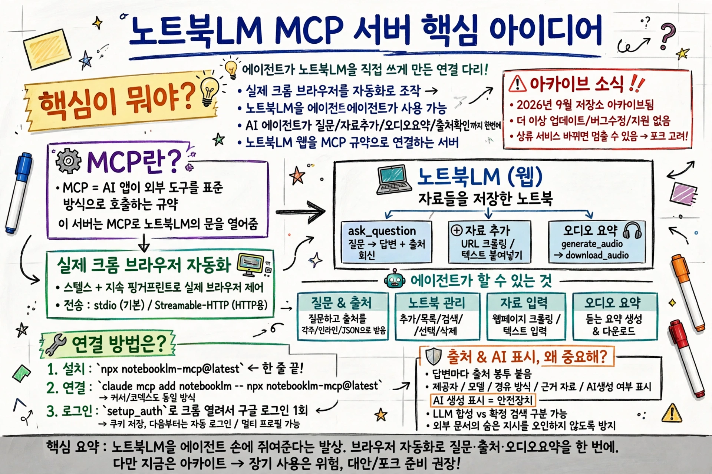
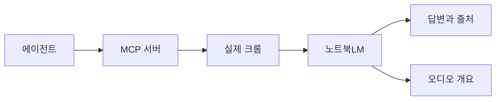
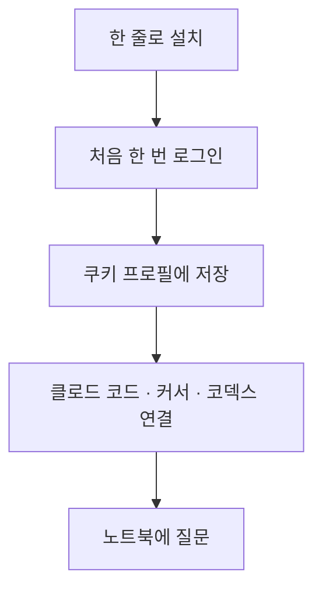

# NotebookLM MCP: 에이전트가 크롬을 몰아 노트북에 직접 질문한다

> **Summary**
> 노트북LM MCP 서버는 크롬 브라우저를 자동화해 AI 에이전트가 노트북에 질문하고 출처를 확인하거나 자료를 추가하고 오디오 요약을 생성하도록 지원합니다. 설치와 초기 로그인이 간편하지만, 저장소가 2026년 9월 아카이브되어 유지보수와 장기적인 사용이 불확실합니다.

---

- 노트북LM MCP 서버는 실제 크롬 브라우저를 몰아서, 에이전트가 노트북에 질문하고 자료를 넣고 오디오 요약을 만들고 출처까지 읽어오게 합니다.
- 설치는 `npx notebooklm-mcp@latest` 한 줄이고, 클로드 코드·커서·코덱스에 바로 연결됩니다. 로그인도 처음 한 번만 하면 됩니다.
- 다만 2026년 9월에 저장소가 아카이브돼서 더 이상 유지보수되지 않습니다. 상류 서비스가 바뀌면 멈출 수 있습니다.

노트북LM에 자료를 잔뜩 넣어두고, 에이전트한테 "이거 요약해줘"라고 시키고 싶었던 적 있으시죠? 노트북LM은 브라우저에서 직접 쓰는 도구라, 에이전트가 바로 붙어서 쓰기엔 손이 많이 갔습니다. MCP 서버가 그 사이를 잇습니다!

🎥 [동영상 보기](https://www.youtube.com/watch?v=HRDYY-qSDuU)

## MCP가 뭐길래 노트북LM을 여는 걸까요?

MCP는 AI 앱이 외부 도구를 표준 방식으로 부르는 규약입니다. 이 서버는 그 규약으로 노트북LM의 문을 열어줍니다. 방식이 독특합니다. 실제 크롬을 자동화로 몰아서 노트북LM 웹을 그대로 조작합니다. 스텔스와 지속 핑거프린트를 갖춘 브라우저 자동화 덕분에, 에이전트는 웹 화면을 사람이 쓰듯 다룹니다. 전송 방식은 두 가지입니다. 기본은 `stdio`, HTTP 전용 클라이언트를 위한 Streamable-HTTP도 있습니다.

## 에이전트가 뭘 할 수 있을까요?

질문이 핵심입니다. `ask_question`으로 노트북에 질문하면 답변과 출처가 함께 옵니다. 인용 방식도 고를 수 있습니다. 각주로 붙일지, 인라인으로 박을지, JSON으로 받을지, 아예 끌지. 자료 추가도 됩니다. URL을 크롤링해서 넣거나 텍스트를 직접 붙여넣습니다. 오디오 개요도 만듭니다. `generate_audio`로 만들고 `download_audio`로 저장합니다. 듣는 요약까지 한 번에 뽑아냅니다! 노트북 관리도 한곳에서 합니다. 추가·목록·검색·선택·삭제까지, 라이브러리 도구로 묶여 있습니다.

이 부분이 저는 가장 인상 깊었습니다. 답변마다 출처 형식을 고를 수 있다는 게, 에이전트 답변을 그대로 믿지 않고 검증할 수 있게 하니까요!

## 연결은 어떻게 할까요?

설치는 한 줄이면 끝입니다! `npx notebooklm-mcp@latest`를 실행하면 됩니다. 클로드 코드에는 이렇게 연결합니다. `claude mcp add notebooklm -- npx notebooklm-mcp@latest` — 명령 한 줄이면 등록이 끝납니다. 커서와 코덱스도 같은 방식입니다. HTTP만 쓰는 클라이언트는 HTTP 모드로 띄워서 연결합니다. 로그인은 처음 한 번만 하면 됩니다! `setup_auth`가 보이는 크롬을 열면, 구글에 로그인하고 쿠키가 프로필에 저장됩니다. 다음부터는 로그인 없이 그대로 씁니다. 계정이 여러 개면 프로필을 나눠서 씁니다.

## 출처와 AI 표시, 왜 신경 쓸까요?

답변마다 출처 봉투가 붙습니다. 제공자, 모델, 경유 방식, 근거 자료, AI 생성 여부가 적혀 있습니다. 기본적으로 답변 앞에는 AI 생성 표시가 붙습니다. 호스트 에이전트가 LLM 합성과 확정 검색을 구분하게 하고, 외부 PDF에 박힌 지시를 사용자 의도로 착각하지 않게 하려는 장치입니다. 외부 문서에 낯선 지시가 숨어 있어도, 표시가 있으면 에이전트가 멈춰서 생각합니다. 이 작은 표시가 안전장치입니다.

## 아카이브 소식, 어떻게 받아들일까요?

2026년 9월, 저장소가 아카이브됐습니다. 더 이상 업데이트도, 버그 수정도, 지원도 없습니다. 패키지도 새 릴리스가 없습니다. 상류 서비스가 바뀌면 멈출 수 있습니다. 포크는 자유입니다. 지금 당장 쓰려면 되지만, 장기적으로 의존하기엔 위험합니다. 대안이나 포크를 염두에 두는 게 좋습니다.

노트북LM을 에이전트 손에 쥐여준다는 발상 자체가 이 서버의 전부였습니다. 브라우저를 직접 모는 방식이 우아하지는 않았지만, 질문·출처·오디오 요약을 한 번에 꺼내주는 길은 분명히 열렸습니다. 아카이브된 지금은 그 길을 이어갈 다음 주자를 찾는 게 남았습니다.

