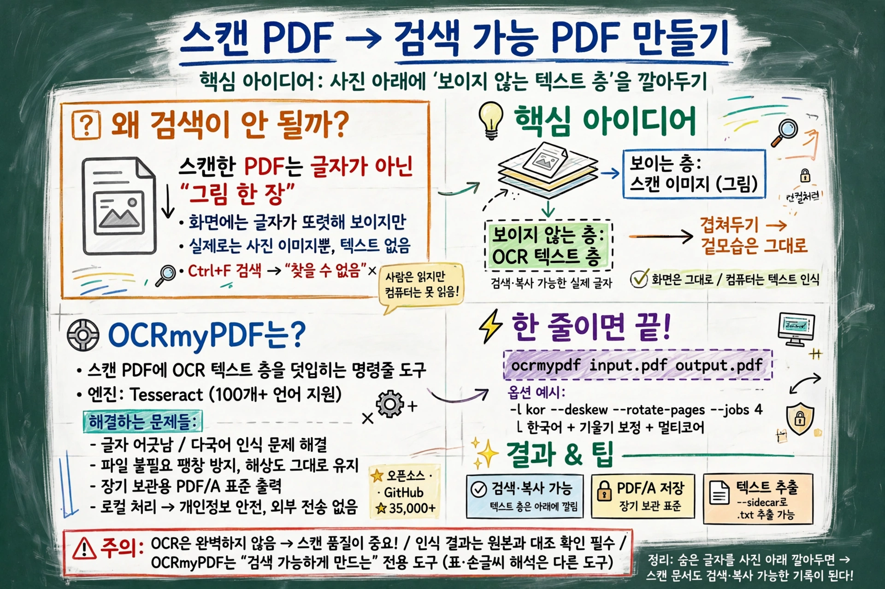
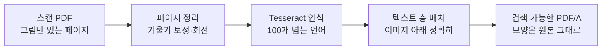
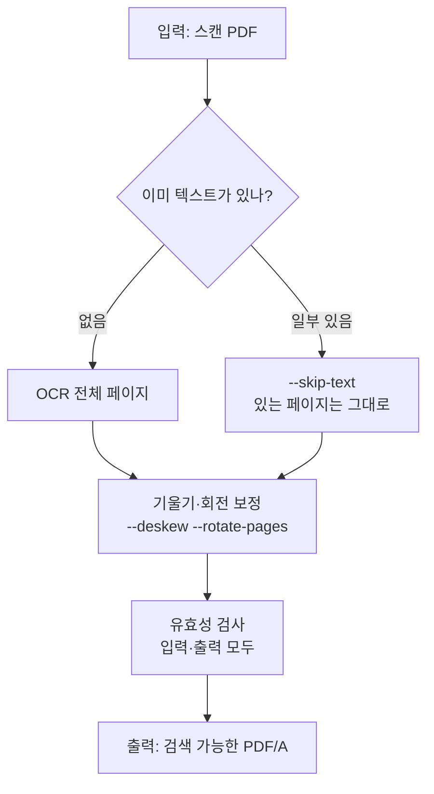
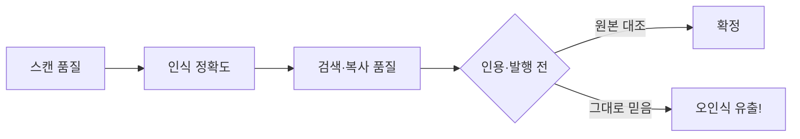

# OCRmyPDF: 스캔 PDF는 그대로 두고, 검색만 되게 만듭니다

> **Summary**
> 스캔한 PDF는 속이 그림 한 장이라 검색도 복사도 안 되는데, OCRmyPDF는 인식한 글자를 이미지 아래층에 깔아 보이는 모양은 그대로 두고 검색과 복사가 되게 만듭니다. 문자 인식은 Tesseract 엔진이 맡아 100개 넘는 언어를 처리하고, 기본 출력은 장기 보관용 PDF/A입니다. 한 줄 명령으로 수천 장의 스캔 문서까지 처리할 수 있고, 로컬에서 돌아가 문서가 외부로 나가지 않지만, OCR이 완벽하지 않아 인용 전에는 원본과 대조해 확인해야 합니다.

---

- 스캔한 PDF는 겉보기엔 멀쩡하지만, 속은 그림 한 장이라 검색도 복사도 안 됩니다.
- OCRmyPDF는 스캔 PDF에 OCR 텍스트 층을 덧입혀, 보이는 모양은 그대로 두고 검색과 복사가 되게 만드는 명령줄 도구입니다.
- 기본 출력은 장기 보관용 PDF/A이고, 인식은 `Tesseract` 엔진이 맡아 100개 넘는 언어를 처리합니다.


스캐너로 넘긴 계약서 PDF에서 "위약금"이라는 단어를 찾으려고 Ctrl+F를 눌러본 적 있으시죠? 화면에는 글자가 또렷하게 보이는데, 검색창은 "찾을 수 없음"만 되돌려줍니다. PDF가 글자를 담고 있는 게 아니라, 글자 사진을 통째로 품고 있기 때문입니다. 종이 뭉치를 스캔하면 생기는 흔한 장면입니다!

🎥 [동영상 보기](https://www.youtube.com/watch?v=Np6XyPKvJI4)

## 왜 검색이 안 될까요?

PDF는 글자를 담는 그릇일 수도 있고, 그림을 담는 그릇일 수도 있습니다. 스캔한 PDF는 후자입니다. 페이지마다 사진 한 장씩이 들어 있을 뿐, 컴퓨터가 읽을 글자는 한 자도 없습니다. 그래서 검색도, 복사도, 붙여넣기도 안 됩니다. 눈으로 읽는 건 사람만 할 수 있는 일이 됩니다.

해결법은 글자를 다시 그리는 게 아닙니다. 사진 아래에 인식한 글자를 살짝 깔아두는 겁니다. 화면에는 사진만 보이니 모양은 그대로인데, 컴퓨터는 아래층 글자를 읽어 검색과 복사를 해줍니다. 이 "보이지 않는 층"이 핵심 아이디어입니다!

## OCRmyPDF는 뭐가 다를까요?

`OCRmyPDF`는 스캔 PDF에 검색 가능한 OCR 텍스트 층을 더하는 오픈소스 명령줄 도구입니다. 별 3만 5천 개가 넘는, 스캔 문서 처리에서 가장 널리 쓰이는 도구 중 하나입니다. 문자 인식 자체는 `Tesseract` 엔진에 맡기고, 그 앞뒤의 PDF 작업을 도구가 책임집니다.



기존 무료 도구들에 실망한 개발자가 직접 만든 도구라, 출발점부터가 "왜 안 되는가"에 대한 답입니다. 글자가 어긋나서 복사가 안 되던 문제, 악센트 문자와 다국어를 못 읽던 문제, 이미지 해상도를 바꿔버리던 문제, 파일이 터무니없이 커지던 문제, 유효하지 않은 PDF를 뱉던 문제, 그리고 장기 보관용 PDF/A를 안 만들던 문제까지요. 이 도구 하나가 그 불만들을 모아서 만든 해법입니다.

## 한 줄이면 끝날까요?

기본 사용법은 정말 한 줄입니다. 입력 PDF와 출력 PDF만 넘기면 됩니다.

```bash
ocrmypdf input.pdf output.pdf
```

언어를 지정하고 기울기를 바로잡고 여러 코어로 나눠 돌리는 조합도 옵션 몇 개면 됩니다.

```bash
ocrmypdf -l kor --deskew --rotate-pages --jobs 4 input.pdf output.pdf
```

`-l` 옵션에는 `Tesseract` 언어 코드를 씁니다. 영문과 불문이 섞인 문서는 `-l eng+fra`처럼 `+`로 이어서 지정합니다. 한국어 문서는 `kor` 언어 팩을 먼저 설치하면 됩니다. 설치 자체는 배포판 패키지 관리자 한 줄이면 됩니다. `apt install ocrmypdf`, `dnf install ocrmypdf`, `brew install ocrmypdf`처럼요. 단, 문자 인식용 `Tesseract`와 PDF 처리용 `Ghostscript`는 함께 깔려 있어야 합니다. 도커 이미지도 `x64`와 `ARM`용으로 나옵니다.

## 결과물은 어떻게 다듬어질까요?

인식한 글자는 이미지 위가 아니라 정확히 아래층에 배치됩니다. 그래서 복사해서 붙여넣어도 글자가 어긋나지 않습니다. 원본 이미지 해상도는 그대로 유지되고, 가능하면 다른 내용은 건드리지 않는 무손실 방식으로 정보가 들어갑니다. 이미지 최적화까지 거치면 입력보다 작은 파일이 나오기도 합니다.



기본 출력 형식은 장기 보관용 표준인 PDF/A입니다. 시간이 지나도 문서가 동일하게 재현되도록 설계된 포맷이라, 계약서나 논문 같은 기록물을 쌓아둘 때 어울립니다. 일반 PDF가 필요하면 `--output-type pdf`로 바꾸면 됩니다. 수천 페이지짜리 파일도 처리하도록 설계됐고, 모든 CPU 코어에 작업을 나눠 처리합니다. "수백만 장의 PDF로 검증됐다"는 게 도구의 설명입니다.

텍스트만 따로 뽑고 싶으면 `--sidecar` 옵션을 쓰면 됩니다. 옆에 텍스트 파일 하나가 같이 생깁니다.

## 엔진은 바꿀 수 있을까요?

`OCRmyPDF`는 플러그인으로 동작을 바꿀 수 있습니다. 기본 엔진인 `Tesseract`를 다른 OCR 엔진으로 교체하는 플러그인들이 대표적입니다. `EasyOCR`로 바꾸는 플러그인, macOS의 `Apple Vision`을 쓰는 플러그인, GPU 가속 엔진인 `PaddleOCR`로 바꾸는 플러그인이 있습니다. 문서 관리 시스템인 `paperless-ngx`는 이 도구를 통합해 검색 가능한 문서 저장소를 구성합니다.

플러그인은 `pluggy` 기반으로, 명령줄 인자 추가부터 OCR 수행 여부 결정, OCR 전 이미지 수정, 엔진 교체까지 훅으로 갈아 끼울 수 있습니다. 17.0 버전부터는 플러그인용 `OcrElement` 구조가 들어와, 엔진이 인식 결과를 표준 트리 형태로 직접 넘길 수도 있게 됐습니다.

## 뭘 조심해야 할까요?

OCR은 완벽하지 않습니다. 글자가 흐릿하거나 스캔이 기울었으면 오인식이 생깁니다. 인식 결과를 인용하거나 다시 발행하기 전에는 원본 이미지와 대조해 확인하는 게 좋습니다. 스캔 품질이 좋을수록 인식이 좋아지는 건 당연한 이치입니다.

그리고 이 도구는 어디까지나 "검색되게 만드는" 도구입니다. 표 구조를 뽑아내거나 손글씨를 읽거나 문서 의미를 이해하는 일은 다른 도구의 몫입니다. 스캔 PDF를 검색 가능한 기록으로 바꾸는 일, 그 한 가지에 집중한 도구가 맞습니다.



로컬에서 처리한다는 점도 짚고 갈 만합니다. 문서가 외부 서버로 나가지 않으니, 계약서나 개인정보가 담긴 문서를 다루기에 부담이 적습니다. 클라우드 OCR에 올리기 망설여졌던 문서들이 있다면, 이 도구가 그 망설임을 덜어줍니다!

## 그래서, 스캔 PDF는 어떻게 다루면 될까요?

스캔 PDF의 문제는 글자가 없어서가 아니라, 글자가 숨어 있어서 생깁니다. `OCRmyPDF`는 그 숨은 글자를 사진 아래에 깔아두는, 단순하고 정확한 해법을 씁니다. 한 줄 명령으로 수천 장의 스캔 문서가 검색 가능한 기록이 됩니다. 오래된 서류 뭉치를 다시 꺼내야 할 때, 이 한 줄을 떠올리면 됩니다.

