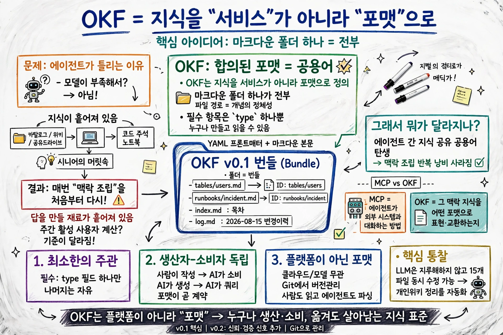
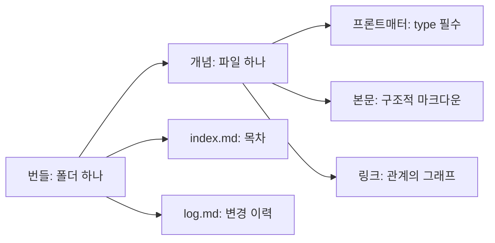
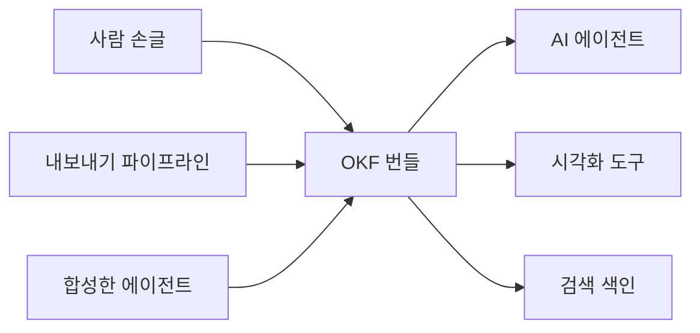
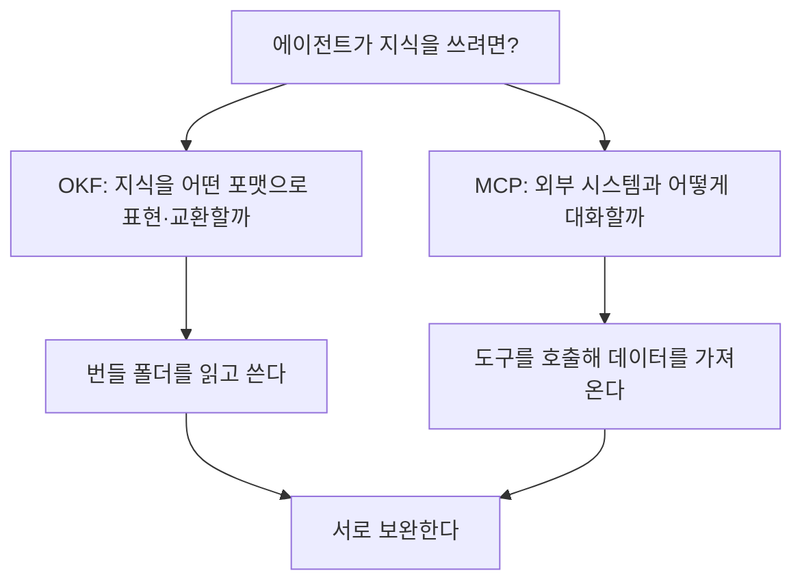

# OKF: 에이전트끼리 지식을 나누는 방법, 새 도구가 아니라 폴더 하나입니다

> **Summary**
> OKF는 에이전트가 쓰는 지식을 마크다운 파일들의 폴더로 표현하는 개방형 표준입니다. 파일 경로가 개념의 정체성이 되고, 필수 항목은 type 하나뿐이라 누구나 만들고 누구나 읽을 수 있습니다. LLM 위키 패턴을 형식화해 에이전트끼리 지식을 나누는 공용어를 만든 것이 핵심이지만, 소개 글은 v0.1 기준이라 v0.2의 신뢰 신호는 따로 봐야 합니다.

---

- OKF는 지식을 서비스가 아니라 포맷으로 정의합니다. 마크다운 폴더 하나가 전부입니다.
- 파일 경로가 곧 개념의 정체성이고, 필수 항목은 `type` 하나뿐이라 누구나 만들고 읽을 수 있습니다.
- 에이전트끼리 지식을 나누는 공용어가 생기면, 맥락 조립을 매번 처음부터 다시 푸는 낭비가 사라집니다.

에이전트에게 물어본 적 있으시죠? "우리 이벤트 스트림에서 주간 활성 사용자, 어떻게 계산하지?" 답은 돌아오는데, 기준이 우리 회사 정의와 다릅니다. 모델이 모자라서 그럴까요? 아닙니다. 답을 만들 재료가 흩어져 있기 때문입니다!

🎥 [동영상 보기](https://www.youtube.com/watch?v=_BD2zq3R4lg)

## 에이전트가 틀리는 이유, 모델이 아니라 맥락입니다?

에이전트가 쓰는 정보는 대부분 내부 지식입니다. 테이블 스키마, 회사가 정한 지표의 의미, 장애 대응 런북, 두 시스템 사이의 조인 경로 같은 것들이죠. 그런데 이 지식의 원자들은 서로 호환되지 않는 곳에 나뉘어 살고 있습니다. 카탈로그, 위키와 공유 드라이브, 코드 주석과 노트북 셀, 몇몇 시니어 엔지니어의 머릿속까지요.

결과는 명백한 낭비입니다. 모든 에이전트 개발자가 똑같은 맥락 조립 문제를 처음부터 다시 풉니다. 이 장면이 저는 가장 인상 깊었습니다. 문제는 모델이 아니라, 지식이 옮겨 다닐 통로가 없다는 점이니까요!

## LLM 위키는 아이디어, OKF는 표준입니다?

에이전트를 만드는 방식이 바뀌고 있습니다. 모델이 똑같은 문서에서 똑같은 사실을 반복 검색하게 하는 대신, 시간이 갈수록 더 유용해지는 공유 마크다운 라이브러리를 에이전트에게 쥐여 주는 방향입니다. 잡일은 에이전트가 맡고, 팀은 콘텐츠를 코드처럼 관리합니다.

이 아이디어를 가장 선명하게 표현한 문장이 있습니다. "LLM은 지루해하지 않고, 상호 참조를 갱신하는 것을 잊지 않으며, 한 번에 15개 파일을 건드릴 수 있다." 사람이 개인 위키를 끝내 포기하게 만드는 장부 정리가, LLM이 가장 잘하는 일이라는 통찰입니다.

그런데 이 패턴은 매력적인 만큼 문제가 있었습니다. 모든 사례가 제각각 따로였기 때문입니다. 한 팀의 위키와 다른 팀의 위키, 벤더 카탈로그의 내보내기 결과물은 비슷해 보여도, 서로 협력하도록 설계된 것은 없었습니다. 어떤 필드를 담아야 하는지, 어떤 파일명이 무엇을 뜻하는지 합의된 답이 없었습니다.

OKF가 하는 일은 바로 이 합의입니다. 지난 1년 사이 여러 이름으로 반복 등장한 LLM 위키 패턴을 누구나 생산하고 누구나 소비할 수 있는 포맷으로 형식화한 것입니다. 아이디어와 도구는 이미 따로 다뤘습니다. 이 글은 표준 자체에 집중합니다.

## 번들 하나면 끝입니다. 파일 경로가 곧 이름입니다

OKF v0.1의 핵심은 의외로 단순합니다. 지식을 "YAML 프론트매터가 붙은 마크다운 파일들의 디렉토리"로 표현하고, 소수의 관례만을 정의합니다.

번들(bundle)은 마크다운 파일들의 디렉토리이며 배포 단위입니다. 각 파일은 하나의 개념(concept)입니다. 테이블, 지표, 플레이북, 런북, API처럼 포착하고 싶은 무엇이든 될 수 있습니다. 가장 중요한 규칙은 파일 경로가 곧 개념의 정체성이라는 점입니다. `tables/users.md`의 ID는 `tables/users`가 됩니다.

개념 문서는 두 부분입니다. 파일 맨 위의 YAML 프론트매터 블록과 그 뒤의 마크다운 본문입니다. 프론트매터에서 유일하게 필수인 필드는 `type` 하나입니다. 나머지는 권장 사항으로, `title`, `description`, `resource`, `tags`, `timestamp`가 있습니다. 타입 값은 중앙에 등록되지 않습니다.

본문은 표준 마크다운입니다. 헤딩, 리스트, 표 같은 구조적 마크다운을 선호해야 합니다. `# Schema`, `# Examples`, `# Citations` 세 헤딩은 관례적 의미를 가집니다.

예약 파일명도 딱 두 개뿐입니다. `index.md`는 내용물을 열거해 점진적 공개를 돕는 목차입니다. `log.md`는 날짜별 변경 이력을 최신 항목부터 기록합니다. 날짜 헤딩은 ISO 8601 `YYYY-MM-DD` 형식을 씁니다.

개념은 마크다운 링크로 다른 개념을 가리킵니다. 디렉토리는 부모·자식 관계보다 풍부한 관계의 그래프가 됩니다. 절대 링크가 권장되고, 링크는 관계가 있다는 사실만 주장할 뿐 종류는 주변 산문이 전달합니다. 소비자는 깨진 링크도 관용해야 합니다. 아직 쓰이지 않은 지식일 수도 있기 때문입니다.

## 왜 서비스가 아니라 포맷이어야 할까요?

이 문제의 해답은 또 하나의 지식 서비스가 아닙니다. 필요한 것은 포맷, 지식을 표현하는 방식 그 자체입니다. 누구나 SDK 없이 생산하고, 누구나 통합 작업 없이 소비하고, 옮겨 다녀도 살아남고, 코드 옆에서 버전 관리 안에 함께 살고, 사람이 읽고 에이전트가 파싱할 수 있어야 합니다. 같은 파일, 번역 계층 없이 말이죠!

설계를 떠받치는 원칙은 세 가지입니다. 첫째, 최소한의 주관입니다. 모든 개념에 요구하는 것은 `type` 필드 하나뿐입니다. 어떤 타입이 존재하는지는 전부 생산자에게 맡깁니다. 둘째, 생산자·소비자 독립성입니다. 사람이 손으로 쓴 번들을 AI 에이전트가 소비할 수 있고, 한 모델이 합성한 번들을 다른 모델이 쿼리할 수 있습니다. 포맷이 곧 계약이고, 양 끝의 도구는 독립적으로 교체 가능합니다. 셋째, 플랫폼이 아니라 포맷입니다. 특정 클라우드나 모델 제공자, 프레임워크에 묶이지 않습니다.

명세는 진입 장벽을 이렇게 선언합니다. 파일을 읽을 수 있으면 OKF를 읽을 수 있고, 저장소를 받을 수 있으면 배포할 수 있다고요. 적합성 규칙도 딱 세 가지입니다. 예약 파일이 아닌 모든 `.md` 파일이 파싱 가능한 프론트매터를 담고, 모든 프론트매터가 비어 있지 않은 `type` 필드를 가지고, 예약 파일명이 있으면 정해진 구조를 따르면 됩니다. 그 외 제약은 느슨한 가이드입니다. 선택 필드가 빠져도, 모르는 타입과 키가 나와도, 링크가 깨져도 번들을 거부해서는 안 됩니다. 이 관대한 소비 모델은 의도적입니다. 번들이 성장하는 동안에도 쓸모 있게 남기 위해서입니다.

## MCP와 뭐가 다를까요?

MCP가 "에이전트가 어떻게 외부 시스템과 대화하는가"를 다룬다면, OKF는 "그 컨텍스트가 되는 지식을 어떤 포맷으로 표현하고 교환하는가"를 다룹니다. 두 접근은 경쟁하기보다 보완적입니다!

OKF는 `Avro`, `Protobuf`, `OpenAPI` 같은 스키마를 대체하지 않습니다. 개념 문서에서 그것들을 가리킬 뿐입니다.

레퍼런스 구현도 함께 공개됐습니다. 데이터셋을 순회하며 개념 문서 초안을 쓰고 두 번째 패스로 인용과 스키마, 조인 경로로 보강하는 인리치먼트 에이전트, 어떤 번들이든 단 하나의 파일 안에서 그래프 뷰로 바꿔 주는 시각화 도구, 샘플 번들 3종입니다. 이 도구들은 의도적으로 개념 증명에 머뭅니다. 에이전트는 생산의 한 방법을, 시각화 도구는 소비의 한 방법을 보여줄 뿐입니다.

## v0.1만 보고 끝내면 안 되는 이유가 있습니다?

이 글의 출발점인 소개 글은 2026년 6월 12일에 공개된 v0.1을 다룹니다. 그런데 표준은 그 뒤로도 움직였습니다. v0.2가 2026년 7월 24일에 나왔고, 출처와 검증, 신선도를 나타내는 신뢰 신호를 더했습니다. 명세는 2026년 8월에 별도 저장소로 이사했습니다. v0.1의 뼈대는 유효하지만, 지금 기준으로 읽으려면 v0.2를 함께 봐야 합니다.

버전은 `<major>.<minor>` 형식입니다. 번들은 루트 `index.md`에 `okf_version`으로 목표 버전을 선언합니다.

시작하는 방법은 명세에 그대로 적혀 있습니다. 명세를 읽고, 자신의 시스템용 생산자와 소비자를 작성해 보고, 레퍼런스 구현을 시험해 보는 것입니다.

지식을 나누는 가장 빠른 길은 새 플랫폼을 짓는 게 아니라, 모두가 이미 읽을 수 있는 폴더 하나에 합의하는 것입니다. 그 합의가 OKF입니다!

