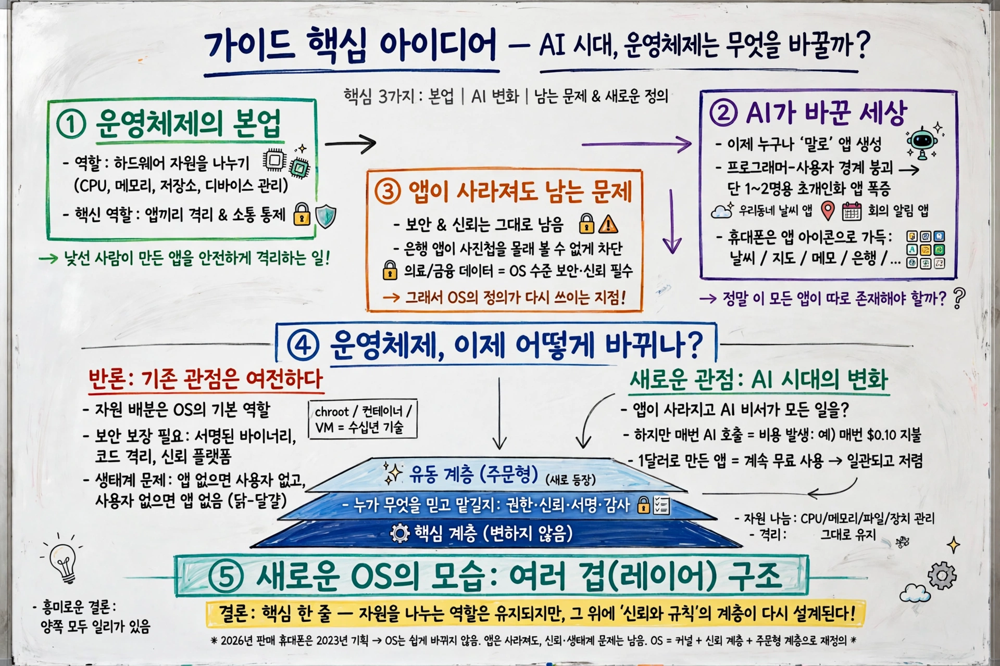
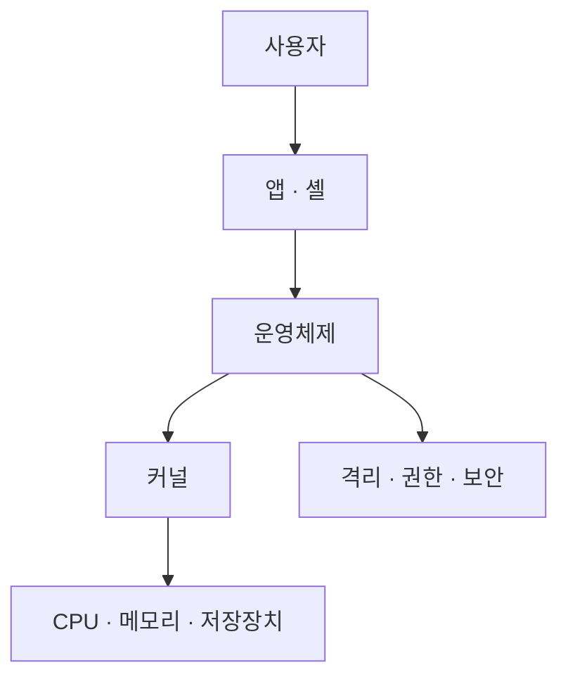
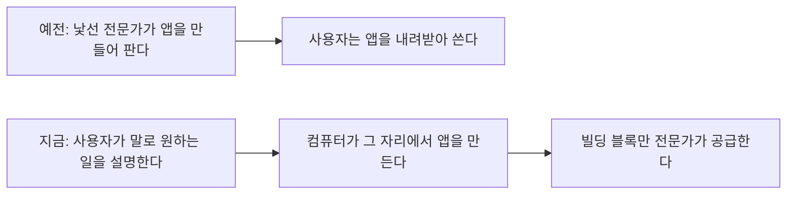

# OS란 대체 무엇인가요? 앱이 사라지는 시대, 자원 배분이 본업으로 남습니다

> **Summary**
> 운영체제의 본업은 하드웨어 자원을 나누는 일이 아니라, 낯선 사람이 만든 앱들을 서로 격리하고 그 소통을 통제하는 일입니다. AI가 프로그래머와 사용자의 경계를 허물면서 단 한두 명만 쓰는 앱이 쏟아지고, 앱을 만드는 사람이 사용자가 되자 앱끼리 담을 쌓을 이유도 줄어들고 있습니다. 그래도 은행·의료 앱이 요구하는 보안 보장과 생태계의 닭과 달걀 문제는 그대로라, 자원을 나누는 일은 남기고 그 위에 신뢰와 규칙의 계층을 다시 설계하는 쪽으로 OS의 정의가 다시 쓰이고 있습니다.

---

- 운영체제의 본업은 하드웨어 자원을 나누고, 낯선 사람의 앱끼리 격리하는 일입니다.
- AI가 프로그래머와 사용자의 경계를 허물면서, 단 한두 명만 쓰는 앱이 쏟아지는 시대가 왔습니다.
- 앱이 사라져도 보안과 신뢰의 문제는 남습니다. OS의 정의는 그 지점에서 다시 쓰입니다.

휴대전화를 켜면 앱 아이콘이 화면을 가득 채웁니다. 날씨 앱, 지도 앱, 메모 앱, 은행 앱까지, 뭐 하나 하려면 앱부터 찾아야 합니다. 그런데 문득 이런 생각이 들지 않으셨나요? 이 앱들, 정말 다 따로 있어야 할까요?

🎥 [동영상 보기](https://www.youtube.com/watch?v=26QPDBe-NB8)

## OS의 본업은 무엇일까요?

교과서 정의는 단순합니다. 운영체제는 하드웨어 자원을 관리하고, 프로그램이 돌아갈 수 있게 해주는 소프트웨어입니다. CPU 시간을 나누고, 메모리를 배정하고, 파일을 정리하고, 하드웨어와 대화합니다.

그런데 한 편의 글이 이 정의에 질문을 던졌습니다. 현대 운영체제가 존재하는 진짜 이유는 자원을 나눠주는 일이 아니라, **서로 다른 앱을 갈라놓고 그 앱들이 어떻게 소통하는지 통제하는 일**이라는 주장입니다!

낯선 사람이 만든 앱을 잔뜩 들여오는 세상에서는 이 역할이 필수입니다. 은행 앱이 사진첩을 함부로 뒤지지 못하게 하고, 게임이 연락처를 몰래 가져가지 못하게 막는 일, 그게 바로 운영체제의 본업이라는 이야기입니다.

## 앱이 사라지면 무엇이 남을까요?

AI가 바꾸는 것은 앱의 개수가 아니라 앱의 출처입니다. 지금까지 소프트웨어는 대부분 전문가가 만들어서 파는 물건이었습니다. 그런데 이제는 말로 설명하면 컴퓨터가 그 자리에서 앱을 만들어 줍니다. 메뉴 표시줄에 쌓인 작은 도구들을 보며 글쓴이는 이렇게 말했습니다. 컴퓨터가 마침내 여덟 살 때 상상했던 대로 동작하기 시작했다고 말입니다!

관객이 단 한두 명뿐인 앱이 넘쳐나는 세상을 상상해 보셨나요? 동네 날씨를 우리 동네 기준으로만 알려주는 앱, 퇴근길에 어느 길로 돌아가야 할지 바로 알려주는 앱, 지금 당장 들어가야 할 회의가 있는지 확인해 주는 앱 말입니다. 아무도 상용 앱으로 만들지 않던 사소한 문제들이, 이제는 각자의 컴퓨터에서 바로 해결됩니다.

여기서 핵심이 바뀝니다. 앱을 만드는 사람이 낯선 사람이 아니라 사용자와 그 지인이라면, 앱끼리 담을 쌓을 이유가 줄어듭니다. 모든 앱이 같은 손에서 나왔는데, 왜 서로를 못 믿는다고 가둬야 할까요? 운영체제의 정의가 흔들리는 지점이 바로 여기입니다!

## 그런데 반론도 만만치 않습니다!

토론장은 곧바로 뜨거워졌습니다. 가장 날카로운 반박은 이렇습니다. 자원 배분을 바꾸지 않는다면 그건 운영체제가 아니라 상위 계층의 이야기라는 지적입니다. 앱을 격리하고 자원을 제한하는 기술은 `chroot`부터 컨테이너, 가상 머신까지 수십 년 전부터 있었던 일이라고 말입니다.

보안 문제도 큽니다. 은행 앱이나 의료 앱은 운영체제 수준의 보안 보장을 원합니다. 검사 결과를 어떤 기기에 믿고 보낼 수 있을까요? 서명된 바이너리와 코드 격리, 신뢰할 수 있는 플랫폼이 없으면 외부 서비스는 움직이지 않습니다. 단순히 DRM 이야기가 아니라, 신뢰의 문제입니다!

생태계의 닭과 달걀 문제도 있습니다. 새 플랫폼에 앱을 올리려면 사용자가 필요하고, 사용자를 모으려면 앱이 필요합니다. 한때 모바일 운영체제에 도전했던 사례가 바로 이 벽에 부딪혔습니다. 앱 계층을 없앤다고 해도, API 수준에서 같은 장벽을 다시 만날 수 있다는 우려입니다.

심지어 이런 반론도 나왔습니다. AI 비서 하나가 모든 일을 처리하는 미래가 온다면, 앱이라는 개념 자체가 낡아가는 것 아니냐는 이야기입니다. 그런데 반대로, 매번 AI에게 말을 걸어 일을 시키는 것보다 한 번 만든 앱을 계속 쓰는 편이 싸고 일관적이라는 지적도 있습니다. 매번 0.10달러를 낼지, 1달러로 앱을 만들어 계속 무료로 쓸지의 차이입니다!

## 그래서 OS는 어떻게 될까요?

흥미로운 점은 양쪽 모두 일리가 있다는 사실입니다. 한쪽은 앱이 사라지는 세상을 말하고, 다른 한쪽은 보안과 신뢰, 생태계가 사라지지 않는다고 말합니다. 2026년에 팔리는 휴대폰이 2023년에 기획됐다는 사실 하나만 봐도, 운영체제는 쉽게 움직이지 않는 층이라는 게 드러납니다.

어쩌면 답은 하나가 아닐지도 모릅니다. 검증된 결정적 기능은 미리 만들어 공유하고, 그 위의 유동적인 계층은 필요할 때 합성하는 방식 말입니다. 코덱이나 데이터베이스처럼 단단한 기반은 그대로 두고, 그 위를 감싸는 껍질만 주문형으로 바뀌는 것입니다.

운영체제라는 단어가 커널을 뜻하기도 하고, 화면까지 포함한 전체를 뜻하기도 하는 것처럼, 정의는 이미 여러 겹으로 겹쳐 있습니다. AI 시대에 그 겹이 하나 더 늘어날 뿐입니다. 자원을 나누는 일은 그대로 남고, 그 위에 누가 무엇을 믿고 맡길지의 규칙이 다시 쓰이고 있습니다!

