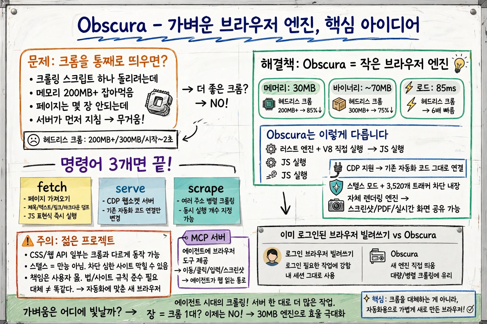
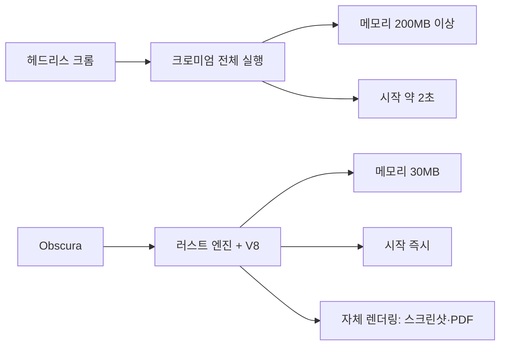
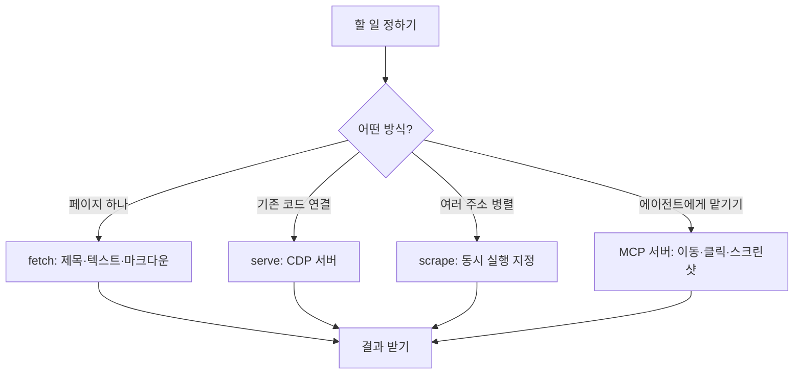

# Obscura: 크롬을 통째로 띄우지 않습니다. 30MB짜리 엔진이 같은 일을 해냅니다

> **Summary**
> Obscura는 크롬을 통째로 띄우는 대신 필요한 부분만 갖춘 헤드리스 브라우저 엔진으로, 메모리 30MB·바이너리 약 70MB·페이지 로드 85ms로 헤드리스 크롬보다 훨씬 가볍습니다. 자바스크립트는 V8으로 직접 실행하고 CDP를 말해 기존 자동화 코드를 그대로 연결하며, 명령어 세 개로 페이지 가져오기·CDP 서버·병렬 크롤링을 하고 MCP 서버로 에이전트에게 브라우저 도구를 건넵니다. 스텔스 모드와 3,520개 트래커 차단이 내장됐지만 만능은 아니고 젊은 프로젝트라 크롬과 다르게 동작하는 CSS나 웹 API가 있을 수 있으니, 가벼움의 대가를 알고 쓰는 것이 순서입니다.

---

- Obscura는 크롬을 통째로 띄우는 대신, 필요한 부분만 갖춘 헤드리스 브라우저 엔진입니다. 메모리 30MB, 바이너리 약 70MB, 페이지 로드 85ms로 헤드리스 크롬보다 훨씬 가볍습니다.
- 자바스크립트는 V8으로 직접 실행하고, CDP를 말해 기존 자동화 코드를 그대로 연결합니다. 스텔스 모드와 트래커 차단까지 내장했습니다.
- 다만 아직 젊은 프로젝트라, 크롬과 다르게 동작하는 CSS나 웹 API가 있을 수 있습니다. 가벼움의 대가를 알고 쓰는 것이 순서입니다.

크롤링 스크립트 하나 돌리려고 크롬을 띄웠는데, 메모리부터 200MB가 넘게 잡아먹는 걸 본 적 있으시죠? 페이지는 몇 장 안 되는데, 브라우저가 무거워서 서버가 먼저 지치는 상황 말입니다. 이럴 때 필요한 건, 더 좋은 크롬이 아니라 더 작은 브라우저가 아닐까요?

🎥 [동영상 보기](https://www.youtube.com/watch?v=_lyXckUUGDo)

## 크롬을 통째로 안 띄우면, 뭐가 달라질까요?

헤드리스 크롬은 결국 크롬입니다. 탭, 확장, 렌더링까지 데스크톱 브라우저의 몸집을 그대로 들고 옵니다. 페이지 몇 장 읽는 데도 메모리가 200MB를 넘기는 이유가 여기에 있습니다.

Obscura는 출발점이 다릅니다. 러스트로 만든 엔진에 자바스크립트 실행기인 V8만 직접 얹었습니다. 크로미엄을 통째로 품지 않고, 자동화에 필요한 부분만 골라서 만든 것입니다. 그래서 숫자가 이렇게 갈립니다!

| 항목 | Obscura | 헤드리스 크롬 |
| --- | --- | --- |
| 메모리 | 30MB | 200MB 이상 |
| 바이너리 | 약 70MB | 300MB 이상 |
| 페이지 로드 | 85ms | 약 500ms |
| 시작 | 즉시 | 약 2초 |

가장 놀라운 부분은 따로 있습니다. 크로미엄 없이도 자체 렌더링 엔진을 갖췄다는 점입니다. 스크린샷, 실시간 화면 공유, PDF 내보내기까지 직접 처리합니다. 브라우저를 통째로 안 띄우는데도, 화면을 보는 일은 그대로 됩니다!

## 명령어 세 개면, 크롤링이 시작될까요?

쓰는 법은 놀랍도록 단순합니다. 명령어 세 개가 일의 대부분을 처리합니다.

`obscura fetch`는 페이지 하나를 가져옵니다. 제목만 뽑을 수도 있고, 텍스트·링크·마크다운 형태로 덤프할 수도 있습니다. 자바스크립트 표현식을 바로 실행해 결과만 받는 것도 됩니다.

`obscura serve`는 CDP 웹소켓 서버를 띄웁니다. 기존 자동화 코드를 연결 지점만 바꿔서 그대로 붙이면 됩니다. `obscura scrape`는 여러 주소를 병렬로 긁습니다. 동시 실행 개수를 지정하면, 수십 개 페이지를 한 번에 처리합니다.

여기에 MCP 서버까지 있습니다. 에이전트에게 브라우저 도구를 직접 건네는 방식입니다. 이동, 클릭, 입력, 스크린샷 같은 도구가 표준 프로토콜로 열려 있습니다. 에이전트가 웹을 읽는 통로가, 브라우저 안에 들어간 셈입니다!

## 스텔스 모드, 어디까지 믿을 수 있을까요?

가벼움만으로 끝이 아닙니다. 스텔스 모드가 내장되어 있습니다. 세션마다 지문을 무작위로 바꾸고, 자동화 흔적을 숨기고, 3,520개 트래커 도메인을 차단합니다. 안티봇 우회 설정을 손으로 일일이 맞출 필요가 없다는 뜻입니다.

하지만 여기서 한 가지는 분명히 해야 합니다. 스텔스 모드가 만능 열쇠는 아닙니다. 차단이 심한 사이트 앞에서는 여전히 막힐 수 있고, 사이트 규칙과 법을 지키는 것은 사용하는 사람의 몫입니다. 가벼운 도구가 책임까지 가볍게 만들지는 않습니다.

젊은 프로젝트라는 점도 알아야 합니다. 긴 꼬리의 CSS나 일부 웹 API, 미디어 재생은 크로미엄과 다르게 동작할 수 있습니다. 그래서 이 도구는 "크롬을 대체한다"가 아니라 "자동화에 맞는 브라우저를 새로 만든다"에 가깝습니다. 대형 클라우드 업체의 에이전트용 브라우저 첫 시제품에도 영감을 줬다는 점이, 이 방향이 가짜가 아니라는 증거입니다!

## 이미 로그인된 내 브라우저를 빌려 쓰는 도구와 뭐가 다를까요?

비슷해 보이는 도구와 헷갈릴 수 있습니다. 이미 로그인된 내 브라우저를 에이전트가 빌려 쓰는 도구가 따로 있습니다. 그 방식은 로그인이 필요한 작업에 강합니다. 내 세션을 그대로 쓰니까요.

Obscura는 정반대 출발점입니다. 내 브라우저를 빌리는 게 아니라, 브라우저 자체를 새로 띄우는 엔진입니다. 로그인 세션이 필요한 일은 빌려 쓰는 쪽이 편하고, 대량 크롤링이나 병렬 실행은 가벼운 엔진 쪽이 유리합니다. 둘은 경쟁자가 아니라 용도가 다른 도구입니다. 무엇을 하느냐에 따라 고르면 됩니다.

## 가벼움은, 어디에 쓸 때 빛날까요?

페이지 몇 장 읽는 데 크롬 한 대를 통째로 띄우는 일, 이제는 당연하지 않습니다. 메모리 30MB짜리 엔진이 같은 일을 해낸다면, 서버 한 대에서 돌릴 수 있는 작업량은 완전히 달라집니다. 가벼운 브라우저는, 에이전트 시대의 크롤링이 크롬의 몸집을 벗어나는 첫걸음입니다!

